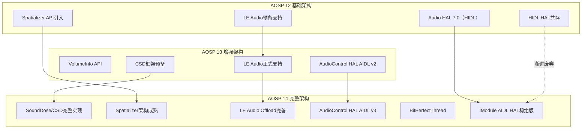

## 1.7 AOSP14 Audio新特性架构演进

> **演进专题（前瞻性内容）**：本篇所述机制均属 AOSP 13/14，**不在本树**（主线 Android 12L/API 32）；文中 AOSP 14 路径在本树不存在，仅作演进索引。本树对照见各章负结论标注。

> [← 上一个](01_1.6_Android_Audio版本演进.md) | [返回目录](README.md) | [下一个 →](01_1.8_播放录音全栈数据流向图.md)

---

AOSP14在音频架构上引入了多项重要特性，涵盖听力保护、空间音频、LE Audio、HAL接口升级和车载BitPerfect等领域。

### 1.7.1 SoundDose/CSD听力保护架构

AOSP14引入了**CSD（Common Sound Dose）**框架，实现WHO推荐的听力保护标准：

- `SoundDoseManager`（AOSP 14 `frameworks/av/services/audioflinger/sounddose/SoundDoseManager.h`，不在本树）运行在AudioFlinger进程中，负责MEL（Maximum Exposure Level）计算
- `MelReporter`（AOSP 14，不在本树）作为桥梁，将SoundDose数据上报至AudioService
- `SoundDoseHelper`（AOSP 14 Java 层，不在本树）管理CSD回调与安全警告触发
- HAL层通过 `ISoundDose` AIDL接口（AOSP 14 `sounddose/`，不在本树）与框架对接

**架构要点**：SoundDoseManager同时支持框架侧MEL计算和HAL侧MEL上报，由`csd_enabled`属性控制模式切换。

> 深度解析 → [13_Volume_Device_Deep_Dive（13.5–13.7 为 SoundDose/CSD 兼容入口，含本树负结论）](../13_Volume_Device_Deep_Dive/README.md)

### 1.7.2 Spatializer空间音频架构

空间音频从AOSP12引入API，到AOSP14架构趋于成熟：

- [`Spatializer`](frameworks/base/media/java/android/media/Spatializer.java) 提供Java API，通过`ISpatializer` Binder接口与AudioFlinger通信
- [`SpatializerThread`](frameworks/av/services/audioflinger/Threads.h) 继承自MixerThread，专门处理空间化音频混音
- 支持Head Tracking传感器数据输入，实现动态声场调整
- AudioPolicy 根据设备能力自动路由到 SpatializerThread（AOSP 14 用 `FEATURE_AUDIO_SPATIALIZER` 系统特性常量；本树 12L 无此常量，路由由 Spatializer.java + APM 协商完成）

> 深度解析 → [07_Effects_Framework（7.6 Spatializer）](../07_Effects_Framework/README.md)

### 1.7.3 LE Audio架构

LE Audio（Low Energy Audio）是蓝牙音频的重大演进（AOSP 13 起正式支持；本树 12L 为早期实现，见 [14.3](../14_Bluetooth_Audio/14_14.3_LE_Audio-低功耗蓝牙音频.md)）：

- `BluetoothLeAudio` Java API（`frameworks/base/core/java/android/bluetooth/BluetoothLeAudio.java`，本树存在）提供设备管理与组控制
- `LeAudioOffloadAudioProvider`（AOSP 13+ `hardware/interfaces/bluetooth/audio/aidl/default/`，不在本树）处理LE Audio Offload模式
- `LeAudioHalVerifier`（AOSP 13+，不在本树）校验HAL层LE Audio能力
- AudioPolicy新增LE Audio设备类型（`DEVICE_OUT_BLE_HEADSET`等）和路由策略
- 支持Broadcast Source/Sink和Unicast双模式（Broadcast 栈为 AOSP 13+/14，本树无 LE_AUDIO_BROADCAST datapath，见 [14.9](../14_Bluetooth_Audio/14_14.9_LE_Audio广播音频Broadcast_Audio.md)）

> 深度解析 → [14_Bluetooth_Audio（14.3 LE Audio / 14.7–14.10 兼容入口）](../14_Bluetooth_Audio/README.md)

### 1.7.4 AudioControl HAL AIDL v3

车载音频控制接口升级到AIDL v3版本：

- [`IAudioControl`](hardware/interfaces/automotive/audiocontrol/aidl/android/hardware/automotive/audiocontrol/IAudioControl.aidl) 新增`onAudioFocusChangeWithMetaData`替代v1的`onAudioFocusChange`
- 新增`IAudioGainCallback`支持HAL主动请求音量变更
- `setBalanceTowardRight`/`setFadeTowardFront` 音场控制接口（**v1 已有**，本树 `IAudioControl.aidl:90/:101` 即含，并非 v3 新增）
- AOSP 14 的 CarAudioService 适配 v3 接口；本树 12L 为 **AIDL v1**（5 个 aidl 文件，见 [10 章](../10_AudioControl_HAL/README.md)）

> 深度解析 → [10_AudioControl_HAL（10.8/10.9 为 v2+/v3 回调演进兼容入口）](../10_AudioControl_HAL/README.md)

### 1.7.5 BitPerfectThread（AAOS）

BitPerfectThread是AAOS（AOSP 14）独有的高保真播放线程（本树 12L 无 BitPerfect 机制，`isBitPerfect` 全树无匹配）：

- [`BitPerfectThread`](frameworks/av/services/audioflinger/Threads.h) 继承自MixerThread，当满足"唯一活跃Track + `AUDIO_OUTPUT_FLAG_BIT_PERFECT`"条件时自动激活
- 绕过AudioMixer混音和Resampler重采样，直接将原始PCM数据写入HAL
- [`isBitPerfect()`](frameworks/av/services/audioflinger/TrackBase.h) 判断Track是否支持BitPerfect模式
- EffectChain通过[`isBitPerfectCompatible()`](frameworks/av/services/audioflinger/Effects.cpp)检查效果链兼容性，不兼容时自动降级

> 深度解析 → [05_AudioFlinger（本树无 BitPerfect；QC 定制 SpatializerThread backport 见 5.1）](../05_AudioFlinger/README.md)

### 1.7.6 AOSP12→13→14架构演进图

---
