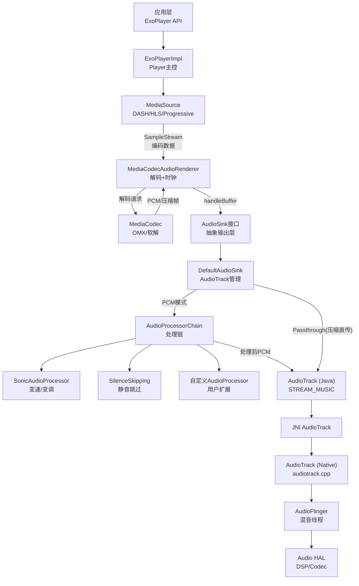
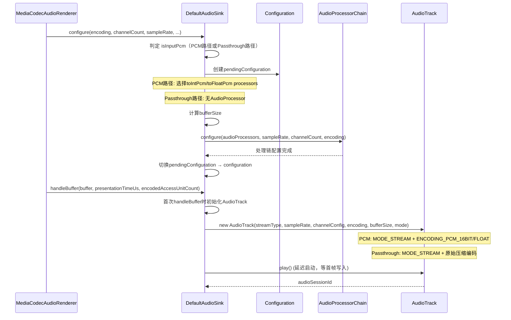
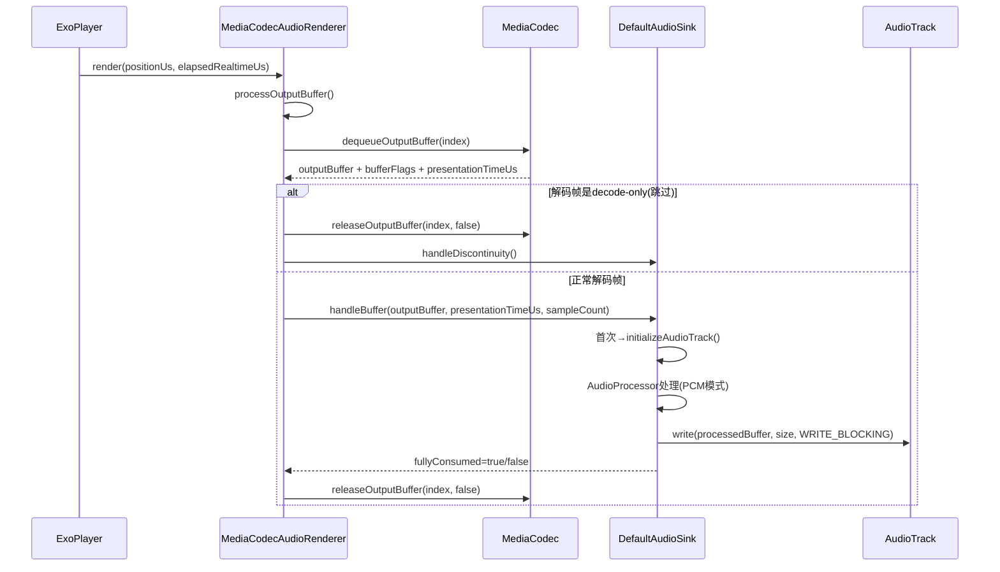
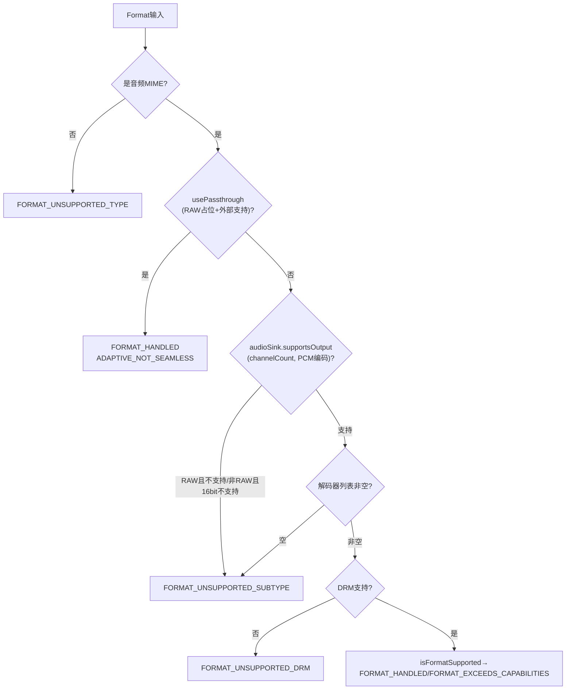

[← 2.9 MediaRecorder](02_2.9_MediaRecorder.md) | [← 返回Application Layer](README.md) | [返回导航](../README.md) | [2.11 OpenSL ES API →](02_2.11_OpenSL_ES_API.md)

---

## 2.10 ExoPlayer调用路径 — 应用层音频播放引擎

### 2.10.1 模块职责与源码位置

ExoPlayer是Google开源的媒体播放器库（非AOSP原生框架API，但在Android生态广泛使用），提供比MediaPlayer更灵活的播放能力。核心音频特性：

- **直接AudioTrack**：绕过MediaPlayer/MediaPlayerService，应用进程内直接创建AudioTrack
- **自适应码率**：DASH/HLS/SmoothStreaming自适应流切换
- **2种输出路径**（2.11.4）：PCM解码→AudioTrack / Passthrough直传（Offload为新版特性）
- **AudioProcessor链**：SilenceSkipping + Sonic(变速) + 自定义处理
- **隧道模式**：音视频同步由AudioFlinger/HW Composer负责

**源码位置**（本树 `external/exoplayer/`，版本 **2.11.4**，见 `library/common/src/main/java/com/google/android/exoplayer2/ExoPlayerLibraryInfo.java:32` `VERSION = "2.11.4"`）：

| 模块 | 文件 | 职责 |
|------|------|------|
| AudioSink接口 | [`AudioSink.java`](external/exoplayer/tree/library/core/src/main/java/com/google/android/exoplayer2/audio/AudioSink.java) | 音频输出抽象层 |
| DefaultAudioSink | [`DefaultAudioSink.java`](external/exoplayer/tree/library/core/src/main/java/com/google/android/exoplayer2/audio/DefaultAudioSink.java) | AudioTrack创建+写入+位置追踪 |
| MediaCodecAudioRenderer | [`MediaCodecAudioRenderer.java`](external/exoplayer/tree/library/core/src/main/java/com/google/android/exoplayer2/audio/MediaCodecAudioRenderer.java) | MediaCodec解码→AudioSink |
| DefaultAudioProcessorChain | [`DefaultAudioProcessorChain`](external/exoplayer/tree/library/core/src/main/java/com/google/android/exoplayer2/audio/DefaultAudioSink.java:126) | 默认AudioProcessor链 |
| SonicAudioProcessor | [`SonicAudioProcessor.java`](external/exoplayer/tree/library/core/src/main/java/com/google/android/exoplayer2/audio/SonicAudioProcessor.java) | 变速变调处理 |
| SilenceSkippingAudioProcessor | [`SilenceSkippingAudioProcessor.java`](external/exoplayer/tree/library/core/src/main/java/com/google/android/exoplayer2/audio/SilenceSkippingAudioProcessor.java) | 静音跳过 |
| AudioTrackPositionTracker | [`AudioTrackPositionTracker.java`](external/exoplayer/tree/library/core/src/main/java/com/google/android/exoplayer2/audio/AudioTrackPositionTracker.java) | AudioTrack位置平滑 |
| ExoPlayerImpl | [`ExoPlayerImpl.java`](external/exoplayer/tree/library/core/src/main/java/com/google/android/exoplayer2/ExoPlayerImpl.java) | Player主控 |

### 2.10.2 整体架构



> 注：图中无 Offload 分支——本树 ExoPlayer 2.11.4 **没有 Offload 输出模式**（Offload 直传是 ExoPlayer 2.17+ 引入的，网上的新版文档描述不适用于本树）。

### 2.10.3 输出模式详解（2.11.4：PCM与Passthrough两种）

2.11.4 的 `DefaultAudioSink` 按 `Configuration.isInputPcm`（[`Configuration`](external/exoplayer/tree/library/core/src/main/java/com/google/android/exoplayer2/audio/DefaultAudioSink.java:1433)）区分两条路径：

| 输出路径 | 判定 | AudioTrack编码 | AudioProcessor链 | 适用格式 |
|----------|-------|---------------|-----------------|---------|
| PCM路径 | `isInputPcm=true` | ENCODING_PCM_16BIT / ENCODING_PCM_FLOAT | 全链路(Sonic+Silence+自定义) | 所有解码后PCM |
| Passthrough路径 | `isInputPcm=false` | 原始压缩编码格式 | **不可用** | 设备支持的压缩格式直传 |

（新版 ExoPlayer 的 `OUTPUT_MODE_PCM/OFFLOAD/PASSTHROUGH` 三常量与 Offload 模式不属于本树 2.11.4。）

**PCM模式详细流程**：

```
编码数据 → MediaCodec解码 → PCM(16bit/float)
→ ResamplingAudioProcessor(重采样到目标格式)
→ ChannelMappingAudioProcessor(通道映射)
→ TrimmingAudioProcessor(裁剪encoder delay/padding)
→ 用户自定义AudioProcessor[]
→ SilenceSkippingAudioProcessor(静音跳过)
→ SonicAudioProcessor(变速变调)
→ AudioTrack.write()
```

> Offload（压缩码流直传DSP、50秒缓冲、gapless、DSP随时回收等）是 ExoPlayer 2.17+ 特性，本树源码不含；车载主线若需 Offload，走 NuPlayer/AudioTrack offload 路径而非 ExoPlayer。

### 2.10.4 DefaultAudioSink核心数据结构

**Configuration内部类**（2.11.4，[`Configuration`](external/exoplayer/tree/library/core/src/main/java/com/google/android/exoplayer2/audio/DefaultAudioSink.java:1433)）：

| 字段 | 类型 | 含义 |
|------|------|------|
| `isInputPcm` | boolean | 输入是否PCM（区分PCM/Passthrough路径） |
| `inputPcmFrameSize` / `inputSampleRate` | int | 输入帧大小/采样率 |
| `outputPcmFrameSize` / `outputSampleRate` / `outputChannelConfig` | int | 输出PCM参数 |
| `outputEncoding` | @C.Encoding | 输出编码(PCM_16BIT/PCM_FLOAT/压缩) |
| `bufferSize` | int | AudioTrack缓冲区大小(字节) |
| `processingEnabled` | boolean | 是否启用AudioProcessor链 |
| `canApplyPlaybackParameters` | boolean | 能否应用变速参数 |
| `availableAudioProcessors` | AudioProcessor[] | 可用处理器链 |

（`outputMode/audioSessionId/tunneling` 字段属于新版；2.11.4 的 tunneling 是 DefaultAudioSink 字段 :306，audioSessionId :304。）

**关键常量**（[`MIN_BUFFER_DURATION_US`](external/exoplayer/tree/library/core/src/main/java/com/google/android/exoplayer2/audio/DefaultAudioSink.java:193)）：

| 常量 | 值 | 含义 |
|------|-----|------|
| `MIN_BUFFER_DURATION_US` | 250,000 | 最小缓冲时长250ms |
| `MAX_BUFFER_DURATION_US` | 750,000 | 最大缓冲时长750ms |
| `PASSTHROUGH_BUFFER_DURATION_US` | 250,000 | Passthrough缓冲250ms |
| `BUFFER_MULTIPLICATION_FACTOR` | 4 | 缓冲区放大因子(4x最小值) |
| `AC3_BUFFER_MULTIPLICATION_FACTOR` | 2 | AC3缓冲放大因子 |

（`OFFLOAD_BUFFER_DURATION_US/AUDIO_TRACK_RETRY_DURATION_MS/ERROR_NATIVE_DEAD_OBJECT` 属于新版 ExoPlayer，不在 2.11.4。）

### 2.10.5 AudioTrack创建流程

DefaultAudioSink在`configure()`+`initializeAudioTrack()`中创建AudioTrack：



**bufferSize计算策略**（2.11.4，`DefaultAudioSink.java:1569-1575`）：

1. PCM路径：`max(getMinBufferSize(), durationUs→bytes) × BUFFER_MULTIPLICATION_FACTOR`
2. Passthrough路径：`PASSTHROUGH_BUFFER_DURATION_US→bytes × AC3因子(如需要)`

### 2.10.6 MediaCodecAudioRenderer解码流程

[`MediaCodecAudioRenderer`](external/exoplayer/tree/library/core/src/main/java/com/google/android/exoplayer2/audio/MediaCodecAudioRenderer.java:71)继承`MediaCodecRenderer implements MediaClock`：

**构造函数链**（6种构造方式，最终都传入AudioSink）：

```java
// 最简构造
public MediaCodecAudioRenderer(Context context, MediaCodecSelector mediaCodecSelector) {
    this(context, mediaCodecSelector, null, null);
}  // L117

// 最终构造
public MediaCodecAudioRenderer(Context context, MediaCodecAdapter.Factory codecAdapterFactory,
    MediaCodecSelector mediaCodecSelector, boolean enableDecoderFallback,
    Handler eventHandler, AudioRendererEventListener eventListener, AudioSink audioSink) {
    super(C.TRACK_TYPE_AUDIO, codecAdapterFactory, mediaCodecSelector,
        enableDecoderFallback, 44100);  // assumedMinimumCodecOperatingRate=44100
    this.audioSink = audioSink;
    audioSink.setListener(new AudioSinkListener());
}  // L239-257
```

**解码→输出完整流程**：



**onOutputMediaFormatChanged**（[`onOutputMediaFormatChanged`](external/exoplayer/tree/library/core/src/main/java/com/google/android/exoplayer2/audio/MediaCodecAudioRenderer.java:397)，2.11.4 方法名是 onOutputMediaFormatChanged）：

- Passthrough时用 `passthroughMediaFormat`（MIME改为原始压缩格式）并通过 `getPassthroughEncoding()` 取编码；否则用解码器输出 MediaFormat
- 处理 Vivo 设备 workaround（`VIVO_BITS_PER_SAMPLE_KEY`）取 PCM 位深；否则 `getPcmEncoding(inputFormat)`
- 从 MediaFormat 提取 channelCount/sampleRate
- `codecNeedsDiscardChannelsWorkaround && channelCount==6 && input<6ch` 时生成丢弃声道的 channelMap
- 调用 `audioSink.configure(encoding, channelCount, sampleRate, ...)`

### 2.10.7 AudioProcessor链详解

[`DefaultAudioProcessorChain`](external/exoplayer/tree/library/core/src/main/java/com/google/android/exoplayer2/audio/DefaultAudioSink.java:126)处理链结构：

```
输入PCM → [用户自定义AudioProcessor...] → SilenceSkippingAudioProcessor → SonicAudioProcessor → 输出PCM
```

**toIntPcmAvailableAudioProcessors**（PCM→16bit路径）：

| 处理器 | 功能 | 默认激活条件 |
|-------|------|------------|
| `ResamplingAudioProcessor` | 重采样到16-bit PCM | 非16-bit输入时 |
| `ChannelMappingAudioProcessor` | 通道重映射 | outputChannels指定时 |
| `TrimmingAudioProcessor` | 裁剪encoder delay/padding | 有encoderDelay/Padding时 |
| `[用户自定义...]` | 自定义处理 | 用户配置 |
| `SilenceSkippingAudioProcessor` | 静音跳过 | skipSilence=true |
| `SonicAudioProcessor` | 变速变调 | speed≠1.0或pitch≠1.0 |

**toFloatPcmAvailableAudioProcessors**（PCM→float路径）：

| 处理器 | 功能 |
|-------|------|
| `FloatResamplingAudioProcessor` | 16-bit PCM→32-bit float |

> **关键设计**：Float输出模式不支持AudioProcessor链（除FloatResampling外），因为变速/变调/静音跳过需要整数PCM处理。

### 2.10.8 AudioSink接口方法列表（2.11.4）

[`AudioSink`](external/exoplayer/tree/library/core/src/main/java/com/google/android/exoplayer2/audio/AudioSink.java)接口定义（节选，:174-276）：

| 方法 | 返回类型 | 功能 |
|------|---------|------|
| `setListener(Listener)` | void | 注册监听器 |
| `supportsOutput(int, @C.Encoding)` | boolean | 输出通道数/编码是否可播 |
| `configure(encoding, channelCount, sampleRate, ...)` | void | 配置输出 |
| `handleBuffer(ByteBuffer,long,int)` | boolean | 写入音频数据(返回是否完全消费) |
| `handleDiscontinuity()` | void | 处理位置不连续(seek后) |
| `play()` / `pause()` 逻辑由flush实现 | void | 播放控制 |
| `playToEndOfStream()` | void | 写入流结束 |
| `flush()` / `reset()` | void | 刷新/重置 |
| `setPlaybackParameters(PlaybackParameters)` / `getPlaybackParameters()` | PlaybackParameters | 变速变调 |
| `setAudioAttributes(AudioAttributes)` | void | 设置音频属性 |
| `setVolume(float)` | void | 设置音量(0.0-1.0) |
| `setAuxEffectInfo(AuxEffectInfo)` | void | 设置辅助效果 |
| `enableTunnelingV21(int)` | void | 启用隧道模式（实现类） |
| `setAudioSessionId(int)` / `getAudioSessionId()` | int | AudioSession管理 |
| `hasPendingData()` / `isEnded()` | boolean | 状态查询 |
| `getCurrentPositionUs(boolean)` | long | 当前播放位置(微秒) |

（`supportsFormat(Format)/getFormatSupport(Format)/@SinkFormatSupport` 三态接口是新版 ExoPlayer API；2.11.4 用更简单的 `supportsOutput(channelCount, encoding)`。）

**AudioSink.Listener回调**（:65-92，2.11.4）：

| 回调 | 含义 |
|------|------|
| `onAudioSessionId(int)` | AudioSession分配 |
| `onPositionDiscontinuity()` | 位置不连续 |
| `onPositionAdvancing(playoutStartSystemTimeMs)` | 位置首次推进(播放开始) |
| `onUnderrun(int,int,long)` | AudioTrack underrun |
| `onSkipSilenceEnabledChanged(boolean)` | 静音跳过状态变更 |
| `onAudioSinkError(Exception)` | AudioSink错误 |

（`onOffloadBufferEmptying/onOffloadBufferFull` 属于新版 Offload 支持，不在 2.11.4。）

### 2.10.9 AudioTrack位置追踪

[`AudioTrackPositionTracker`](external/exoplayer/tree/library/core/src/main/java/com/google/android/exoplayer2/audio/AudioTrackPositionTracker.java)负责AudioTrack播放位置的精确追踪和平滑处理：

**位置获取策略**：

| API级别 | 位置获取方式 | 精度 |
|---------|------------|------|
| API 19+ | `AudioTrack.getTimestamp()` | 高精度(硬件timestamp) |
| 所有级别 | `AudioTrack.getPlaybackHeadPosition()` | 中精度(可能不连续) |
| 辅助 | 计算writtenFrames - playbackHeadPosition | 缓冲区剩余推算 |

**位置平滑算法**：

1. 定期调用`AudioTrack.getTimestamp()`获取硬件时间戳
2. 检测spurious timestamp（位置回跳超过阈值→InvalidAudioTrackTimestampException）
3. 线性插值平滑position，避免AudioTrack.getPlaybackHeadPosition()的16-bit截断不连续
4. 结合mediaPositionParametersCheckpoints队列，处理变速变调下的媒体时间映射

### 2.10.10 Passthrough模式详解

Passthrough模式将压缩音频（如AC3/EAC3/DTS）直接传给AudioTrack，不做解码：

**Passthrough判定**（`MediaCodecAudioRenderer.java:303-309`）：

```java
passthroughEnabled =
    MimeTypes.AUDIO_RAW.equals(codecInfo.mimeType)
        && !MimeTypes.AUDIO_RAW.equals(format.sampleMimeType);
MediaFormat mediaFormat =
    getMediaFormat(format, codecInfo.codecMimeType, codecMaxInputSize, codecOperatingRate);
codec.configure(mediaFormat, /* surface= */ null, crypto, /* flags= */ 0);
if (passthroughEnabled) {
    // Store the input MIME type if we're using the passthrough codec.
    passthroughMediaFormat = mediaFormat;
    passthroughMediaFormat.setString(MediaFormat.KEY_MIME, format.sampleMimeType);
} else {
    passthroughMediaFormat = null;
}
```
> 源码：`MediaCodecAudioRenderer.java:303-313`（逐字摘录，2.11.4）：Passthrough 即用 RAW 编解码器占位、把 MIME 改回原始压缩格式。

**AudioCapabilities作用**：

- 查询设备是否支持特定编码的Passthrough
- 默认能力 = 不支持任何Passthrough
- 通过`AudioCapabilities.getAudioCapabilities(context)`获取设备真实能力
- HDMI/S/PDIF连接时通常支持AC3/DTS Passthrough

**Passthrough vs Offload区别**（Offload 仅存在于新版 ExoPlayer/AudioTrack，本树 ExoPlayer 无此模式）：

| 维度 | Passthrough（2.11.4支持） | Offload（新版，非本树） |
|------|-------------|---------|
| 数据流向 | AudioTrack→AudioFlinger→HAL→DSP | AudioTrack→AudioFlinger→HAL→DSP |
| AudioTrack编码 | 压缩编码(ENCODING_AC3等) | 压缩编码(setOffloadMode) |
| 解码位置 | 外部接收器/AVR | DSP |
| 缓冲时长 | 250ms | 50秒 |
| 变速变调 | 不支持 | 不支持 |

### 2.10.11 隧道模式(Tunneling)

隧道模式将音视频同步交给底层硬件，ExoPlayer不做时钟驱动：

**启用条件**：

- API 21+（`enableTunnelingV21()`）
- `MediaCodecAudioRenderer.onEnabled()`中根据getConfiguration().tunneling决定
- AudioTrack创建时设置`FLAG_TUNNEL_MODE`
- AudioTrack的sessionId与视频MediaCodec共享

**隧道模式约束**：

- AudioProcessor不能改变输出帧时长（变速不可用）
- BufferProcessor必须立即输出最后一帧输入后的输出
- ExoPlayer不驱动MediaClock，由AudioFlinger/HW Composer同步

### 2.10.12 音量与AudioAttributes映射

**音量控制**：

```java
// DefaultAudioSink.setVolume(float volume) → audioTrack.setVolume(volume)
// 或 API <21: audioTrack.setStereoVolume(volume, volume)
```

- 范围0.0-1.0，直接映射AudioTrack.setVolume()
- 不经过AudioProcessor，直接在AudioTrack层设置

**AudioAttributes映射**（ExoPlayer→Android AudioAttributes）：

| ExoPlayer AudioAttributes | Android AudioAttributes | AudioTrack streamType |
|--------------------------|----------------------|---------------------|
| USAGE_MEDIA | CONTENT_TYPE_MOVIE + USAGE_MEDIA | STREAM_MUSIC |
| USAGE_VOICE_COMMUNICATION | CONTENT_TYPE_SPEECH + USAGE_VOICE_COMMUNICATION | STREAM_VOICE_CALL |
| USAGE_GAME | CONTENT_TYPE_GAME + USAGE_GAME | STREAM_MUSIC |
| USAGE_ALARM | CONTENT_TYPE_SONIFICATION + USAGE_ALARM | STREAM_ALARM |

**AudioSession ID管理**：

- 默认：让AudioTrack自动分配sessionId
- 自定义：`setAudioSessionId(sessionId)` → AudioTrack创建时使用指定ID
- 场景：AudioEffect需要绑定到特定session

### 2.10.13 Renderer消息类型

[`MediaCodecAudioRenderer`](external/exoplayer/tree/library/core/src/main/java/com/google/android/exoplayer2/audio/MediaCodecAudioRenderer.java:70)支持通过ExoPlayer.createMessage发送的控制消息：

| MSG类型 | Payload类型 | 功能 |
|---------|-----------|------|
| `MSG_SET_VOLUME` | Float (0-1) | 设置音量 |
| `MSG_SET_AUDIO_ATTRIBUTES` | AudioAttributes | 设置音频属性 |
| `MSG_SET_AUX_EFFECT_INFO` | AuxEffectInfo | 设置辅助效果 |
| `MSG_SET_SKIP_SILENCE_ENABLED` | Boolean | 静音跳过 |
| `MSG_SET_AUDIO_SESSION_ID` | Integer | 设置AudioSession ID |

### 2.10.14 事件回调体系

**AudioRendererEventListener.EventDispatcher**分发的事件：

| 回调方法 | 含义 |
|---------|------|
| `onAudioEnabled(decoderCounters)` | 音频渲染器启用 |
| `onAudioDecoderInitialized(name, initTs, initDuration)` | 解码器初始化 |
| `onAudioDecoderReleased(name)` | 解码器释放 |
| `onAudioAudioCodecError(error)` | 解码器错误 |
| `onAudioInputFormatChanged(format, evaluation)` | 输入格式变更 |
| `onAudioPositionAdvancing(playoutStartMs)` | 播放位置首次推进 |
| `onAudioUnderrun(bufferSize, bufferSizeMs, elapsedMs)` | AudioTrack underrun |
| `onAudioSkipSilenceEnabledChanged(enabled)` | 静音跳过变更 |

### 2.10.15 Offload缓冲与事件回调

Offload模式下DSP缓冲50秒音频数据，需要特殊缓冲管理：

**StreamEventCallbackV29**（API 29+的Offload事件回调）：

| 回调 | 含义 |
|------|------|
| `onOffloadTrackEndOfStream()` | Offload流结束 |
| `onOffloadTrackError()` | Offload错误 |
| `onOffloadBufferEmptying()` | DSP缓冲正在清空 |
| `onOffloadBufferFull()` | DSP缓冲已满 |

**Offload恢复策略**：

- `ERROR_DEAD_OBJECT` → 重建AudioTrack并重试
- `AUDIO_TRACK_RETRY_DURATION_MS`(100ms)内的重试不抛异常
- `PendingExceptionHolder`延迟异常上报机制

### 2.10.16 格式支持判断流程（2.11.4）

[`MediaCodecAudioRenderer.supportsFormat()`](external/exoplayer/tree/library/core/src/main/java/com/google/android/exoplayer2/audio/MediaCodecAudioRenderer.java:211)的判断逻辑（解码器侧，AudioSink 能力用 `audioSink.supportsOutput()`）：



**与新版差异**：新版把 AudioSink 侧抽成 `supportsFormat(Format)/getFormatSupport(Format)` 三态（SUPPORTED_DIRECTLY/WITH_TRANSCODING/UNSUPPORTED）；2.11.4 只有 `supportsOutput(channelCount, encoding)` 布尔判定，解码器侧 `supportsFormat`（[:211](external/exoplayer/tree/library/core/src/main/java/com/google/android/exoplayer2/audio/MediaCodecAudioRenderer.java:211)）负责整体仲裁。

### 2.10.17 keepSessionIdAudioTrack（2.11.4 的 seek 保留机制）

网上文档的 `experimentalSetEnableKeepAudioTrackOnSeek()/experimentalFlushWithoutAudioTrackRelease()` 是新版 API。2.11.4 的对应机制是 **keepSessionIdAudioTrack**（[`keepSessionIdAudioTrack`](external/exoplayer/tree/library/core/src/main/java/com/google/android/exoplayer2/audio/DefaultAudioSink.java:270)）：

- flush 重建 AudioTrack 时，若 sessionId 变化，先用一个两字节缓冲的最小 AudioTrack（`initializeKeepSessionIdAudioTrack`，:1171）占住旧 sessionId，避免依赖该 session 的 AudioEffect 被重置
- 真正的 AudioTrack 重建后，`keepSessionIdAudioTrack` 异步释放（:1052）

**seek处理对比**：

| 操作 | 2.11.4 行为 |
|------|-----------|
| seek时 | audioSink.flush() → 若sessionId变→占位保session → 重建AudioTrack |
| 延迟 | 重建开销存在，但 session 相关效果器状态得到保留 |

### 2.10.18 ExoPlayer vs MediaPlayer音频路径对比

| 维度 | ExoPlayer | MediaPlayer |
|------|----------|------------|
| AudioTrack创建位置 | 应用进程(DefaultAudioSink) | mediaserver进程(MediaPlayerService) |
| 解码器 | 应用进程(MediaCodec) | mediaserver进程(AwesomePlayer/NuPlayer) |
| IPC开销 | 无(同一进程) | Binder IPC每帧数据 |
| AudioProcessor | 支持(Sonic/SilenceSkip/自定义) | 不支持 |
| 变速变调 | SonicAudioProcessor(高质量) | PlaybackParams(低延迟/不可靠) |
| Passthrough | 支持(需AudioCapabilities) | NuPlayer自动判断 |
| Offload | 支持(需配置) | NuPlayer自动判断 |
| 隧道模式 | 支持(V21+) | NuPlayer支持 |
| 自适应码率 | DASH/HLS/SmoothStreaming | 不支持 |
| 位置追踪 | AudioTrackPositionTracker(平滑) | MediaPlayer.getTimestamp |
| 错误恢复 | PendingExceptionHolder+重试 | 有限恢复 |
| 适用场景 | 流媒体/自定义处理/低延迟 | 简单本地播放 |

### 2.10.19 AAOS车载场景中的ExoPlayer

在AAOS车载系统中，ExoPlayer的优势：

- **多音区路由**：通过`setAudioAttributes()` + CarAudioManager设置音区路由
- **低延迟播放**：避免mediaserver IPC开销
- **省电**：Passthrough直传减少解码CPU负载（Offload省电需新版 ExoPlayer，本树无）
- **静音跳过**：导航播报自动跳过静音段
- **隧道模式**：与车载视频显示硬件同步
- **自适应码率**：车载网络不稳定时自动降级

---

[← 2.9 MediaRecorder](02_2.9_MediaRecorder.md) | [← 返回Application Layer](README.md) | [返回导航](../README.md) | [2.11 OpenSL ES API →](02_2.11_OpenSL_ES_API.md)