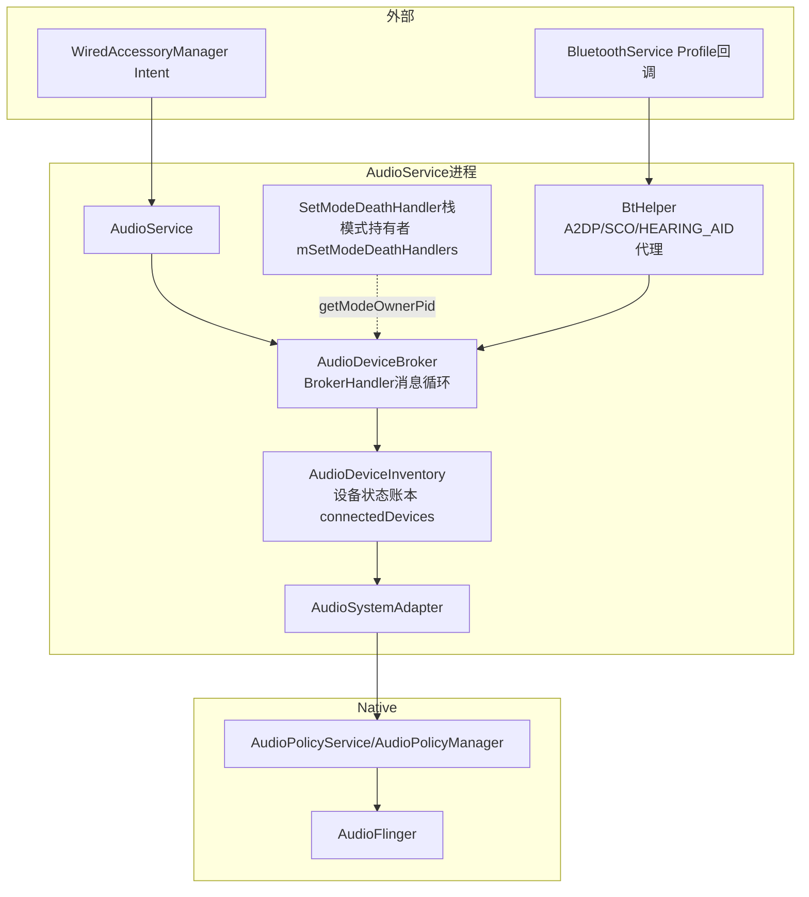
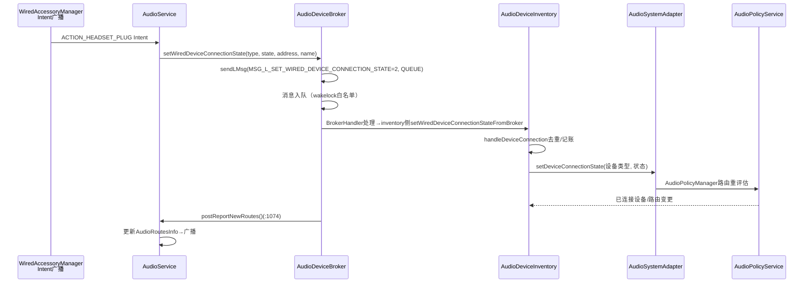
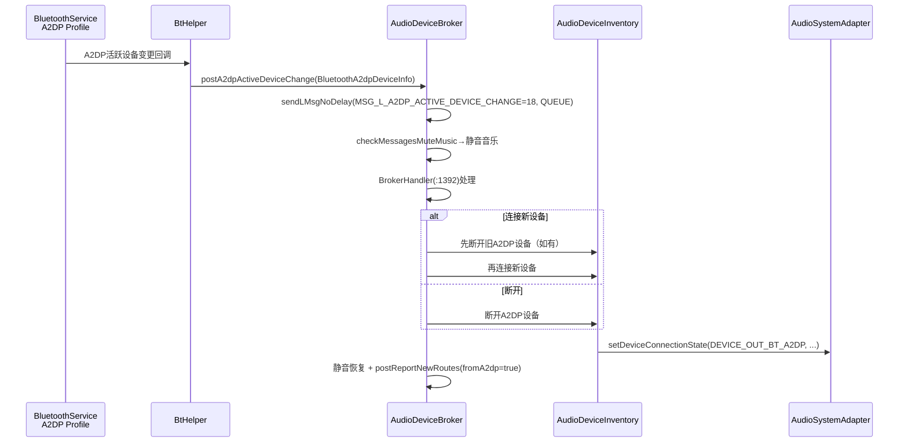

## 3.5 AudioDeviceBroker — 设备热插拔管理

> [← 上一篇](03_3.4_VolumeController-音量控制机制.md) | [返回目录](README.md) | [下一篇 →](03_3.6_PlaybackActivityMonitor-播放状态追踪.md)

---

> **版本锚定**：本页全部行号/结构对应本仓库 **Android 12L（API 32）** 的 `frameworks/base/services/core/java/com/android/server/audio/AudioDeviceBroker.java`（1962 行）。网上流传的 Android 13/14 版本里有 `AudioModeInfo`、`BtDeviceInfo(mIsLeOutput)`、`BleVolumeInfo`、`MSG_L_SET_BT_ACTIVE_DEVICE` 等结构——**12L 没有这些**，阅读时注意区分。

### 模块职责

AudioDeviceBroker 是 AudioService 的设备事件**总线**：所有有线/蓝牙/USB/助听设备的连接、断开、活跃切换、ForceUse、通信路由请求，都被投递到它的 BrokerHandler 里**串行处理**，再落到 `AudioDeviceInventory`（设备状态账本）与 `AudioSystem`（native 侧）。它解决三个问题：

1. **串行化**：设备事件来自不同进程（BluetoothService、WiredAccessoryManager、HDMI观察者），消息队列保证按序执行；
2. **状态一致性**：Java 侧设备账本（Inventory）与 AudioPolicyManager 的 native 设备状态保持同步；
3. **通信路由仲裁**：VoIP/通话的通信设备请求（`setCommunicationDevice()`/`setSpeakerphoneOn()`）在这里排队决策。

### 类架构图



- 模式持有者（谁把 AudioMode 设成 IN_CALL）在 **AudioService** 的 [`mSetModeDeathHandlers`](frameworks/base/services/core/java/com/android/server/audio/AudioService.java:570)（`SetModeDeathHandler` 列表）；Broker 只保存结果 [`mModeOwnerPid`](frameworks/base/services/core/java/com/android/server/audio/AudioDeviceBroker.java:117)，并在收到 `MSG_I_SET_MODE_OWNER_PID` 时从 `AudioService.getModeOwnerPid()` 刷新【源码 :179】。
- 设备账本是 [`mDeviceInventory`](frameworks/base/services/core/java/com/android/server/audio/AudioDeviceBroker.java:91)（构造于 :124）。

### 核心数据结构

**通信路由客户端栈**：每个请求通信设备的进程一个 `CommunicationRouteClient`（binder + pid + 请求设备），存在 `mCommunicationRouteClients` 列表；请求参数打包为 `CommunicationClientInfo`。三个入口都汇到同一队列：

| 入口 | 行为 |
|---|---|
| [`setSpeakerphoneOn(cb, pid, on, src)`](frameworks/base/services/core/java/com/android/server/audio/AudioDeviceBroker.java:238) | 扬声器请求：构造/移除 client，再 post 消息 |
| [`setCommunicationDevice(cb, pid, device, src)`](frameworks/base/services/core/java/com/android/server/audio/AudioDeviceBroker.java:268) | API 31 的通信设备选择：锁内查/建 client，`postSetCommunicationRouteForClient(CommunicationClientInfo(...))` |
| [`setCommunicationRouteForClient(...)`](frameworks/base/services/core/java/com/android/server/audio/AudioDeviceBroker.java:294) | 消息处理侧真正改栈的地方（增/删 client、SCO 启停） |

**注意**：12L 的 `setCommunicationDevice()` 是**投递消息后立即返回 true**，没有"调用线程 wait 3 秒等结果"的同步等待——那是 Android 13/14 的行为。

**蓝牙设备信息**：A2DP 活跃设备变更携带的是 `BtHelper.BluetoothA2dpDeviceInfo`（设备+状态+profile+suppressNoisy+codec），由 [`postA2dpActiveDeviceChange()`](frameworks/base/services/core/java/com/android/server/audio/AudioDeviceBroker.java:1079) 投递 `MSG_L_A2DP_ACTIVE_DEVICE_CHANGE`。12L 的 Broker **没有** LE Audio 活跃设备管理（`mIsLeOutput`/`BleVolumeInfo` 是 13/14 结构）。

### 锁体系设计

| 锁 | 保护对象 |
|---|---|
| [`mSetModeLock`](frameworks/base/services/core/java/com/android/server/audio/AudioDeviceBroker.java:114) | 与 AudioService 共享的模式/通信路由外层锁 |
| [`mDeviceStateLock`](frameworks/base/services/core/java/com/android/server/audio/AudioDeviceBroker.java:106) | 设备状态、client 栈 |
| `sLastDeviceConnectionMsgTimeLock`（static，:101） | 设备连接消息时间戳 |

获取顺序 `mSetModeLock → mDeviceStateLock`；消息处理 `isMessageHandledUnderWakelock()` 清单内的消息都在持锁+持 wakelock 状态下处理。

### BrokerHandler 消息体系

真实消息常量（12L，:1537-1592 非连续选摘，已按源码声明顺序排列，逐项核对值无误）：

```java
    private static final int MSG_RESTORE_DEVICES = 1;
    private static final int MSG_L_SET_WIRED_DEVICE_CONNECTION_STATE = 2;
    private static final int MSG_IIL_SET_FORCE_USE = 4;
    private static final int MSG_IIL_SET_FORCE_BT_A2DP_USE = 5;
    private static final int MSG_TOGGLE_HDMI = 6;
    private static final int MSG_BROADCAST_AUDIO_BECOMING_NOISY = 12;
    private static final int MSG_REPORT_NEW_ROUTES = 13;
    private static final int MSG_I_SET_MODE_OWNER_PID = 16;
    private static final int MSG_L_A2DP_DEVICE_CONFIG_CHANGE = 11;
    private static final int MSG_L_A2DP_ACTIVE_DEVICE_CHANGE = 18;
```
> 源码：`AudioDeviceBroker.java`（常量区 1537 行起；31 个基础消息 + 32~44 号策略/通信/路由消息）

```java
    private static final int MSG_L_UPDATE_COMMUNICATION_ROUTE = 39;
    private static final int MSG_IL_SET_PREF_DEVICES_FOR_STRATEGY = 40;
    private static final int MSG_L_SET_COMMUNICATION_ROUTE_FOR_CLIENT = 42;
    private static final int MSG_L_UPDATE_COMMUNICATION_ROUTE_CLIENT = 43;
    private static final int MSG_I_SCO_AUDIO_STATE_CHANGED = 44;
```
> 源码：`AudioDeviceBroker.java`（32~44 号消息区）

**三种发送策略**（`sendMsg*` 家族）：
- `SENDMSG_REPLACE`：同类消息只保留最新（ForceUse、setModeOwnerPid）；
- `SENDMSG_NOOP`：已有在途则丢弃（reportNewRoutes 类）；
- `SENDMSG_QUEUE`：设备连接序列保序（有线连接、A2DP 活跃设备切换）。

**时序保证**：设备连接类消息（`MSG_L_SET_WIRED_DEVICE_CONNECTION_STATE`、`MSG_L_A2DP_ACTIVE_DEVICE_CHANGE` 等）入队时与 `sLastDeviceConnectionMsgTime` 比对，时间戳不前进则追加延迟，确保断开→连接按入队顺序到达 handler。

**WakeLock**：`mBrokerEventWakeLock`（PARTIAL_WAKE_LOCK，:1191-1195）。`isMessageHandledUnderWakelock()` 白名单内的设备连接类消息在处理前 `acquire(BROKER_WAKELOCK_TIMEOUT_MS)`（:1679），防止处理途中系统休眠。

**音乐静音**：`MESSAGES_MUTE_MUSIC` 集合内的消息（A2DP 切换类）入队时先 `checkMessagesMuteMusic()` 静音音乐流（:1500/:1519/:1686-1687），全部处理完再恢复——防止蓝牙切换瞬间音频从扬声器泄漏。

### 有线设备连接处理流程



要点：
- 入口 [`setWiredDeviceConnectionState()`](frameworks/base/services/core/java/com/android/server/audio/AudioDeviceBroker.java:506) 收 4 参（类型/状态/地址/名字），内部 `mDeviceInventory.setWiredDeviceConnectionState(...)`【源码 :511】；
- QUEUE 策略保证"耳机拔出→扬声器回退"这类序列不乱序；
- 断开时由 Inventory 侧决策是否发 `AUDIO_BECOMING_NOISY` 广播（suppressNoisy 场景除外）。

### 蓝牙 A2DP 活跃设备切换



- 投递点 [`postA2dpActiveDeviceChange()`](frameworks/base/services/core/java/com/android/server/audio/AudioDeviceBroker.java:1079)【源码 :1080 `sendLMsgNoDelay(MSG_L_A2DP_ACTIVE_DEVICE_CHANGE, SENDMSG_QUEUE, btDeviceInfo)`】；
- 处理点 BrokerHandler `case MSG_L_A2DP_ACTIVE_DEVICE_CHANGE:`【源码 :1392】；
- 入队前 `mBrokerHandler.removeEqualMessages(MSG_L_A2DP_ACTIVE_DEVICE_CHANGE, ...)` 清理在途同设备消息【源码 :614】。

**A2dpSuspended 同步**：A2DP 被通话暂停/恢复时由 BtHelper 直接 `AudioSystem.setParameters("A2dpSuspended=true/false")`【源码 `BtHelper.java:446`、`AudioDeviceInventory.java:981/:1045`】——HAL 据此避免把媒体路由到暂停的 A2DP。12L 没有独立的 `updateAudioHalBluetoothState()` 聚合方法（那是 13/14 的）。

### 通信设备选择机制

决策核心 [`topCommunicationRouteClient()`](frameworks/base/services/core/java/com/android/server/audio/AudioDeviceBroker.java:358)（12L 真实语义）：

```java
    private CommunicationRouteClient topCommunicationRouteClient() {
        for (CommunicationRouteClient crc : mCommunicationRouteClients) {
            if (crc.getPid() == mModeOwnerPid) {
                return crc;
            }
        }
        if (!mCommunicationRouteClients.isEmpty() && mModeOwnerPid == 0) {
            return mCommunicationRouteClients.get(0);
        }
        return null;
    }
```
> 源码：`AudioDeviceBroker.java:358-367`（逐字摘录）

语义（与 13/14 的差异要记住）：
1. **模式持有者优先**：谁的 pid == `mModeOwnerPid`，谁的设备请求胜出（即使它不在栈顶）；
2. **无模式持有者时最新请求优先**：`mModeOwnerPid == 0` 才取列表头；
3. **有模式持有者但不匹配任何 client → 返回 null**（不是取栈顶！）——此时回退默认听筒/扬声器路由。

配合流程：`setCommunicationDevice()`（:268）→ 锁内查/建 client → `postSetCommunicationRouteForClient(CommunicationClientInfo)` → 消息 `MSG_L_SET_COMMUNICATION_ROUTE_FOR_CLIENT=42` → `setCommunicationRouteForClient()`（:294）实际增删栈、按设备类型启停 SCO 或设策略偏好设备 → `MSG_L_UPDATE_COMMUNICATION_ROUTE=39` 重评估。Binder 死亡由 `MSG_L_COMMUNICATION_ROUTE_CLIENT_DIED=34` 兜底回收。

### ForceUse 机制

[`setForceUse_Async()`](frameworks/base/services/core/java/com/android/server/audio/AudioDeviceBroker.java:190) 投递 `MSG_IIL_SET_FORCE_USE=4`（REPLACE 策略，同类型只留最新）与 `MSG_IIL_SET_FORCE_BT_A2DP_USE=5`。后者处理 A2DP 强制路由：A2DP 挂起时会替换为 `FORCE_SPEAKER`，避免路由到不可用设备。

### LE Audio 边界说明

12L 的设备类型常量里有 BLE_HEADSET/BLE_SPEAKER，但 **AudioDeviceBroker/BtHelper 没有LE Audio活跃设备切换、音量同步（BleVolumeInfo）、HaCompat 判定等逻辑**——这些是 Android 13/14 引入的。本树蓝牙语音链路管理仍是经典 A2DP+SCO+HEARING_AID 三件套【源码（负结论）：BtHelper.java 无 LeAudio/BLE_HEADSET 处理】。

### 关键设计总结

| 设计要素 | 12L 实现 |
|---|---|
| 串行化 | BrokerHandler 单线程消息循环（1~44 号消息） |
| 锁分层 | mSetModeLock → mDeviceStateLock（+static 时间戳锁） |
| 消息策略 | REPLACE / NOOP / QUEUE |
| 时序保证 | sLastDeviceConnectionMsgTime |
| WakeLock | mBrokerEventWakeLock，isMessageHandledUnderWakelock 白名单 |
| 音乐防泄漏 | MESSAGES_MUTE_MUSIC + checkMessagesMuteMusic |
| 通信路由 | CommunicationRouteClient 栈 + mModeOwnerPid 优先匹配（无匹配≠栈顶） |
| 模式持有者 | AudioService.mSetModeDeathHandlers（本类只存 pid） |
| HAL 同步 | BtHelper/Inventory 直接 setParameters("A2dpSuspended=...") |

### 能证明/不能证明

| 层次 | 能证明（静态） | 不能证明 |
|---|---|---|
| 源码 | 消息表、锁、路由决策、投递点 | — |
| 运行 | — | 实机设备插拔时序、消息积压、wakelock 持有时长、路由实际切换结果 |

---

> [← 上一篇](03_3.4_VolumeController-音量控制机制.md) | [返回](README.md) | [下一篇 →](03_3.6_PlaybackActivityMonitor-播放状态追踪.md)
