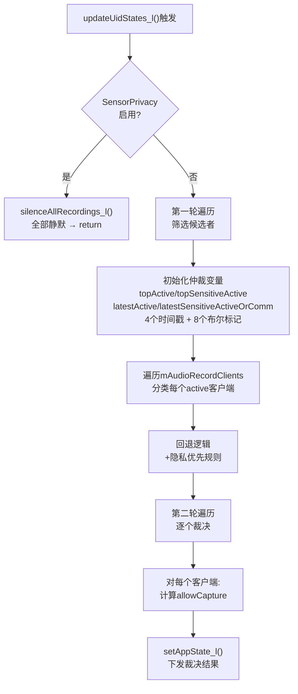
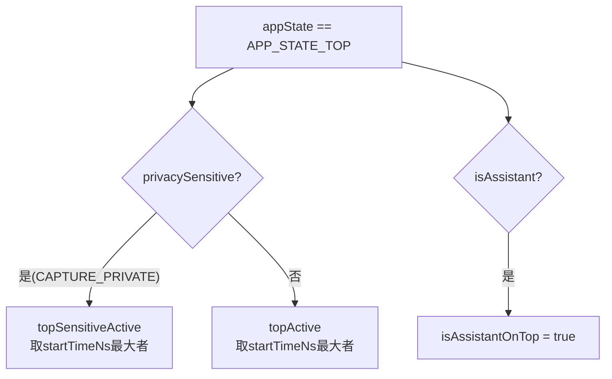
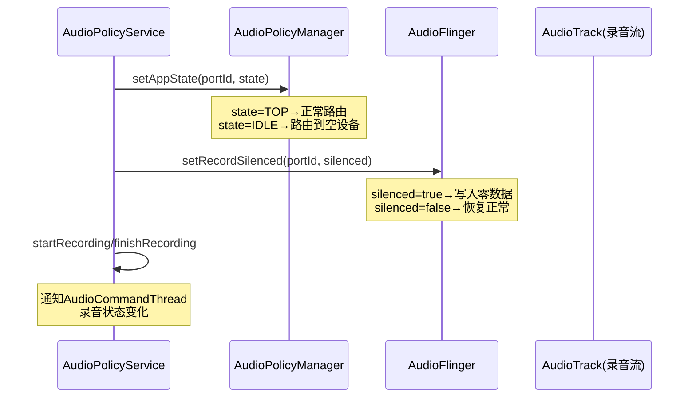
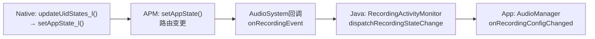

## 3.9 录音并发仲裁机制 — Concurrent Capture

> [← 上一个](03_3.8_AudioMode状态机与通信设备路由.md) | [返回目录](README.md) | [下一个→](03_3.10_RecordingActivityMonitor-录音状态追踪.md)

---

### 3.9.1 录音并发架构总览

Android 10+支持多App并发录音，但并非"无限制并发"——Native层`AudioPolicyService`通过两轮遍历仲裁模型决定每个录音客户端是被允许还是被静默。Java层`RecordingActivityMonitor`则负责状态追踪与回调通知，两者分工明确：

| 层级 | 组件 | 职责 |
|------|------|------|
| **Native仲裁层** | [`AudioPolicyService::updateUidStates_l()`](frameworks/av/services/audiopolicy/service/AudioPolicyService.cpp:607) | 基于UID优先级/隐私标志/通话状态裁决每个客户端的`APP_STATE` |
| **Native执行层** | [`AudioPolicyService::setAppState_l()`](frameworks/av/services/audiopolicy/service/AudioPolicyService.cpp:917) | 将裁决结果下发给APM路由引擎与AudioFlinger静音模块 |
| **Java追踪层** | `RecordingActivityMonitor` | 接收Native层状态变更回调，通知App端录音状态变化 |

核心仲裁入口[`updateUidStates_l()`](frameworks/av/services/audiopolicy/service/AudioPolicyService.cpp:607)在以下场景被触发：
- 录音客户端active状态变更（start/stop）
- UID优先级变更（前台/后台切换）
- AudioMode变更（通话/VoIP进入/退出）
- SensorPrivacy开关切换

### 3.9.2 AudioRecordClient核心数据结构

[`AudioRecordClient`](frameworks/av/services/audiopolicy/service/AudioPolicyService.h:899)是仲裁的原子单元，每个录音客户端在`getInputForAttr()`时创建，`releaseInput()`时销毁：

```cpp
// AudioPolicyService.h:899-926
class AudioRecordClient : public AudioClient {
public:
    AudioRecordClient(const audio_attributes_t attributes,
                      const audio_io_handle_t io,
                      const audio_session_t session, audio_port_handle_t portId,
                      const audio_port_handle_t deviceId,
                      const AttributionSourceState& attributionSource,
                      bool canCaptureOutput, bool canCaptureHotword,
                      wp<AudioCommandThread> commandThread);
    bool hasOp() const;  // h:917-919: AppOps权限检查
    // --- 核心字段 ---
    const AttributionSourceState attributionSource;  // h:922: 含uid/package/attribution链
    nsecs_t startTimeNs;       // h:923: 录音启动时间戳(仲裁时序依据)
    const bool canCaptureOutput;   // h:924: 是否持有CAPTURE_AUDIO_OUTPUT特权
    const bool canCaptureHotword;  // h:925: 是否持有CAPTURE_AUDIO_HOTWORD特权
    bool silenced;                 // h:926: 当前是否被静音
private:
    sp<OpRecordAudioMonitor> mOpRecordAudioMonitor;  // h:928: AppOps运行时监控
};
```

**权限维度映射**：

| 字段 | 权限来源 | 仲裁影响 |
|------|---------|---------|
| [`canCaptureOutput`](frameworks/av/services/audiopolicy/service/AudioPolicyService.h:923) | `CAPTURE_AUDIO_OUTPUT`系统特权 | 绕过隐私优先规则 + 绕过通话录音限制 |
| [`canCaptureHotword`](frameworks/av/services/audiopolicy/service/AudioPolicyService.h:924) | `CAPTURE_AUDIO_HOTWORD`系统特权 | 允许HOTWORD源录音 |
| [`hasOp()`](frameworks/av/services/audiopolicy/service/AudioPolicyService.h:917) | `AppOpsManager.RECORD_AUDIO`运行时授权 | denied → 强制禁止（[:801-803](frameworks/av/services/audiopolicy/service/AudioPolicyService.cpp:801)） |
| `privacySensitive` | `AUDIO_FLAG_CAPTURE_PRIVATE`属性标志 | 进入topSensitiveActive通道，优先于普通录音 |

### 3.9.3 updateUidStates_l()仲裁主流程 — 两轮遍历模型



**初始化阶段**（[:638-655](frameworks/av/services/audiopolicy/service/AudioPolicyService.cpp:638)）：

| 变量 | 类型 | 初始值 | 含义 |
|------|------|--------|------|
| `topActive` | `sp<AudioRecordClient>` | nullptr | 前台TOP中最新启动的**非隐私敏感**客户端 |
| `latestActive` | `sp<AudioRecordClient>` | nullptr | 全部(含非TOP)中最新启动的**非隐私敏感**客户端 |
| `topSensitiveActive` | `sp<AudioRecordClient>` | nullptr | 前台TOP中最新启动的**隐私敏感**客户端 |
| `latestSensitiveActiveOrComm` | `sp<AudioRecordClient>` | nullptr | 全部中最新启动的**隐私敏感**客户端(含通信模式优先) |
| `isA11yOnTop` | `bool` | `mUidPolicy->isA11yOnTop()` | 辅助服务是否在前台TOP |
| `isInCall` | `bool` | `mPhoneState == IN_CALL` | 是否处于电话通话模式 |
| `isInCommunication` | `bool` | `mPhoneState == IN_COMMUNICATION` | 是否处于VoIP通信模式 |
| `rttCallActive` | `bool` | `(isInCall||isInCommunication) && isRttEnabled()` | RTT实时文本通话是否活跃 |
| `onlyHotwordActive` | `bool` | `true` | 是否所有活跃客户端都使用HOTWORD源(第二轮判断用) |

### 3.9.4 第一轮遍历：候选者筛选

[第一轮遍历](frameworks/av/services/audiopolicy/service/AudioPolicyService.cpp:663)对每个`active`且`appState != IDLE`的客户端进行分类：

**排除规则**（[:672-680](frameworks/av/services/audiopolicy/service/AudioPolicyService.cpp:672)）：
- `appState == APP_STATE_IDLE` → 直接跳过（后台且无优先级）
- `isAccessibility` → 不参与top/latest候选（避免掩盖普通App）
- `isVirtualSource` → 不参与top/latest候选（虚拟源始终允许）

**APP_STATE_TOP分类**（[:685-700](frameworks/av/services/audiopolicy/service/AudioPolicyService.cpp:685)）：


> 12L 的TOP分支只做这三件事；13/14 的活跃助手列表分支（isActiveAssistant/useActiveAssistantList）不存在。

**latestActive/latestSensitiveActive筛选**（[:704-727](frameworks/av/services/audiopolicy/service/AudioPolicyService.cpp:704)）：

排除条件（不参与latest候选）：
- `source == AUDIO_SOURCE_HOTWORD` — HOTWORD源不参与，避免掩盖普通App
- `(isA11yOnTop || rttCallActive) && isAssistant` — 特殊模式下助手不参与latest

对于隐私敏感类客户端，有**通信模式优先规则**（[:709-718](frameworks/av/services/audiopolicy/service/AudioPolicyService.cpp:709)）：
- `isInCommunication`时，`mPhoneStateOwnerUid`的客户端**强制优先**为`latestSensitiveActiveOrComm`，即使其`startTimeNs`更小

**onlyHotwordActive更新**（[:728-730](frameworks/av/services/audiopolicy/service/AudioPolicyService.cpp:728)）：
- 每遇到`source != AUDIO_SOURCE_HOTWORD`的客户端，`onlyHotwordActive`置为false

**isPhoneStateOwnerActive更新**（[:731-733](frameworks/av/services/audiopolicy/service/AudioPolicyService.cpp:731)）：
- `currentUid == mPhoneStateOwnerUid` → `isPhoneStateOwnerActive = true`（12L 此处无虚拟源排除条件）

### 3.9.5 隐私优先规则与回退逻辑

**回退逻辑**（[:736-752](frameworks/av/services/audiopolicy/service/AudioPolicyService.cpp:736)）：
- `topActive == nullptr` → 用`latestActive`回退（无前台App时取最新后台App）
- `topSensitiveActive == nullptr` → 用`latestSensitiveActiveOrComm`回退
- `isInCommunication && topSensitiveActive已有值 && latestActiveUid == mPhoneStateOwnerUid` → **通信模式Owner覆盖前台隐私敏感**（[:741-752](frameworks/av/services/audiopolicy/service/AudioPolicyService.cpp:741))

**隐私优先规则**（[:758-762](frameworks/av/services/audiopolicy/service/AudioPolicyService.cpp:758)）：

```cpp
// L762-766（12L 逐字摘录）
if (topActive != nullptr && topSensitiveActive != nullptr
        && !topActive->canCaptureOutput) {
    topActive = nullptr;
}
```

**核心含义**：若隐私敏感录音（如VoIP通话）和普通录音同时活跃，除非普通录音客户端持有`CAPTURE_AUDIO_OUTPUT`特权，否则**普通录音候选者被彻底清除**（`topActive = nullptr`）。这确保隐私敏感录音不会被"窃听式"普通录音并行干扰。

### 3.9.6 第二轮遍历：逐个裁决

[第二轮遍历](frameworks/av/services/audiopolicy/service/AudioPolicyService.cpp:765)对每个`active`客户端计算`allowCapture`布尔值，最终通过[`setAppState_l()`](frameworks/av/services/audiopolicy/service/AudioPolicyService.cpp:917)下发：

**身份标记计算**（[:771-780](frameworks/av/services/audiopolicy/service/AudioPolicyService.cpp:771)）：

| 标记 | 计算方式 | 含义 |
|------|---------|------|
| `isTopOrLatestActive` | `current.uid == topActive.uid` | 是否是第一轮选出的普通录音候选者 |
| `isTopOrLatestSensitive` | `current.uid == topSensitiveActive.uid` | 是否是第一轮选出的隐私敏感候选者 |

（12L 只有这两个身份标记；13/14 的 `isTopOrLatestAssistant`/活跃助手列表不存在。）

**allowCapture默认规则**（[:795-800](frameworks/av/services/audiopolicy/service/AudioPolicyService.cpp:795)）：

```cpp
// AudioPolicyService.cpp:795-800（12L逐字摘录）
        // By default allow capture if:
        //     The assistant is not on TOP
        //     AND is on TOP or latest started
        //     AND there is no active privacy sensitive capture or call
        //             OR client has CAPTURE_AUDIO_OUTPUT privileged permission
        bool allowCapture = !isAssistantOnTop
                && (isTopOrLatestActive || isTopOrLatestSensitive)
                && !(isSensitiveActive
                    && !(isTopOrLatestSensitive || current->canCaptureOutput))
                && canCaptureIfInCallOrCommunication(current);
```

四个条件**全部满足**才默认允许录音：1) 助手不在TOP；2) 是普通/隐私敏感候选者之一；3) 无活跃隐私敏感采集冲突（除非持有特权）；4) 无通话冲突。任一条件失败即进入特殊规则通道。

### 3.9.7 canCaptureIfInCallOrCommunication lambda

[:786-794](frameworks/av/services/audiopolicy/service/AudioPolicyService.cpp:786)定义了通话/通信模式下的录音限制lambda：

```cpp
auto canCaptureIfInCallOrCommunication = [&](const auto &recordClient) REQUIRES(mLock) {
    uid_t recordUid = VALUE_OR_FATAL(aidl2legacy_int32_t_uid_t(
        recordClient->attributionSource.uid));
    bool canCaptureCall = recordClient->canCaptureOutput;
    bool canCaptureCommunication = recordClient->canCaptureOutput
        || !isPhoneStateOwnerActive
        || recordUid == mPhoneStateOwnerUid;
    return !(isInCall && !canCaptureCall)
        && !(isInCommunication && !canCaptureCommunication);
};
```
> 源码：`AudioPolicyService.cpp:781-790`（逐字摘录，12L）。语义：通信限制可被 `canCaptureOutput`、Mode Owner 不活跃或"自己就是 Mode Owner"三个条件之一豁免

| 模式 | 限制条件 | 绕过方式 |
|------|---------|---------|
| `IN_CALL` | 非特权客户端禁止录音 | `canCaptureOutput = true` |
| `IN_COMMUNICATION` | 非特权+PhoneStateOwner活跃+非Owner → 禁止 | `canCaptureOutput` 或 `!isPhoneStateOwnerActive` 或 `uid == mPhoneStateOwnerUid` |

**设计意图**：通话中禁止普通App录音防止窃听；VoIP通信中仅通信发起方和特权App可录音。

### 3.9.8 特殊客户端规则详解

第二轮遍历中，`allowCapture`默认规则之后有6条特殊规则（规则1-6，按优先级依次检查）：

#### 规则1: AppOps禁止（[:801-803](frameworks/av/services/audiopolicy/service/AudioPolicyService.cpp:801)）

```cpp
if (!current->hasOp()) {
    allowCapture = false;  // AppOps RECORD_AUDIO被denied → 强制禁止
}
```

`hasOp()`调用[`OpRecordAudioMonitor::hasOp()`](frameworks/av/services/audiopolicy/service/AudioPolicyService.h:859)，是**最高优先级检查**——即使其他规则允许，AppOps denied也强制禁止。

#### 规则2: 虚拟源豁免（[:804-806](frameworks/av/services/audiopolicy/service/AudioPolicyService.cpp:804)）

```cpp
else if (isVirtualSource(source)) {
    allowCapture = true;  // 远程混音/通话音频TX/RX → 始终允许
}
```

虚拟源（`AUDIO_SOURCE_REMOTE_SUBMIX`等）不消耗真实麦克风，无需仲裁。

#### 规则3: 助手规则（[:807-826](frameworks/av/services/audiopolicy/service/AudioPolicyService.cpp:807)）

```cpp
} else if (mUidPolicy->isAssistantUid(currentUid)) {
    // For assistant allow capture if:
    //     An accessibility service is on TOP or a RTT call is active
    //            AND the source is VOICE_RECOGNITION or HOTWORD
    //     OR is on TOP AND uses VOICE_RECOGNITION
    //            OR uses HOTWORD
    //         AND there is no active privacy sensitive capture or call
    //             OR client has CAPTURE_AUDIO_OUTPUT privileged permission
    if (isA11yOnTop || rttCallActive) {
        if (source == AUDIO_SOURCE_HOTWORD || source == AUDIO_SOURCE_VOICE_RECOGNITION) {
            allowCapture = true;
        }
    } else {
        if (((isAssistantOnTop && source == AUDIO_SOURCE_VOICE_RECOGNITION) ||
                source == AUDIO_SOURCE_HOTWORD)
                && !(isSensitiveActive && !current->canCaptureOutput)
                && canCaptureIfInCallOrCommunication(current)) {
            allowCapture = true;
        }
    }
}
```
> 源码：`AudioPolicyService.cpp:807-826`（逐字摘录，12L）

两条子规则：
- **A11y/RTT优先通道**：辅助服务在TOP或RTT通话活跃时，助手用`VOICE_RECOGNITION/HOTWORD`源可直接录音
- **常规通道**：助手在TOP用`VOICE_RECOGNITION`、或任意位置用`HOTWORD`（后台唤醒场景），且无隐私/通话冲突 → 允许

（12L 没有网上文档描述的“活跃/非活跃助手列表”拆分——那是 13/14 的 `latestActiveAssistant`/`useActiveAssistantList` 机制。）

#### 规则4: 辅助服务(A11y)规则（[:827-843](frameworks/av/services/audiopolicy/service/AudioPolicyService.cpp:827)）

```cpp
else if (mUidPolicy->isA11yUid(currentUid)) {
    // 通道A: !isAssistantOnTop && allowSensitiveCapture && canCaptureIfInCall → 允许
    // 通道B: isA11yOnTop && (VOICE_RECOGNITION || HOTWORD) → 允许
}
```

辅助服务的两条通道：
- **助手不在TOP时**：辅助服务可绕过助手占用，在无隐私/通话冲突下录音
- **辅助服务在TOP时**：使用`VOICE_RECOGNITION/HOTWORD`源无条件允许

#### 规则5: HOTWORD源规则（[:844-852](frameworks/av/services/audiopolicy/service/AudioPolicyService.cpp:844)）

```cpp
else if (source == AUDIO_SOURCE_HOTWORD) {
    if (onlyHotwordActive && canCaptureIfInCallOrCommunication(current)) {
        allowCapture = true;  // 所有活跃者都用HOTWORD → 允许并发
    }
}
```

当**所有**活跃录音客户端都使用`HOTWORD`源时（`onlyHotwordActive = true`），且无通话冲突，允许并发——这是多唤醒词引擎并发监听的场景。

#### 规则6: IME规则（[:853-857](frameworks/av/services/audiopolicy/service/AudioPolicyService.cpp:853)）

```cpp
else if (mUidPolicy->isCurrentImeUid(currentUid)) {
    if (rttCallActive && source == AUDIO_SOURCE_VOICE_RECOGNITION) {
        allowCapture = true;  // RTT通话中IME可用VOICE_RECOGNITION源录音
    }
}
```

仅RTT（实时文本）通话活跃时，输入法(IME)可使用`VOICE_RECOGNITION`源录音，用于语音转文字输入。

### 3.9.9 setAppState_l()执行机制

[`setAppState_l()`](frameworks/av/services/audiopolicy/service/AudioPolicyService.cpp:917)是仲裁结果的**唯一执行通道**，三重执行：



**关键逻辑**（[:917-941](frameworks/av/services/audiopolicy/service/AudioPolicyService.cpp:917)）：

```cpp
bool silenced = state == APP_STATE_IDLE;
if (client->silenced != silenced) {   // 状态变化才执行
    if (client->active) {
        if (silenced) {
            finishRecording(...);       // 静默→停止录音追踪
        } else {
            startRecording(...);        // 解除静默→开始录音追踪
            // startRecording失败 → silenced强制为true
        }
    }
    af->setRecordSilenced(portId, silenced);  // AudioFlinger执行静音
    client->silenced = silenced;              // 更新客户端标记
}
```

**状态映射**：[`apmStatFromAmState()`](frameworks/av/services/audiopolicy/service/AudioPolicyService.cpp:878)将ActivityManager进程状态转为APM状态：

| AM状态 | APM状态 | 录音行为 |
|--------|---------|---------|
| `PROCESS_STATE_UNKNOWN` | `APP_STATE_IDLE` | 静默 |
| `≤ PROCESS_STATE_TOP` | `APP_STATE_TOP` | 正常录音 |
| `> PROCESS_STATE_TOP` | `APP_STATE_FOREGROUND` | 正常录音(前台服务) |

### 3.9.10 silenceAllRecordings_l()紧急静音

[`silenceAllRecordings_l()`](frameworks/av/services/audiopolicy/service/AudioPolicyService.cpp:866)在SensorPrivacy启用时执行（[:866-873](frameworks/av/services/audiopolicy/service/AudioPolicyService.cpp:866)）：

```cpp
void AudioPolicyService::silenceAllRecordings_l() {
    for (size_t i = 0; i < mAudioRecordClients.size(); i++) {
        sp<AudioRecordClient> current = mAudioRecordClients[i];
        if (!isVirtualSource(current->attributes.source)) {  // 虚拟源排除
            setAppState_l(current, APP_STATE_IDLE);          // 全部静默
        }
    }
}
```

**排除虚拟源**：`AUDIO_SOURCE_REMOTE_SUBMIX`等虚拟源不受SensorPrivacy影响，因为它们不使用物理传感器。

### 3.9.11 Java层RecordingActivityMonitor与Native层仲裁的协作关系

Native层仲裁完成后，状态变更通过以下路径传递到Java层：



`RecordingActivityMonitor`（下一个详述）维护一个`RecordingInfo`列表，记录每个活跃录音的详细配置。Native层仲裁结果通过`onRecordConfigChanged`回调同步到Java层，Java层再通过`AudioManager.OnRecordingConfigChangedListener`通知App端。

### 3.9.12 关键仲裁场景速查表

| 场景 | 仲裁结果 | 规则来源行号 |
|------|---------|-------------|
| **SensorPrivacy启用** | 全部静默(除虚拟源) | [:866-873](frameworks/av/services/audiopolicy/service/AudioPolicyService.cpp:866) |
| **AppOps RECORD_AUDIO denied** | 强制禁止 | [:801-803](frameworks/av/services/audiopolicy/service/AudioPolicyService.cpp:801) |
| **虚拟源(remote submix等)** | 始终允许 | [:804-806](frameworks/av/services/audiopolicy/service/AudioPolicyService.cpp:804) |
| **普通App前台 + 隐私App活跃** | 隐私App优先，普通App被静默 | [:758-762](frameworks/av/services/audiopolicy/service/AudioPolicyService.cpp:758) |
| **特权App(CAPTURE_AUDIO_OUTPUT)** | 绕过隐私+通话限制 | [:923](frameworks/av/services/audiopolicy/service/AudioPolicyService.h:923) |
| **IN_CALL通话中 + 非特权录音** | 禁止 | [:788-794](frameworks/av/services/audiopolicy/service/AudioPolicyService.cpp:788) |
| **IN_COMM VoIP + PhoneStateOwner录音** | 允许(自身是ModeOwner) | [:790-792](frameworks/av/services/audiopolicy/service/AudioPolicyService.cpp:790) |
| **助手前台 + VOICE_RECOGNITION** | 允许（isAssistantOnTop分支） | [:811-820](frameworks/av/services/audiopolicy/service/AudioPolicyService.cpp:811) |
| **助手后台 + HOTWORD** | 允许（HOTWORD子条件，需无隐私/通话冲突） | [:817-820](frameworks/av/services/audiopolicy/service/AudioPolicyService.cpp:817) |
| **A11y前台 + VOICE_RECOGNITION** | 允许 | [:827-838](frameworks/av/services/audiopolicy/service/AudioPolicyService.cpp:827) |
| **所有活跃者都用HOTWORD** | 允许并发(无通话时) | [:844-852](frameworks/av/services/audiopolicy/service/AudioPolicyService.cpp:844) |
| **RTT通话 + IME + VOICE_RECOGNITION** | 允许 | [:853-857](frameworks/av/services/audiopolicy/service/AudioPolicyService.cpp:853) |
| **IN_COMM VoIP + 前台隐私敏感 + ModeOwner** | ModeOwner覆盖前台隐私优先 | [:741-752](frameworks/av/services/audiopolicy/service/AudioPolicyService.cpp:741) |

> **核心原则**：隐私敏感录音优先于普通录音 → 特权权限可绕过 → 通话模式限制最严 → 助手/A11y/IME有特殊通道 → HOTWORD源有兜底并发机制。

---

> [← 上一个](03_3.8_AudioMode状态机与通信设备路由.md) | [返回目录](README.md) | [下一个→](03_3.10_RecordingActivityMonitor-录音状态追踪.md)