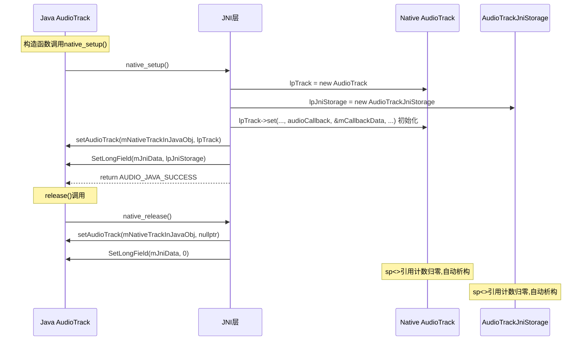
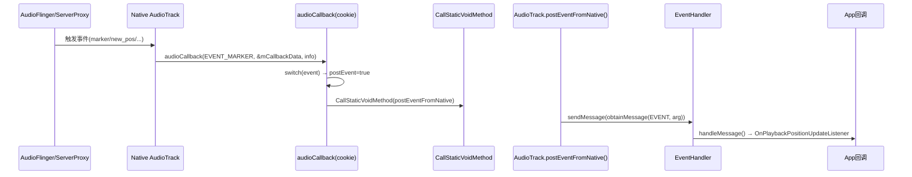

[← 03章 Java Framework Layer](../03_Java_Framework_Layer/README.md) | [← 返回Native Framework Layer](README.md) | [返回导航](../README.md) | [4.2 libaudioclient →](04_4.2_libaudioclient-Native音频客户端库.md)

## 4.1 JNI Bridge — Java到Native的桥梁

### 模块职责与源码位置

JNI层是Android音频系统中Java世界与Native C++世界之间的桥梁。当App进程调用`AudioTrack.write()`或`AudioRecord.read()`时，调用链经过JNI层进入Native AudioTrack/AudioRecord，再通过Binder IPC到达AudioFlinger。

**核心JNI文件列表：**

| Java类 | JNI文件 | 源码行数 | 关键JNI函数 |
|--------|---------|----------|-------------|
| AudioTrack | [`android_media_AudioTrack.cpp`](frameworks/base/core/jni/android_media_AudioTrack.cpp) | 1640 | native_setup/start/write/stop/pause/flush/release |
| AudioRecord | [`android_media_AudioRecord.cpp`](frameworks/base/core/jni/android_media_AudioRecord.cpp) | 1011 | native_setup/start/read/stop/release |
| AudioEffect | `android_media_AudioEffect.cpp` | ~1200 | native_create/command/getParameter |
| AudioSystem | `android_media_AudioSystem.cpp` | ~600 | native_setParameters/getParameters |

---

### 4.1.1 JNI方法注册机制

JNI方法的注册在进程启动时由Android Runtime完成，采用**静态注册表**方式。

#### AudioTrack JNI注册

[`register_android_media_AudioTrack()`](frameworks/base/core/jni/android_media_AudioTrack.cpp:1598) 在进程启动时被调用：

```cpp
// frameworks/base/core/jni/android_media_AudioTrack.cpp:1598-1624（12L 逐字摘录）
int register_android_media_AudioTrack(JNIEnv *env)
{
    // must be first
    int res = RegisterMethodsOrDie(env, kClassPathName, gMethods, NELEM(gMethods));

    javaAudioTrackFields.nativeTrackInJavaObj = NULL;
    javaAudioTrackFields.postNativeEventInJava = NULL;

    // Get the AudioTrack class
    jclass audioTrackClass = FindClassOrDie(env, kClassPathName);

    // Get the postEvent method
    javaAudioTrackFields.postNativeEventInJava = GetStaticMethodIDOrDie(env,
            audioTrackClass, JAVA_POSTEVENT_CALLBACK_NAME,
            "(Ljava/lang/Object;IIILjava/lang/Object;)V");

    // Get the variables fields
    //      nativeTrackInJavaObj
    javaAudioTrackFields.nativeTrackInJavaObj = GetFieldIDOrDie(env,
            audioTrackClass, JAVA_NATIVETRACKINJAVAOBJ_FIELD_NAME, "J");
    //      jniData
    javaAudioTrackFields.jniData = GetFieldIDOrDie(env,
            audioTrackClass, JAVA_JNIDATA_FIELD_NAME, "J");
    //      fieldStreamType
    javaAudioTrackFields.fieldStreamType = GetFieldIDOrDie(env,
            audioTrackClass, JAVA_STREAMTYPE_FIELD_NAME, "I");

    env->DeleteLocalRef(audioTrackClass);
```

#### AudioTrack JNI方法注册表

[`gMethods[]`](frameworks/base/core/jni/android_media_AudioTrack.cpp:1491) 定义了所有native方法映射（共54个方法）：

| Java native方法 | JNI签名 | C++实现函数 |
|----------------|---------|------------|
| `native_setup` | `(Ljava/lang/Object;...Ljava/lang/String;)I` | [`android_media_AudioTrack_setup()`](frameworks/base/core/jni/android_media_AudioTrack.cpp:249) |
| `native_start` | `()V` | [`android_media_AudioTrack_start()`](frameworks/base/core/jni/android_media_AudioTrack.cpp:537) |
| `native_stop` | `()V` | [`android_media_AudioTrack_stop()`](frameworks/base/core/jni/android_media_AudioTrack.cpp:552) |
| `native_pause` | `()V` | [`android_media_AudioTrack_pause()`](frameworks/base/core/jni/android_media_AudioTrack.cpp:567) |
| `native_flush` | `()V` | [`android_media_AudioTrack_flush()`](frameworks/base/core/jni/android_media_AudioTrack.cpp:582) |
| `native_write_byte` | `([BIIIZ)I` | [`android_media_AudioTrack_writeArray<jbyteArray>`](frameworks/base/core/jni/android_media_AudioTrack.cpp:724) |
| `native_write_short` | `([SIIIZ)I` | [`android_media_AudioTrack_writeArray<jshortArray>`](frameworks/base/core/jni/android_media_AudioTrack.cpp:724) |
| `native_write_float` | `([FIIIZ)I` | [`android_media_AudioTrack_writeArray<jfloatArray>`](frameworks/base/core/jni/android_media_AudioTrack.cpp:724) |
| `native_write_native_bytes` | `(Ljava/nio/ByteBuffer;IIIZ)I` | [`android_media_AudioTrack_write_native_bytes()`](frameworks/base/core/jni/android_media_AudioTrack.cpp:766) |
| `native_release` | `()V` | [`android_media_AudioTrack_release()`](frameworks/base/core/jni/android_media_AudioTrack.cpp:611) |
| `native_setVolume` | `(FF)V` | [`android_media_AudioTrack_set_volume()`](frameworks/base/core/jni/android_media_AudioTrack.cpp:596) |
| `native_get_position` | `()I` | `android_media_AudioTrack_get_position` |
| `native_get_timestamp` | `([J)I` | `android_media_AudioTrack_get_timestamp` |
| `native_applyVolumeShaper` | `(LVolumeShaper$Configuration;LVolumeShaper$Operation;)I` | `android_media_AudioTrack_apply_volume_shaper` |

#### AudioRecord JNI方法注册表

[`gMethods[]`](frameworks/base/core/jni/android_media_AudioRecord.cpp:914) 定义了AudioRecord的native方法映射（共27个方法）：

| Java native方法 | JNI签名 | C++实现函数 |
|----------------|---------|------------|
| `native_setup` | `(Ljava/lang/Object;Ljava/lang/Object;[IIIIII[ILandroid/os/Parcel;JI)I` | [`android_media_AudioRecord_setup()`](frameworks/base/core/jni/android_media_AudioRecord.cpp:188) |
| `native_start` | `(II)I` | [`android_media_AudioRecord_start()`](frameworks/base/core/jni/android_media_AudioRecord.cpp:382) |
| `native_stop` | `()V` | [`android_media_AudioRecord_stop()`](frameworks/base/core/jni/android_media_AudioRecord.cpp:397) |
| `native_read_in_byte_array` | `([BIIZ)I` | [`android_media_AudioRecord_readInArray<jbyteArray>`](frameworks/base/core/jni/android_media_AudioRecord.cpp:496) |
| `native_read_in_short_array` | `([SIIZ)I` | [`android_media_AudioRecord_readInArray<jshortArray>`](frameworks/base/core/jni/android_media_AudioRecord.cpp:496) |
| `native_read_in_float_array` | `([FIIZ)I` | [`android_media_AudioRecord_readInArray<jfloatArray>`](frameworks/base/core/jni/android_media_AudioRecord.cpp:496) |
| `native_read_in_direct_buffer` | `(Ljava/lang/Object;IZ)I` | [`android_media_AudioRecord_readInDirectBuffer()`](frameworks/base/core/jni/android_media_AudioRecord.cpp:538) |
| `native_release` | `()V` | [`android_media_AudioRecord_release()`](frameworks/base/core/jni/android_media_AudioRecord.cpp:413) |
| `native_get_min_buff_size` | `(III)I` | [`android_media_AudioRecord_get_min_buff_size()`](frameworks/base/core/jni/android_media_AudioRecord.cpp:646) |
| `native_get_timestamp` | `(LAudioTimestamp;I)I` | `android_media_AudioRecord_get_timestamp` |
| `native_get_active_microphones` | `(Ljava/util/ArrayList;)I` | `android_media_AudioRecord_get_active_microphones` |

---

### 4.1.2 Java对象与Native对象的关联机制

JNI层的核心设计是**将Native C++对象的指针存储在Java对象的long字段中**，Java层只看到一个64位整数。

#### audio_track_fields_t 结构体

[`audio_track_fields_t`](frameworks/base/core/jni/android_media_AudioTrack.cpp:55) 定义了JNI层需要访问的Java字段：

```cpp
struct audio_track_fields_t {
    jmethodID postNativeEventInJava;  // AudioTrack.postEventFromNative() 方法ID
    jfieldID  nativeTrackInJavaObj;   // mNativeTrackInJavaObj - 存储Native AudioTrack的sp<>指针
    jfieldID  jniData;                // mJniData - 存储AudioTrackJniStorage的sp<>指针
    jfieldID  fieldStreamType;        // mStreamType - 流类型字段
};
```

#### 对象存取辅助函数

[`getAudioTrack()`](frameworks/base/core/jni/android_media_AudioTrack.cpp:216) 从Java对象中取出Native AudioTrack的智能指针：

```cpp
// android_media_AudioTrack.cpp:216-224（12L 逐字摘录）
static sp<AudioTrack> getAudioTrack(JNIEnv* env, jobject thiz)
{
    Mutex::Autolock l(sLock);
    AudioTrack* const at =
            (AudioTrack*)env->GetLongField(thiz, javaAudioTrackFields.nativeTrackInJavaObj);
    return sp<AudioTrack>(at);
}
```

[`setAudioTrack()`](frameworks/base/core/jni/android_media_AudioTrack.cpp:227) 将Native对象指针存入Java字段——裸指针转`jlong`存入，配对手写`incStrong`/`decStrong`维持引用计数（`native_setup`成功路径与`native_release`均经此函数）：

```cpp
// android_media_AudioTrack.cpp:227-241（12L 逐字摘录）
static sp<AudioTrack> setAudioTrack(JNIEnv* env, jobject thiz, const sp<AudioTrack>& at)
{
    Mutex::Autolock l(sLock);
    sp<AudioTrack> old =
            (AudioTrack*)env->GetLongField(thiz, javaAudioTrackFields.nativeTrackInJavaObj);
    if (at.get()) {
        at->incStrong((void*)setAudioTrack);
    }
    if (old != 0) {
        old->decStrong((void*)setAudioTrack);
    }
    env->SetLongField(thiz, javaAudioTrackFields.nativeTrackInJavaObj, (jlong)at.get());
    return old;
}
```

> **负结论**：`getFieldSp`/`setFieldSp` 模板辅助函数不在本树（grep 无匹配）——12L 是上述手写 incStrong/decStrong + SetLongField 机制。

#### 对象生命周期



---

### 4.1.3 native_setup 深度解析

[`android_media_AudioTrack_setup()`](frameworks/base/core/jni/android_media_AudioTrack.cpp:249) 是JNI层最复杂的函数，负责创建并初始化Native AudioTrack对象（签名与 gMethods 注册一致：`(Ljava/lang/Object;Ljava/lang/Object;[IIIIII[IJZILjava/lang/Object;Ljava/lang/String;)I`；本树无 `jAttributionSource` 参数——uid/pid 归因在 `set()` 调用处传 `AttributionSourceState()` 默认值，包名归因由 `opPackageName` 构造，源码注释"TODO b/182469354: make consistent with AudioRecord"）。

#### 函数签名

```cpp
static jint android_media_AudioTrack_setup(
    JNIEnv *env, jobject thiz, jobject weak_this,
    jobject jaa,                    // AudioAttributes
    jintArray jSampleRate,          // 采样率
    jint channelPositionMask,       // 通道位置掩码
    jint channelIndexMask,          // 通道索引掩码
    jint audioFormat,               // 音频格式
    jint buffSizeInBytes,           // 缓冲区大小(字节)
    jint memoryMode,                // MODE_STREAM=1 / MODE_STATIC=0
    jintArray jSession,             // Session ID
    jlong nativeAudioTrack,         // 已有Native AudioTrack指针(0=新建)
    jboolean offload,               // 是否Offload模式
    jint encapsulationMode,         // 封装模式
    jobject tunerConfiguration,     // Tuner配置
    jstring opPackageName)          // 包名（函数内由其构造AttributionSourceState）
```

#### 核心流程

1. **参数解析**：从Java数组中提取采样率、Session ID等
2. **格式转换**：Java channel mask → Native channel mask，Java format → Native format
3. **FrameCount计算**：`frameCount = buffSizeInBytes / (channelCount * bytesPerSample)`
4. **根据memoryMode分支**：
   - `MODE_STREAM`：使用`TRANSFER_SYNC`或`TRANSFER_SYNC_NOTIF_CALLBACK`
   - `MODE_STATIC`：分配共享内存，使用`TRANSFER_SHARED`
5. **创建Native AudioTrack**：调用`lpTrack->set()`
6. **存储Native对象**：`setAudioTrack()`（incStrong+SetLongField）将指针存入Java字段

#### MODE_STREAM 分支

```cpp
// frameworks/base/core/jni/android_media_AudioTrack.cpp:386-401（12L 逐字摘录）
case MODE_STREAM:
    status = lpTrack->set(AUDIO_STREAM_DEFAULT, // stream type, but more info conveyed
                                                    // in paa (last argument)
                          sampleRateInHertz,
                          format, // word length, PCM
                          nativeChannelMask, offload ? 0 : frameCount,
                          offload ? AUDIO_OUTPUT_FLAG_COMPRESS_OFFLOAD
                                  : AUDIO_OUTPUT_FLAG_NONE,
                          audioCallback,
                          &(lpJniStorage->mCallbackData), // callback, callback data (user)
                          0,    // notificationFrames == 0 since not using EVENT_MORE_DATA
                                // to feed the AudioTrack
                          0,    // shared mem
                          true, // thread can call Java
                          sessionId, // audio session ID
                          offload ? AudioTrack::TRANSFER_SYNC_NOTIF_CALLBACK
                                  : AudioTrack::TRANSFER_SYNC,
                          (offload || encapsulationMode) ? &offloadInfo : NULL,
                          AttributionSourceState(), // default uid, pid values
                          paa.get());
    break;
```

#### MODE_STATIC 分支

```cpp
// frameworks/base/core/jni/android_media_AudioTrack.cpp:403-425（12L 逐字摘录）
case MODE_STATIC:
    // AudioTrack is using shared memory

    if (!lpJniStorage->allocSharedMem(buffSizeInBytes)) {
        ALOGE("Error creating AudioTrack in static mode: error creating mem heap base");
        goto native_init_failure;
    }

    status = lpTrack->set(AUDIO_STREAM_DEFAULT, // stream type, but more info conveyed
                                                    // in paa (last argument)
                          sampleRateInHertz,
                          format, // word length, PCM
                          nativeChannelMask, frameCount, AUDIO_OUTPUT_FLAG_NONE,
                          audioCallback,
                          &(lpJniStorage->mCallbackData), // callback, callback data (user)
                          0, // notificationFrames == 0 since not using EVENT_MORE_DATA
                             // to feed the AudioTrack
                          lpJniStorage->mMemBase, // shared mem
                          true,                   // thread can call Java
                          sessionId,              // audio session ID
                          AudioTrack::TRANSFER_SHARED,
                          NULL,       // default offloadInfo
                          AttributionSourceState(), // default uid, pid values
                          paa.get());
    break;
```

[`AudioTrackJniStorage::allocSharedMem()`](frameworks/base/core/jni/android_media_AudioTrack.cpp:87) 为Static模式分配共享内存（成员函数、返回bool、句柄存于mMemHeap/mMemBase）：

```cpp
// frameworks/base/core/jni/android_media_AudioTrack.cpp:87-96（12L 逐字摘录）
bool allocSharedMem(int sizeInBytes) {
    mMemHeap = new MemoryHeapBase(sizeInBytes, 0, "AudioTrack Heap Base");
    if (mMemHeap->getHeapID() < 0) {
        return false;
    }
    mMemBase = new MemoryBase(mMemHeap, 0, sizeInBytes);
    return true;
}
```

---

### 4.1.4 native_write 数据写入流程

AudioTrack的write操作支持多种数据类型，通过C++模板实现代码复用。

#### 模板化writeArray

[`android_media_AudioTrack_writeArray<T>()`](frameworks/base/core/jni/android_media_AudioTrack.cpp:724) 处理byte/short/float数组的写入（NULL检查不可省略）：

```cpp
// android_media_AudioTrack.cpp:723-761（12L 逐字摘录）
template <typename T>
static jint android_media_AudioTrack_writeArray(JNIEnv *env, jobject thiz,
                                                T javaAudioData,
                                                jint offsetInSamples, jint sizeInSamples,
                                                jint javaAudioFormat,
                                                jboolean isWriteBlocking) {
    //ALOGV("android_media_AudioTrack_writeArray(offset=%d, sizeInSamples=%d) called",
    //        offsetInSamples, sizeInSamples);
    sp<AudioTrack> lpTrack = getAudioTrack(env, thiz);
    if (lpTrack == NULL) {
        jniThrowException(env, "java/lang/IllegalStateException",
            "Unable to retrieve AudioTrack pointer for write()");
        return (jint)AUDIO_JAVA_INVALID_OPERATION;
    }

    if (javaAudioData == NULL) {
        ALOGE("NULL java array of audio data to play");
        return (jint)AUDIO_JAVA_BAD_VALUE;
    }

    // NOTE: We may use GetPrimitiveArrayCritical() when the JNI implementation changes in such
    // a way that it becomes much more efficient. When doing so, we will have to prevent the
    // AudioSystem callback to be called while in critical section (in case of media server
    // process crash for instance)

    // get the pointer for the audio data from the java array
    auto cAudioData = envGetArrayElements(env, javaAudioData, NULL);
    if (cAudioData == NULL) {
        ALOGE("Error retrieving source of audio data to play");
        return (jint)AUDIO_JAVA_BAD_VALUE; // out of memory or no data to load
    }

    jint samplesWritten = writeToTrack(lpTrack, javaAudioFormat, cAudioData,
            offsetInSamples, sizeInSamples, isWriteBlocking == JNI_TRUE /* blocking */);

    envReleaseArrayElements(env, javaAudioData, cAudioData, 0);

    //ALOGV("write wrote %d (tried %d) samples in the native AudioTrack with offset %d",
    //        (int)samplesWritten, (int)(sizeInSamples), (int)offsetInSamples);
    return samplesWritten;
}
```

#### writeToTrack 核心逻辑

[`writeToTrack()`](frameworks/base/core/jni/android_media_AudioTrack.cpp:696) 区分STREAM和STATIC模式的写入：

```cpp
template <typename T>
static jint writeToTrack(const sp<AudioTrack>& track, jint audioFormat, const T *data,
                         jint offsetInSamples, jint sizeInSamples, bool blocking) {
    ssize_t written = 0;
    size_t sizeInBytes = sizeInSamples * sizeof(T);
    if (track->sharedBuffer() == 0) {
        // MODE_STREAM: 调用Native AudioTrack.write()
        written = track->write(data + offsetInSamples, sizeInBytes, blocking);
        if (written == (ssize_t) WOULD_BLOCK) {
            written = 0;
        }
    } else {
        // MODE_STATIC: 直接memcpy到共享内存
        if ((size_t)sizeInBytes > track->sharedBuffer()->size()) {
            sizeInBytes = track->sharedBuffer()->size();
        }
        memcpy(track->sharedBuffer()->unsecurePointer(), data + offsetInSamples, sizeInBytes);
        written = sizeInBytes;
    }
    if (written >= 0) {
        return written / sizeof(T);  // 返回采样数
    }
    return interpretWriteSizeError(written);
}
```

**关键差异**：
- **STREAM模式**：调用`AudioTrack::write()`，内部通过`obtainBuffer/releaseBuffer`操作共享环形缓冲区
- **STATIC模式**：直接`memcpy`到共享内存，数据一次性写入

#### Direct ByteBuffer写入

[`android_media_AudioTrack_write_native_bytes()`](frameworks/base/core/jni/android_media_AudioTrack.cpp:766) 支持ByteBuffer：

```cpp
static jint android_media_AudioTrack_write_native_bytes(JNIEnv *env, jobject thiz,
        jobject javaByteBuffer, jint byteOffset, jint sizeInBytes,
        jint javaAudioFormat, jboolean isWriteBlocking) {
    sp<AudioTrack> lpTrack = getAudioTrack(env, thiz);
    const jbyte* bytes = reinterpret_cast<const jbyte*>(env->GetDirectBufferAddress(javaByteBuffer));
    jint written = writeToTrack(lpTrack, javaAudioFormat, bytes, byteOffset,
            sizeInBytes, isWriteBlocking == JNI_TRUE);
    return written;
}
```

---

### 4.1.5 AudioRecord JNI层深度解析

#### native_setup 流程

[`android_media_AudioRecord_setup()`](frameworks/base/core/jni/android_media_AudioRecord.cpp:188) 与AudioTrack类似，但参数不同：

```cpp
static jint android_media_AudioRecord_setup(JNIEnv *env, jobject thiz, jobject weak_this,
                                            jobject jaa, jintArray jSampleRate, jint channelMask,
                                            jint channelIndexMask, jint audioFormat,
                                            jint buffSizeInBytes, jintArray jSession,
                                            jobject jAttributionSource, jlong nativeRecordInJavaObj,
                                            jint sharedAudioHistoryMs) {
```

核心创建逻辑：

```cpp
// frameworks/base/core/jni/android_media_AudioRecord.cpp:299-312（12L 逐字摘录）
const status_t status =
        lpRecorder->set(paa->source, sampleRateInHertz,
                        format, // word length, PCM
                        localChanMask, frameCount,
                        recorderCallback, // callback_t
                        lpCallbackData,   // void* user
                        0,                // notificationFrames,
                        true,             // threadCanCallJava
                        sessionId, AudioRecord::TRANSFER_DEFAULT, flags, -1,
                        -1, // default uid, pid
                        paa.get(), AUDIO_PORT_HANDLE_NONE, MIC_DIRECTION_UNSPECIFIED,
                        MIC_FIELD_DIMENSION_DEFAULT, sharedAudioHistoryMs);
```

#### native_read 数据读取

[`android_media_AudioRecord_readInArray<T>()`](frameworks/base/core/jni/android_media_AudioRecord.cpp:496) 模板函数：

```cpp
template <typename T>
static jint android_media_AudioRecord_readInArray(JNIEnv *env, jobject thiz,
                                                  T javaAudioData,
                                                  jint offsetInSamples, jint sizeInSamples,
                                                  jboolean isReadBlocking) {
    sp<AudioRecord> lpRecorder = getAudioRecord(env, thiz);
    auto *recordBuff = envGetArrayElements(env, javaAudioData, NULL);
    const size_t sizeInBytes = sizeInSamples * sizeof(*recordBuff);
    ssize_t readSize = lpRecorder->read(
            recordBuff + offsetInSamples, sizeInBytes, isReadBlocking == JNI_TRUE);
    envReleaseArrayElements(env, javaAudioData, recordBuff, 0);
    if (readSize < 0) {
        return interpretReadSizeError(readSize);
    }
    return (jint)(readSize / sizeof(*recordBuff));  // 返回采样数
}
```

---

### 4.1.6 Native→Java回调机制

JNI层不仅需要从Java调到Native，还需要从Native回调到Java（如通知marker位置、underrun等事件）。

#### audiotrack_callback_cookie + audioCallback（本树真实机制）

12L JNI 层**没有** `AudioTrackCallbackImpl` 类：Native→Java 事件转发是 C 风格自由函数 `audioCallback(int event, void* user, void* info)` + `audiotrack_callback_cookie` 结构体（`setup` 以 `audioCallback, &(lpJniStorage->mCallbackData)` 传入 `AudioTrack::set()`，见 4.1.3）。

```cpp
// android_media_AudioTrack.cpp:66-71（12L 逐字摘录）
struct audiotrack_callback_cookie {
    jclass      audioTrack_class;
    jobject     audioTrack_ref;
    bool        busy;
    Condition   cond;
    bool        isOffload;
};
```

事件分发（Offload 专属事件仅 isOffload 时转发；EVENT_MARKER/EVENT_NEW_POST 无条件转发）：

```cpp
// android_media_AudioTrack.cpp:158-189（12L 逐字摘录，节选switch骨架）
switch (event) {
// Offload only events
case AudioTrack::EVENT_CAN_WRITE_MORE_DATA:
    // this event will read the info return parameter of the callback:
    // for JNI offload, use the returned size to indicate:
    // 1/ no data is returned through callback, as it's all done through write()
    // 2/ do not wait as AudioTrack does when it receives 0 bytes
    if (callbackInfo->isOffload) {
        AudioTrack::Buffer* pBuffer = (AudioTrack::Buffer*) info;
        const size_t availableForWrite = pBuffer->size;
        arg = availableForWrite > INT32_MAX ? INT32_MAX : (int) availableForWrite;
        pBuffer->size = 0;
    }
    FALLTHROUGH_INTENDED;
case AudioTrack::EVENT_STREAM_END:
case AudioTrack::EVENT_NEW_IAUDIOTRACK: // a.k.a. tear down
    if (callbackInfo->isOffload) {
        postEvent = true;
    }
    break;

// PCM and offload events
case AudioTrack::EVENT_MARKER:
case AudioTrack::EVENT_NEW_POS:
    postEvent = true;
    break;
default:
    // event will not be posted
    break;
}
```

#### postEvent 核心实现

回调线程经 `AndroidRuntime::getJNIEnv()` 获取 JNIEnv 后调用Java静态方法（`audioCallback` 内联实现，非独立方法）：

```cpp
// android_media_AudioTrack.cpp:192-199（12L 逐字摘录）
if (postEvent) {
    JNIEnv *env = AndroidRuntime::getJNIEnv();
    if (env != NULL) {
        env->CallStaticVoidMethod(
                callbackInfo->audioTrack_class,
                javaAudioTrackFields.postNativeEventInJava,
                callbackInfo->audioTrack_ref, event, arg, 0, NULL);
        if (env->ExceptionCheck()) {
            env->ExceptionDescribe();
            env->ExceptionClear();
        }
    }
}
```

> **负结论**：`AudioTrackCallbackImpl`/`AudioTrack::IAudioTrackCallback`（onMarker/onNewPos/onStreamEnd/onCanWriteMoreData 虚函数形态）在本树 android_media_AudioTrack.cpp 与 libaudioclient AudioTrack.h 中 grep 均无匹配——event_type 枚举（EVENT_MORE_DATA…EVENT_CAN_WRITE_MORE_DATA=9）属于 AudioTrack.h:57-88，JNI 侧以 switch 转发；`wp<media::IAudioTrackCallback>`（AudioTrack.h:1404）是 AIDL 的编解码格式回调接口（仅 onCodecFormatChanged），与事件转发无关。

Java端的[`postEventFromNative()`](frameworks/base/media/java/android/media/AudioTrack.java) 收到调用后，向Handler发送消息：



#### 录音侧：audiorecord_callback_cookie + recorderCallback

录音侧同构：**没有** `AudioRecordJNIStorage` 类，`android_media_AudioRecord.cpp:71-75` 是 `audiorecord_callback_cookie` 结构体（audioRecord_class/audioRecord_ref/busy/cond），:88 起为自由函数 `recorderCallback(int event, void* user, void *info)`，`setup` 以 `recorderCallback, lpCallbackData` 传入 `AudioRecord::set()`（AudioRecord.h:226 起，callback_t 机制）：

```cpp
// android_media_AudioRecord.cpp:290-294（12L 逐字摘录）
lpCallbackData = new audiorecord_callback_cookie;
lpCallbackData->audioRecord_class = (jclass)env->NewGlobalRef(clazz);
// we use a weak reference so the AudioRecord object can be garbage collected.
lpCallbackData->audioRecord_ref = env->NewGlobalRef(weak_this);
lpCallbackData->busy = false;
```

> **负结论**：`AudioRecord::IAudioRecordCallback`（onMoreData/onOverrun/onMarker/onNewPos/onNewIAudioRecord）在本树 AudioRecord.h grep 无匹配——12L 回调即 `callback_t cbf` C 函数指针（AudioRecord.h:192/:231/:237）。

---

### 4.1.7 AudioTrackJniStorage 详解

[`AudioTrackJniStorage`](frameworks/base/core/jni/android_media_AudioTrack.cpp:79) 是JNI层的辅助存储类（**普通class**，非RefBase继承；Java类引用/弱引用由 mCallbackData 内的 jclass/jobject 全局引用持有）：

```cpp
// android_media_AudioTrack.cpp:79-97（12L 逐字摘录）
class AudioTrackJniStorage {
public:
    sp<MemoryHeapBase> mMemHeap;
    sp<MemoryBase> mMemBase;
    audiotrack_callback_cookie mCallbackData{};
    sp<JNIDeviceCallback> mDeviceCallback;
    sp<JNIAudioTrackCallback> mAudioTrackCallback;

    bool allocSharedMem(int sizeInBytes) {
        mMemHeap = new MemoryHeapBase(sizeInBytes, 0, "AudioTrack Heap Base");
        if (mMemHeap->getHeapID() < 0) {
            return false;
        }
        mMemBase = new MemoryBase(mMemHeap, 0, sizeInBytes);
        return true;
    }
};
```

**存储内容**：
- `mMemHeap`/`mMemBase`：MODE_STATIC 共享内存（见 4.1.3）
- `mCallbackData`：audiotrack_callback_cookie（audioCallback 的 user 数据）
- `mDeviceCallback`：设备连接/断开回调（JNIDeviceCallback，路由变化通知）
- `mAudioTrackCallback`：JNIAudioTrackCallback（AudioRouting 布线通知，native_routing_migration 路径）

> **负结论**：`(jclass, jobject, bool)` 构造器与 `getAudioTrackWeakRef()` 均不在本树类定义中。

---

### 4.1.8 JNI层错误处理

JNI层将Native错误码转换为Java错误码，使用[`nativeToJavaStatus()`](frameworks/base/core/jni/android_media_AudioRecord.cpp:739) 辅助函数：

#### AudioTrack错误码

```cpp
#define AUDIOTRACK_ERROR_SETUP_AUDIOSYSTEM         (-16)
#define AUDIOTRACK_ERROR_SETUP_INVALIDCHANNELMASK  (-17)
#define AUDIOTRACK_ERROR_SETUP_INVALIDFORMAT       (-18)
#define AUDIOTRACK_ERROR_SETUP_INVALIDSTREAMTYPE   (-19)
#define AUDIOTRACK_ERROR_SETUP_NATIVEINITFAILED    (-20)
```

#### AudioRecord错误码

```cpp
#define AUDIORECORD_ERROR_SETUP_ZEROFRAMECOUNT      (-16)
#define AUDIORECORD_ERROR_SETUP_INVALIDCHANNELMASK  (-17)
#define AUDIORECORD_ERROR_SETUP_INVALIDFORMAT       (-18)
#define AUDIORECORD_ERROR_SETUP_INVALIDSOURCE       (-19)
#define AUDIORECORD_ERROR_SETUP_NATIVEINITFAILED    (-20)
```

#### write/read错误转换

[`interpretWriteSizeError()`](frameworks/base/core/jni/android_media_AudioTrack.cpp:683) 处理写入错误：

```cpp
static inline jint interpretWriteSizeError(ssize_t writeSize) {
    if (writeSize == WOULD_BLOCK) {
        return (jint)0;                    // 非阻塞模式返回0
    } else if (writeSize == NO_INIT) {
        return AUDIO_JAVA_DEAD_OBJECT;     // 服务端死亡
    } else {
        return nativeToJavaStatus(writeSize);
    }
}
```

---

### 4.1.9 JNI层完整调用时序图

```mermaid
sequenceDiagram
    participant App as Application
    participant Java as AudioTrack.java
    participant JNI as android_media_AudioTrack.cpp
    participant Native as Native AudioTrack
    participant AF as AudioFlinger

    Note over App,AF: === 创建阶段 ===
    App->>Java: new AudioTrack(attrs, sampleRate, ...)
    Java->>JNI: native_setup(weak_this, jaa, ...)
    JNI->>Native: sp<AudioTrack>::make(attributionSource)
    JNI->>Native: lpTrack->set(stream, rate, format, ...)
    Native->>AF: createTrack(CreateTrackRequest)
    AF-->>Native: CreateTrackResponse (IAudioTrack句柄; cblk/buffers经IAudioTrack单独获取)
    Native-->>JNI: NO_ERROR
    JNI->>Java: setAudioTrack(mNativeTrackInJavaObj, lpTrack)
    JNI-->>Java: AUDIO_JAVA_SUCCESS

    Note over App,AF: === 写入阶段 ===
    App->>Java: track.write(byte[], offset, size)
    Java->>JNI: native_write_byte(array, offset, size, format, blocking)
    JNI->>Native: track->write(data + offset, sizeInBytes, blocking)
    Native->>Native: obtainBuffer() → 从环形缓冲区获取空位
    Native->>Native: memcpy到共享缓冲区
    Native->>Native: releaseBuffer() → 通知Server消费
    Native-->>JNI: written (字节数)
    JNI-->>Java: samplesWritten (采样数)

    Note over App,AF: === 播放阶段 ===
    App->>Java: track.play()
    Java->>JNI: native_start()
    JNI->>Native: lpTrack->start()
    Native->>AF: IAudioTrack->start()
    AF-->>Native: OK

    Note over App,AF: === 回调阶段 ===
    AF->>Native: ServerProxy检测到marker位置
    Native->>JNI: audioCallback(EVENT_MARKER, &mCallbackData, info)
    JNI->>Java: CallStaticVoidMethod(postEventFromNative, EVENT_MARKER)
    Java->>Java: EventHandler.handleMessage()
    Java->>App: OnPlaybackPositionUpdateListener.onMarkerReached()

    Note over App,AF: === 释放阶段 ===
    App->>Java: track.release()
    Java->>JNI: native_release()
    JNI->>Java: setAudioTrack(mNativeTrackInJavaObj, nullptr)
    JNI->>Java: SetLongField(mJniData, 0)
    Note over Native: sp<>引用计数归零，析构Native AudioTrack
```

---

### 4.1.10 JNI字段映射总结

| Java字段（宏定义于各自JNI文件） | 类型 | Native对应 | 用途 |
|---------|------|-----------|------|
| `mNativeTrackInJavaObj` | `long` | `AudioTrack*`（setAudioTrack incStrong/decStrong） | Native AudioTrack指针 |
| `mJniData` | `long` | `AudioTrackJniStorage*` | JNI回调存储 |
| `mStreamType` | `int` | `audio_stream_type_t` | 流类型 |
| `mNativeRecorderInJavaObj` | `long` | `AudioRecord*` | Native AudioRecord指针（android_media_AudioRecord.cpp:965 宏） |
| `mNativeCallbackCookie` | `long` | `audiorecord_callback_cookie*` | 录音回调cookie |
| `mNativeDeviceCallback` | `long` | `JNIDeviceCallback*` | 录音设备回调 |

---

[← 03章 Java Framework Layer](../03_Java_Framework_Layer/README.md) | [← 返回Native Framework Layer](README.md) | [返回导航](../README.md) | [4.2 libaudioclient →](04_4.2_libaudioclient-Native音频客户端库.md)