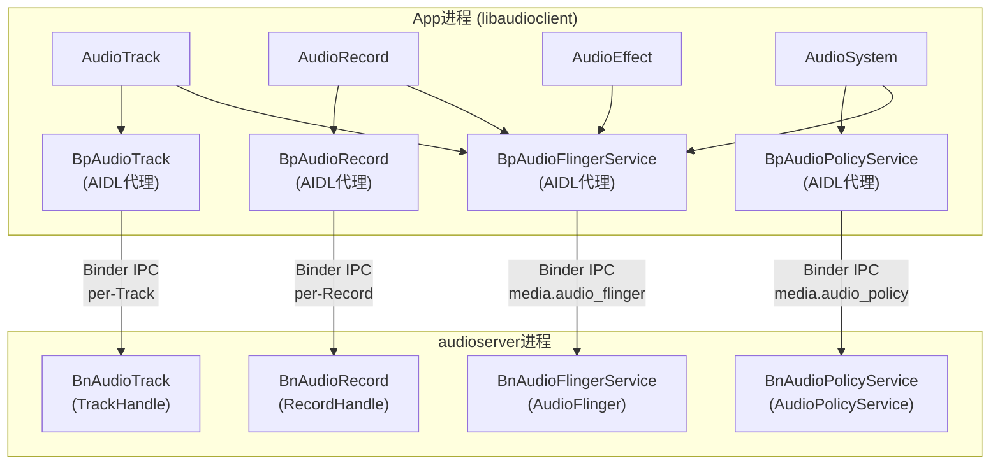
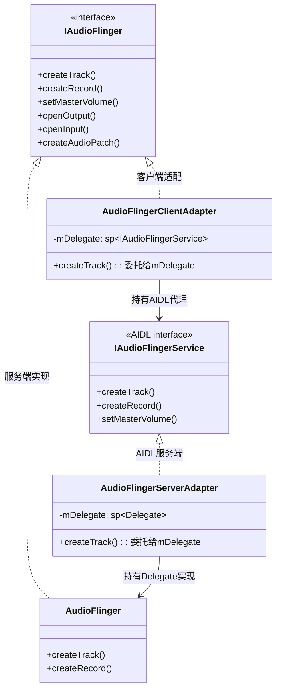
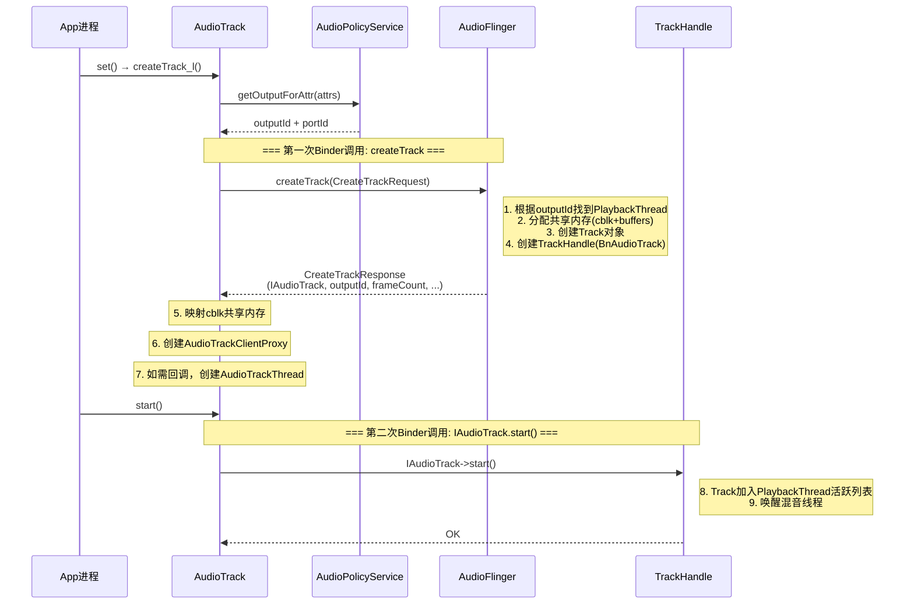
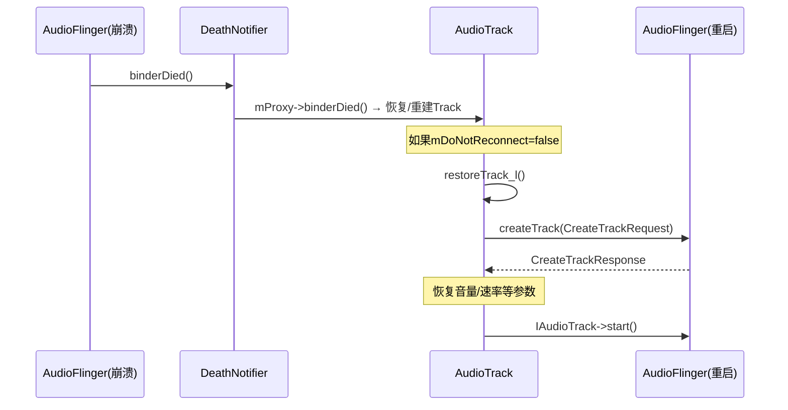
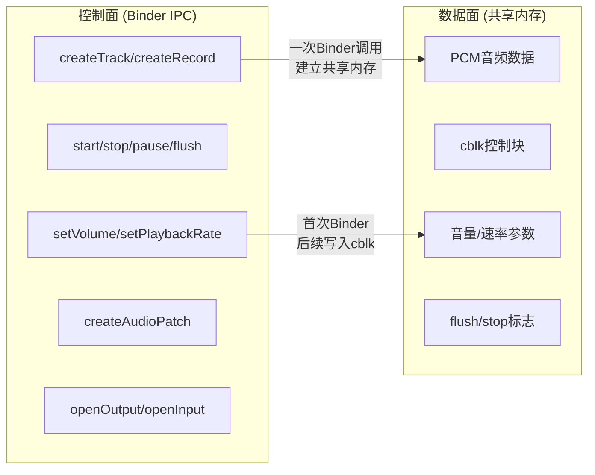

[← 4.2 libaudioclient](04_4.2_libaudioclient-Native音频客户端库.md) | [← 返回Native Framework Layer](README.md) | [返回导航](../README.md) | [4.4 共享内存 →](04_4.4_共享内存机制深度解析.md)

## 4.3 Binder IPC机制 — 音频进程间通信

### 概述

Android音频系统的Binder IPC连接了App进程中的libaudioclient与audioserver进程中的AudioFlinger。控制命令（创建Track、start/stop、音量设置等）通过Binder传输，而音频数据本身通过共享内存传递，实现了控制面与数据面的分离。

**关键设计原则：**
- 控制命令走Binder IPC（低频、小数据量）
- 音频数据走共享内存（高频、大数据量）
- App进程与audioserver进程完全隔离

---

### 4.3.1 Binder接口体系架构



**服务名映射：**

| 服务名 | 接口 | 进程 | 用途 |
|--------|------|------|------|
| `media.audio_flinger` | IAudioFlingerService | audioserver | 音频混音/路由核心服务 |
| `media.audio_policy` | IAudioPolicyService | audioserver | 音频策略/路由决策服务 |

---

### 4.3.2 IAudioFlinger接口深度解析

[`IAudioFlinger`](frameworks/av/media/libaudioclient/include/media/IAudioFlinger.h:69) 是音频系统最核心的Binder接口。**本树（12L）已迁移至AIDL**（`aidl/android/media/IAudioFlingerService.aidl`，219行），并通过双适配器模式在 `IAudioFlinger.h` 内兼容旧 C++ 接口——这不是 AOSP14 现象，而是本树现行机制。

#### AIDL迁移与适配器模式

**本树12L已有**双层适配器架构（AudioFlingerClientAdapter :359 / AudioFlingerServerAdapter :458 / Delegate::TransactionCode :469 / onTransactWrapper :541）：



- [`AudioFlingerClientAdapter`](frameworks/av/media/libaudioclient/include/media/IAudioFlinger.h:359)：客户端适配器，将旧`IAudioFlinger`调用转换为`IAudioFlingerService` AIDL调用
- [`AudioFlingerServerAdapter`](frameworks/av/media/libaudioclient/include/media/IAudioFlinger.h:458)：服务端适配器，将AIDL请求分发给`AudioFlinger`实现

#### CreateTrackInput/Output 数据结构

[`CreateTrackInput`](frameworks/av/media/libaudioclient/include/media/IAudioFlinger.h:77) 和 [`CreateTrackOutput`](frameworks/av/media/libaudioclient/include/media/IAudioFlinger.h:101) 是`createTrack()`的请求/响应结构：

**CreateTrackInput（App → AudioFlinger）：**

| 字段 | 类型 | 方向 | 说明 |
|------|------|------|------|
| `attr` | `audio_attributes_t` | 输入 | 音频属性（用法/内容类型/标志） |
| `config` | `audio_config_t` | 输入 | 音频配置（采样率/格式/声道） |
| `clientInfo` | `AudioClient` | 输入 | 客户端信息（UID/PID/包名） |
| `sharedBuffer` | `sp<IMemory>` | 输入 | 静态模式共享数据 |
| `speed` | `float` | 输入 | 初始播放速度 |
| `audioTrackCallback` | `sp<IAudioTrackCallback>` | 输入 | 事件回调接口 |
| `flags` | `audio_output_flags_t` | 输入/输出 | 输出标志（可能被AF修改） |
| `frameCount` | `size_t` | 输入/输出 | 请求/实际帧数 |
| `notificationFrameCount` | `size_t` | 输入/输出 | 通知帧数 |
| `selectedDeviceId` | `audio_port_handle_t` | 输入/输出 | 选择的设备 |
| `sessionId` | `audio_session_t` | 输入/输出 | 会话ID |

**CreateTrackOutput（AudioFlinger → App）：**

| 字段 | 类型 | 方向 | 说明 |
|------|------|------|------|
| `flags` | `audio_output_flags_t` | 输入/输出 | 实际输出标志 |
| `frameCount` | `size_t` | 输入/输出 | 实际分配帧数 |
| `notificationFrameCount` | `size_t` | 输入/输出 | 实际通知帧数 |
| `selectedDeviceId` | `audio_port_handle_t` | 输入/输出 | 实际路由设备 |
| `sessionId` | `audio_session_t` | 输入/输出 | 实际会话ID |
| `sampleRate` | `uint32_t` | 输出 | 实际采样率 |
| `streamType` | `audio_stream_type_t` | 输出 | 解析后的流类型 |
| `afFrameCount` | `size_t` | 输出 | AF缓冲区帧数 |
| `afSampleRate` | `uint32_t` | 输出 | AF采样率 |
| `afLatencyMs` | `uint32_t` | 输出 | AF延迟(ms) |
| `outputId` | `audio_io_handle_t` | 输出 | 输出流句柄 |
| `portId` | `audio_port_handle_t` | 输出 | 音频端口ID |
| `audioTrack` | `sp<IAudioTrack>` | 输出 | Track的Binder代理 |

#### CreateRecordInput/Output 数据结构

[`CreateRecordInput`](frameworks/av/media/libaudioclient/include/media/IAudioFlinger.h:120) 和 [`CreateRecordOutput`](frameworks/av/media/libaudioclient/include/media/IAudioFlinger.h:153) 是`createRecord()`的请求/响应结构：

**CreateRecordOutput独有字段：**

| 字段 | 类型 | 说明 |
|------|------|------|
| `cblk` | `sp<IMemory>` | 共享控制块内存 |
| `buffers` | `sp<IMemory>` | 共享数据缓冲区内存 |
| `audioRecord` | `sp<media::IAudioRecord>` | Record的Binder代理 |

> **负结论**：`afChannelMask`/`afFormat`（CreateTrackOutput）与 `serverConfig`/`halConfig`（CreateRecordOutput）均不在本树 IAudioFlinger.h:99-178 的真实字段集；CreateTrackInput 含 `notificationsPerBuffer`（:83）。

> 注意：`createTrack()`返回的cblk/buffers通过`IAudioTrack`接口单独获取，而`createRecord()`直接在CreateRecordOutput中返回。

---

### 4.3.3 IAudioFlinger核心方法分类

#### Track/Record管理

| 方法 | 签名 | 说明 |
|------|------|------|
| [`createTrack()`](frameworks/av/media/libaudioclient/include/media/IAudioFlinger.h:179) | `CreateTrackRequest → CreateTrackResponse` | 创建播放Track |
| [`createRecord()`](frameworks/av/media/libaudioclient/include/media/IAudioFlinger.h:186) | `CreateRecordRequest → CreateRecordResponse` | 创建录音Record |

#### 输出/输入流管理

| 方法 | 说明 |
|------|------|
| [`openOutput()`](frameworks/av/media/libaudioclient/include/media/IAudioFlinger.h:250) | 打开HAL输出流，创建PlaybackThread |
| [`openInput()`](frameworks/av/media/libaudioclient/include/media/IAudioFlinger.h:258) | 打开HAL输入流，创建RecordThread |
| [`closeOutput()`](frameworks/av/media/libaudioclient/include/media/IAudioFlinger.h:254) | 关闭输出流 |
| [`closeInput()`](frameworks/av/media/libaudioclient/include/media/IAudioFlinger.h:261) | 关闭输入流 |
| [`openDuplicateOutput()`](frameworks/av/media/libaudioclient/include/media/IAudioFlinger.h:252) | 创建重复输出（同一数据写两路） |
| [`suspendOutput()`](frameworks/av/media/libaudioclient/include/media/IAudioFlinger.h:255) | 挂起输出 |
| [`restoreOutput()`](frameworks/av/media/libaudioclient/include/media/IAudioFlinger.h:256) | 恢复输出 |

#### 音量控制

| 方法 | 说明 |
|------|------|
| [`setMasterVolume()`](frameworks/av/media/libaudioclient/include/media/IAudioFlinger.h:207) | 主音量 |
| [`setMasterMute()`](frameworks/av/media/libaudioclient/include/media/IAudioFlinger.h:208) | 主静音 |
| [`setStreamVolume()`](frameworks/av/media/libaudioclient/include/media/IAudioFlinger.h:219) | 按流类型音量 |
| [`setStreamMute()`](frameworks/av/media/libaudioclient/include/media/IAudioFlinger.h:221) | 按流类型静音 |
| [`setVoiceVolume()`](frameworks/av/media/libaudioclient/include/media/IAudioFlinger.h:268) | 通话音量 |
| [`setMasterBalance()`](frameworks/av/media/libaudioclient/include/media/IAudioFlinger.h:213) | 左右声道平衡 |
| [`setMicMute()`](frameworks/av/media/libaudioclient/include/media/IAudioFlinger.h:231) | 麦克风静音 |
| [`setRecordSilenced()`](frameworks/av/media/libaudioclient/include/media/IAudioFlinger.h:233) | 静音指定录音端口 |

#### 音频路由Patch

| 方法 | 说明 |
|------|------|
| [`createAudioPatch()`](frameworks/av/media/libaudioclient/include/media/IAudioFlinger.h:314) | 创建音频路由(source→sink) |
| [`releaseAudioPatch()`](frameworks/av/media/libaudioclient/include/media/IAudioFlinger.h:317) | 释放音频路由 |
| [`listAudioPatches()`](frameworks/av/media/libaudioclient/include/media/IAudioFlinger.h:319) | 列出所有Patch |
| [`getAudioPort()`](frameworks/av/media/libaudioclient/include/media/IAudioFlinger.h:311) | 获取音频端口属性 |
| [`setAudioPortConfig()`](frameworks/av/media/libaudioclient/include/media/IAudioFlinger.h:321) | 设置端口配置 |

#### 设备与参数

| 方法 | 说明 |
|------|------|
| [`setParameters()`](frameworks/av/media/libaudioclient/include/media/IAudioFlinger.h:235) | 设置键值对参数到HAL |
| [`getParameters()`](frameworks/av/media/libaudioclient/include/media/IAudioFlinger.h:237) | 从HAL获取参数 |
| [`setMode()`](frameworks/av/media/libaudioclient/include/media/IAudioFlinger.h:228) | 设置音频模式(NORMAL/RING/IN_CALL) |
| [`invalidateStream()`](frameworks/av/media/libaudioclient/include/media/IAudioFlinger.h) | 使某一流类型的Track失效重建 |

> **负结论（版本边界）**：`setDeviceConnectedState()`/`invalidateTracks()` **不在本树 IAudioFlinger.h**（设备连接状态在 AudioPolicyService：`IAudioPolicyService.aidl:65 setDeviceConnectionState`；使失效只有按流类型的 `invalidateStream(AudioStreamType)`，见 IAudioFlingerService.aidl:131）。

#### AAudio/低延迟相关 — 不在本树

> **负结论（版本边界）**：`getMmapPolicyInfos()`/`getAAudioMixerBurstCount()`/`getAAudioHardwareBurstMinUsec()`/`setRequestedLatencyMode()`/`getSupportedLatencyModes()` 均不在本树 IAudioFlinger.h 与 IAudioFlingerService.aidl（grep 无匹配）——为 13+/14+ AIDL 演进接口。MMAP 策略在本树经 `AudioSystem`/AAudio 属性（`aaudio.mmap_policy` 等）获取。

#### Sound Dose — 不在本树（兼容入口）

> **负结论（版本边界）**：`getSoundDoseInterface()` 不在本树 IAudioFlinger.h 与 IAudioFlingerService.aidl（grep 无匹配）——软件 SoundDose/CSD 为 13+/14+ 机制，本树 HAL 亦无相应接口。

---

### 4.3.4 IAudioTrack接口

[`IAudioTrack`](frameworks/av/media/libaudioclient/aidl/android/media/IAudioTrack.aidl) 是每个播放Track的独立Binder接口（**本树12L已是AIDL**，无 `libaudioclient/include/media/IAudioTrack.h`），由`createTrack()`返回。

**核心方法（18个，IAudioTrack.aidl 全集）：**

| 方法 | 说明 | 调用频率 |
|------|------|---------|
| `getCblk()` | 取控制块共享内存(SharedFileRegion) | 每Track一次 |
| `start()` / `stop()` | 开始/停止播放 | 低频(状态切换) |
| `pause()` / `flush()` | 暂停/清空缓冲区 | 低频 |
| `getTimestamp()` | 获取播放时间戳 | 中频 |
| `signal()` | 唤醒服务端(如offload) | 低频 |
| `attachAuxEffect(int)` | 附加辅助效果 | 极低频 |
| `setParameters(String)` / `selectPresentation(int, int)` | 参数/呈现方式 | 极低频 |
| `applyVolumeShaper()` / `getVolumeShaperState()` | VolumeShaper | 低频 |
| `getDualMonoMode()` / `setDualMonoMode()` | 双单声道模式 | 极低频 |
| `getAudioDescriptionMixLevel()` / `setAudioDescriptionMixLevel()` | 音频描述混音电平 | 极低频 |
| `getPlaybackRateParameters()` / `setPlaybackRateParameters()` | 播放速率(AudioPlaybackRate) | 低频 |

> **负结论**：`setVolume(float,float)`/`setBufferSizeInFrames(size_t)` **不在**本树 IAudioTrack.aidl（音量经 `cblk.mVolumeLR` 共享内存传递——见 4.3.10；缓冲区大小在客户端经 cblk/Proxy 协商）。

> **设计要点**：start/stop/pause/flush通过Binder IPC触发AudioFlinger端状态变化，而数据传输（write到共享内存）完全不经过Binder。这是零拷贝设计的关键。

---

### 4.3.5 IAudioRecord接口

[`IAudioRecord`](frameworks/av/media/libaudioclient/aidl/android/media/IAudioRecord.aidl) 是每个录音Record的独立Binder接口（**本树12L已是AIDL**，无 `libaudioclient/include/media/IAudioRecord.h`）。

**核心方法（IAudioRecord.aidl 全集，6个）：**

| 方法 | 说明 | 特色 |
|------|------|------|
| `start(int event, int triggerSession)` | 开始录音 | 支持同步事件触发(sync_event_t) |
| `stop()` | 停止录音 | — |
| `getActiveMicrophones(MicrophoneInfoData)` | 活跃麦克风列表 | — |
| `setPreferredMicrophoneDirection(int)` | 麦克风方向 | — |
| `setPreferredMicrophoneFieldDimension(float)` | 麦克风场维度 | — |
| `shareAudioHistory(String, long)` | 共享音频历史 | 12L已有 |

> **负结论**：`getTimestamp`/`setAudioSource`/`setGain` 不在本树 IAudioRecord.aidl（时间戳经 cblk/Proxy 读取；录音源变更需重建Record）。方法实名是 `setPreferredMicrophoneDirection`（非 setPreferredMicDirection）。

**同步事件触发**：`start()`支持`SYNC_EVENT_START`，例如在某个session开始播放时同步启动录音（用于卡拉OK/实时反馈场景）。

---

### 4.3.6 createTrack完整Binder交互时序



**createTrack()的Binder调用开销：**
- 一次Binder事务传输CreateTrackRequest
- 服务端分配共享内存，返回IAudioTrack Binder对象+共享内存fd
- 通过`mmap()`映射共享内存到App进程
- 后续数据传输不再经过Binder

---

### 4.3.7 IAudioFlingerClient回调注册

[`registerClient()`](frameworks/av/media/libaudioclient/include/media/IAudioFlinger.h:243) 注册一个`IAudioFlingerClient`回调接口，用于接收audioserver主动推送的通知：

```cpp
virtual void registerClient(const sp<media::IAudioFlingerClient>& client) = 0;
```

**IAudioFlingerClient回调方法：**

| 方法 | 说明 |
|------|------|
| `ioConfigChanged()` | 输出/输入流配置变化通知（本树唯一方法） |

> `latencyChanged()` 不在本树 IAudioFlingerClient.aidl（14+ 演进）。

每个App进程只注册一次（AudioFlinger忽略同一PID的重复注册），由[`AudioSystem`](frameworks/av/media/libaudioclient/include/media/AudioSystem.h)在首次使用时自动注册。

**ioConfigChanged事件类型：**

| 事件（audio_io_config_event，AudioIoDescriptor.h:22-31） | 说明 |
|------|------|
| `AUDIO_OUTPUT_REGISTERED` | 输出流注册 |
| `AUDIO_OUTPUT_OPENED` | 输出流打开 |
| `AUDIO_OUTPUT_CLOSED` | 输出流关闭 |
| `AUDIO_OUTPUT_CONFIG_CHANGED` | 输出流配置变化 |
| `AUDIO_INPUT_REGISTERED` | 输入流注册 |
| `AUDIO_INPUT_OPENED` | 输入流打开 |
| `AUDIO_INPUT_CLOSED` | 输入流关闭 |
| `AUDIO_INPUT_CONFIG_CHANGED` | 输入流配置变化 |
| `AUDIO_CLIENT_STARTED` | 客户端Track启动 |

> **负结论**：`STREAM_CONFIG_CHANGED`/`CLIENTS_CHANGED` 不在本树枚举（grep 无匹配）。

---

### 4.3.8 Binder死亡通知与Track重建

当audioserver进程崩溃时，App进程中的Binder代理会收到死亡通知。AudioTrack通过`DeathNotifier`内部类处理此场景：



**两种处理策略：**
1. **自动重建**（`mDoNotReconnect=false`）：`restoreTrack_l()`自动重连
2. **通知应用**（`mDoNotReconnect=true`）：回调`EVENT_NEW_IAUDIOTRACK`，让应用自行处理

---

### 4.3.9 IAudioFlingerService AIDL接口

AOSP14将`IAudioFlinger`从手写Binder迁移到AIDL定义：

- AIDL定义：`android/media/IAudioFlingerService.aidl`
- 客户端代理：`BpAudioFlingerService`（AIDL自动生成）
- 服务端桩：`BnAudioFlingerService`（AIDL自动生成）
- 适配器：[`AudioFlingerClientAdapter`](frameworks/av/media/libaudioclient/include/media/IAudioFlinger.h:359) 和 [`AudioFlingerServerAdapter`](frameworks/av/media/libaudioclient/include/media/IAudioFlinger.h:458)

**AIDL迁移优势：**
1. 自动生成序列化/反序列化代码
2. 类型安全的参数传递
3. 支持nullable/@utf8InCpp等注解
4. 更好的版本兼容性

**TransactionCode枚举**：[`Delegate::TransactionCode`](frameworks/av/media/libaudioclient/include/media/IAudioFlinger.h:469) 将每个AIDL方法映射到事务码，用于`onTransactWrapper()`钩子（日志/权限检查）：

```cpp
enum class TransactionCode {
    CREATE_TRACK = BnAudioFlingerService::TRANSACTION_createTrack,
    CREATE_RECORD = BnAudioFlingerService::TRANSACTION_createRecord,
    SET_MASTER_VOLUME = BnAudioFlingerService::TRANSACTION_setMasterVolume,
    // ... 50+ 事务码
};
```

---

### 4.3.10 Binder线程模型

#### audioserver端Binder线程池

audioserver进程的Binder线程池按Binder驱动默认策略管理（本树 audioserver 源码无 `setThreadPoolMaxThreadCount()` 调用，grep 无匹配；"默认16"无源码依据，实际线程数由驱动按并发负载动态决定）。

#### 关键Binder调用频率（经验参考，非源码结论）

| 方法 | 典型频率 | 耗时 | 说明 |
|------|---------|------|------|
| `createTrack()` | 每个Track创建一次 | 经验~5ms量级 | 含共享内存分配 |
| `start()/stop()` | 播放状态切换 | 亚毫秒量级 | 简单状态变更 |
| `setVolume()` | 音量变化时 | 0（不走Binder） | 写入cblk.mVolumeLR |
| `getTimestamp()` | 按需/周期 | 亚毫秒量级 | 读取服务端位置 |
| `createAudioPatch()` | 路由变化时 | 毫秒~十毫秒量级 | 涉及HAL配置 |
| `openOutput()` | 设备热插拔 | 十毫秒~百毫秒量级 | HAL流打开 |

> 注：上表耗时列为**经验数量级参考**（无本树源码/实测依据），精确值取决于HAL与负载；频率列为典型使用模式。

#### Binder调用优化

1. **音量通过共享内存传递**：`setVolume()`实际写入`cblk.mVolumeLR`，而非每次Binder调用
2. **播放速率通过队列传递**：`setPlaybackRate()`写入`cblk.mPlaybackRateQueue`
3. **flush/stop通过原子变量**：通过`mFlush`/`mStop`计数器传递给服务端

---

### 4.3.11 IAudioPolicyService Binder接口

[`IAudioPolicyService`](frameworks/av/media/libaudioclient/aidl/android/media/IAudioPolicyService.aidl) 是音频策略决策服务（**本树12L已是AIDL**，无 `include/media/IAudioPolicyService.h`），与AudioFlinger分离：

**核心方法：**

| 方法 | 说明 |
|------|------|
| `getOutputForAttr()` | 根据音频属性获取输出路由 |
| `getInputForAttr()` | 根据音频属性获取输入路由 |
| `setDeviceConnectionState()` | 设备连接状态变更 |
| `setPhoneState()` | 设置通话模式 |
| `setForceUse()/getForceUse()` | 强制使用配置 |
| `setVolumeIndexForAttributes()` | 按属性设置音量 |
| `createAudioPatch()/releaseAudioPatch()` | 策略层路由Patch |
| `registerClient()` | 注册IAudioPolicyServiceClient |

> **负结论**：`getAudioPolicyConfig()` 不在本树 IAudioPolicyService.aidl（grep 无匹配）。

**与IAudioFlinger的分工：**
- `IAudioPolicyService`：决定"怎么路由"（策略决策）
- `IAudioFlinger`：执行"怎么混音"（策略执行）

---

### 4.3.12 Binder IPC数据流总结



**零拷贝数据路径：**
1. App通过`obtainBuffer()`获取共享内存中的可写区域
2. App直接`memcpy()`写入PCM数据
3. App通过`releaseBuffer()`更新`mFront`指针
4. AudioFlinger混音线程直接从共享内存读取数据
5. 整个数据传输路径无Binder调用、无额外拷贝

---

[← 4.2 libaudioclient](04_4.2_libaudioclient-Native音频客户端库.md) | [← 返回Native Framework Layer](README.md) | [返回导航](../README.md) | [4.4 共享内存 →](04_4.4_共享内存机制深度解析.md)