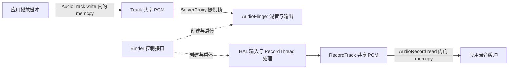
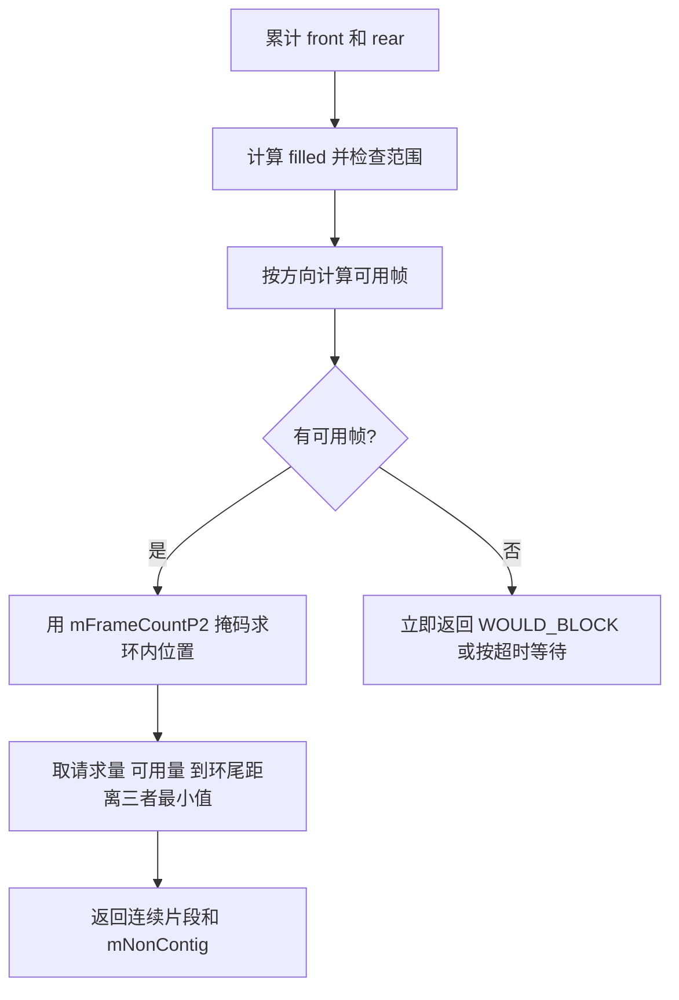
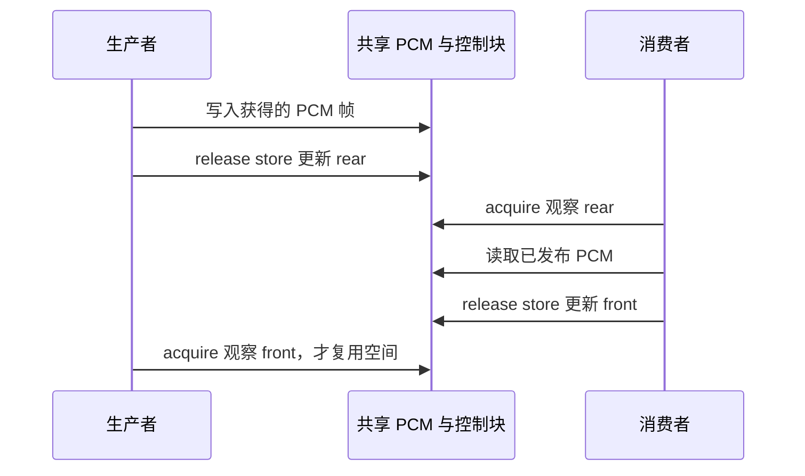

# 4.4 共享内存：AudioTrack / AudioRecord 的生产与消费协议

> 本文依据本地 Android 12L/API 32 产品源码，讨论普通流式 PCM 的客户端与 AudioFlinger 协作。Static AudioTrack、FAST 和 HAL FMQ 只在相关边界处对照，不把它们合并成一种缓冲模型。

## 1. 为什么需要共享内存

创建、启动和停止一个 Track 属于控制操作，可以通过 Binder 接口表达；持续传输的 PCM 则通过双方映射的缓冲区交换。共享内存减少了把每块 PCM 放进 Binder 事务的需要，但**不是端到端零拷贝**。

普通同步接口仍有明确的数据复制：

- `AudioTrack::write()`：应用提供的缓冲区 → Track 共享 PCM 缓冲区。
- `AudioRecord::read()`：RecordTrack 共享 PCM 缓冲区 → 应用提供的缓冲区。
- AudioFlinger 的混音、格式转换、录音分发，以及 HIDL HAL 的 FMQ 读写有各自的缓冲区与处理步骤。

“两个进程映射同一份共享存储”不表示两端虚拟地址相同，也不表示音频一路使用同一份物理缓冲。



图只描述客户端—AudioFlinger 边界。HAL FMQ 是 AudioFlinger—HAL 服务边界的另一套队列，见 [8.1 Audio HAL](../08_HAL_Layer/08_8.1_Audio_HAL双轨架构.md)。

## 2. 四个对象，而不是一个裸指针

| 对象 | 作用 | 不应混淆为 |
|---|---|---|
| `audio_track_cblk_t` | 共享控制块；包含游标、事件、音量/采样率相关字段、时间戳队列等 | PCM 内容本身 |
| PCM buffer | 实际音频帧的存储 | 所有模式都紧跟在 cblk 后的固定布局 |
| ClientProxy | 客户端侧访问控制块与 PCM 的封装 | 跨进程远程对象 |
| ServerProxy | 服务端侧访问封装，向线程提供可消费/可填写的帧 | HAL 的 FMQ writer/reader |

Proxy 自身在普通进程内存中。头文件明确指出：每个控制块对应一对 client/server proxy，**同一侧的 Proxy 不是多线程安全接口**。单生产者/单消费者的共享协议不能替代应用对同一对象的并发使用约束。

### 2.1 cblk 与 PCM 如何分配

`TrackBase` 构造函数位于 `frameworks/av/services/audioflinger/Tracks.cpp`。它先根据帧数和帧大小检查乘法溢出，再按 `alloc` 分支设置存储：

| 分支 | 源码行为 |
|---|---|
| `ALLOC_CBLK`，未传入 buffer | 同次分配控制块与 PCM；PCM 起点为 `mCblk + sizeof(audio_track_cblk_t)` 对应的字节地址 |
| `ALLOC_CBLK`，已有 buffer | 控制块与传入 PCM 存储分别处理 |
| `ALLOC_READONLY` | PCM 从线程的 read-only heap 另行分配 |
| `ALLOC_PIPE` | 引用线程的 pipe memory，`mBuffer` 被置空以防直接误用 |
| `ALLOC_LOCAL` / `ALLOC_NONE` | 本地分配 / 使用外部 buffer，适用于对应内部 Track 模式 |

没有依据把 `sizeof(audio_track_cblk_t)` 固定写成某个字节数；结构体包含 union、队列和原子字段，也不应通过旧文章中的固定偏移访问它。客户端按照服务返回的共享内存对象及协议建立 Proxy。

### 2.2 Streaming 与 Static 不同

控制块的 `u` 联合体包含 `mStreaming` 和 `mStatic`。Streaming 使用 front/rear；Static 使用 `StaticAudioTrackState`、位置/循环状态和 `SingleStateQueue`。因此“Static 只是把 Streaming 的指针不再移动”并不成立。

## 3. front / rear：先明确谁生产

以下讨论正常流式操作；flush、stop 和 overrun 恢复还有专门协议。

| 方向 | 生产者，推进 rear | 消费者，推进 front | 客户端 obtain 的含义 |
|---|---|---|---|
| 播放，`mIsOut=true` | ClientProxy / AudioTrack | ServerProxy / AudioFlinger | 可写的空闲帧 |
| 录音，`mIsOut=false` | ServerProxy / AudioFlinger | ClientProxy / AudioRecord | 可读的已填充帧 |

游标以**帧**累计，不是字节偏移。普通 PCM 的帧大小为一个时间点上所有声道样本的总字节数；不同格式、声道配置不能共用固定的乘数。

`ClientProxy::obtainBuffer()` 中的原文：

```cpp
// write to rear, read from front
ssize_t filled = audio_utils::safe_sub_overflow(rear, front);
```

随后检查 `0 <= filled <= mFrameCount`。播放发现非法差值会进入 shutdown 并返回 `NO_INIT`；录音发现超限则将 front 追上 rear、设置 `CBLK_OVERRUN`。这两个方向的异常处理不一样。

播放可写量还受 `getBufferSizeInFrames()` 的**有效大小**限制，不能总按分配容量减去 filled。用户缩小有效大小后，可写量可能暂时为负，源码会将它钳制到零。

### 3.1 环形寻址不等于游标每圈归零

`Proxy` 保存 `mFrameCountP2 = roundup(frameCount)`。读取缓冲地址时用 `mFrameCountP2 - 1` 做掩码；`TrackBase` 对自己分配的 PCM 也按 roundup 后的容量准备存储。



一次 `obtainBuffer()` 只返回第一段连续空间。跨环尾的数据要通过下一次获取继续处理。不能把 `mFrameCount`、环形地址跨度 `mFrameCountP2`、有效 buffer size、通知阈值视为同一个数。

## 4. release 发布的不只是一个计数

`frameworks/av/media/libaudioclient/AudioTrackShared.cpp`，`ClientProxy::releaseBuffer()` 原文：

```cpp
// Both of these barriers are required
if (mIsOut) {
    int32_t rear = cblk->u.mStreaming.mRear;
    android_atomic_release_store(stepCount + rear, &cblk->u.mStreaming.mRear);
} else {
    int32_t front = cblk->u.mStreaming.mFront;
    android_atomic_release_store(stepCount + front, &cblk->u.mStreaming.mFront);
}
```

- 播放：先填写 PCM，再以 release 语义推进 rear，通知消费方哪些帧已经准备好。
- 录音：先读取 PCM，再推进 front，允许生产方重新使用已消费的空间。
- 对端在获取其依赖的游标时使用 acquire 语义。客户端播放读取 front、客户端录音读取 rear 时均有 `android_atomic_acquire_load`。
- 服务端 `ServerProxy::releaseBuffer()` 对称地发布播放 front 或录音 rear。



这是正常 streaming 协议的概念时序，不代表每一帧都发一次通知或进行一次系统调用。也不能只靠 `volatile` 解释跨核数据可见性：发布与获取的顺序是关键。

## 5. futex：等待状态变化，不搬运 PCM

`ClientProxy::obtainBuffer()` 先检查 flags 和可用帧。无数据或无空间时，根据请求选择不等待、有限等待或持续等待。等待依赖 cblk 中的 `mFutex` 与事件位，避免在用户态不停轮询。

`ServerProxy::releaseBuffer()` 的唤醒逻辑包括：

1. 更新游标和累计帧数。
2. 根据 `mMinimum`、容量的一半等条件计算唤醒阈值；录音当前实现有每次 release 唤醒客户端的分支。
3. 设置 `CBLK_FUTEX_WAKE`；只有之前未设置该事件位时才请求 futex wake。
4. 根据 `mClientInServer` 选择 private 或跨进程 futex 操作。

这解释了为何“每次 write 都无条件唤醒 MixerThread”不是这一函数的实际含义。线程还有自己的调度和工作条件；客户端 `releaseBuffer()` 的上述片段也没有无条件 futex wake。

### 5.1 标志位与恢复层次

| 标志/结果 | Proxy 中的含义 | 上层应如何理解 |
|---|---|---|
| `CBLK_INVALID` → `DEAD_OBJECT` | Track 被失效或检测到服务死亡 | AudioTrack/AudioRecord 上层可能重建；不是 HAL read/write 的错误码直通 |
| `CBLK_DISABLED` → `NOT_ENOUGH_DATA` | 输出因连续 underrun 被禁用 | 与单次暂时没数据不同；需要上层处理重新启动 |
| `CBLK_INTERRUPT` → `-EINTR` | 等待被打断，另有初始 pending interrupt 处理 | 不能假定阻塞 read/write 永不退出 |
| `CBLK_OVERRUN` | 录音消费者落后，数据已被追赶/丢弃 | 后续取得的帧不能补回丢失音频 |
| `WOULD_BLOCK` | 当前无可用帧且不能继续等 | 可能同时伴随先前已传输的部分数据 |

`AudioTrack::write()` / `AudioRecord::read()` 在已有传输量时遇到错误，会优先返回已传输字节数；没有传输量时才返回相应错误，并可将 `TIMED_OUT`、`-EINTR` 转为 `WOULD_BLOCK`。应按返回值推进应用缓冲区，不能一律假定完成整次请求。

## 6. 如何用这个模型定位问题

- **write 阻塞**：先确认应用请求是否按帧对齐、有效 buffer size、消费方是否活跃，再查输出线程和下游写入；不能仅凭阻塞就认定 Binder 慢。
- **录音断续**：区分共享 buffer overrun、RecordThread 上游 read 失败，以及应用读取不及时；它们发生在不同缓冲边界。
- **返回成功但音频不连续**：核对短返回、Track 重建、丢帧/丢数据，以及 HAL 对异常的处理。重建恢复的是可继续工作的对象，不是历史 PCM。
- **计算延迟**：buffer 中帧数除以采样率只说明该缓冲对应的音频时长，不等于端到端延迟；仍有混音、HAL、跨 VM/DSP 和设备时钟边界。

## 7. 源码与后续阅读

源码路径均相对 `Android/lagvm/LINUX/android/`：

- `frameworks/av/include/private/media/AudioTrackShared.h`：控制块、streaming/static 协议与 Proxy 声明。
- `frameworks/av/media/libaudioclient/AudioTrackShared.cpp`：obtain/release、游标、futex、flags。
- `frameworks/av/media/libaudioclient/AudioTrack.cpp`：`createTrack_l`、`write`、`restoreTrack_l`。
- `frameworks/av/media/libaudioclient/AudioRecord.cpp`：`createRecord_l`、`read`、`restoreRecord_l`。
- `frameworks/av/services/audioflinger/Tracks.cpp`：`TrackBase` 分配与服务端 Track 生命周期。

下一步：[5.9 普通 PCM 播放](../05_AudioFlinger/05_5.9_音乐播放全栈调用链.md) → [5.10 普通 PCM 录音](../05_AudioFlinger/05_5.10_录音全栈调用链.md)。
