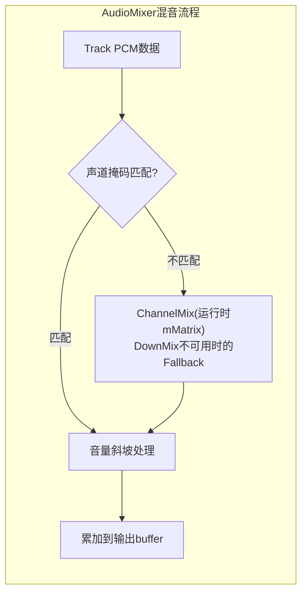
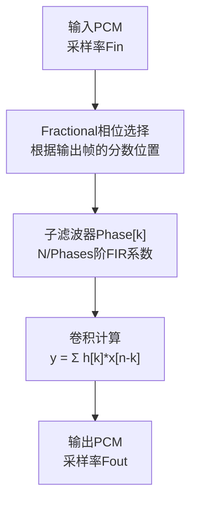
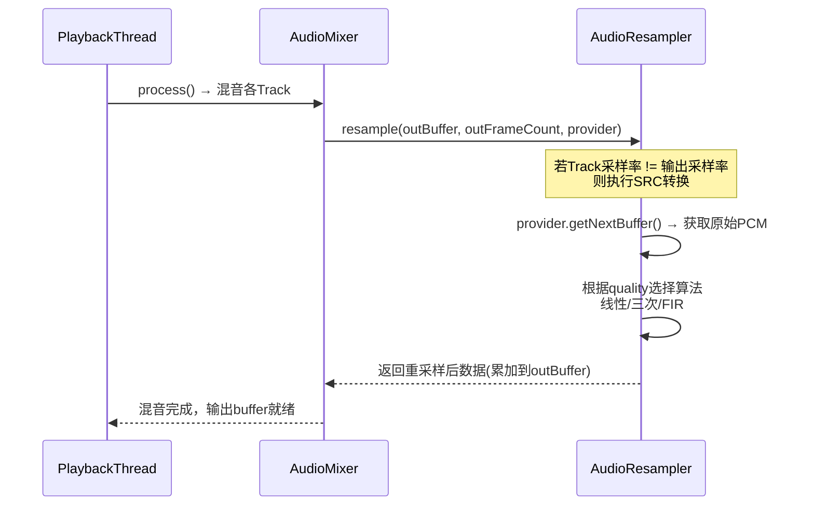
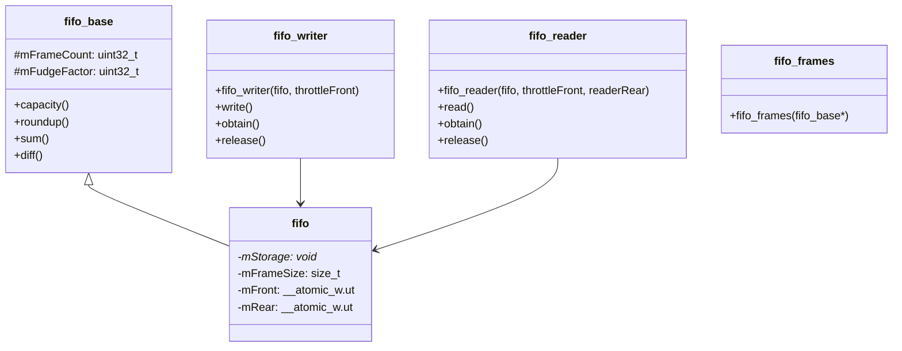
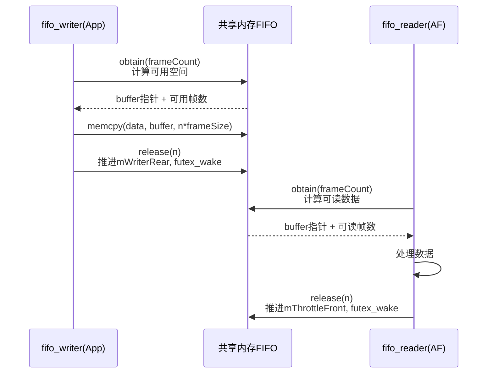
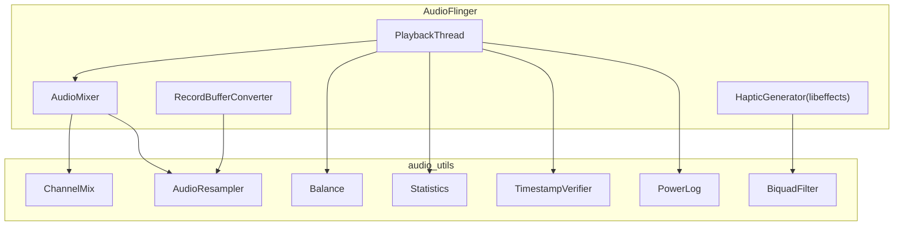
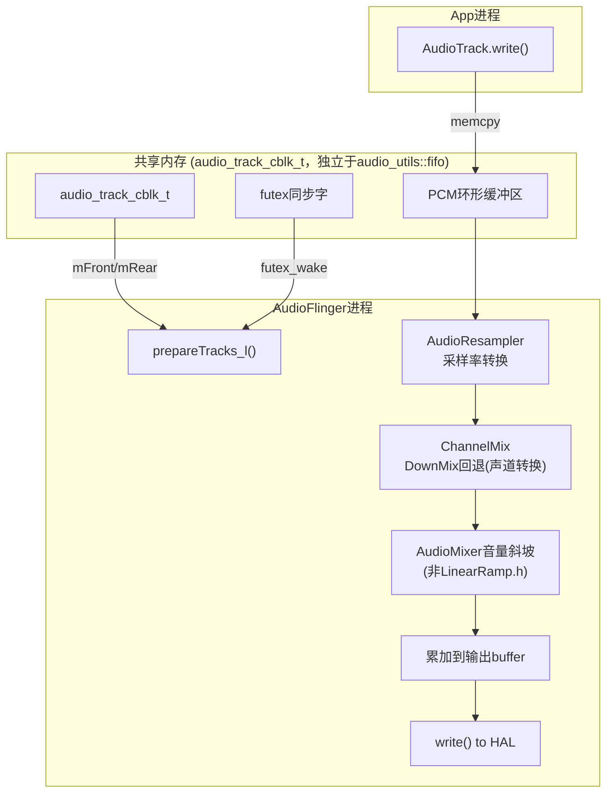

[← 4.5 AIDL重构](04_4.5_AIDL_IPC接口重构-从Binder_C++到AIDL.md) | [← 返回Native Framework Layer](README.md) | [返回导航](../README.md) | [05 AudioFlinger →](../05_AudioFlinger/README.md)

## 4.6 audio_utils核心工具类

### 概述

audio_utils是AOSP音频子系统的底层工具库，提供声道混音、采样率转换、FIFO管理、滤波器等基础能力。它被AudioFlinger、AudioPolicyManager、AudioMixer等核心组件大量使用。

**源码目录：** `system/media/audio_utils/include/audio_utils/`（头文件）与 `system/media/audio_utils/src/`

---

### 4.6.1 ChannelMix — 多声道混音矩阵

源码: [`ChannelMix.h`](system/media/audio_utils/include/audio_utils/ChannelMix.h)

#### 核心机制（12L：运行时矩阵填充）

本树 ChannelMix 是**运行时**机制：构造/`setInputChannelMask()` 后由 switch 逐声道填 `mMatrix`（ChannelMix.h:57-122），`process()` 按 mMatrix 加权混合。**没有**模板化的 `fillChannelMatrix<>()`/`sparseChannelMatrixMultiply`（grep 无匹配，13+ 重构产物）：

```cpp
// ChannelMix.h:119-122（12L 逐字摘录：FRONT_CENTER→双声道示例）
case AUDIO_CHANNEL_OUT_FRONT_CENTER:
case AUDIO_CHANNEL_OUT_TOP_FRONT_CENTER:
case AUDIO_CHANNEL_OUT_BOTTOM_FRONT_CENTER:
    mMatrix[index][0] = mMatrix[index][1] = MINUS_3_DB_IN_FLOAT;
    break;
```

#### 5.1→Stereo下混矩阵（ITU-R 775-2标准）

| 输入声道 | FL输出系数 | FR输出系数 | 说明 |
|----------|-----------|-----------|------|
| Front Left | 1.0 | 0 | 直通 |
| Front Right | 0 | 1.0 | 直通 |
| Front Center | 0.707 (√2/2) | 0.707 | -3dB等功率分配 |
| LFE | 0.5 | 0.5 | 半幅混入(防扬声器过载) |
| Back Left | 0.707 | 0 | -3dB侧声道 |
| Back Right | 0 | 0.707 | -3dB侧声道 |

**-3dB原理：** `√2/2 ≈ 0.707`是等功率分配系数。中心声道同时送入L和R，每路减半功率，总功率保持不变：`0.707² + 0.707² ≈ 1.0`。

#### 7.1→Stereo下混矩阵

| 输入声道 | FL | FR | 说明 |
|----------|-----|-----|------|
| Front Left | 1.0 | 0 | 直通 |
| Front Right | 0 | 1.0 | 直通 |
| Front Center | 0.707 | 0.707 | -3dB |
| LFE | 0.5 | 0.5 | 防过载 |
| Side Left | 0.707 | 0 | -3dB侧声道 |
| Side Right | 0 | 0.707 | -3dB侧声道 |
| Back Left | 0.707 | 0 | -3dB后声道 |
| Back Right | 0 | 0.707 | -3dB后声道 |

**注意：** Side和Back都使用0.707系数，混入对应侧的前方声道。

#### Mono→Stereo上混

| 输入声道 | FL | FR |
|----------|-----|-----|
| Center/Mono | 0.707 (-3dB) | 0.707 (-3dB) |

FRONT_CENTER→立体声复制时**使用 -3dB 系数**（`MINUS_3_DB_IN_FLOAT`，ChannelMix.h:119-122）——Center 混入两个声道存在功率叠加，需补偿；纯 MONO 输入（无Center语义的AUDIO_CHANNEL_OUT_MONO）另循直接复制分支。

#### 混音执行（12L）

`process()` 在运行时按 `mMatrix` 加权累加（非模板展开）；矩阵中的零元素通过逐系数判断自然跳过，无编译期稀疏化。**负结论**：`sparseChannelMatrixMultiply` 不在本树（13+）。

#### 与AudioMixer的调用关系（12L）



---

### 4.6.2 resampler — 采样率转换引擎

AOSP音频子系统有**两套**SRC实现：

| 体系 | API | 源码位置 | 用途 |
|------|-----|---------|------|
| audio_utils/resampler | C API | [`resampler.h`](system/media/audio_utils/include/audio_utils/resampler.h) | 独立C库（libaudioclient外部使用者） |
| AudioResampler | C++ API | [`AudioResampler.h`](frameworks/av/media/libaudioprocessing/include/media/AudioResampler.h) | 播放(AudioMixer)与**录音(RecordBufferConverter)**共用 |

> RecordBufferConverter.cpp:23 include `<media/AudioResampler.h>`、:174 `AudioResampler::create(...)`——**录音路径同样用 C++ AudioResampler**，不用 audio_utils C API。

#### AudioResampler体系 — 4种实现

| 实现类 | 质量 | 算法 | 用途 | 源码 |
|--------|------|------|------|------|
| [`AudioResamplerOrder1`](frameworks/av/media/libaudioprocessing/AudioResampler.cpp) | LOW | 线性插值(1阶) | VoIP/低延迟场景 | AudioResampler.cpp |
| [`AudioResamplerCubic`](frameworks/av/media/libaudioprocessing/AudioResamplerCubic.h) | MED | 三次插值(3阶Hermite) | 一般播放 | AudioResamplerCubic.cpp |
| [`AudioResamplerSinc`](frameworks/av/media/libaudioprocessing/AudioResamplerSinc.h) | HIGH/VERY_HIGH | 多相FIR(Polyphase) | 高质量重采样 | AudioResamplerSinc.cpp |
| [`AudioResamplerDyn`](frameworks/av/media/libaudioprocessing/AudioResamplerDyn.h) | DYN_LOW/MED/HIGH | 动态FIR | 多声道动态SRC | AudioResamplerDyn.cpp |

#### 质量常量

[`resampler.h`](system/media/audio_utils/include/audio_utils/resampler.h) 定义了质量等级：

| 常量（resampler.h:26-30，C API自有体系） | 值 | 说明 |
|------|---|------|
| `RESAMPLER_QUALITY_VOIP` | 3 | VoIP(低延迟优先) |
| `RESAMPLER_QUALITY_DEFAULT` | 4 | 默认(FIR) |
| `RESAMPLER_QUALITY_DESKTOP` | 5 | 桌面级 |
| `RESAMPLER_QUALITY_MAX` | 10 | 最高质量上限 |

> 注意：这组常量属 audio_utils C API 体系；C++ `AudioResampler::src_quality`（LOW/MED/HIGH/VERY_HIGH/DYN_*）是**另一套独立枚举**，两者不可互相对应（上表原"对应实现"列已删）。

#### AudioResamplerSinc — Polyphase FIR架构



**Polyphase分解原理：**
1. 将L阶FIR滤波器分解为`Phases`个短子滤波器
2. 输出帧的fractional位置（0~1之间）决定选择哪个phase
3. 每个子滤波器长度 = L / Phases
4. 内置系数表：常见转换(48K→44.1K)有预计算系数

**Resampler创建流程：**

```cpp
// AudioResampler.cpp:150-151（12L 逐字摘录：真实签名）
AudioResampler* AudioResampler::create(audio_format_t format, int inChannelCount,
        int32_t sampleRate, src_quality quality) {
```

工厂内部：`DEFAULT_QUALITY` 先经 `pthread_once` 读属性确定实际质量（`af.resampler.quality`）；随后按 quality switch 构造 Order1/Cubic/Sinc/Dyn 实例（各实现类接收 format/inChannelCount/sampleRate/quality）。

#### 与PlaybackThread的调用链



---

### 4.6.3 fifo — 共享内存FIFO

源码: [`fifo.h`](system/media/audio_utils/include/audio_utils/fifo.h)

#### audio_utils::fifo与audio_track_cblk_t的关系 — 相互独立

> **负结论**：`audio_utils::fifo` **不是** cblk 的底层抽象——`fifo`/`fifo_base` 在 AudioTrackShared.cpp 与 Tracks.cpp 中 grep 无匹配，两套是独立实现（cblk 用 `android_atomic_release_store` 等内建原子操作 + futex，见 4.4；fifo 用 `audio_utils_fifo_sync` 策略）。fifo 本树实际用户是 nbaio 的 Pipe/MonoPipe（FastMixer 链路）与 libnblog。

| 机制 | Producer(写端) | Consumer(读端) | 索引同步 |
|------|----------------|----------------|----------|
| `audio_track_cblk_t` (播放) | App(AudioTrack) 推进mRear | AF(PlaybackThread) 推进mFront | atomic release/acquire + futex |
| `audio_utils::fifo` (nbaio等) | `fifo_writer` 推进writer索引 | `fifo_reader` 推进reader索引 | 4种sync模式(见下) |

#### FIFO框架类体系



> **成员以真实头文件为准**（fifo.h）：fifo_base 对外是 `capacity()`（返回mFrameCount，:54-55），无 `mThreshold/threshold()/frameCountP2()`；write/read 分别在 fifo_writer（:425起）/fifo_reader（:514起）；无 `mIsObservable/mObserver/mObservable` 成员（grep 无匹配）。

| 类 | 说明 |
|----|------|
| [`audio_utils_fifo_base`](system/media/audio_utils/include/audio_utils/fifo.h) | 索引管理基类，仅操作frame索引，不涉及buffer |
| [`audio_utils_fifo`](system/media/audio_utils/include/audio_utils/fifo.h) | 知晓frameSize和buffer指针，不拥有buffer |
| `audio_utils_fifo_writer` | 写入操作类：obtain()获取空间，release()提交数据 |
| `audio_utils_fifo_reader` | 读取操作类：obtain()获取数据，release()释放空间 |

#### 同步模式

[`audio_utils_fifo_sync`](system/media/audio_utils/include/audio_utils/fifo.h) 枚举定义了四种同步策略：

| 模式（audio_utils_fifo_sync，fifo.h:28-36） | 值 | 说明 | 适用场景 |
|------|---|------|----------|
| `AUDIO_UTILS_FIFO_SYNC_SINGLE_THREADED` | 0 | 无同步，单线程 | 单线程测试 |
| `AUDIO_UTILS_FIFO_SYNC_SLEEP` | 1 | clock_nanosleep轮询 | 单进程阻塞 |
| `AUDIO_UTILS_FIFO_SYNC_PRIVATE` | 2 | futex，单进程 | 同进程多线程 |
| `AUDIO_UTILS_FIFO_SYNC_SHARED` | 3 | futex，跨进程共享内存 | nbaio跨进程场景 |

> cblk 不属于该枚举的使用者（见上文负结论）。

**SHARED模式详解：**
- Producer(App)和Consumer(AF)通过共享内存中的futex word进行跨进程唤醒/等待
- 使用`FUTEX_WAKE`/`FUTEX_WAIT`系统调用
- 与audio_track_cblk_t的mFutex机制完全对应

#### fifo_writer写入流程



---

### 4.6.4 BiquadFilter — IIR滤波器

源码: [`BiquadFilter.h`](system/media/audio_utils/include/audio_utils/BiquadFilter.h)

#### 核心结构

```cpp
template <typename T>
class BiquadFilter {
    static constexpr size_t kNumIndices = 2;  // 二阶IIR需要2个历史样本

    struct Biquad {
        T b0, b1, b2;   // 前馈系数(分子)
        T a1, a2;       // 反馈系数(分母, a0=1归一化)
    };

    Biquad mCoef[kMaxBiquads];     // 级联Biquad系数
    size_t mNumBiquads;             // 级联级数
    T mState[kMaxBiquads][kNumIndices][2]; // 历史状态[x(n-1), x(n-2)]
};
```

**传递函数：**
```
H(z) = (b0 + b1*z^-1 + b2*z^-2) / (1 + a1*z^-1 + a2*z^-2)
```

#### 使用场景

| 场景 | 级联级数 | 滤波器类型 | 用途 |
|------|---------|-----------|------|
| HapticGenerator(libeffects) | 多级 | 峰值滤波器 | 触觉反馈波形处理 |
| AudioEffect Equalizer | 可变 | 峰值/陷波滤波器 | 频段均衡 |
| ToneGenerator | 1级 | 带通 | DTMF音调生成 |

> **负结论（版本边界）**：本树 audio_utils 无软件 SoundDose/MelProcessor（无 MelProcessor.h），"SoundDose A-weighting 3级Biquad"用法不存在——本树 BiquadFilter.h 的实际用户是 `media/libeffects/hapticgenerator/Processors.h:25` 与 NXP LVM 效果库。

#### NEON优化

BiquadFilter针对ARM NEON做了SIMD优化：
- 单指令处理4个float的乘加运算
- 级联Biquad的逐级处理可向量化
- 状态更新使用NEON load/store

---

### 4.6.5 Balance — 左右声道平衡

源码: [`Balance.h`](system/media/audio_utils/include/audio_utils/Balance.h)

#### 核心功能

Balance类实现左右声道平衡控制，被AudioFlinger的`setMasterBalance()`使用：

```cpp
// Balance.h:44-50（12L 逐字摘录：构造器）
explicit Balance(
        bool ramp = true,
        std::function<float(float)> curve = [](float x) { return x * (x + 0.2f); })
    : mRamp(ramp)
    , mCurve(normalize(std::move(curve))) { }
```

真实成员语义：`mRamp` 是 **bool**（是否启用斜坡，Balance.h:183 附近），斜坡起止点由 `mRampVolumes`/`mVolumes` 承担，无 `kMinRamp` 常量与 `mTargetRamp` float 成员（grep 无匹配）。

**斜坡处理：** 避免平衡值突变导致的音频爆音(click/pop)。切换 `setRamp()` 后以下一次 `process()` 的当前 balance/volume 为起点渐变（头文件注释原文）。

**平衡算法：**

| balance值 | 左声道增益 | 右声道增益 |
|-----------|-----------|-----------|
| -1.0 (全左) | 1.0 | 0.0 |
| -0.5 | 1.0 | 0.5 |
| 0.0 (居中) | 1.0 | 1.0 |
| +0.5 | 0.5 | 1.0 |
| +1.0 (全右) | 0.0 | 1.0 |

**设计特点：** 向"大"侧声道保持1.0增益不变，只衰减"小"侧。这避免了两侧同时衰减导致的整体音量下降。

---

### 4.6.6 Statistics — 统计采样

源码: [`Statistics.h`](system/media/audio_utils/include/audio_utils/Statistics.h)

#### 核心功能

Statistics模板类提供运行时统计采样，用于性能监控和异常检测：

```cpp
// Statistics.h 真实方法名（本树getter带get前缀，12L逐字签名）
constexpr int64_t getN() const;        // :307 采样数
constexpr D getMean() const;           // :325 均值
constexpr D2 getVariance() const;      // :329 方差
D2 getStdDev() const;                  // :347 标准差
constexpr T getMin() const;            // :355 最小值
constexpr T getMax() const;            // :359 最大值
```

> 方法名是 `getMean()/getVariance()/getN()`（非 mean()/variance()/n()，grep 无后者）。

#### 音频系统使用场景

| 场景 | 采样对象 | 用途 |
|------|---------|------|
| AudioMixer | 混音处理时间 | 性能异常检测 |
| PlaybackThread | underrun间隔 | 欠载模式分析 |
| AAudio | MMAP时间戳偏差 | 时间戳连续性验证 |

> SoundDose/Mel 行已删：本树 audio_utils 无软件 SoundDose（见 4.6.9 BiquadFilter 负结论）。

**Welford算法：** Statistics使用Welford在线算法计算方差，只需一次遍历且数值稳定，适合实时流式统计。

---

### 4.6.7 TimestampVerifier — 时间戳验证

源码: [`TimestampVerifier.h`](system/media/audio_utils/include/audio_utils/TimestampVerifier.h)

#### 核心功能

TimestampVerifier验证音频时间戳的连续性和合理性，用于AAudio MMAP模式：

```cpp
// TimestampVerifier.h:60（12L 逐字摘录：add是三参数模板方法）
constexpr void add(F frames, T timeNs, uint32_t sampleRate) {
```

真实接口形态：`add(F frames, T timeNs, uint32_t sampleRate)`（sampleRate 用于帧↔时间换算验证）；无 `verify()`/`getStatistics()` 方法（grep 无匹配，统计由内部位移跟踪）。

**验证规则：**
1. 时间戳必须单调递增（帧位置和时间都不能回退）
2. 帧增量与时间增量的比值应在合理范围内（接近采样率）
3. 连续时间戳之间的偏差不应超过阈值

**使用场景：** AAudio MMAP模式中，App直接与HAL共享内存交互，TimestampVerifier确保HAL提供的时间戳有效，防止时间戳异常导致音频故障。

---

### 4.6.8 PowerLog — 功率日志

源码: [`PowerLog.h`](system/media/audio_utils/include/audio_utils/PowerLog.h)

#### 核心功能

PowerLog周期性记录音频功率值，用于SoundDose的CSD(Continuous Sound Dose)监测：

```cpp
// PowerLog.h:54-58,67（12L 逐字摘录：真实签名）
PowerLog(uint32_t sampleRate,
        uint32_t channelCount,
        audio_format_t format,
        size_t entries,
        size_t framesPerEntry);

void log(const void *buffer, size_t frames, int64_t nowNs);
```

真实接口：5参构造（采样率/声道数/格式/条目数/每条目帧数），`log()` 接**原始音频buffer指针**（内部计算功率），导出用 `dumpToString(prefix, lines, limitNs, logPlot)`（非 `dump()`/`log(float power)`，grep 无后者）。

---

### 4.6.9 LogPlot — 功率数据可视化

源码: [`LogPlot.h`](system/media/audio_utils/include/audio_utils/LogPlot.h)

#### 核心功能

LogPlot将功率数据渲染为文本图表，用于dumpsys和日志输出：

```
功率(dB)
  0 |█████████████████████████████
-10 |██████████████████
-20 |████████████
-30 |████████
-40 |████
-50 |██
-60 |█
    +----------------------------→ 时间
```

**使用方式：** dumpsys audio中输出SoundDose功率历史图表。

---

### 4.6.10 其他工具类速查

| 类名 | 头文件 | 说明 | 被谁使用 |
|------|--------|------|----------|
| [`BiquadFilter`](system/media/audio_utils/include/audio_utils/BiquadFilter.h) | BiquadFilter.h | 级联Biquad IIR滤波器(NEON优化) | SoundDose A-weighting |
| [`Balance`](system/media/audio_utils/include/audio_utils/Balance.h) | Balance.h | 左右声道平衡控制(斜坡) | AudioFlinger setMasterBalance() |
| [`Statistics`](system/media/audio_utils/include/audio_utils/Statistics.h) | Statistics.h | 运行时统计采样(Welford) | underrun分析、性能监控 |
| [`TimestampVerifier`](system/media/audio_utils/include/audio_utils/TimestampVerifier.h) | TimestampVerifier.h | 时间戳连续性验证 | AAudio MMAP模式 |
| [`PowerLog`](system/media/audio_utils/include/audio_utils/PowerLog.h) | PowerLog.h | 功率日志(周期性记录) | 音频功率历史/调试 |
| [`LogPlot`](system/media/audio_utils/include/audio_utils/LogPlot.h) | LogPlot.h | 功率数据文本图表 | SoundDose调试输出 |
| [`ChannelMix`](system/media/audio_utils/include/audio_utils/ChannelMix.h) | ChannelMix.h | 多声道混音矩阵(运行时mMatrix) | AudioMixer DownMix回退路径 |
| [`fifo`](system/media/audio_utils/include/audio_utils/fifo.h) | fifo.h | FIFO(4种同步模式) | nbaio Pipe/MonoPipe、libnblog |
| [`resampler`](system/media/audio_utils/include/audio_utils/resampler.h) | resampler.h | 采样率转换(C API) | 独立C库用户 |
| [`LogPlot`](system/media/audio_utils/include/audio_utils/LogPlot.h) | LogPlot.h | 功率数据文本图表 | 调试输出 |

> **负结论**：`LinearRamp.h` 与 `type_traits.h` 均**不在本树** audio_utils（find 无结果）；音量斜坡由 AudioMixer/AudioFlinger 自身 ramp 逻辑实现。

---

### 4.6.11 工具类与AudioFlinger组件的调用关系



---

### 4.6.12 audio_utils与4.4节共享内存的完整数据路径



**完整处理链路：** App写入 → 共享内存(cblk，独立实现) → AF读取 → SRC采样率转换 → DownMix/ChannelMix声道转换 → 音量斜坡(AudioMixer内置) → 混音累加 → HAL输出

---

[← 4.5 AIDL重构](04_4.5_AIDL_IPC接口重构-从Binder_C++到AIDL.md) | [← 返回Native Framework Layer](README.md) | [返回导航](../README.md) | [05 AudioFlinger →](../05_AudioFlinger/README.md)