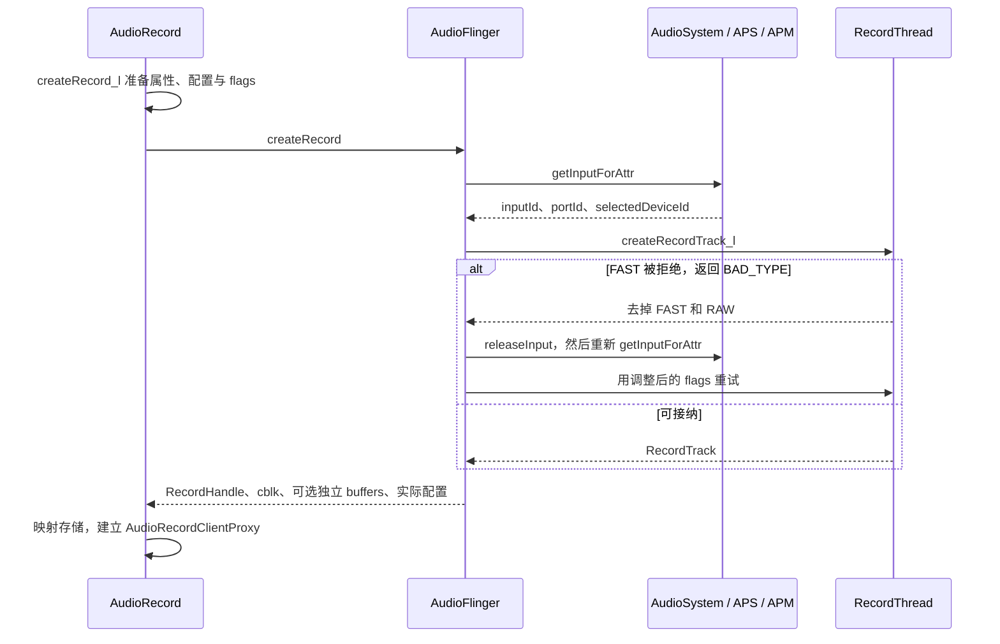
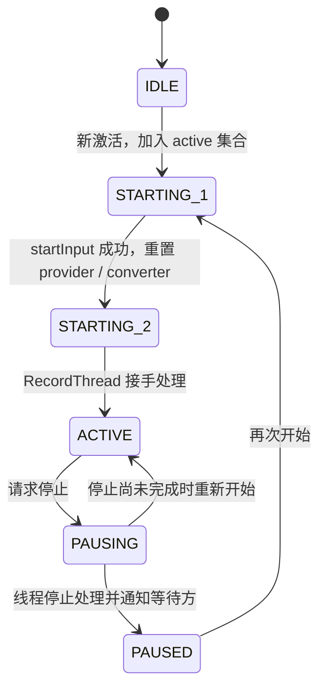
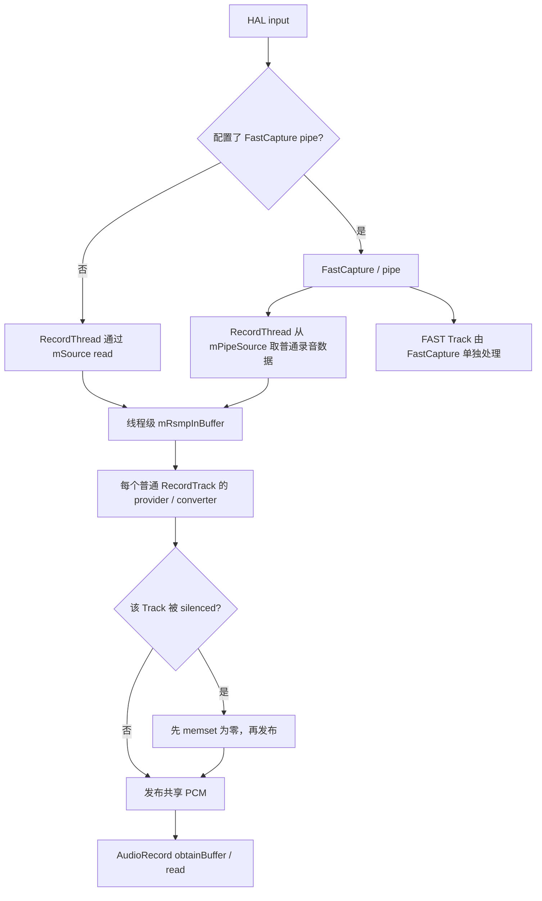
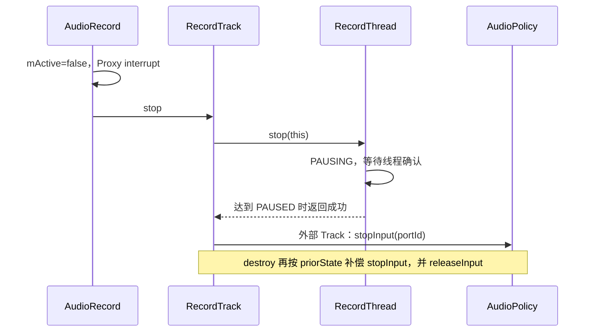

# 5.10 普通 PCM 录音：AudioRecord、RecordTrack 与输入线程

> 原文件名保留，正文集中于本地 Android 12L/API 32 AudioFlinger 视角。普通录音不是播放链的反向复制；权限、输入选择、两阶段启动、分发和静音语义都需要单独理解。

前置：[4.4 共享内存](../04_Native_Framework_Layer/04_4.4_共享内存机制深度解析.md)。本文主线为普通 PCM；FastCapture、MMAP、SoundTrigger 和特殊来源只在分叉处说明，不保证本产品启用了每条通路。

## 1. 一条输入流可以服务多个录音客户端

| 对象 | 主要职责 |
|---|---|
| Native AudioRecord | 配置客户端、取得控制接口和共享内存、读取帧、处理死亡/重建 |
| AudioPolicyService / Manager | 校验来源与身份、选择 input、维护 client port、控制活动状态与路由 |
| RecordThread | 从 HAL 或 FastCapture pipe 取数据，维护线程级缓冲，向活跃 RecordTrack 分发 |
| RecordTrack | 一个录音客户端在服务端的状态、共享缓冲、转换器与源数据读取位置 |
| HAL input stream | AudioFlinger 向下读取的接口，不等于应用的 AudioRecord 对象 |

普通路径中，RecordThread 是共享录音 PCM 的生产方，应用是消费方。但 RecordThread 还有自己的输入缓冲，不能将 HAL read 的目标地址自动等同于每个客户端的共享 buffer。

## 2. 创建：input 选择与 RecordTrack 接纳



图省略身份/格式校验和各错误出口；第二次选择仍可能失败。Track 与 input/HAL stream 不是一一对应，input 可以按策略复用或新开。

### 2.1 两类重试不能混为一谈

**服务端 FAST 重选：** `AudioFlinger::createRecord()` 中先按 flags 选 input。`RecordThread::createRecordTrack_l()` 发现 FAST 请求无法保持时，清除 FAST/RAW 并返回 `BAD_TYPE`；外层释放此前 input 引用，再请求不带 FAST 约束的 input。

**客户端状态不匹配重试：** `AudioRecord::createRecord_l()` 对 `FAILED_TRANSACTION` 有有限次重试。本地注释指向输入打开期间 Policy 与 AudioFlinger 的状态不匹配；例如服务端得到 input handle，却查不到对应 RecordThread。它不是“任何权限或参数错误都重试”。

### 2.2 FAST 录音的接受条件

除了客户端 transfer mode 检查，服务端要求请求帧数不超过 pipe depth、线性 PCM、格式/声道/采样率匹配、存在 FastCapture 且有可用 fast slot，并检查效果兼容性。共享音频历史的请求/线程状态也影响 FAST 分支。

`Threads.cpp` 中拒绝后的原文：

```cpp
// If FAST or RAW flags were corrected, ask caller to request new input from audio policy
if ((*flags & AUDIO_INPUT_FLAG_FAST) !=
        (requestedFlags & AUDIO_INPUT_FLAG_FAST)) {
    *flags = (audio_input_flags_t) (*flags & ~(AUDIO_INPUT_FLAG_FAST | AUDIO_INPUT_FLAG_RAW));
    lStatus = BAD_TYPE;
    goto Exit;
}
```

判断实际比较的是 FAST 位是否改变，不应只照注释扩写为“任意 RAW 改动都会触发同一重试”。应用应观察返回的 flags 和实际帧数，而不是只看创建时的请求。

## 3. start：为什么需要 STARTING_1 与 STARTING_2

客户端 `AudioRecord::start()` 会丢弃客户端共享缓冲中的旧数据、清理时间戳、调整位置 epoch，再调用远程 `start(event, triggerSession)`。遇到 invalid/dead 对象时可以进入恢复路径；失败后清除客户端 active 标志。

服务端 `RecordHandle::start()` 转交给 `RecordTrack::start()`，后者进入所属 `RecordThread::start()`。这些实现都在 `Tracks.cpp` / `Threads.cpp`，不需要假设存在独立的 RecordHandle.cpp。



这是普通有效 Track 的主要状态，不包括所有 invalidation、同步事件和销毁分支。

- `STARTING_1` 表示已经进入启动流程，但不能据此认为 Policy 的 `startInput` 成功。
- 外部 Track 调用 `AudioSystem::startInput(portId)` 时，线程锁被释放；返回后重新检查 invalid 和状态，避免并发销毁或 stop 覆盖结果。
- 成功后进入 `STARTING_2`，广播线程工作条件。销毁路径通过此状态识别已成功启动 Policy 的情形，从而补做 `stopInput`。
- `startInput` 失败会从 active 集合移除，不盲目进行 stopInput。
- 同步事件可使初始帧暂时丢弃；它不是一次函数调用阻塞到某个扬声器真实发声的通用保证。

权限也不是仅在构造时检查。APS 的 `startInput()` 调用录音权限/数据交付检查，并更新 UID 活动状态；取得 RecordHandle 不等于之后必然获准采集真实麦克风数据。

## 4. 线程读入与分发：两个缓冲边界



RecordThread 对普通 Track 的分发循环会跳过 fast track。不能画成所有录音都依次通过普通 converter 再 FastCapture。

### 4.1 无 pipe 分支的 HAL 读取

`RecordThread::threadLoop()` 原文：

```cpp
status_t result = mSource->read(
        (uint8_t*)mRsmpInBuffer + rear * mFrameSize, mBufferSize, &bytesRead);
```

这是读取到**线程级**缓冲。返回的字节数再换算成帧数，并参与位置/时间戳更新。有 pipe 时则读取 NBAIO source，以帧计数处理 overrun 等结果。

无有效数据或读取失败时，线程有输入 standby 与稍后重试的分支。它不会通过“往应用缓冲填固定长度垃圾数据”来证明录音正常。

### 4.2 普通 RecordTrack 的处理

对每个活跃非 FAST Track：

1. `getNextBuffer()` 从 ServerProxy 获取这个客户端共享环中的可写空间。
2. `mResamplerBufferProvider` 同步该 Track 的输入位置，检查是否落后产生 overrun。
3. 非 Direct Track 用 `mRecordBufferConverter->convert()` 完成相应采样率/声道/格式转换；Direct 分支复制线程缓冲，不经过该 converter。
4. 根据同步启动/丢帧状态决定是否发布。
5. 如果 Track 被 silenced，先清零，再 `releaseBuffer()`。

清零与发布的原文：

```cpp
if (activeTrack->isSilenced()) {
    memset(activeTrack->mSink.raw, 0, framesOut * activeTrack->frameSize());
}
activeTrack->releaseBuffer(&activeTrack->mSink);
```

因此“read 有正返回但只有零”可能是上层录音管控，不能直接断言麦克风、HAL 或 DSP 没有数据。这与 AudioReach HAL 自己的错误处理/特殊输入补零又是不同层次。

线程按最快客户端的需求继续读取；落后的客户端可能 overrun，不能要求其他客户端无限等待最慢读者。丢失数据也不会因下一次 read 成功而补回来。

## 5. AudioRecord::read：帧协议，字节返回

`frameworks/av/media/libaudioclient/AudioRecord.cpp` 原文：

```cpp
size_t bytesRead = audioBuffer.size;
memcpy(buffer, audioBuffer.i8, bytesRead);
buffer = ((char *) buffer) + bytesRead;
userSize -= bytesRead;
read += bytesRead;

releaseBuffer(&audioBuffer);
```

这里源地址来自共享缓冲，目标是调用方缓冲。应用 read 不等于一次同步 HAL read；两者由共享环、线程级环和调度解耦。

- 该 `read()` 接口要求 `TRANSFER_SYNC`。
- 每次按剩余字节除以帧大小提出请求，跨环尾可能分多次处理。
- 阻塞/非阻塞改变等待行为，不改变生产者与消费者角色。
- 已读一部分后遇错，优先返回已读字节数；没有已读量时才返回错误。超时/中断可被映射为 `WOULD_BLOCK`。
- 小于一帧的尾部不进入传输循环。上层应使用实际返回量而不是请求量更新数据长度。

## 6. stop、destroy 与恢复

客户端 stop 先清 active，调用 Proxy interrupt 打断等待，然后通知服务端停止。服务端的普通流程如下：



停止并不必然立刻关闭共享 input。APM 的 `releaseInput()` 移除 client 后，仍有其他客户端时保留输入；最后一个 client 离开才进入关闭 input 的路径。

`restoreRecord_l()` 会重新建立录音对象，结合原活动状态恢复工作。它不能找回服务死亡、overrun 或路由切换期间丢失的音频；新的时间戳/epoch 也需要按恢复语义理解，不能拼接成未经验证的连续硬件时间线。

## 7. 和特殊录音路径的边界

| 路径 | 与本文普通模型的区别 |
|---|---|
| FastCapture | 单独的采集线程、pipe 和 fast track 分发；不是普通 converter 的附加步骤 |
| MMAP_NOIRQ | `openInput_l()` 可创建 MmapCaptureThread；不套用普通 RecordTrack 环形复制链 |
| SoundTrigger/HOTWORD | 权限、预建会话、LAB/历史音频与 HAL 特殊输入路径各有条件 |
| Remote submix / playback capture | 音频来源可为虚拟设备，需按 input type 和权限理解，不能一概称为物理麦克风 |
| 通话、回声参考等来源 | 受专门 source/权限/设备约束，不等于普通 MIC 参数换名 |

往下阅读：[8.1 HAL](../08_HAL_Layer/08_8.1_Audio_HAL双轨架构.md) 与 [15.10 HAL-PAL](../15_PAL_Architecture/15_15.10_HAL-PAL适配层架构.md) 的输入章节。HAL input 对象创建、首次 read 时 PAL Open/start、SoundTrigger 分支也要分别分析。

## 8. 定位顺序与源码入口

先确认 **创建结果和实际 input/flags → startInput 是否成功 → Track 是否被 silenced → 线程上游 read → 每个客户端的 overrun/消费速度 → HAL/PAL 路径**。

- `dumpsys media.audio_flinger`：RecordThread、RecordTrack 与输入流状态。
- `dumpsys media.audio_policy`：输入描述符、client、设备/策略状态。
- `dumpsys audio`：Java AudioService 状态；不是原生录音线程的替代输出。

缓冲帧数/采样率给出音频时长；不能据此宣布应用到麦克风的固定端到端延迟。本文没有执行实机采集或展示伪造的测量结果。

源码路径相对 `Android/lagvm/LINUX/android/`：

- `frameworks/av/media/libaudioclient/AudioRecord.cpp`：create/start/read/stop/restore。
- `frameworks/av/services/audioflinger/AudioFlinger.cpp`：`createRecord`、`openInput_l`。
- `frameworks/av/services/audioflinger/Tracks.cpp`：RecordHandle、RecordTrack、provider。
- `frameworks/av/services/audioflinger/Threads.cpp`：`createRecordTrack_l`、`RecordThread::start/stop/threadLoop`。
- `frameworks/av/services/audiopolicy/service/AudioPolicyInterfaceImpl.cpp`：输入获取和启动的权限/客户端状态。
- `frameworks/av/services/audiopolicy/managerdefault/AudioPolicyManager.cpp`：input 选择、启动、停止与释放。

小结：录音必须同时看**是否获准取得真实音频、谁在生产帧、谁在丢帧、谁在读取**；“对象创建成功”和“read 正返回”只是其中两个观察点。
