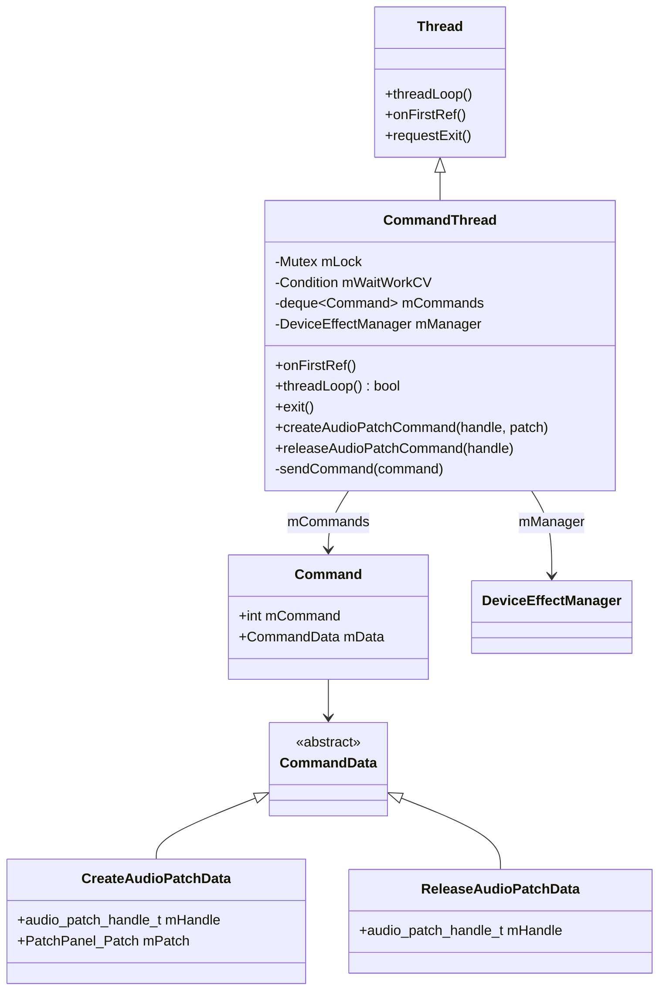
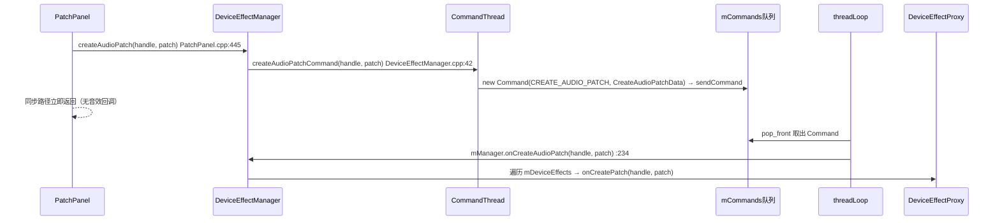
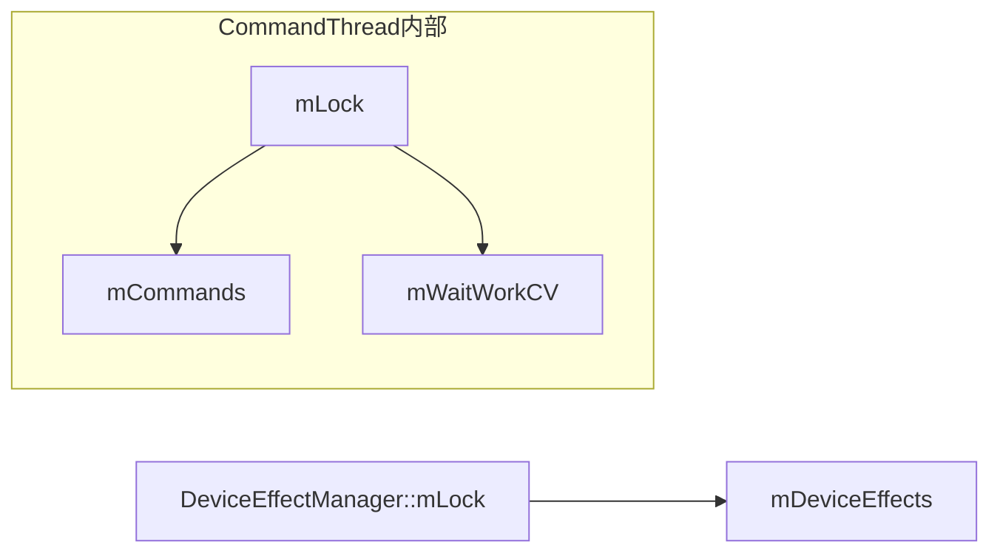
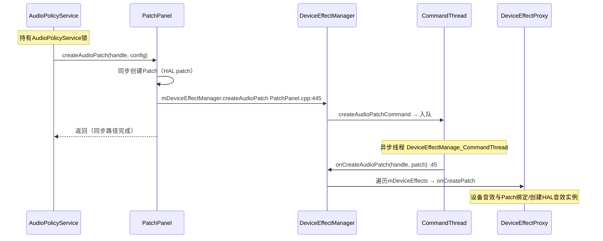

[← 5.14 SoundDoseManager](05_5.14_SoundDoseManager-CSD声剂量管理.md) | [← 返回AudioFlinger](README.md) | [返回导航](../README.md) | [5.16 BufLog →](05_5.16_BufLog-缓冲区调试日志.md)

## 5.15 PatchCommandThread - Patch异步命令线程（12L 实体：DeviceEffectManager::CommandThread）

> **重要勘误（版本边界）**：本产品源码树（Android 12L / API 32）中**不存在独立的 `PatchCommandThread.h/.cpp` 文件，也不存在 `PatchCommandListener` 接口**（grep 零匹配）。12L 中的等价机制是 **`AudioFlinger::DeviceEffectManager` 的内部类 `CommandThread`**（`DeviceEffectManager.h:68`），仅服务于设备级音效（无 MelReporter/多 Listener）。
>
> 独立的 `PatchCommandThread` 类与 `PatchCommandListener` 观察者接口是 **AOSP 13+/14+** 引入的（将命令线程上提为 AudioFlinger 级组件，并支持 MelReporter 等多 Listener）。本文以 **12L 实体为主线**讲解，AOSP 14 形态在末节对照。

## 1. 概述

12L 中处理 AudioPatch 创建/释放命令的异步线程是 `DeviceEffectManager::CommandThread`，其核心目的是**解耦 PatchPanel 的同步操作与需要回调 AudioPolicyService 的设备音效操作**，避免死锁。

源码位置（均在真实文件内）：
- 类声明：[`CommandThread` 声明于 DeviceEffectManager.h:68](frameworks/av/services/audioflinger/DeviceEffectManager.h:68)（`class CommandThread : public Thread`）
- 实现：[`DeviceEffectManager.cpp:215`](frameworks/av/services/audioflinger/DeviceEffectManager.cpp:215)（onFirstRef/threadLoop/sendCommand/exit 等）

设计动机的源码注释（`DeviceEffectManager.h:64-66` 逐字摘录）：

```cpp
// DeviceEffectManager.h:64-66（逐字摘录）
    // Thread to execute create and release patch commands asynchronously. This is needed because
    // PatchPanel::createAudioPatch and releaseAudioPatch are executed from audio policy service
    // with mutex locked and effect management requires to call back into audio policy service
```

## 2. 设计动机：互锁问题

AudioPatch 的创建和释放由 AudioPolicyService 发起（持有其 `mLock`），若设备音效管理在同步路径内直接执行，会反向回调 AudioPolicyService 造成死锁：

```
AudioPolicyService::mLock → PatchPanel::createAudioPatch → 设备音效管理 → 回调AudioPolicyService → 死锁!
```

解决方案（12L 实链）：

```
AudioPolicyService → PatchPanel::createAudioPatch(:445) → DeviceEffectManager::createAudioPatch(:35) 入队 → 立即返回
CommandThread(:220) 异步出队 → onCreateAudioPatch(:45) → 遍历 mDeviceEffects → DeviceEffectProxy::onCreatePatch
```

## 3. 类结构与继承（12L 实体）



> 与 AOSP 14 的差异：12L 无 `mListeners`/`mListenerLock`/`wp<PatchCommandListener>`（单消费者直连 `mManager`），无独立线程名常量文件。

## 4. 命令数据结构（`DeviceEffectManager.h:94-124` 逐字摘录）

```cpp
// DeviceEffectManager.h:94-124（逐字摘录）
        class Command: public RefBase {
        public:
            Command() = default;
            Command(int command, sp<CommandData> data)
                : mCommand(command), mData(data) {}

            int mCommand = -1;
            sp<CommandData> mData;
        };

        class CommandData: public RefBase {
        public:
            virtual ~CommandData() = default;
        };

        class CreateAudioPatchData : public CommandData {
        public:
            CreateAudioPatchData(audio_patch_handle_t handle, const PatchPanel::Patch& patch)
                :   mHandle(handle), mPatch(patch) {}

            audio_patch_handle_t mHandle;
            const PatchPanel::Patch mPatch;
        };

        class ReleaseAudioPatchData : public CommandData {
        public:
            ReleaseAudioPatchData(audio_patch_handle_t handle)
                :   mHandle(handle) {}

            audio_patch_handle_t mHandle;
        };
```

`mCommand` 取值（枚举 `DeviceEffectManager.h:71-74`）：`CREATE_AUDIO_PATCH`（0）/ `RELEASE_AUDIO_PATCH`（1）。

## 5. 命令发送流程（真实调用链）

### 5.1 createAudioPatch

PatchPanel 在同步创建 Patch 后投递命令（[`createAudioPatch` 调用 PatchPanel.cpp:445](frameworks/av/services/audioflinger/PatchPanel.cpp:445) → [`DeviceEffectManager.cpp:35`](frameworks/av/services/audioflinger/DeviceEffectManager.cpp:35)）：



### 5.2 releaseAudioPatch

```cpp
// DeviceEffectManager.cpp:58-60（逐字摘录）
void AudioFlinger::DeviceEffectManager::releaseAudioPatch(audio_patch_handle_t handle) {
    ALOGV("%s", __func__);
    mCommandThread->releaseAudioPatchCommand(handle);
}
```

Patch 侧入口为 [`PatchPanel.cpp:780`](frameworks/av/services/audioflinger/PatchPanel.cpp:780)。

## 6. threadLoop详解（`DeviceEffectManager.cpp:220-255`）

```cpp
// DeviceEffectManager.cpp:220-243（逐字摘录）
bool AudioFlinger::DeviceEffectManager::CommandThread::threadLoop()
{
    mLock.lock();
    while (!exitPending())
    {
        while (!mCommands.empty() && !exitPending()) {
            sp<Command> command = mCommands.front();
            mCommands.pop_front();
            mLock.unlock();

            switch (command->mCommand) {
            case CREATE_AUDIO_PATCH: {
                CreateAudioPatchData *data = (CreateAudioPatchData *)command->mData.get();
                ALOGV("CommandThread() processing create audio patch handle %d", data->mHandle);
                mManager.onCreateAudioPatch(data->mHandle, data->mPatch);
                } break;
            case RELEASE_AUDIO_PATCH: {
                ReleaseAudioPatchData *data = (ReleaseAudioPatchData *)command->mData.get();
                ALOGV("CommandThread() processing release audio patch handle %d", data->mHandle);
                mManager.onReleaseAudioPatch(data->mHandle);
                } break;
            default:
                ALOGW("CommandThread() unknown command %d", command->mCommand);
            }
            mLock.lock();
        }
```

### 6.1 关键设计细节

1. **锁释放处理**：处理命令前 `mLock.unlock()`，回调（onCreateAudioPatch 可能进入 HAL/回调 APS）期间不持队列锁，回环后 `mLock.lock()`
2. **单消费者直连**：直接调用 `mManager.onCreateAudioPatch/onReleaseAudioPatch`，无 Listener 快照/弱引用提升（12L 无 Listener 列表）
3. **条件变量等待**：队列空时 `mWaitWorkCV.wait(mLock)`（Android Mutex/Condition，非 std），入队侧 `signal()` 唤醒

## 7. sendCommand与队列管理

[`sendCommand()`](frameworks/av/services/audioflinger/DeviceEffectManager.cpp:258) 将命令入队并唤醒线程：

```cpp
// DeviceEffectManager.cpp:258-261（逐字摘录）
void AudioFlinger::DeviceEffectManager::CommandThread::sendCommand(sp<Command> command) {
    Mutex::Autolock _l(mLock);
    mCommands.push_back(command);
    mWaitWorkCV.signal();
}
```

`mCommands` 为 `std::deque<sp<Command>>`（`DeviceEffectManager.h:130`），入队用 `push_back`，出队用 `front/pop_front`（FIFO）。

## 8. 线程启动与退出

### 8.1 onFirstRef（`DeviceEffectManager.cpp:215-218` 逐字摘录）

```cpp
// DeviceEffectManager.cpp:215-218（逐字摘录）
void AudioFlinger::DeviceEffectManager::CommandThread::onFirstRef()
{
    run("DeviceEffectManage_CommandThread", ANDROID_PRIORITY_AUDIO);
}
```

线程名 **`DeviceEffectManage_CommandThread`**（源码原文如此，Manage 无 r 结尾），优先级 `ANDROID_PRIORITY_AUDIO`。

### 8.2 exit（`DeviceEffectManager.cpp:280-291` 逐字摘录）

```cpp
// DeviceEffectManager.cpp:280-291（逐字摘录）
void AudioFlinger::DeviceEffectManager::CommandThread::exit()
{
    ALOGV("CommandThread::exit");
    {
        AutoMutex _l(mLock);
        requestExit();
        mWaitWorkCV.signal();
    }
    // Note that we can call it from the thread loop if all other references have been released
    // but it will safely return WOULD_BLOCK in this case
    requestExitAndWait();
}
```

由 `~DeviceEffectManager()`（`DeviceEffectManager.h:29-31`）调用。

## 9. 锁设计



- **CommandThread::mLock**：仅保护命令队列与条件变量
- **DeviceEffectManager::mLock**：`onCreateAudioPatch`/`onReleaseAudioPatch`（:45/:63）内 `Mutex::Autolock _l(mLock)` 后遍历 `mDeviceEffects`

命令处理线程先释放队列锁再进入管理器锁，锁序单向（队列锁 → 管理器锁），无交叉依赖。

## 10. 与其他组件的交互全景



## 11. AOSP 13+/14+ 形态对照（兼容性说明）

| 方面 | 本产品（12L） | AOSP 13+/14+ |
|------|--------------|--------------|
| 命令线程载体 | `DeviceEffectManager::CommandThread`（内部类） | `AudioFlinger::PatchCommandThread`（独立 `PatchCommandThread.h/.cpp`） |
| 消费者 | 单一：DeviceEffectManager 自身 | `PatchCommandListener` 观察者列表（`DeviceEffectManager` + `MelReporter`，弱引用存储） |
| Listener 锁 | 无 | `mListenerLock` + 快照遍历 |
| 命令集合 | CREATE_AUDIO_PATCH / RELEASE_AUDIO_PATCH | 同名命令，线程常驻 AudioFlinger 级 |
| 线程名 | `DeviceEffectManage_CommandThread` | `AudioFlinger_PatchCommandThread` |

## 12. 总结

1. **异步解耦**：将设备音效的 Patch 事件从 PatchPanel 同步路径解耦到异步线程，避免与 AudioPolicyService 互锁（源码注释 `DeviceEffectManager.h:64-66` 明示此动机）
2. **生产者-消费者**：PatchPanel/DeviceEffectManager 生产命令，CommandThread 消费
3. **单消费者直连**（12L）：无 Listener 抽象，直接回调 `mManager.onCreateAudioPatch/onReleaseAudioPatch`
4. **锁序单向**：队列锁与 `mDeviceEffectManager` 内锁无交叉
5. **演进边界**：独立 PatchCommandThread + PatchCommandListener = AOSP 13+/14+（配合 MelReporter 引入），本树无

---

- **本文状态**：已按 12L 源码勘误（原 AOSP 14 形态描述已重写为 12L 实体 + 演进对照）
- 上一节：[5.14 SoundDoseManager](05_5.14_SoundDoseManager-CSD声剂量管理.md)（兼容性条目）
- 下一节：[5.16 BufLog](05_5.16_BufLog-缓冲区调试日志.md)
