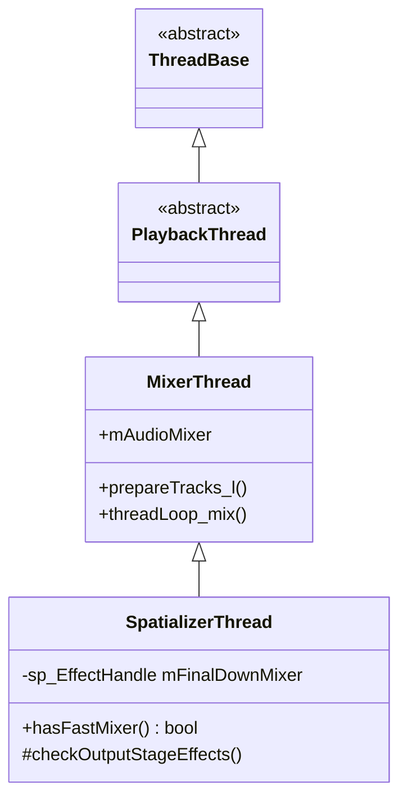
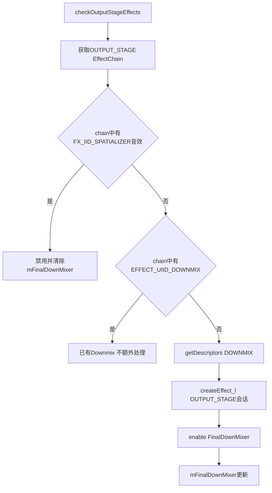
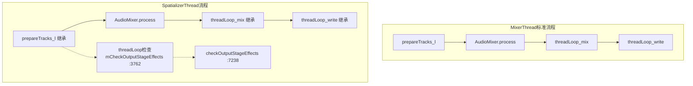
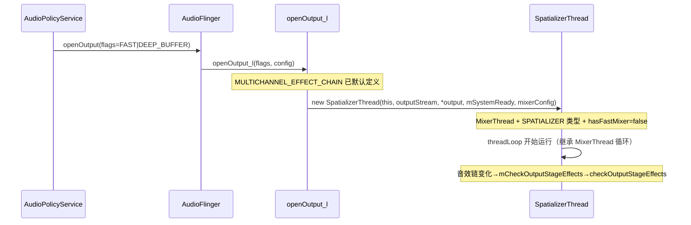

[← 5.16 BufLog](05_5.16_BufLog-缓冲区调试日志.md) | [← 返回AudioFlinger](README.md) | [返回导航](../README.md)

## 5.17 SpatializerThread与BitPerfectThread - 特殊输出线程

> **版本边界**：`SpatializerThread` 在本产品源码树（Android 12L / API 32）中**真实存在**（`Threads.h:1676`）；`BitPerfectThread` 为 **AOSP 14+** 组件，本树**不存在**（`Threads.h/.cpp` grep 零匹配，`AUDIO_OUTPUT_FLAG_BIT_PERFECT` 标志亦未定义）。BitPerfect 部分为兼容性说明。另：12L 的 SpatializerThread **没有**延迟模式控制（`setHalLatencyMode_l`/`setRequestedLatencyMode`/`mRequestedLatencyMode` 均为 13+/14+ API，本树零匹配）。

## 1. 概述

`SpatializerThread` 是继承自 `MixerThread` 的特殊输出线程，为空间音频（Head-tracking Spatializer）提供**多通道混音 + OUTPUT_STAGE 会话音效管理**。其 12L 的定制点只有两个：禁用 FastMixer、自动管理 FinalDownMixer 降混。

源码位置（真实锚点）：
- 类声明：[`SpatializerThread 类 Threads.h:1676`](frameworks/av/services/audioflinger/Threads.h:1676)（SpatializerThread）
- 构造与核心方法：[`SpatializerThread` ctor Threads.cpp:7229](frameworks/av/services/audioflinger/Threads.cpp:7229)（ctor 与 checkOutputStageEffects）

## 2. 线程创建条件（12L 真实分支）

[`openOutput_l()`](frameworks/av/services/audioflinger/AudioFlinger.cpp:2507) 中的真实判断（`AudioFlinger.cpp:2573-2585` 逐字摘录）：

```cpp
// AudioFlinger.cpp:2573-2585（逐字摘录）
            //TODO: b/193496180 use spatializer flag at audio HAL when available
            if (flags == (audio_output_flags_t)(AUDIO_OUTPUT_FLAG_FAST
                                                    | AUDIO_OUTPUT_FLAG_DEEP_BUFFER)) {
#ifdef MULTICHANNEL_EFFECT_CHAIN
                thread = new SpatializerThread(this, outputStream, *output,
                                                    mSystemReady, mixerConfig);
                ALOGD("openOutput_l() created spatializer output: ID %d thread %p",
                      *output, thread.get());
#else
                ALOGE("openOutput_l() cannot create spatializer thread "
                        "without #define MULTICHANNEL_EFFECT_CHAIN");
#endif
            } else if (flags & AUDIO_OUTPUT_FLAG_COMPRESS_OFFLOAD) {
```

**12L 关键事实**：
- 创建条件是 `flags == (AUDIO_OUTPUT_FLAG_FAST | AUDIO_OUTPUT_FLAG_DEEP_BUFFER)` **精确组合相等**，不是 `AUDIO_OUTPUT_FLAG_SPATIALIZER` 位测试（HAL 侧尚无 spatializer flag，见 TODO 注释 b/193496180）
- `AUDIO_OUTPUT_FLAG_SPATIALIZER = 0x40000` 宏存在于 [`audio-base-utils.h:25`](../../Android/lagvm/LINUX/android/system/media/audio/include/system/audio-base-utils.h)，但 openOutput_l 未使用它
- 后续分支顺序：COMPRESS_OFFLOAD → DIRECT/非法PCM格式 → 默认 MixerThread（12L **无** BIT_PERFECT 分支）

### 2.1 MULTICHANNEL_EFFECT_CHAIN前提

`MULTICHANNEL_EFFECT_CHAIN` 宏在 [`Configuration.h:51-52`](frameworks/av/services/audioflinger/Configuration.h) 中**默认定义**（`// define MULTICHANNEL_EFFECT_CHAIN to allow multichannel effects` + `#define MULTICHANNEL_EFFECT_CHAIN`），即本树默认编译进 spatializer 支持。

## 3. SpatializerThread详解

### 3.1 类定义（`Threads.h:1676-1690` 逐字摘录）

```cpp
// Threads.h:1676-1690（逐字摘录）
class SpatializerThread : public MixerThread {
public:
    SpatializerThread(const sp<AudioFlinger>& audioFlinger,
                           AudioStreamOut* output,
                           audio_io_handle_t id,
                           bool systemReady,
                           audio_config_base_t *mixerConfig);
            ~SpatializerThread() override {}

            bool hasFastMixer() const override { return false; }

protected:
            void checkOutputStageEffects() override;

private:
            sp<EffectHandle> mFinalDownMixer;
};
```



> **勘误**：12L 无 `onFirstRef()`/`setRequestedLatencyMode()`/`setHalLatencyMode_l()`/`mRequestedLatencyMode`（延迟模式控制为 13+ 引入的 HAL LatencyMode API 族，本树 `Threads.h/.cpp` 与 `audio-hal` 7.x 接口均无）。

### 3.2 构造函数（`Threads.cpp:7229-7236` 逐字摘录）

```cpp
// Threads.cpp:7229-7236（逐字摘录）
AudioFlinger::SpatializerThread::SpatializerThread(const sp<AudioFlinger>& audioFlinger,
                                                             AudioStreamOut* output,
                                                             audio_io_handle_t id,
                                                             bool systemReady,
                                                             audio_config_base_t *mixerConfig)
    : MixerThread(audioFlinger, output, id, systemReady, SPATIALIZER, mixerConfig)
{
}
```

构造仅以 `SPATIALIZER` 类型委托 MixerThread；混音/写入路径全部复用父类实现（12L 未重写 `prepareTracks_l`/`threadLoop_mix`）。

### 3.3 hasFastMixer返回false

```cpp
bool hasFastMixer() const override { return false; }
```

SpatializerThread 明确禁用 FastMixer。原因：空间音频的多通道处理和音效链不适合 FastMixer 的快速路径设计。

### 3.4 checkOutputStageEffects与自动Downmix（核心定制）

[`checkOutputStageEffects()`](frameworks/av/services/audioflinger/Threads.cpp:7238) 自动管理 `AUDIO_SESSION_OUTPUT_STAGE` 会话的音效：



关键步骤（源码 `Threads.cpp:7238-7285`）：
1. 加锁查询 OUTPUT_STAGE 链上的 `FX_IID_SPATIALIZER` 与 `EFFECT_UIID_DOWNMIX`
2. **有 Spatializer 音效**：禁用旧 FinalDownMixer（空间化器自身完成多通道→立体声转换）
3. **无 Spatializer 且无 Downmix**：`mEffectsFactoryHal->getDescriptors(EFFECT_UIID_DOWNMIX)` → `createEffect_l(..., AUDIO_SESSION_OUTPUT_STAGE, ...)` → `enable()`
4. 结果写回成员 `mFinalDownMixer`（`Threads.h:1689`）

**触发机制（12L 真实链路）**：音效链变化时 `EffectChain` 经回调调用 [`setCheckOutputStageEffects()`](frameworks/av/services/audioflinger/Threads.h:1193)（`mCheckOutputStageEffects.store(true)`），`PlaybackThread::threadLoop`（MixerThread 继承使用，Threads.cpp:3658）每循环检查 [`mCheckOutputStageEffects.exchange(false)`](frameworks/av/services/audioflinger/Threads.cpp:3762)后执行——即**异步、无锁地在混音线程内**重整音效。

这确保了空间音频关闭时，多通道数据仍能正确降混到输出设备支持的通道数。

### 3.5 mFinalDownMixer生命周期

```cpp
sp<EffectHandle> mFinalDownMixer;
```

- 在 `checkOutputStageEffects()` 中创建，绑定到 `AUDIO_SESSION_OUTPUT_STAGE` 会话
- 当 Spatializer 音效激活时被禁用
- 始终在 OUTPUT_STAGE 会话上操作，确保是音效链的最后一环

### 3.6 与Effects框架的交互

- [`isSpatializer()`](frameworks/av/services/audioflinger/Effects.cpp:2992)实现为 `return mThreadType == ThreadBase::SPATIALIZER;`，供 EffectChain 判断所在线程
- **OUTPUT_STAGE 链缓冲区路由特例**（`Effects.cpp:2280-2290` 注释+代码）：spatializer 线程的 OUTPUT_STAGE 链上，第一个音效（spatializer）从输入缓冲读、写输出缓冲，其余音效全部读写输出缓冲
- **创建位置约束**（`Threads.cpp:1337-1343`）：`memcmp(&desc->type, FX_IID_SPATIALIZER, ...) == 0 && mType != SPATIALIZER` 时拒绝创建（`attempt to create a spatializer effect on a thread of type %d` → BAD_VALUE），即空间化音效**只能**创建在 SpatializerThread 上

## 4. BitPerfectThread详解（AOSP 14+，本树无）

> `BitPerfectThread`、`AUDIO_OUTPUT_FLAG_BIT_PERFECT`、Track 的 `isBitPerfect()`、`TEE_BUFFER` 比特完美路径均为 **AOSP 14** 引入（本树 `Threads.h` 无该类，`system/media/audio` 头文件无该 flag）。以下为机制轮廓，供升级对照，**不构成本产品行为**。

### 4.1 机制概述

- **比特完美**：单活跃 Track 且 Track 声明 `isBitPerfect()` 时，PCM 数据经 AudioMixer 的 TEE_BUFFER 参数**直拷**到 sink buffer，绕过混音与软件音量
- `prepareTracks_l()` 重写：设置/清除 TEE_BUFFER，多 Track 时回退普通混音
- `threadLoop_mix()` 重写：置 `mHasDataCopiedToSinkBuffer`，写入路径跳过二次拷贝
- 音量经 `setVolumeForOutput_l()` 交由 HAL 硬件音量

### 4.2 与12L的对照

| 方面 | AOSP 14 | 本产品（12L） |
|------|---------|--------------|
| BitPerfectThread 类 | Threads.h 独立类 | **无** |
| AUDIO_OUTPUT_FLAG_BIT_PERFECT | 0x10000 | **无此 flag** |
| 高保真直通替代 | — | DIRECT 输出（AUDIO_OUTPUT_FLAG_DIRECT，DirectOutputThread）为最接近路径 |

## 5. 两种线程对比

| 特性 | SpatializerThread（12L） | BitPerfectThread（14+，本树无） |
|------|-------------------|------------------|
| 线程类型 | SPATIALIZER（Threads.h:35，12L type_t 已含） | （14+ 另有 BIT_PERFECT 枚举值，本树无） |
| 创建条件 | flags == FAST\|DEEP_BUFFER 精确组合（openOutput_l :2571） | 14+：flags & BIT_PERFECT |
| 继承 | MixerThread | MixerThread |
| 核心功能 | 自动 Downmix 管理（checkOutputStageEffects） | PCM 数据直通 |
| hasFastMixer | false | 未重写（继承 MixerThread） |
| prepareTracks_l / threadLoop_mix | 未重写 | 重写（TEE_BUFFER / mHasDataCopiedToSinkBuffer） |
| 音效管理 | checkOutputStageEffects | 无特殊处理 |
| 延迟模式控制 | **无**（13+ API） | 无 |

## 6. 与MixerThread的区别



## 7. 完整创建时序



## 8. 总结

### SpatializerThread核心要点（12L）：
1. **创建条件特殊**：flags 精确等于 FAST|DEEP_BUFFER（HAL 无 spatializer flag，TODO b/193496180）
2. **自动Downmix**：无 Spatializer 音效时自动创建 FinalDownMixer，确保多通道降混（checkOutputStageEffects :7238）
3. **异步重整触发**：mCheckOutputStageEffects 原子标志在 threadLoop 内消费（:3762-3764）
4. **禁用FastMixer**：空间音频的多通道处理不适合 FastMixer 快速路径
5. **音效位置约束**：spatializer 音效只能创建在 SPATIALIZER 线程（Threads.cpp:1337-1343）
6. **延迟模式控制不存在**：setHalLatencyMode_l/setRequestedLatencyMode 为 13+/14+ API

### BitPerfectThread（14+，兼容性）：
1. 单 Track 且 isBitPerfect 时经 TEE_BUFFER 直通，音量交 HAL
2. 本树对应需求由 DIRECT 输出路径承担

---

- **本文状态**：SpatializerThread 部分已按 12L 源码校准；BitPerfect 部分为兼容性条目
- 上一节：[5.16 BufLog](05_5.16_BufLog-缓冲区调试日志.md)
