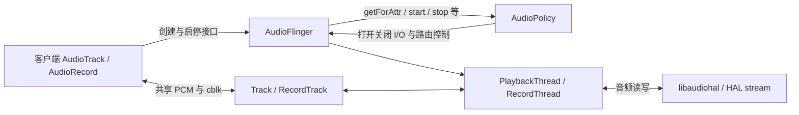
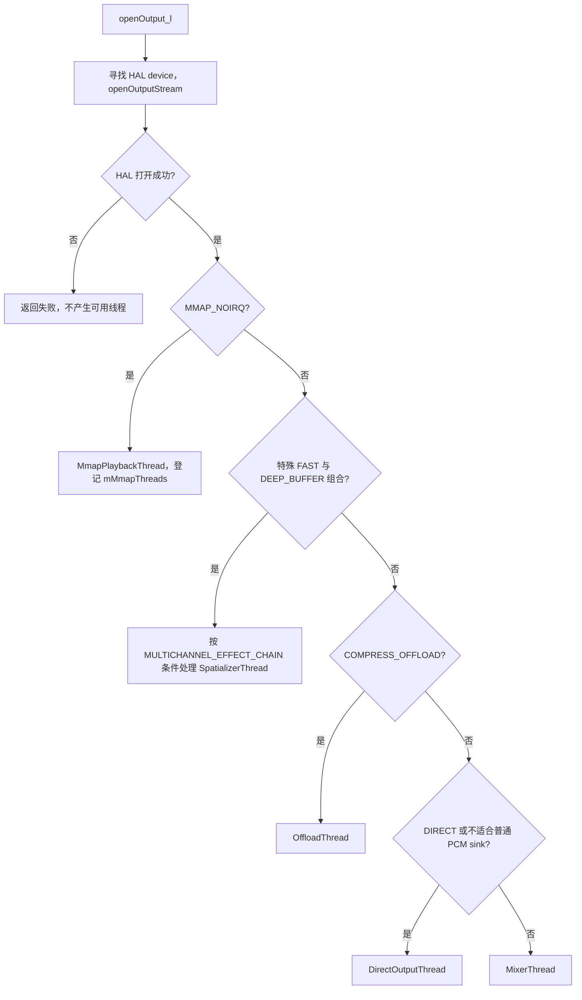
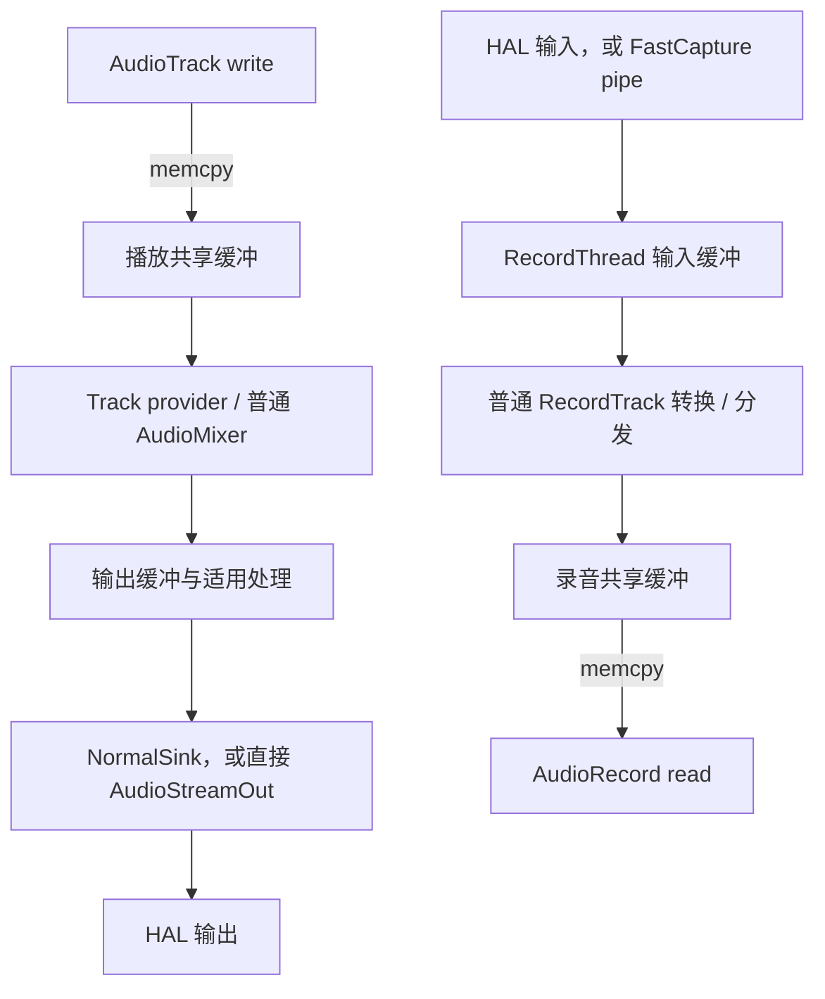

# 5.1 AudioFlinger：Track、线程与 HAL 之间的数据面核心

> 本页建立本地 Android 12L/API 32 产品源码的 AudioFlinger 模型。重点是职责、对象生命周期、I/O 线程选择与控制/数据边界，不将整个源树的可选能力视为当前产品运行事实。

## 1. 先问“谁决定”，再问“谁搬运”

AudioFlinger（AF）负责创建播放/录音端点、管理处理线程和共享缓冲、执行适用的软件处理，并连接 HAL 的输入输出。AudioPolicy 则根据属性、设备和活动状态决定应使用的通路。



这些箭头表示职责关系，不表示所有箭头都跨进程，也不表示一个 API 调用顺序。普通 PCM 不流经 AudioPolicy。

## 2. 对象层次决定了生命周期

| 对象 | 关联范围 | 典型生命周期 |
|---|---|---|
| `AudioHwDevice` | 一个被 AF 加载的 HAL 模块封装 | 模块级 |
| `AudioStreamOut` / `AudioStreamIn` | 一个打开的 HAL 输出/输入流封装 | I/O 级 |
| PlaybackThread / RecordThread | 一个 I/O 的工作执行单元 | 通常随相应 I/O 建立/关闭 |
| Track / RecordTrack | 一个播放/录音客户端在服务端的端点 | 客户端创建、启停、销毁 |
| TrackHandle / RecordHandle | 提供给客户端的控制接口 | 持有相应服务端 Track 引用 |
| Client | 按 PID 登记的客户端资源对象，包括共享内存分配支持 | 相关 Track 等引用存续期间 |

一个线程可以服务多个客户端。停止一个 Track、销毁 Track、关闭 output、卸载 HAL 模块不是同一个操作。

### 2.1 四类 ID 不可互换

- **session ID**：连接 Track 与会话级音效等关系。
- **I/O handle**：定位 input/output 与对应 AF 线程。
- **client portId**：Policy 为客户端分配，用于 start/stop/release。
- **device port ID**：代表设备端口，用于设备选择与路由。

打印了相同的整数外观，不代表这些 ID 属于同一命名空间。

## 3. 本地 Framework 已经使用 AIDL 适配

服务声明位于 `frameworks/av/media/libaudioclient/aidl/android/media/IAudioFlingerService.aidl`。`AudioFlinger` 实现 `AudioFlingerServerAdapter::Delegate`；适配层把生成的服务接口交给 delegate。

`frameworks/av/media/libaudioclient/IAudioFlinger.cpp` 原文：

```cpp
Status AudioFlingerServerAdapter::createTrack(const media::CreateTrackRequest& request,
                                              media::CreateTrackResponse* _aidl_return) {
    return Status::fromStatusT(mDelegate->createTrack(request, *_aidl_return));
}
```

这与 `DeviceHalHidl` / `StreamOutHalHidl` 连接 HIDL HAL 是两件事。不要用“Android 12L 的 HAL 是 HIDL”推导 AF 没有 AIDL，也不要把 AF 的 AIDL 接口解释成 Android 14 AIDL core HAL。

控制返回也不只有一层：例如本地 `TrackHandle::start()` 将 Track 启动结果写入返回参数，而 Binder `Status` 可以仍为成功；判断时必须看对应方法实际定义。

## 4. 打开 I/O：先打开 HAL 流，再创建相应线程

`AudioFlinger::openOutput_l()` 先寻找合适 `AudioHwDevice`，分配 output handle，调用设备封装的 `openOutputStream()`。成功后按 flags/配置选择线程。



### 4.1 判断有优先顺序

- MMAP_NOIRQ 优先分支进入 `mMmapThreads`，不是普通 Track 的共享环混音链。
- 本地特殊 Spatializer 分支检查精确的 FAST|DEEP_BUFFER 组合，且有编译宏条件；不能把“FAST”单独解释为 Spatializer。
- COMPRESS_OFFLOAD 创建 OffloadThread。
- DIRECT **或** HAL 格式/声道不适合作为普通 PCM sink 时创建 DirectOutputThread。
- 剩余普通 PCM 输出使用 MixerThread。

因此 Direct 不等于压缩；有 FAST 请求也不意味着创建一个名为 FastMixerThread 的顶层输出线程。FastMixer 是与相应 MixerThread 配合的专门执行路径，Track 是否 FAST 还要另行协商。

### 4.2 输入不是相同表格换方向

`openInput_l()` 调 HAL 打开输入。HAL 建议参数并返回 `BAD_VALUE` 时，若满足线性 PCM、重采样比例与声道限制等条件，AF 可以用建议参数再尝试打开。

成功后：MMAP_NOIRQ 创建 MmapCaptureThread；普通分支创建 RecordThread。不能直接拿输出的 Direct/Offload 线程选择顺序套在输入上。

“HAL input 打开成功”只说明 I/O 已准备；AudioRecord 的 RecordTrack 创建、startInput 权限/路由、线程 active 与真实数据交付仍在后续步骤。

## 5. 创建客户端端点：先选 I/O，再让线程接纳

### 5.1 createTrack

`AudioFlinger::createTrack()`：校验身份与配置 → `AudioSystem::getOutputForAttr()` → 查 PlaybackThread → `createTrack_l()` → 构造 TrackHandle 并返回实际配置。

线程会核对 flags、FAST 条件、帧数/通知周期和效果兼容性。失败时必须回收此前取得的策略引用；成功时 Track 与 output 的关联由服务端维持。

完整创建和数据链见 [5.9 普通 PCM 播放](05_5.9_音乐播放全栈调用链.md)。

### 5.2 createRecord

`AudioFlinger::createRecord()`：校验请求 → `getInputForAttr()` → 查 RecordThread → `createRecordTrack_l()` → 返回 RecordHandle、cblk 与可选独立 buffers。

FAST 被拒绝时，RecordThread 返回 `BAD_TYPE`，AF 释放先前 input 并重新选取不带 FAST 约束的通路。客户端还有针对 `FAILED_TRANSACTION` 的另一类重试，不能与此混淆。

完整输入启动、分发与静音见 [5.10 普通 PCM 录音](05_5.10_录音全栈调用链.md)。

## 6. 从共享缓冲到 HAL：不是一条零拷贝直线



图只覆盖普通路径的主要缓冲关系。输出 NormalSink 还可能是 MonoPipe 后接 FastMixer；FAST input 可由 FastCapture 单独处理；MMAP/Offload 不套用此图。

共享环减少每块 PCM 经 Binder payload 传递的需要，但客户端同步 read/write 明确复制数据。HAL FMQ 也不是上图的同一个环，见 [4.4](../04_Native_Framework_Layer/04_4.4_共享内存机制深度解析.md) 与 [8.1](../08_HAL_Layer/08_8.1_Audio_HAL双轨架构.md)。

## 7. 锁、回调与线程状态

读 AF 时不要看到 `_l` 就认为所有方法都受同一把全局锁保护。需要结合函数注释和实际锁域。

| 锁/状态 | 本地可确认的职责与约束 |
|---|---|
| `AudioFlinger::mLock` | 保护服务级共享状态和多个资源操作 |
| `ThreadBase::mLock` | 线程内部 Track/工作状态；调用 Policy 时某些路径会临时释放 |
| `mClientLock` | 保护 `mClients`、`mNotificationClients`；头文件约定与 AF/线程锁同时需要时后取得 |
| `mHardwareLock` | 保护硬件模块相关访问；若与 AF mLock 同持，先取 mLock |
| `mHardwareStatus` | 为 dump 指示正在进行的硬件控制操作，不是通用音频播放状态机 |

`hardware_call_state` 中有多个明确标注 unused 的枚举，头文件还说明它不覆盖 stream operations。因此不能据此画“每个 write 都经历 AUDIO_HW_* 状态”的虚构状态图。

实际并发例子：PlaybackThread 的 `addTrack_l()` 调 Policy startOutput 前释放线程锁，回来后检查 Track 是否已被 stop/pause；RecordThread 的 start 通过 STARTING_1/STARTING_2 区分 Policy 启动前后。线程安全不只是“有 mutex”，还要在跨调用返回后重新验证对象状态。

## 8. 控制成功、消费进度与硬件进度分别看

| 观察 | 可以说明 | 不能单独说明 |
|---|---|---|
| createTrack/createRecord 成功 | 客户端端点与相关资源建立 | 已在真实硬件播放/采集 |
| start 成功 | 对应控制流程接受/完成其责任范围 | 首帧时刻或无静音 |
| AudioTrack write 正返回 | 已接受相应客户端字节 | 硬件已播放这些字节 |
| AudioRecord read 正返回 | 交付了相应字节 | 内容必然来自未静音的物理 MIC |
| Track 位置/线程帧数 | 对应层的进度 | 与设备/DSP 时钟无误差对齐 |
| HAL/PAL 返回成功 | 对应层报告的状态 | 排除错误掩蔽、丢弃或恢复路径 |

音量与静音也可能位于不同层：客户端 Track 增益、AF 软件处理、HAL/设备控制及车载音量组不应压成一个“全局音量变量”。分析无声时要把控制值与实际路由、数据进度一起看。

## 9. 源码与下一步

路径相对 `Android/lagvm/LINUX/android/`：

- `frameworks/av/services/audioflinger/AudioFlinger.h`：对象集合、锁约束与 Delegate。
- `frameworks/av/services/audioflinger/AudioFlinger.cpp`：创建端点、打开/关闭 I/O、模块管理。
- `frameworks/av/services/audioflinger/Threads.cpp`：执行线程、Track 接纳与周期处理。
- `frameworks/av/services/audioflinger/Tracks.cpp`：TrackBase、TrackHandle/RecordHandle、端点生命周期。
- `frameworks/av/media/libaudioclient/IAudioFlinger.cpp`：Framework 接口适配。
- `frameworks/av/media/libaudioclient/aidl/android/media/IAudioFlingerService.aidl`：服务声明。

建议路线：[共享内存](../04_Native_Framework_Layer/04_4.4_共享内存机制深度解析.md) → [播放](05_5.9_音乐播放全栈调用链.md) → [录音](05_5.10_录音全栈调用链.md) → [Policy 选择](../06_Audio_Policy_Engine/06_6.2_AudioPolicyManager-策略核心实现.md) → [HAL](../08_HAL_Layer/08_8.1_Audio_HAL双轨架构.md)。

定位时用 `dumpsys media.audio_flinger` 看数据核心，与 `dumpsys media.audio_policy`、Java `dumpsys audio` 分开。本页是静态实现讲解，没有进行设备运行或延迟验证。
