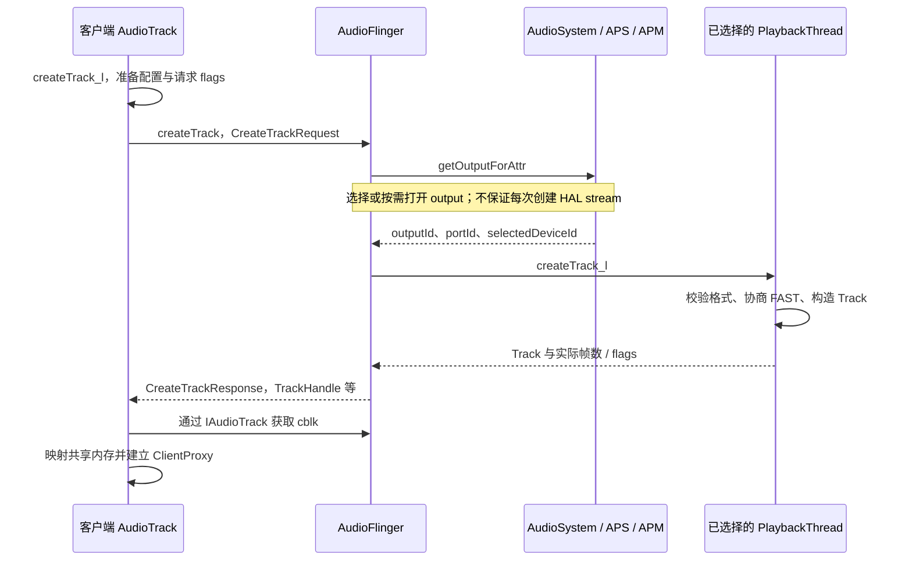
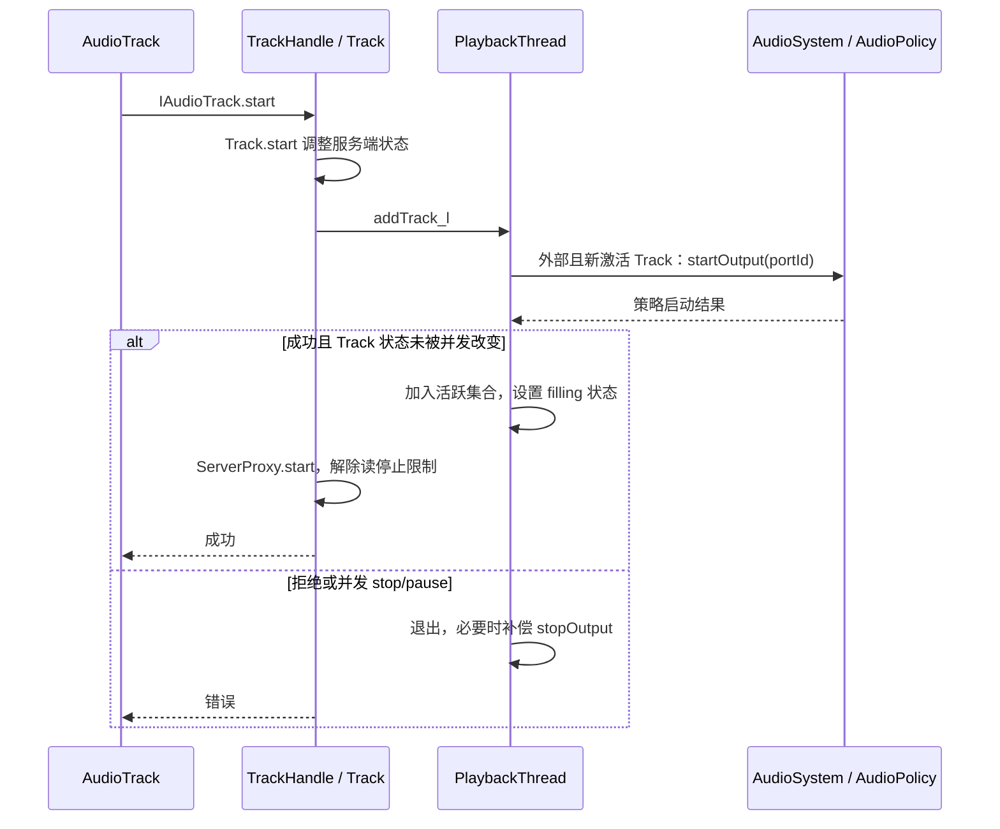
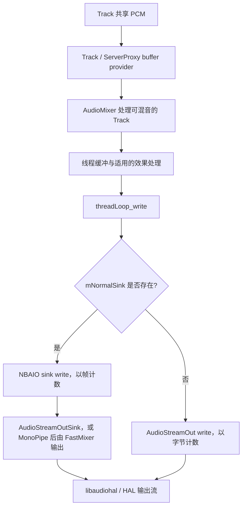

# 5.9 普通 PCM 播放：从 AudioTrack 到 AudioFlinger 输出

> 保留原“音乐播放全栈调用链”文件路径。本文以 AudioFlinger 为中心，讲普通流式 PCM 的创建、启动、供数与停止；不把解码器、HAL、PAL、跨 VM 和 DSP 拼成一条无条件全栈链。依据本地 Android 12L/API 32 产品源码。

前置：[4.4 共享内存](../04_Native_Framework_Layer/04_4.4_共享内存机制深度解析.md)。这里的客户端是 Native `AudioTrack`；Java/JNI 和媒体解码器只是可能的上游，不参与每一次服务端混音决策。

## 1. 先区分五个时刻

| 时刻 | 发生什么 | 尚不能得出的结论 |
|---|---|---|
| 构造/配置 AudioTrack | 校验参数，选择传输方式，调用 `createTrack_l()` | 未必已开始供数 |
| 策略选择 output | 属性、设备、flags 与可用输出匹配，登记 client port | 不是每个 Track 独占一个 HAL stream |
| 创建服务端 Track | 归属 PlaybackThread，协商 flags/buffer，返回控制接口 | Track 尚未 active |
| `start()` | 通知 Track，调用策略 `startOutput(portId)`，加入活跃集合 | 尚不能证明首帧已被设备播放 |
| `write()` 与线程处理 | 应用填共享 buffer；线程取帧、处理、向下游写入 | 写入字节数不是 DAC 播放进度 |

一个已打开的混音 output 可以承载多个 Track。output/HAL stream 的创建与复用属于 I/O 生命周期；Track 的创建属于客户端生命周期。

## 2. 创建：由服务端发起策略选择



### 2.1 客户端请求不等于最后配置

`frameworks/av/media/libaudioclient/AudioTrack.cpp` 中 `createTrack_l()` 使用内部 `CreateTrackInput`，再转为 AIDL 请求：

```cpp
media::CreateTrackResponse response;
status = audioFlinger->createTrack(VALUE_OR_FATAL(input.toAidl()), response);
```

输入包含 attributes、格式/声道/采样率、请求帧数、通知帧数、session、所选设备、flags、可选 sharedBuffer 和客户端身份。返回后，客户端保存实际 `frameCount`、`sampleRate`、`flags`、`portId`、路由设备等，而不是继续把请求值当成事实。

本地 `IAudioFlingerService.aidl` 定义 `CreateTrackRequest` / `CreateTrackResponse`。Framework 有 AIDL 接口，与本产品核心音频 HAL 声明 HIDL 6.0 并不冲突；它们是不同边界。

### 2.2 服务端的两个选择

`AudioFlinger::createTrack()` 先调用 `AudioSystem::getOutputForAttr()`，再在 `mPlaybackThreads` 中查找该 output 对应的线程，随后调用线程的 `createTrack_l()`。

- **Policy 选择 output**：回答在哪个 I/O 上处理这个客户端；还产生用于 start/stop/release 的 client `portId`。
- **线程创建 Track**：回答该 output 能否接纳此格式、帧数与 flags，并创建共享协议和服务端对象。

找不到 output、找不到 PlaybackThread、格式/声道校验失败或 Track 初始化失败，都会阻止正常创建。已经取得的策略资源在失败出口释放，不应画成“先创建 Track，最后随便分配一个扬声器”。

## 3. FAST 是协商，不是开关承诺

客户端先检查传输模式。允许的情形包括 sharedBuffer、callback、obtain/release，以及满足本地 `mThreadCanCallJava` 条件的同步模式；不能从“调用了同步 write”直接推断 FAST 必然不可能或必然成功。

服务端 `PlaybackThread::createTrack_l()` 还检查：

- 请求 flags 是否包含在 output flags 内；先做交集。
- 线性 PCM、声道转换条件、与输出一致的采样率。
- 是否存在 FastMixer，以及是否还有 fast track slot。
- 对应 effect chain 是否兼容。
- streaming buffer 的最小帧数与通知周期；请求值可能被放大或调整。

拒绝 FAST 后，普通播放路径可以返回移除了 FAST 的实际 flags。以后 Track 重建时，客户端会从 `mOrigFlags` 再次开始请求。**不要把录音的 `BAD_TYPE` 重新选 input 流程直接复制到播放。**

## 4. 启动：Track 状态与策略活动状态协同



`addTrack_l()` 调策略时临时释放线程锁，再重新加锁并检查状态。原因不仅是“减少锁开销”，更重要的是跨模块调用可能发生等待和回调；返回后不能假定 Track 还是调用前的状态。

`Track::start()` 对 `PERMISSION_DENIED` 会恢复先前状态；已经在 active 集合的情形可按成功处理。普通 streaming Track 还要等到合适的填充条件才被消费，`start()` 成功不等于立即输出首帧。

## 5. write：客户端负责供数，不同步执行混音

`AudioTrack::write()` 的传输核心原文：

```cpp
size_t toWrite = audioBuffer.size;
memcpy(audioBuffer.i8, buffer, toWrite);
buffer = ((const char *) buffer) + toWrite;
userSize -= toWrite;
written += toWrite;

releaseBuffer(&audioBuffer);
```

此前 `obtainBuffer()` 按帧申请连续可写空间。代码以字节复制，然后发布已填写帧。线程消费在另一侧进行，不存在“每次 write 的 Binder 调用立刻调用一次 AudioMixer”的固定时序。

### 5.1 返回值与边界

- 同步 `write` 要求相应 transfer mode；错误模式返回 `INVALID_OPERATION`。
- 循环条件是 `userSize >= mFrameSize`，不处理最后不足一帧的尾部。
- 非阻塞模式空间不足时可能短返回；阻塞模式也可能被错误或中断打断。
- 已经写入部分数据时遇错，返回已写字节数；尚未写入时才返回错误，`TIMED_OUT` / `-EINTR` 可转为 `WOULD_BLOCK`。
- Direct Track 在检测到 `CBLK_INVALID` 时有直接返回 `DEAD_OBJECT` 的分支。

应用应按返回量推进源指针。把每次调用的请求长度都计入“播放完成量”，会同时掩盖短写与下游未消费的问题。

## 6. AudioFlinger 怎样处理这些帧

普通 MixerThread 的核心节奏是：`prepareTracks_l()` 确认可用 Track、设置 AudioMixer 参数与 buffer provider；`threadLoop_mix()` 调用 `mAudioMixer->process()`；随后按实际输出缓冲和剩余量执行 `threadLoop_write()`。



图中的效果处理取决于实际 effect chain 和缓冲布置，并非所有 Track 都固定经过同一软件效果链。

### 6.1 不能省略 NormalSink

`PlaybackThread::threadLoop_write()` 并非一律直接 `mOutput->write()`：

- 有 `mNormalSink`：调用 NBAIO sink，返回帧数，再转换成字节数。
- 没有 `mNormalSink`：走 `AudioStreamOut::write()` 的直接路径，Direct/Offload 线程可在此有异步确认逻辑。
- `MixerThread` 构造/运行配置会让 normal sink 指向 output sink 或 pipe sink；有 FastMixer 的配置中，normal mix 可以通过 MonoPipe 交给 FastMixer。

因此“非 FAST Track 不会经过 FastMixer 的最终输出环节”和“所有 PCM 都只有一次 AF→HAL 直接写”都过度简化了线程关系。

下游 HIDL FMQ 与 C HAL 适配见 [8.1](../08_HAL_Layer/08_8.1_Audio_HAL双轨架构.md)；AudioReach 普通 PCM 的 PAL 延迟 Open/start 见 [15.10](../15_PAL_Architecture/15_15.10_HAL-PAL适配层架构.md)。这里不推断跨 VM 的具体 PCM 搬运。

## 7. 停止、释放与恢复不是同一个动作

### 7.1 stop 不等于 close output

`Track::stop()` 根据当前状态、active 集合及 Track 类型处理：普通非 FAST、非 Direct、非 Offload 的活跃 Track 可转为 `STOPPED`；其他类型有 `STOPPING_1` / `STOPPING_2` 等分支。

线程清理活跃 Track 时与 `AudioSystem::stopOutput(portId)` 协作。Track 的资源回收再涉及 `releaseOutput(portId)`。如果别的 Track 仍在使用共享 output，不能把一个客户端的 stop 画成关闭所有客户端的 HAL 流。

pause、flush、stop 也不同：pause 保留继续播放的意图；flush 涉及缓冲丢弃协议；stop 的 drain/状态推进还依赖 Track 类型。本文不把这些动作简化成一个“销毁”箭头。

### 7.2 重建不是无缝回放

`AudioTrack::restoreTrack_l()` 的限制原文：

```cpp
if (isOffloadedOrDirect_l() || mDoNotReconnect) {
    // FIXME re-creation of offloaded and direct tracks is not yet implemented;
    // reconsider enabling for linear PCM encodings when position can be preserved.
    result = DEAD_OBJECT;
    return result;
}
```

普通可重连路径会清理 AudioSystem 配置缓存、重新创建 Track、恢复相应参数，并在原状态 active 时尝试启动。源码明确计算 Track 重建带来的丢失帧对位置的影响；位置补偿不是旧 PCM 的恢复，更不保证无爆音或零间隙。

## 8. 按边界观察，而非仅看“播放成功”

| 现象 | 先核对 | 下一层 |
|---|---|---|
| 创建失败 | 实际返回码、attributes/config、outputId、client portId | Policy 匹配、输出打开、Track 接纳条件 |
| 请求 FAST 却未走 FAST | 返回 flags、输出采样率、slots、效果兼容性 | FastMixer 配置与线程状态 |
| write 卡住/短写 | 有效 buffer size、消费进度、active/invalid/disabled | 线程 write 与 HAL 状态 |
| write 正返回但无声 | Track 是否消费、线程 output、静音/音量/路由 | HAL/PAL 错误掩蔽与真实设备通路 |
| 切换设备后中断 | Track 是否 invalidated、是否发生 restore | 新路由配置及重建后的协商值 |

`dumpsys media.audio_flinger` 观察线程与 Track；`dumpsys media.audio_policy` 观察策略 I/O 和客户端；`dumpsys audio` 是 Java AudioService，三者不能互换。这里给出的是定位入口，没有附加虚构的实机日志或延迟数值。

## 9. 源码入口与小结

以下路径相对 `Android/lagvm/LINUX/android/`：

- `frameworks/av/media/libaudioclient/AudioTrack.cpp`：`createTrack_l`、`start`、`write`、`restoreTrack_l`。
- `frameworks/av/media/libaudioclient/aidl/android/media/IAudioFlingerService.aidl`：Framework 服务请求/回复。
- `frameworks/av/services/audioflinger/AudioFlinger.cpp`：`createTrack`、`openOutput_l`。
- `frameworks/av/services/audioflinger/Tracks.cpp`：`TrackHandle`、`Track::start/stop`、共享内存生命周期。
- `frameworks/av/services/audioflinger/Threads.cpp`：`createTrack_l`、`addTrack_l`、`prepareTracks_l`、`threadLoop_mix/write`。

抓住三个独立问题：**Policy 在哪里播放，Track 何时 active，线程何时真正消费并输出帧。** 只有把三者对齐，才有基础继续分析 HAL/PAL 与硬件播放。

继续：[5.10 录音](05_5.10_录音全栈调用链.md) · [6.2 策略选择](../06_Audio_Policy_Engine/06_6.2_AudioPolicyManager-策略核心实现.md)。
