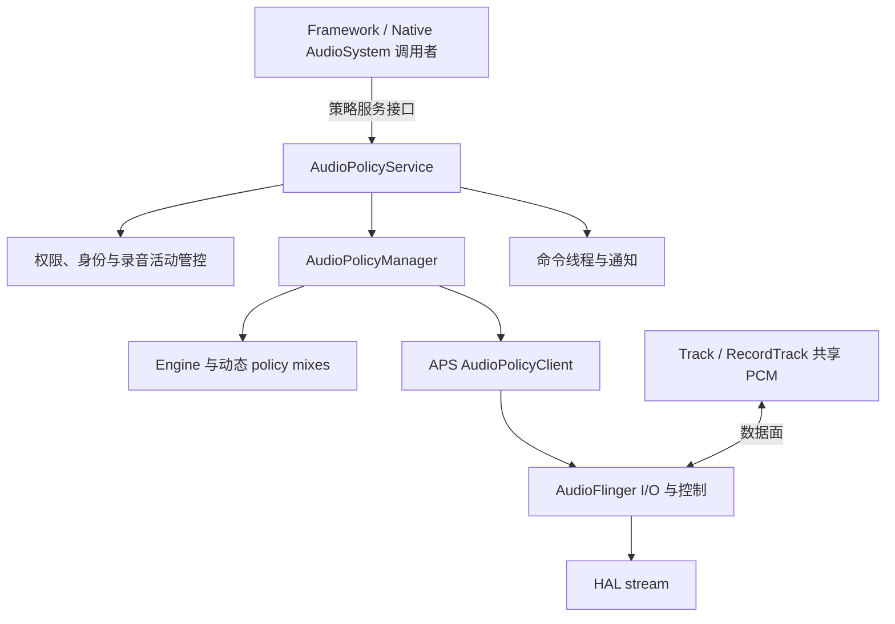
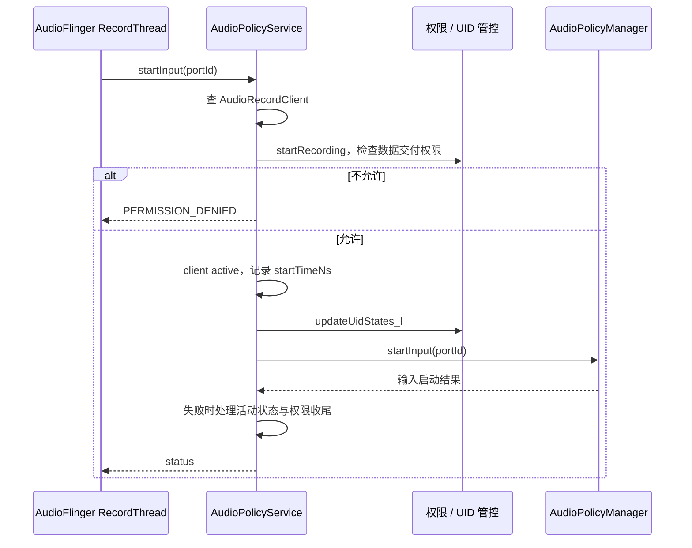
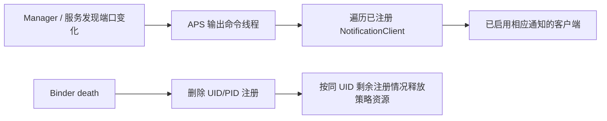

# 6.1 AudioPolicyService：接口、权限与策略执行的连接点

> 本文依据本地 Android 12L/API 32 产品源码。AudioPolicyService 简称 APS，是 Native 策略服务；不是 Java AudioService，也不是直接传输 PCM 的 AudioFlinger。

## 1. 三个名字相近、职责不同的对象

| 对象 | 解决的问题 | 不负责什么 |
|---|---|---|
| Java AudioService | Java Framework 层的音频管理与相关状态 | 不执行 Native 每周期混音 |
| AudioPolicyService | 接收策略接口请求、校验身份/权限、管理通知和录音管控、连接 APM | 不直接混合 PCM |
| AudioPolicyManager | 根据属性、设备、配置与活动状态管理输入输出资源 | 不替代 APS 的所有权限判断 |

AudioFlinger 则管理 Track、I/O 线程、软件音频处理与 HAL 数据接口。APS 与 AF 之间既有资源控制，也有状态回调；不是 APS 把每一块 PCM 交给 AF。



`AudioPolicyClient` 是 APS 提供给 Manager 的回调适配对象，不是应用进程的 AudioTrack，也不是登记在策略中的 TrackClientDescriptor。

## 2. 接口声明与实现放在哪里

本地接口声明在 `frameworks/av/media/libaudioclient/aidl/android/media/IAudioPolicyService.aidl`。主要 Native 入口实现在 `AudioPolicyInterfaceImpl.cpp`，例如 `getOutputForAttr`、`startOutput`、`getInputForAttr`、`startInput`。

这些接口使用 AIDL 侧类型、`binder::Status` 和参数转换；Manager 内部则使用 `audio_attributes_t`、`audio_io_handle_t`、`status_t` 等类型。不能粘贴一个旧式 C++ 签名后称它就是本地 Binder 服务原型。

也不能因为核心 audio HAL 为 HIDL 6.0，就把 Framework 所有服务都画成 HIDL；APS/AF 与 vendor HAL 是不同 IPC 边界。

## 3. 初始化：准备执行环境，而非打开所有应用流

`AudioPolicyService::onFirstRef()` 的相关原文，位于 `AudioPolicyService.cpp`：

```cpp
// start audio commands thread
mAudioCommandThread = new AudioCommandThread(String8("ApmAudio"), this);
// start output activity command thread
mOutputCommandThread = new AudioCommandThread(String8("ApmOutput"), this);

mAudioPolicyClient = new AudioPolicyClient(this);

loadAudioPolicyManager();
mAudioPolicyManager = mCreateAudioPolicyManager(mAudioPolicyClient);
```

之后创建 AudioPolicyEffects、UidPolicy、SensorPrivacyPolicy，注册相应观察者，并通知 `AudioSystem::audioPolicyReady()`。本地还会查询空间音频支持并有条件创建 Spatializer；只看这一分支不能确认产品启用状态。

这里应理解三个层次：

1. 服务准备接口、命令线程和管控对象。
2. Manager 初始化策略资源，并通过 client interface 与 AF 协作。
3. 之后每个应用的 get/start/stop/release 请求继续驱动客户端与 I/O 状态变化。

服务初始化成功不代表所有设备、流配置或应用请求都可用。

## 4. 输出请求：从可信身份到 client port

`getOutputForAttr()` 的典型步骤：

1. 将 AIDL attributes、config、flags、设备标识转换为内部类型。
2. 检查 Manager、属性有效性和 usage。
3. 根据调用者身份校正 attribution UID，避免任意调用者冒用其他 UID。
4. 根据播放捕获与 bypass 权限调整属性标志。
5. 调用 `mAudioPolicyManager->getOutputForAttr()`。
6. 根据 output type 再检查 telephony/reroute 等专门权限。
7. 成功后登记 `AudioPlaybackClient`，返回 output、stream、selectedDeviceId、portId 与 secondaryOutputs。

因此，APS 不是简单转发器；而且权限检查不是仅在入口进行一次。请求经校验后的属性，可能不同于应用最初填写的属性。

### 4.1 getOutputForAttr 与 startOutput

`getOutputForAttr()` 成功只是取得并登记策略资源。`startOutput(portId)` 根据 client 找到 session/stream，为会话添加适用的输出效果，再调用 Manager 的 `startOutput()`，成功后将 APS client 置为 active。

效果添加异常有日志/状态分支，不能从“调用了 addOutputSessionEffects”断言所有播放都实际开启了同一效果。

播放 `stopOutput()` 的入口原文：

```cpp
ALOGV("stopOutput()");
mOutputCommandThread->stopOutputCommand(portId);
return Status::ok();
```

这说明接口接收停止请求与 `doStopOutput()` 完成策略收尾并不是同一个执行时刻。不能把 `Status::ok()` 解释为所有下游音频资源已经同步关闭。

## 5. 输入请求：创建时检查与开始采集时检查

输入比输出多了来源、录音数据交付与隐私约束。

### 5.1 getInputForAttr

APS 校验输入 source 和调用身份。VOICE_UPLINK/DOWNLINK/CALL、ECHO_REFERENCE、FM_TUNER、HOTWORD/HW_HOTWORD 等来源或 flags 有各自权限条件。

Manager 返回的 input type 又决定后置权限：普通 legacy、playback capture、telephony RX、外部策略 reroute 等不能一概当普通麦克风。后置检查失败时，可释放已经取得的输入资源。

成功后登记 `AudioRecordClient`，添加适用的输入效果，并返回 input、selectedDeviceId、client portId。RecordTrack 本身仍由 AudioFlinger 创建，APS 这里登记的是**策略客户端状态**。

### 5.2 startInput 再检查录音交付



UID 前后台状态、隐私/并发管控和实际录音数据是否允许交付有关。取得 input 并不意味着永远可读真实麦克风样本；部分情形通过 Track silenced 表达，普通 RecordThread 在发布前清零，见 [5.10](../05_AudioFlinger/05_5.10_录音全栈调用链.md)。

不要把“read 返回正数”当作权限无问题的证明，也不要把“所有样本为零”直接归因于物理麦克风。

## 6. 从 Manager 到 AudioFlinger：回调适配层

`AudioPolicyClientImpl.cpp` 中的 `AudioPolicyService::AudioPolicyClient` 实现 Manager 所需的 client interface：

| Manager 的控制需求 | 本地适配方式 |
|---|---|
| `loadHwModule` | 取得 AF 接口，转交模块加载 |
| `openOutput` | 构造 `OpenOutputRequest`，调用 AF，将实际配置/handle/latency 写回 |
| `openInput` | 构造 `OpenInputRequest`，调用 AF 并更新 input handle |
| close / suspend / restore output | 转交 AF 对应资源操作 |
| stream volume / parameters / patch | 交由 APS 对应入口，可能经命令线程处理 |
| 通知策略 mix/端口等变化 | 通过 APS 通知路径交付 |

以 openOutput 成功返回处理为例：

```cpp
status_t status = af->openOutput(request, &response);
if (status == OK) {
    *output = VALUE_OR_RETURN_STATUS(aidl2legacy_int32_t_audio_io_handle_t(response.output));
    *halConfig =
            VALUE_OR_RETURN_STATUS(aidl2legacy_AudioConfig_audio_config_t(response.config));
    *latencyMs = VALUE_OR_RETURN_STATUS(convertIntegral<uint32_t>(response.latencyMs));
}
return status;
```

这里回写的是打开结果与实际配置，不是给每个应用复制一份 PCM。失败也必须保留返回语义，不能在图里省略成永远成功的“打开设备”。

## 7. 命令线程与通知不是一回事

- `ApmAudio` 与 `ApmOutput` 是服务初始化创建的命令执行对象，用于对应控制/输出活动工作。
- `NotificationClient` 按调用者 UID/PID 组合登记，持有策略服务客户端回调并 linkToDeath。
- Audio port、volume group 等回调有启用状态，不能假定所有注册者接收所有通知。
- 客户端进程死亡时移除 notification client；同 UID 没有剩余注册者时可调用 Manager 的 `releaseResourcesForUid()`。



通知是状态变化信号，不代表应用缓存已在同一时刻更新，也不是 PCM 数据传输。

## 8. 看问题时如何分层

| 现象 | APS 层应问的问题 | 之后查看 |
|---|---|---|
| 创建失败 | 转换/属性/usage 是否有效，权限是否允许，Manager 返回什么 | APM 的 profile/mix/设备选择 |
| 创建成功、start 失败 | portId 是否有效，录音交付权限和 Manager start 是否成功 | AF 启动回滚与输入状态 |
| 停止后仍看到 I/O | 命令是否已执行，是否仍有其他客户端，是否仅 stop 未 release | APM 描述符与 AF 线程 |
| 状态通知缺失 | 注册身份、回调使能、客户端死亡和队列 | 调用者缓存刷新 |
| 录音只有零 | UID/隐私/并发状态是否导致 silenced | AF 清零位置与真实上游采集 |

使用 `dumpsys media.audio_policy` 观察 Native policy，使用 `dumpsys media.audio_flinger` 对照数据线程，使用 `dumpsys audio` 查看 Java AudioService。本文未执行实机命令，不提供假定的输出样例。

## 9. 源码入口与阅读顺序

路径相对 `Android/lagvm/LINUX/android/`：

- `frameworks/av/media/libaudioclient/aidl/android/media/IAudioPolicyService.aidl`。
- `frameworks/av/services/audiopolicy/service/AudioPolicyService.cpp`：初始化、命令与通知生命周期。
- `frameworks/av/services/audiopolicy/service/AudioPolicyInterfaceImpl.cpp`：Binder 入口、身份与权限、get/start/stop/release。
- `frameworks/av/services/audiopolicy/service/AudioPolicyClientImpl.cpp`：Manager 向 AF/APS 请求控制操作。

先掌握本页的职责分工，再读 [6.2 APM 选择与生命周期](06_6.2_AudioPolicyManager-策略核心实现.md)，最后通过 [播放](../05_AudioFlinger/05_5.9_音乐播放全栈调用链.md) 和 [录音](../05_AudioFlinger/05_5.10_录音全栈调用链.md) 把控制面与数据面对齐。
