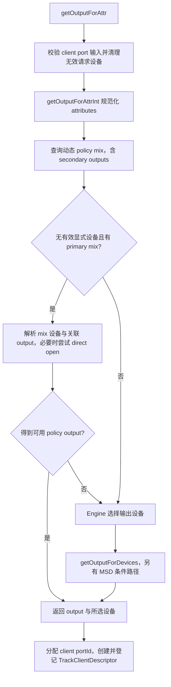
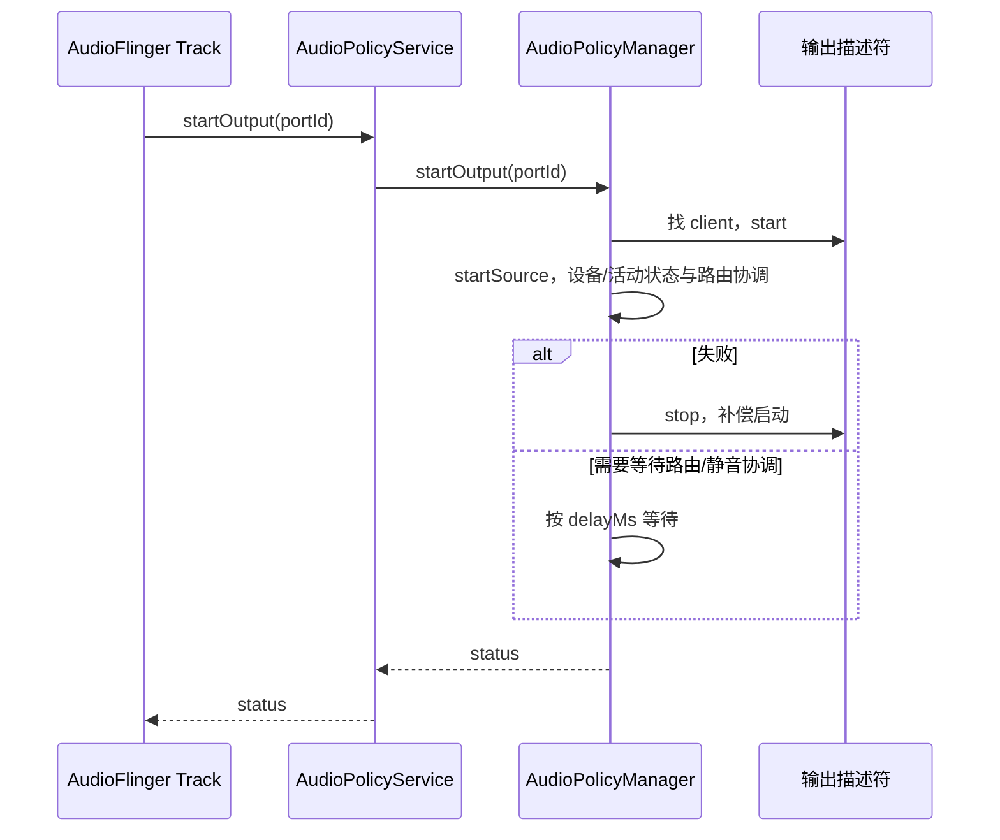
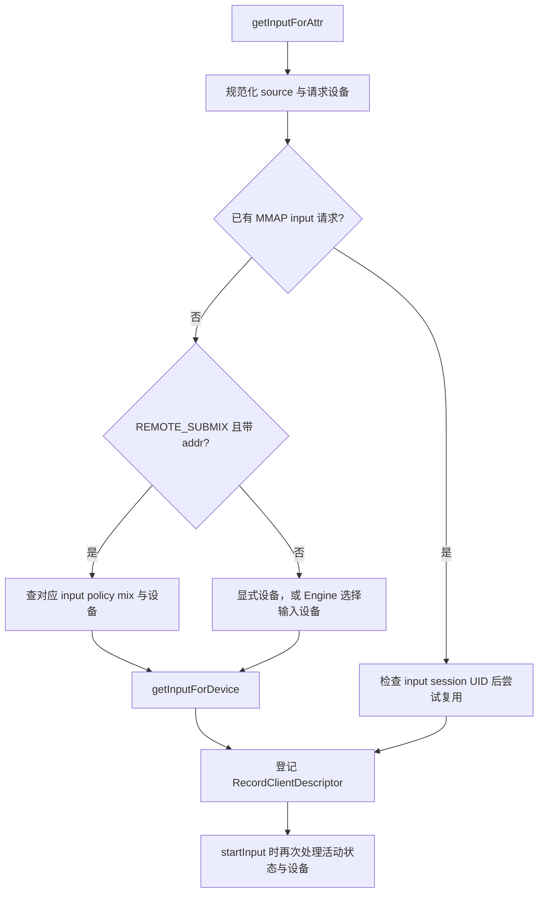
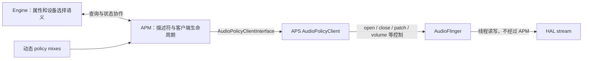

# 6.2 AudioPolicyManager：将音频意图映射到可用 I/O

> 主线依据本地 Android 12L/API 32 产品源码。APM 指 Native AudioPolicyManager；它管理策略资源与活动状态，**不承载 PCM**。本地可见的条件扩展按源码说明，不根据版本名称推断运行时能力。

前置：[6.1 AudioPolicyService](06_6.1_AudioPolicyService-控制面入口.md)、[5.1 AudioFlinger](../05_AudioFlinger/05_5.1_AudioFlinger-音频数据面引擎.md)。

## 1. APM 不是“固定设备优先级表”

应用表达的是 attributes、配置、flags、可选首选设备与身份。系统还必须结合已连接设备、策略 mix、正在使用的 I/O、profile 能力、活动客户端和效果约束作决定。

| 对象/标识 | 含义 |
|---|---|
| `mEngine` | 属性到 stream/strategy、输入输出设备选择等策略语义 |
| `mPolicyMixes` | 动态音频策略注册的规则与关联输出，不只是默认 Engine 的一个设备常量 |
| `mHwModules` / `IOProfile` | 模块及声明的 I/O 能力，用于判断是否能够打开相应通路 |
| `mAvailableOutputDevices` / `mAvailableInputDevices` | 当前策略视角的可用设备集合 |
| `mOutputs` / `mInputs` | 已建立的输出/输入描述符集合 |
| `TrackClientDescriptor` / `RecordClientDescriptor` | 一个客户端的属性、session、请求设备、flags 与活动状态 |
| I/O handle | 定位一个 input/output；AudioFlinger 用它关联线程 |
| client `portId` | getForAttr 为客户端分配的标识；用于 start/stop/release |
| `selectedDeviceId` | 设备端口标识；不能当作 I/O handle 或 client portId 使用 |

因此，不能用“媒体总是扬声器，电话总是某设备”替代真实选择过程。在 AAOS 中，动态规则与 BUS 地址尤其重要。

## 2. 输出选择分成三个问题



图省略多个错误出口：动态策略适用时非 PCM 可被拒绝，无法路由的 virtual source 会失败，找不到 output 也不会自动回退到“任意扬声器”。

### 2.1 属性和设备：getOutputForAttrInt

函数先用 `getAudioAttributes()` 规范化 attributes，合并允许捕获策略，再向 Engine 查询对应 stream type。随后查询动态策略。

`frameworks/av/services/audiopolicy/managerdefault/AudioPolicyManager.cpp` 原文：

```cpp
// Explicit routing is higher priority then any dynamic policy primary output
bool usePrimaryOutputFromPolicyMixes = requestedDevice == nullptr && primaryMix != nullptr;
```

这里的显式设备必须已解析为有效可用设备。secondary outputs 仍由动态策略查找，不因为显式主输出就自然消失。没有可用 primary mix 输出时，再进入 Engine 等后续路径；特殊 virtual source 有自己的拒绝条件。

Engine 返回设备，并不意味着 PCM 已开始沿该设备播放。APM 还要找到能服务这些设备的 I/O，并在启动/活动状态变化时落实相应路由。

### 2.2 输出通路：getOutputForDevices

这个函数不只“遍历找第一个设备”：

1. 根据请求调整 flags，例如 COMPRESS_OFFLOAD、HW_AV_SYNC 隐含 DIRECT；非 MUSIC 的 DEEP_BUFFER 有清除规则。
2. 本地还存在 TTS、VoIP、haptic 与 Spatializer 条件分支。
3. 尝试 `openDirectOutput()`。
4. 只有返回 `NAME_NOT_FOUND` 才进入普通混音候选选择。
5. HW_AV_SYNC / MMAP_NOIRQ 不能简单退到普通混音输出；普通非 Direct 输出只接受线性 PCM。
6. 从支持目标设备的已有 outputs 中，用 `selectOutput()` 结合 flags、格式、声道、采样率、session 选择。

关键回退门槛原文：

```cpp
status_t status = openDirectOutput(stream, session, &directConfig, *flags, devices, &output);
if (status != NAME_NOT_FOUND) {
    return output;
}
```

这意味着“direct 打开失败就一定自动播放普通 PCM”不成立。返回码、格式和 flags 决定是否还允许后续路径。

### 2.3 direct 可以复用，也可能根本无需打开

`openDirectOutput()` 对明显可走普通混音且未显式请求 DIRECT 的参数直接返回 `NAME_NOT_FOUND`。需要 direct 时，它会查 profile、效果约束和可用 I/O 数量，并可复用**同 profile、配置与 session** 的已有 direct output。

新开时通过 `SwAudioOutputDescriptor::open()` 调 client interface，最终请求 AudioFlinger 打开 HAL output。打开后的实际配置还要和请求核对；不匹配时可关闭，随后根据条件允许混音回退或返回失败。

这解释了为何：一次 getOutputForAttr 可能只登记客户端，也可能触发较重的 I/O 操作；不能为所有创建调用画一个必经的 HAL open。

## 3. startOutput 才把客户端变为活动使用者

`getOutputForAttr()` 最后创建 client descriptor 并登记到 output；`startOutput(portId)` 则找到该客户端的 output，启动描述符并执行 `startSource()`。

```cpp
uint32_t delayMs;
status = startSource(outputDesc, client, &delayMs);

if (status != NO_ERROR) {
    outputDesc->stop();
    return status;
}
if (delayMs != 0) {
    usleep(delayMs * 1000);
}
```

这段位于 `AudioPolicyManager::startOutput()`。失败会补偿描述符的 start；返回延迟由具体路由/静音协调产生，不是本平台统一的固定启动延迟。

`startSource()` 会结合 policy mix、preferred device 和活跃客户端更新设备、使用计数与音量/静音相关状态。图中的“激活”是策略资源状态，不等于底层硬件已经播放首帧。



stop/release 也不同：stop 结束客户端活动；release 移除资源引用。普通混音 output 不因一个 Track release 就必然关闭；direct output 则有 `mDirectOpenCount`，减到零可关闭。还有等待 profile 重查询而重开 output 的分支。

## 4. 输入选择不能照抄输出顺序

`getInputForAttr()` 首先把 DEFAULT source 规范化为 MIC；随后有独立的输入规则：

- MMAP 请求若已提供 input handle，可以尝试复用，但必须满足 input、session、UID 等约束。
- 带 `addr=` 标签的 REMOTE_SUBMIX 有专门的 policy mix 与设备查询。
- 其他路径优先考虑有效显式输入设备，否则调用 `mEngine->getInputDeviceForAttributes()`。
- 根据选中设备/mix 形成 input type，供 APS 执行相应权限检查。
- 通过 `getInputForDevice()` 选择/打开通路，再分配 `RecordClientDescriptor` 和 client portId。



HOTWORD 还涉及已登记的 SoundTrigger session；存在该 session 时可以使用预有输入并设置 HW_HOTWORD，否则有来源转换。它不能等价为“始终新开普通麦克风”。

### 4.1 startInput 的失败回滚

`startInput(portId)` 找不到对应 input 返回 `DEAD_OBJECT`；客户端已 active 时返回 `INVALID_OPERATION`。之后先 `inputDesc->start()`，再将 client 置 active，才能按活跃 session 选择新输入设备。

若设备设置失败，恢复 client 为 inactive 并 `inputDesc->stop()`。首个有效活动输入还可能通知动态 mix、SoundTrigger capture state；remote submix 有相关虚拟输出连接状态管理。

`stopInput()` 结束活动，必要时按剩余活跃客户端重选设备；`releaseInput()` 移除 client，仍有其他 client 则保留 input，最后一个离开才关闭。

## 5. Engine、APM 与 AudioFlinger 的职责线



APM 下发 Patch/音量等控制不意味着 PCM 穿过 APM。`AudioPolicyClientImpl.cpp` 将输出/输入打开请求转换后交给 AudioFlinger；有些控制则先交 APS 命令线程，不应把全部 client callback 画成相同的同步 Binder 调用。

设备连接状态变化会影响 available devices、可用 profiles、Engine 判断和已有路由。要分析具体设备，应沿实际 connect/disconnect 路径追踪，不能拿某次 getOutputForAttr 的设备结果当永久绑定。

## 6. 本地条件扩展与使用边界

本地 `getOutputForDevices()` 确实包含 `mSpatializerOutput` / `canBeSpatializedInt()` 分支；AudioFlinger 也有条件创建 SpatializerThread 的实现。这说明源树含有相应代码，**不是当前 SA8295 产品已经启用空间音频的证据**，也不应直接改写成 Android 14 的实现。

类似地，MSD、MMAP、Direct、Offload、动态 capture mix 的源码存在性，都需要与具体配置、权限、资源、构建条件和运行状态区分。本文给出普通路径及关键拒绝/回退边界，不宣称覆盖所有策略算法。

## 7. 读 dumps 时先对应标识

| 问题 | 应对齐的内容 |
|---|---|
| 播放去了错误区域/设备 | attributes、有效请求 device、primary mix、output、selectedDeviceId |
| 创建成功但启动失败 | client portId、描述符活动状态、startSource/startInput 返回 |
| 实际 flags 与请求不同 | getOutputForDevices 调整、direct 回退、AF Track 接纳 |
| 停止一个流影响另一个流 | 是否共用 I/O、活动 client 计数、设备重选与 Patch |
| 有录音数据但静音 | APS 的 UID/权限/隐私状态与 AF Track silenced，而不仅是 inputId |

策略状态主要查看 `dumpsys media.audio_policy`，再与 `dumpsys media.audio_flinger` 的 I/O handle 和 Track/RecordTrack 对齐。查询命令不是运行结果；本页没有执行实机检查。

## 8. 源码入口与延伸

路径相对 `Android/lagvm/LINUX/android/`：

- `frameworks/av/services/audiopolicy/managerdefault/AudioPolicyManager.cpp`：本文选择、启动、停止与释放函数。
- `frameworks/av/services/audiopolicy/service/AudioPolicyInterfaceImpl.cpp`：APS 接口、权限与客户端登记。
- `frameworks/av/services/audiopolicy/service/AudioPolicyClientImpl.cpp`：向 AF/命令线程传递控制。
- `frameworks/av/services/audioflinger/AudioFlinger.cpp`：I/O 打开与线程选择。

结合 [5.9 播放](../05_AudioFlinger/05_5.9_音乐播放全栈调用链.md)、[5.10 录音](../05_AudioFlinger/05_5.10_录音全栈调用链.md) 阅读，才能把“选择—创建—启动—数据—停止—释放”连接起来，而不是把所有操作压缩成一次路由查表。
