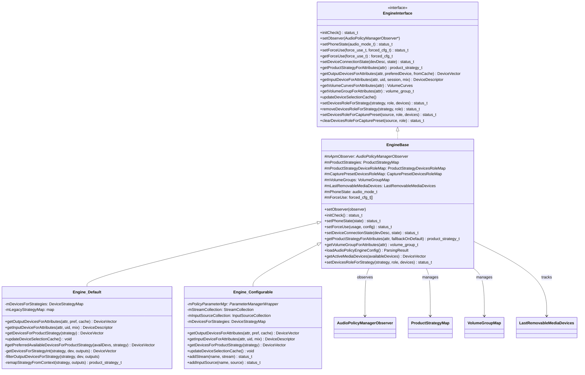
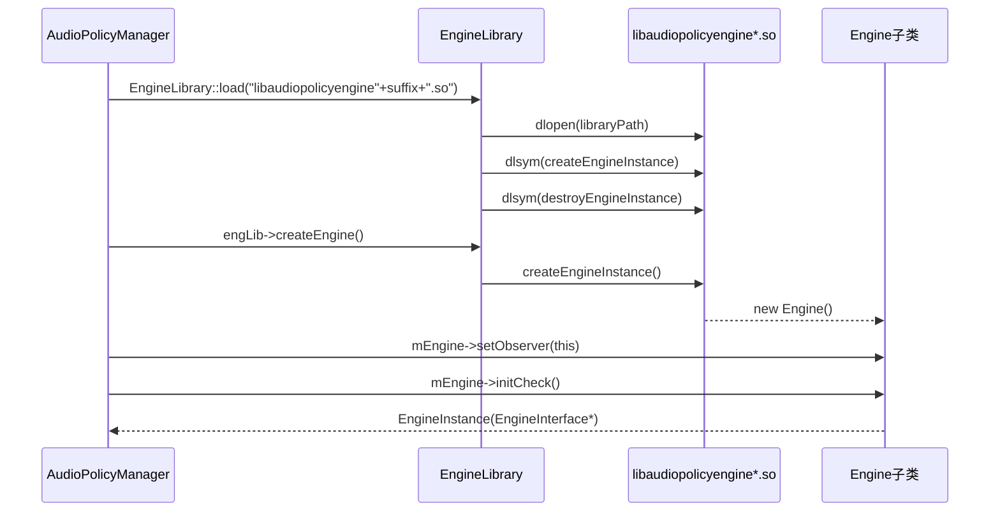
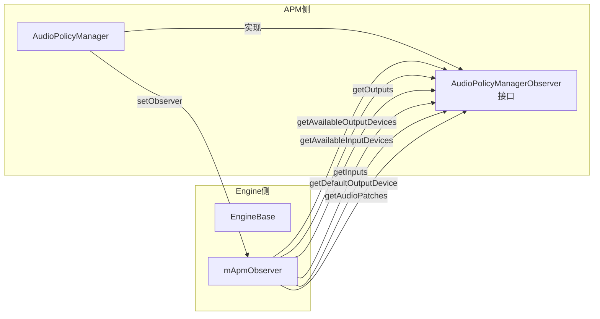
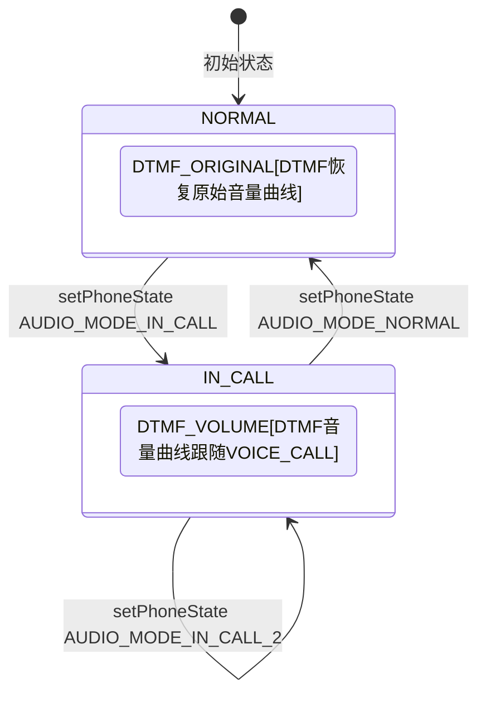
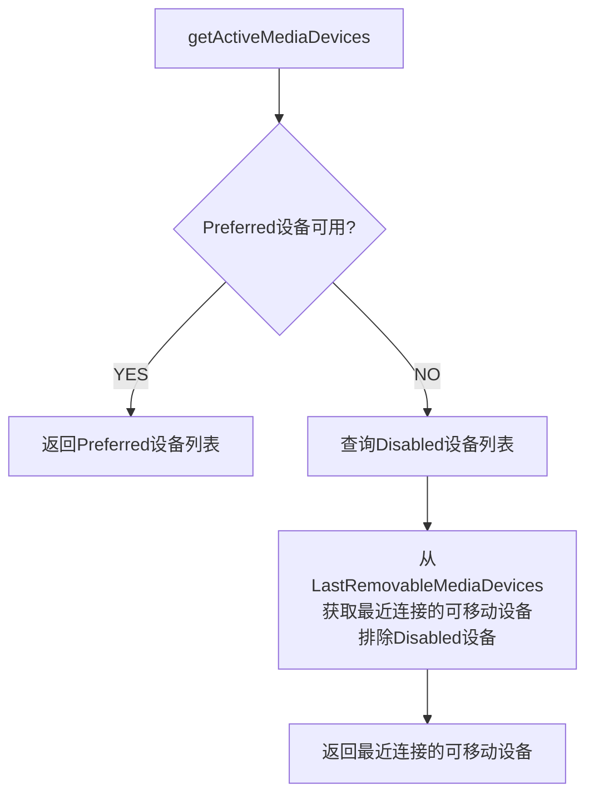
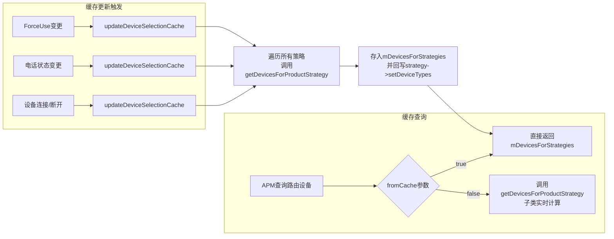
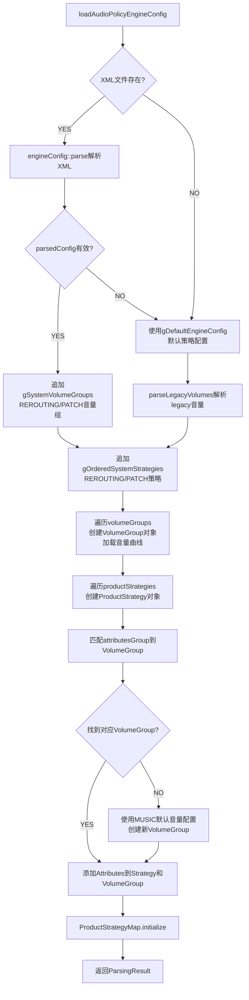
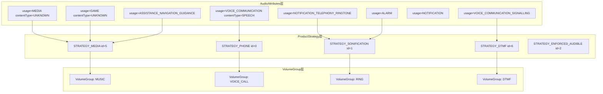
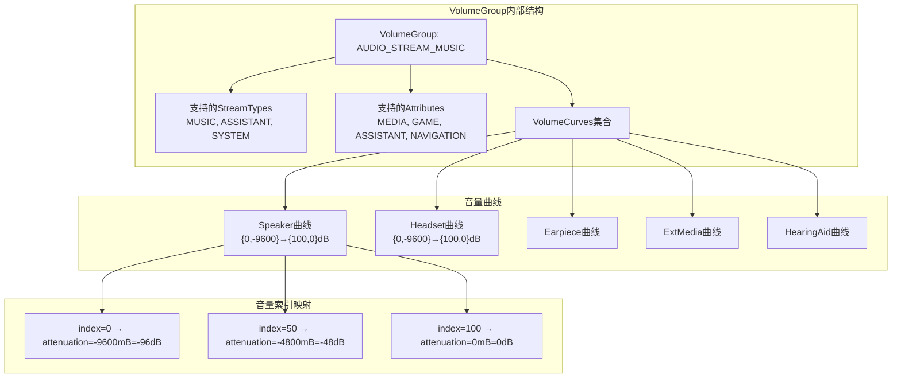
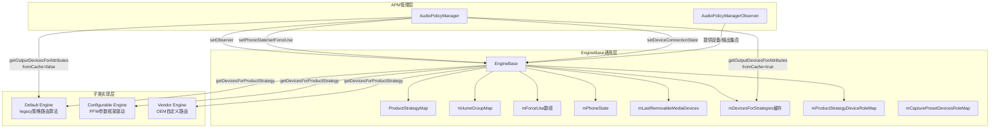

## 6.3 EngineBase — 可插拔策略引擎

[← 上一个](06_6.2_AudioPolicyManager-策略核心实现.md) | [← 返回Audio Policy Engine](README.md) | [返回导航](../README.md) | [下一个 →](06_6.4_Device_Routing-设备路由.md)

---

### 模块定位与设计哲学

[`EngineBase`](frameworks/av/services/audiopolicy/engine/common/include/EngineBase.h:28) 是Android音频策略引擎的**基类骨架**，实现了 [`EngineInterface`](frameworks/av/services/audiopolicy/engine/interface/EngineInterface.h:46) 定义的策略查询接口，同时将**路由决策核心逻辑**留给子类通过纯虚函数 `getDevicesForProductStrategy()` 实现。这种设计实现了**策略引擎的可插拔替换**——OEM可以选择默认引擎(`enginedefault`)或可配置引擎(`engineconfigurable`)，甚至实现完全自定义的路由算法。



---

### 可插拔引擎加载机制

APM通过 [`EngineLibrary`](frameworks/av/services/audiopolicy/managerdefault/EngineLibrary.cpp:38) 在运行时动态加载引擎共享库，实现策略引擎的完全替换：



关键源码位于 [`EngineLibrary::init()`](frameworks/av/services/audiopolicy/managerdefault/EngineLibrary.cpp:38)：

```cpp
// EngineLibrary.cpp:40-45（逐字）
    mLibraryHandle = dlopen(libraryPath.c_str(), 0);
    if (mLibraryHandle == nullptr) {
        ALOGE("Could not dlopen %s: %s", libraryPath.c_str(), dlerror());
        return false;
    }
    mCreateEngineInstance = (EngineInterface* (*)())dlsym(mLibraryHandle, "createEngineInstance");
```

**引擎选择规则**：
- `librarySuffix=""` → 加载 `libaudiopolicyenginedefault.so`（默认引擎，硬编码路由规则）
- `librarySuffix="configurable"` → 加载 `libaudiopolicyengineconfigurable.so`（可配置引擎，PFW驱动）
- OEM可编译自定义 `libaudiopolicyengine<vendor>.so`，导出 `createEngineInstance/destroyEngineInstance` C符号

[`EngineInterface.h:431`](frameworks/av/services/audiopolicy/engine/interface/EngineInterface.h:431) 定义的工厂函数签名：
```cpp
extern "C" EngineInterface* createEngineInstance();
extern "C" void destroyEngineInstance(EngineInterface *engine);
```

---

### EngineBase成员变量详解

| 成员变量 | 类型 | 源码行 | 职责 |
|---------|------|-------|------|
| [`mApmObserver`](frameworks/av/services/audiopolicy/engine/common/include/EngineBase.h:175) | `AudioPolicyManagerObserver*` | :175 | APM观察者，提供设备/输出/输入集合查询 |
| [`mProductStrategies`](frameworks/av/services/audiopolicy/engine/common/include/EngineBase.h:177) | `ProductStrategyMap` | :177 | 策略映射表，attr→strategy→volumeGroup |
| [`mProductStrategyDeviceRoleMap`](frameworks/av/services/audiopolicy/engine/common/include/EngineBase.h:178) | `ProductStrategyDevicesRoleMap` | :178 | 策略的设备角色映射（PREFERRED/DISABLED） |
| [`mCapturePresetDevicesRoleMap`](frameworks/av/services/audiopolicy/engine/common/include/EngineBase.h:179) | `CapturePresetDevicesRoleMap` | :179 | 录音源的设备角色映射 |
| [`mVolumeGroups`](frameworks/av/services/audiopolicy/engine/common/include/EngineBase.h:180) | `VolumeGroupMap` | :180 | 音量组映射表，管理音量曲线 |
| [`mLastRemovableMediaDevices`](frameworks/av/services/audiopolicy/engine/common/include/EngineBase.h:181) | `LastRemovableMediaDevices` | :181 | 最近连接的可移动媒体设备追踪器 |
| [`mPhoneState`](frameworks/av/services/audiopolicy/engine/common/include/EngineBase.h:182) | `audio_mode_t` | :182 | 当前电话状态，默认AUDIO_MODE_NORMAL |
| [`mForceUse`](frameworks/av/services/audiopolicy/engine/common/include/EngineBase.h:185) | `audio_policy_forced_cfg_t[]` | :185 | 强制使用配置数组，索引为AUDIO_POLICY_FORCE_USE_CNT |

> **归属澄清**：`mDevicesForStrategies` 设备选择缓存**不在 EngineBase**——它是各引擎子类的私有成员（enginedefault/src/Engine.h:100、engineconfigurable/src/Engine.h:135），EngineInterface.h:235 只声明纯虚的 `updateDeviceSelectionCache()`。

---

### Observer模式：EngineBase与APM的交互

[`AudioPolicyManagerObserver`](frameworks/av/services/audiopolicy/engine/interface/AudioPolicyManagerObserver.h:35) 是Engine反向查询APM状态的桥梁：



[`setObserver()`](frameworks/av/services/audiopolicy/engine/common/src/EngineBase.cpp:30) 在APM初始化时被调用，将自身作为Observer注入Engine：
```cpp
// EngineBase.cpp:30-33
void EngineBase::setObserver(AudioPolicyManagerObserver *observer) {
    ALOG_ASSERT(observer != NULL, "Invalid Audio Policy Manager observer");
    mApmObserver = observer;
}
```

[`initCheck()`](frameworks/av/services/audiopolicy/engine/common/src/EngineBase.cpp:35) 验证Observer已设置：
```cpp
// EngineBase.cpp:35-38
status_t EngineBase::initCheck() {
    return (mApmObserver != nullptr)? NO_ERROR : NO_INIT;
}
```

---

### 核心方法源码解析

#### 1. setPhoneState() — 电话状态切换与音量曲线切换

[`setPhoneState()`](frameworks/av/services/audiopolicy/engine/common/src/EngineBase.cpp:42) 在电话状态变化时，执行**音量曲线动态替换**：

```cpp
// EngineBase.cpp:42-68（逐字）
status_t EngineBase::setPhoneState(audio_mode_t state)
{
    ALOGV("setPhoneState() state %d", state);

    if (state < 0 || uint32_t(state) >= AUDIO_MODE_CNT) {
        ALOGW("setPhoneState() invalid state %d", state);
        return BAD_VALUE;
    }

    if (state == mPhoneState ) {
        ALOGW("setPhoneState() setting same state %d", state);
        return BAD_VALUE;
    }

    // store previous phone state for management of sonification strategy below
    int oldState = mPhoneState;
    mPhoneState = state;

    if (!is_state_in_call(oldState) && is_state_in_call(state)) {
        ALOGV("  Entering call in setPhoneState()");
        switchVolumeCurve(AUDIO_STREAM_VOICE_CALL, AUDIO_STREAM_DTMF);
    } else if (is_state_in_call(oldState) && !is_state_in_call(state)) {
        ALOGV("  Exiting call in setPhoneState()");
        restoreOriginVolumeCurve(AUDIO_STREAM_DTMF);
    }
    return NO_ERROR;
}
```

**设计意图**：通话中DTMF按键音应跟随通话音量，退出通话后恢复独立控制。这是通过 [`switchVolumeCurve()`](frameworks/av/services/audiopolicy/engine/common/src/EngineBase.cpp:307) 将源Stream的音量曲线复制到目标Stream实现的。



#### 2. setDeviceConnectionState() — 设备连接状态与可移动设备追踪

[`setDeviceConnectionState()`](frameworks/av/services/audiopolicy/engine/common/src/EngineBase.cpp:70) 在设备连接/断开时更新可移动媒体设备记录：

```cpp
// EngineBase.cpp:70-79（逐字）
status_t EngineBase::setDeviceConnectionState(const sp<DeviceDescriptor> devDesc,
                                              audio_policy_dev_state_t state)
{
    audio_devices_t deviceType = devDesc->type();
    if ((deviceType != AUDIO_DEVICE_NONE) && audio_is_output_device(deviceType)) {
        mLastRemovableMediaDevices.setRemovableMediaDevices(devDesc, state);
    }

    return NO_ERROR;
}
```

> **负结论**：12L 的 EngineBase 此处**没有**任何排除规则（不存在"排除 DGTL_DOCK_HEADSET/BLE_BROADCAST"的逻辑，`AUDIO_DEVICE_OUT_BLE_BROADCAST` 常量本树不存在——13+ 设备类型）。设备分组排除发生在 `LastRemovableMediaDevices::getDeviceOutGroup`（GROUP_WIRED/GROUP_BT_A2DP，见 6.13）。

[`LastRemovableMediaDevices`](frameworks/av/services/audiopolicy/engine/common/include/LastRemovableMediaDevices.h:33) 内部按设备分组（`GROUP_WIRED`/`GROUP_BT_A2DP`）维护连接顺序，最近连接的设备排在前面。

#### 3. getOrderedProductStrategies() — 策略优先级排序

[`getOrderedProductStrategies()`](frameworks/av/services/audiopolicy/engine/common/src/EngineBase.cpp:233) 根据ForceUse状态动态调整策略优先级：

```cpp
// EngineBase.cpp:233-260（逐字）
StrategyVector EngineBase::getOrderedProductStrategies() const
{
    auto findByFlag = [](const auto &productStrategies, auto flag) {
        return std::find_if(begin(productStrategies), end(productStrategies),
                            [&](const auto &strategy) {
            for (const auto &attributes : strategy.second->getAudioAttributes()) {
                if ((attributes.flags & flag) == flag) {
                    return true;
                }
            }
            return false;
        });
    };
    auto strategies = mProductStrategies;
    auto enforcedAudibleStrategyIter = findByFlag(strategies, AUDIO_FLAG_AUDIBILITY_ENFORCED);

    if (getForceUse(AUDIO_POLICY_FORCE_FOR_SYSTEM) == AUDIO_POLICY_FORCE_SYSTEM_ENFORCED &&
            enforcedAudibleStrategyIter != strategies.end()) {
        auto enforcedAudibleStrategy = *enforcedAudibleStrategyIter;
        strategies.erase(enforcedAudibleStrategyIter);
        strategies.insert(begin(strategies), enforcedAudibleStrategy);
    }
    StrategyVector orderedStrategies;
    for (const auto &iter : strategies) {
        orderedStrategies.push_back(iter.second->getId());
    }
    return orderedStrategies;
}
```

**关键逻辑**：当 `AUDIO_POLICY_FORCE_FOR_SYSTEM = FORCE_SYSTEM_ENFORCED` 时（如紧急模式），`STRATEGY_ENFORCED_AUDIBLE` 会被提升至策略列表首位，确保强制可听音频获得最高路由优先级。

#### 4. getProductStrategyForAttributes() — AudioAttributes策略映射

[`getProductStrategyForAttributes()`](frameworks/av/services/audiopolicy/engine/common/src/EngineBase.cpp:81) 直接委托给 `ProductStrategyMap`：

```cpp
// EngineBase.cpp:81-84（逐字）
product_strategy_t EngineBase::getProductStrategyForAttributes(
        const audio_attributes_t &attr, bool fallbackOnDefault) const {
    return mProductStrategies.getProductStrategyForAttributes(attr, fallbackOnDefault);
}
```

`fallbackOnDefault=true` 时，若找不到精确匹配的策略，返回默认策略（通常是MEDIA）。匹配规则遵循属性"交集匹配"：usage匹配（如果定义）AND contentType匹配（如果定义）AND flags匹配（如果定义）AND tags匹配（如果定义）。

#### 5. getVolumeCurvesForAttributes() — 音量曲线查询

[`getVolumeCurvesForAttributes()`](frameworks/av/services/audiopolicy/engine/common/src/EngineBase.cpp:287) 通过VolumeGroup查找音量曲线：

```cpp
// EngineBase.cpp:287-293（逐字）
VolumeCurves *EngineBase::getVolumeCurvesForAttributes(const audio_attributes_t &attr) const {
    volume_group_t volGr = mProductStrategies.getVolumeGroupForAttributes(attr);
    const auto &iter = mVolumeGroups.find(volGr);
    LOG_ALWAYS_FATAL_IF(iter == std::end(mVolumeGroups), ...);  // 必须找到，否则fatal
    return mVolumeGroups.at(volGr)->getVolumeCurves();
}
```

**致命检查**：`LOG_ALWAYS_FATAL_IF` 确保每个AudioAttributes都必须映射到有效的VolumeGroup，否则进程崩溃。这保证了配置文件的完整性。

[`getVolumeCurvesForStreamType()`](frameworks/av/services/audiopolicy/engine/common/src/EngineBase.cpp:295) 对legacy StreamType的查询有容错机制：
```cpp
// EngineBase.cpp:295-303（逐字）
VolumeCurves *EngineBase::getVolumeCurvesForStreamType(audio_stream_type_t stream) const {
    volume_group_t volGr = mProductStrategies.getVolumeGroupForStreamType(stream);
    if (volGr == VOLUME_GROUP_NONE) {
        volGr = mProductStrategies.getDefaultVolumeGroup();  // 行319: 回退到默认音量组
    }
    // ...同上fatal检查
}
```

#### 6. getVolumeGroupForAttributes() — 音量组映射

[`getVolumeGroupForAttributes()`](frameworks/av/services/audiopolicy/engine/common/src/EngineBase.cpp:333) 和 [`getVolumeGroupForStreamType()`](frameworks/av/services/audiopolicy/engine/common/src/EngineBase.cpp:339) 均委托给ProductStrategyMap：

```cpp
// EngineBase.cpp:333-344（逐字）
volume_group_t EngineBase::getVolumeGroupForAttributes(
        const audio_attributes_t &attr, bool fallbackOnDefault) const {
    return mProductStrategies.getVolumeGroupForAttributes(attr, fallbackOnDefault);
}
volume_group_t EngineBase::getVolumeGroupForStreamType(
        audio_stream_type_t stream, bool fallbackOnDefault) const {
    return mProductStrategies.getVolumeGroupForStreamType(stream, fallbackOnDefault);
}
```

映射链路：`AudioAttributes → ProductStrategy → VolumeGroup → VolumeCurves`

#### 7. getActiveMediaDevices() — 媒体活跃设备选择

[`getActiveMediaDevices()`](frameworks/av/services/audiopolicy/engine/common/src/EngineBase.cpp:604) 实现媒体设备的优先级选择逻辑：

```cpp
// EngineBase.cpp:604-622（逐字）
DeviceVector EngineBase::getActiveMediaDevices(const DeviceVector& availableDevices) const
{
    // The priority of active devices as follows:
    // 1: the available preferred devices for media
    // 2: the latest connected removable media device that is enabled
    DeviceVector activeDevices;
    if (getMediaDevicesForRole(
            DEVICE_ROLE_PREFERRED, availableDevices, activeDevices) != NO_ERROR) {
        activeDevices.clear();
        DeviceVector disabledDevices;
        getMediaDevicesForRole(DEVICE_ROLE_DISABLED, availableDevices, disabledDevices);
        sp<DeviceDescriptor> device =
                mLastRemovableMediaDevices.getLastRemovableMediaDevice(disabledDevices);
        if (device != nullptr) {
            activeDevices.add(device);
        }
    }
    return activeDevices;
}
```



---

### 设备选择缓存机制（mDevicesForStrategies）

**归属澄清（12L 实况）**：策略→设备缓存 `mDevicesForStrategies` **不在 EngineBase**——它是两个引擎子类各自的私有成员（[`mDevicesForStrategies`](frameworks/av/services/audiopolicy/enginedefault/src/Engine.h:100)、[`mDevicesForStrategies`](frameworks/av/services/audiopolicy/engineconfigurable/src/Engine.h:135)）；基类只通过 EngineInterface 的纯虚方法 [`updateDeviceSelectionCache()`](frameworks/av/services/audiopolicy/engine/interface/EngineInterface.h:235) 约定刷新动作。

> **负结论**：`initializeDeviceSelectionCache()`、`setStrategyDevices()` 在本树全树 grep 无结果（13+ 演化形；12L 缓存初始化由子类构造/`updateDeviceSelectionCache` 自身完成）。

#### 更新缓存（enginedefault 实现）

enginedefault 的 `updateDeviceSelectionCache()`（Engine.cpp:607-616）遍历策略重新计算并回写：

```cpp
// enginedefault/src/Engine.cpp:607-616（逐字）
void Engine::updateDeviceSelectionCache()
{
    for (const auto &iter : getProductStrategies()) {
        const auto& strategy = iter.second;
        auto devices = getDevicesForProductStrategy(strategy->getId());
        mDevicesForStrategies[strategy->getId()] = devices;
        strategy->setDeviceTypes(devices.types());
        strategy->setDeviceAddress(devices.getFirstValidAddress().c_str());
    }
}
```

**缓存使用场景**：
- `fromCache=true`：APM查询当前稳定状态下的设备选择（如openOutput时）
- `fromCache=false`：APM在状态变化过程中查询"未来"设备选择（如setDeviceConnectionState/setPhoneState后，尚未更新输出时）



---

### ForceUse与PhoneState对路由决策的影响

#### ForceUse机制

[`setForceUse()`](frameworks/av/services/audiopolicy/engine/common/include/EngineBase.h:42) 直接存储强制配置，影响策略排序和设备选择：

```cpp
// EngineBase.h:42-45（逐字，内联实现）
    status_t setForceUse(audio_policy_force_use_t usage, audio_policy_forced_cfg_t config) override
    {
        mForceUse[usage] = config;
        return NO_ERROR;
    }
```

ForceUse枚举与典型配置对应关系：

| Force Use枚举 | 典型Forced Config | 影响的策略 |
|---------------|-------------------|-----------|
| `FORCE_FOR_MEDIA` | `FORCE_SPEAKER` / `FORCE_HEADPHONES` | STRATEGY_MEDIA路由到Speaker/耳机 |
| `FORCE_FOR_COMMUNICATION` | `FORCE_SPEAKER` / `FORCE_BT_SCO` | STRATEGY_PHONE路由决策 |
| `FORCE_FOR_SYSTEM` | `FORCE_SYSTEM_ENFORCED` | STRATEGY_ENFORCED_AUDIBLE优先级提升 |
| `FORCE_FOR_DOCK` | `FORCE_DOCK_SPEAKER` / `FORCE_DOCK_HEADSET` | Dock设备路由 |
| `FORCE_FOR_RECORD` | `FORCE_NONE` / `FORCE_BT_SCO` | 录音源设备选择 |

#### PhoneState对音量曲线的影响

[`mPhoneState`](frameworks/av/services/audiopolicy/engine/common/include/EngineBase.h:182) 存储当前电话模式，影响音量曲线的动态切换。[`isInCall()`](frameworks/av/services/audiopolicy/engine/common/include/EngineBase.h:118) 是便捷查询：

```cpp
// EngineBase.h:118-120（逐字）
    inline bool isInCall() const
    {
        return is_state_in_call(getPhoneState());
    }
```

`is_state_in_call()` 对 `AUDIO_MODE_IN_CALL` / `AUDIO_MODE_IN_CALL_2` / `AUDIO_MODE_IN_COMMUNICATION` 返回true。

---

### 设备角色管理（Preferred/Disabled）

EngineBase通过 [`mProductStrategyDeviceRoleMap`](frameworks/av/services/audiopolicy/engine/common/include/EngineBase.h:178) 管理策略的Preferred和Disabled设备角色。

#### setDevicesRoleForStrategy — 设置策略的设备角色

[`setDevicesRoleForStrategy()`](frameworks/av/services/audiopolicy/engine/common/src/EngineBase.cpp:449) 使用泛型模板函数 [`setDevicesRoleForT()`](frameworks/av/services/audiopolicy/engine/common/src/EngineBase.cpp:356) 实现：

```cpp
// EngineBase.cpp:356-385（逐字，核心模板逻辑）
template <typename T>
status_t setDevicesRoleForT(
        std::map<std::pair<T, device_role_t>, AudioDeviceTypeAddrVector>& tDevicesRoleMap,
        T t, device_role_t role, const AudioDeviceTypeAddrVector &devices,
        const std::string &logStr, std::function<bool(T)> p) {
    if (!p(t)) {
        ALOGE("%s invalid %s %u", __func__, logStr.c_str(), t);
        return BAD_VALUE;
    }

    switch (role) {
    case DEVICE_ROLE_PREFERRED:
    case DEVICE_ROLE_DISABLED: {
        tDevicesRoleMap[std::make_pair(t, role)] = devices;
        // The preferred devices and disabled devices are mutually exclusive. Once a device is added
        // the a list, it must be removed from the other one.
        const device_role_t roleToRemove = role == DEVICE_ROLE_PREFERRED ? DEVICE_ROLE_DISABLED
                                                                         : DEVICE_ROLE_PREFERRED;
        auto it = tDevicesRoleMap.find(std::make_pair(t, roleToRemove));
        if (it != tDevicesRoleMap.end()) {
            it->second = excludeDeviceTypeAddrsFrom(it->second, devices);
            if (it->second.empty()) {
                tDevicesRoleMap.erase(it);
            }
        }
    } break;
    case DEVICE_ROLE_NONE:
        // Intentionally fall-through as it is no need to set device role as none for a strategy.
    default:
        ALOGE("%s invalid role %d", __func__, role);
        return BAD_VALUE;
    }
    return NO_ERROR;
}
```

**互斥设计**：Preferred和Disabled是**互斥角色**——同一设备不能既是Preferred又是Disabled。设置一个角色时，自动从另一个角色的列表中移除。

#### getPreferredAvailableDevicesForProductStrategy — 查询可用Preferred设备

[`getPreferredAvailableDevicesForProductStrategy()`](frameworks/av/services/audiopolicy/enginedefault/src/Engine.cpp:638) 是 **enginedefault Engine** 的私有方法（声明于 enginedefault/src/Engine.h:97；engineconfigurable 未实现此查询），在路由计算中调用：

```cpp
// enginedefault/src/Engine.cpp:638-655（逐字）
DeviceVector Engine::getPreferredAvailableDevicesForProductStrategy(
        const DeviceVector& availableOutputDevices, product_strategy_t strategy) const {
    DeviceVector preferredAvailableDevVec = {};
    AudioDeviceTypeAddrVector preferredStrategyDevices;
    const status_t status = getDevicesForRoleAndStrategy(
            strategy, DEVICE_ROLE_PREFERRED, preferredStrategyDevices);
    if (status == NO_ERROR) {
        // there is a preferred device, is it available?
        preferredAvailableDevVec =
                availableOutputDevices.getDevicesFromDeviceTypeAddrVec(preferredStrategyDevices);
        if (preferredAvailableDevVec.size() == preferredAvailableDevVec.size()) {
            ALOGVV("%s using pref device %s for strategy %u",
                   __func__, preferredAvailableDevVec.toString().c_str(), strategy);
            return preferredAvailableDevVec;
        }
    }
    return preferredAvailableDevVec;
}
```

> **注**：上游此处 `preferredAvailableDevVec.size() == preferredAvailableDevVec.size()`（自比较恒真，12L 源码原文如此）；`getDisabledDevicesForProductStrategy()` 在本树不存在（grep 无结果）。

---

### 配置加载：loadAudioPolicyEngineConfig()

[`loadAudioPolicyEngineConfig()`](frameworks/av/services/audiopolicy/engine/common/src/EngineBase.cpp:112) 是EngineBase最复杂的方法，负责从XML或默认配置加载ProductStrategy和VolumeGroup映射。

#### 加载流程



#### 默认配置详解

[`EngineDefaultConfig.h`](frameworks/av/services/audiopolicy/engine/common/src/EngineDefaultConfig.h) 定义了AOSP内置的默认策略和音量配置。

**默认ProductStrategy排序**（[`gOrderedStrategies`](frameworks/av/services/audiopolicy/engine/common/src/EngineDefaultConfig.h:27)）：

| 序号 | 策略名 | 关联Stream | 关键AudioAttributes |
|------|--------|-----------|---------------------|
| 0 | STRATEGY_PHONE | VOICE_CALL, BLUETOOTH_SCO | usage=VOICE_COMMUNICATION, flag=SCO |
| 1 | STRATEGY_SONIFICATION | RING, ALARM | usage=NOTIFICATION_TELEPHONY_RINGTONE, usage=ALARM |
| 2 | STRATEGY_ENFORCED_AUDIBLE | ENFORCED_AUDIBLE | flag=AUDIBILITY_ENFORCED |
| 3 | STRATEGY_ACCESSIBILITY | ACCESSIBILITY | usage=ASSISTANCE_ACCESSIBILITY |
| 4 | STRATEGY_SONIFICATION_RESPECTFUL | NOTIFICATION | usage=NOTIFICATION, usage=NOTIFICATION_EVENT |
| 5 | STRATEGY_MEDIA | ASSISTANT, MUSIC, SYSTEM | usage=MEDIA/GAME/ASSISTANT/NAVIGATION |
| 6 | STRATEGY_DTMF | DTMF | usage=VOICE_COMMUNICATION_SIGNALLING |
| 7 | STRATEGY_CALL_ASSISTANT | CALL_ASSISTANT | usage=CALL_ASSISTANT |
| 8 | STRATEGY_TRANSMITTED_THROUGH_SPEAKER | TTS | flag=BEACON, contentType=ULTRASOUND |

**系统内部策略**（[`gOrderedSystemStrategies`](frameworks/av/services/audiopolicy/engine/common/src/EngineDefaultConfig.h:142)）：

| 策略名 | Stream | 用途 |
|--------|--------|------|
| STRATEGY_REROUTING | REROUTING | 内部路由重定向，tag=AUDIO_TAG_APM_RESERVED_INTERNAL |
| STRATEGY_PATCH | PATCH | 内部patch操作，tag=AUDIO_TAG_APM_RESERVED_INTERNAL |

这两个系统策略的音量曲线均为**零衰减**（0→0dB, 100→0dB），表示内部路由不需要音量调节。

#### VolumeGroup创建过程

```cpp
// EngineBase.cpp:95-110 — lambda: loadVolumeConfig
auto loadVolumeConfig = [](auto &volumeGroups, auto &volumeConfig) {
    // 唯一性检查: VolumeGroup名称不可重复
    LOG_ALWAYS_FATAL_IF(std::any_of(..., name比较), "group name defined twice");
    
    sp<VolumeGroup> volumeGroup = new VolumeGroup(volumeConfig.name, 
                                                    volumeConfig.indexMin, volumeConfig.indexMax);
    volumeGroups[volumeGroup->getId()] = volumeGroup;
    
    // 加载设备类别音量曲线
    for (auto &configCurve : volumeConfig.volumeCurves) {
        device_category deviceCat = DEVICE_CATEGORY_SPEAKER;
        DeviceCategoryConverter::fromString(configCurve.deviceCategory, deviceCat);
        sp<VolumeCurve> curve = new VolumeCurve(deviceCat);
        for (auto &point : configCurve.curvePoints) {
            curve->add({point.index, point.attenuationInMb});  // idx→dB映射点
        }
        volumeGroup->add(curve);
    }
};
```

---

### ProductStrategy映射详解

ProductStrategy是连接AudioAttributes与路由策略的核心桥梁。每个Strategy包含：
- 一组AudioAttributes（定义哪些音频用途遵循此策略）
- 关联的VolumeGroup（定义音量控制）
- 关联的StreamType（兼容legacy API）



**匹配算法**：[`ProductStrategy::getProductStrategyForAttributes()`](frameworks/av/services/audiopolicy/engine/common/src/EngineBase.cpp:81) 在 `mProductStrategies` 中查找时，按照策略定义顺序遍历，对每个策略的attributes进行**交集匹配**——仅当请求的attributes与策略定义的attributes在所有非空字段上完全一致时才匹配。`fallbackOnDefault=true` 时，若无精确匹配，返回默认策略（通常是STRATEGY_MEDIA）。

---

### VolumeGroup映射详解

VolumeGroup替代了legacy StreamType的音量管理。每个VolumeGroup包含：
- 名称和ID
- 音量索引范围（indexMin~indexMax）
- 支持的AudioAttributes集合
- 支持的StreamType集合
- 每个设备类别（Speaker/Headset/Earpiece/ExtMedia/HearingAid）的音量曲线



**StreamType→VolumeGroup映射规则**（ [`loadAudioPolicyEngineConfig`](frameworks/av/services/audiopolicy/engine/common/src/EngineBase.cpp:112) 中的逻辑）：
1. 每个legacy Stream只能属于**一个**VolumeGroup（`LOG_ALWAYS_FATAL_IF` 检查重复）
2. 未在XML中定义VolumeGroup的attributesGroup，使用MUSIC的音量配置作为默认
3. 系统Stream（>=AUDIO_STREAM_PUBLIC_CNT）使用PATCH的音量配置作为默认

---

### CapturePreset设备角色管理

EngineBase通过 [`mCapturePresetDevicesRoleMap`](frameworks/av/services/audiopolicy/engine/common/include/EngineBase.h:179) 管理录音源的Preferred/Disabled设备。

数据结构：`std::map<std::pair<audio_source_t, device_role_t>, AudioDeviceTypeAddrVector>`

例如：`{MIC, DEVICE_ROLE_PREFERRED} → {USB_MIC_TypeAddr}` 表示录音源MIC优先使用USB麦克风。

[`addDevicesRoleForCapturePreset()`](frameworks/av/services/audiopolicy/engine/common/src/EngineBase.cpp:489) 与 `setDevicesRoleForStrategy` 的区别：
- **set**：替换整个设备列表
- **add**：追加到现有列表（先排除已存在的，再追加）

两个角色之间依然保持互斥关系——添加Preferred设备时，自动从Disabled列表移除。

---

### 子类必须实现的纯虚函数

EngineBase定义了两个关键的纯虚/虚函数，是可插拔设计的核心：

#### getDevicesForProductStrategy() — 纯虚函数

```cpp
// EngineBase.h:209
virtual DeviceVector getDevicesForProductStrategy(product_strategy_t strategy) const = 0;
```

这是**路由决策的核心**——给定一个ProductStrategy ID，返回应该使用的输出设备列表。不同引擎实现完全不同的算法：

- **Default Engine**：使用legacy策略路由算法 [`getDevicesForStrategyInt()`](frameworks/av/services/audiopolicy/enginedefault/src/Engine.h:86)，基于ForceUse/PhoneState/可用设备组合计算
- **Configurable Engine**：使用PFW(Parameter Framework)驱动的路由规则，通过 [`mPolicyParameterMgr`](frameworks/av/services/audiopolicy/engineconfigurable/src/Engine.h:133) 查询路由决策

#### setStrategyDevices() — 不存在（负结论）

> **负结论**：`setStrategyDevices()` 在 12L EngineBase.h/.cpp 中**不存在**（grep 零匹配；上方代码块系按 13+ 版本臆造，已移除）。12L 中缓存写入由各子类的 `updateDeviceSelectionCache()` 内联完成（enginedefault：`mDevicesForStrategies[strategy->getId()]` + `strategy->setDeviceTypes/setDeviceAddress`，Engine.cpp:607-616；engineconfigurable：Engine.cpp:353-359）。PFW 侧同步走 Plugin 的 `setDeviceTypesForProductStrategy`/`setDeviceAddressForProductStrategy`（engineconfigurable Engine.cpp:372/:361），见 6.10。

---

### 总结：EngineBase的设计架构



**EngineBase的核心价值**：
1. **策略映射基础设施**：ProductStrategy/VolumeGroup的创建、存储和查询全部由基类完成
2. **状态管理**：PhoneState/ForceUse/DeviceConnection的状态维护由基类统一处理
3. **缓存机制**：设备选择缓存的初始化和更新逻辑由基类管理
4. **配置加载**：XML解析和默认配置回退由基类的 `loadAudioPolicyEngineConfig()` 统一处理
5. **路由决策留白**：只通过 `getDevicesForProductStrategy()` 纯虚函数将核心路由算法留给子类

这种"基础设施统一+决策算法可插拔"的分层设计，使OEM可以在不修改APM框架代码的情况下，完全替换音频路由策略。

---

[← 上一个](06_6.2_AudioPolicyManager-策略核心实现.md) | [← 返回Audio Policy Engine](README.md) | [返回导航](../README.md) | [下一个 →](06_6.4_Device_Routing-设备路由.md)