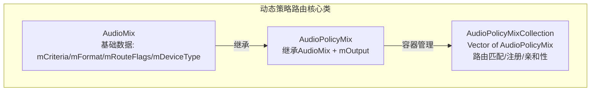
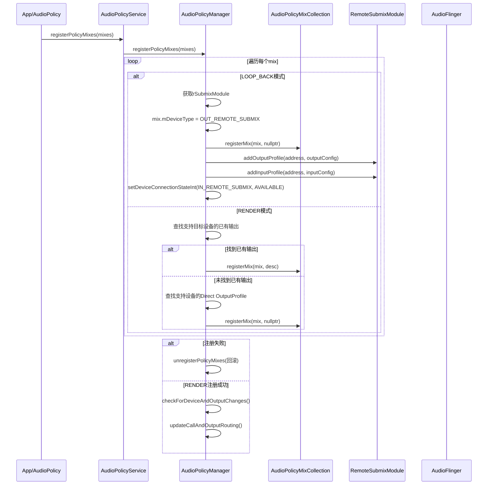
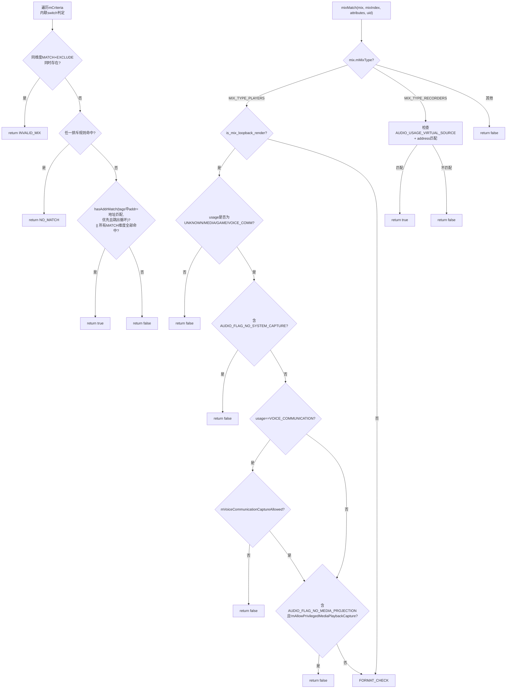
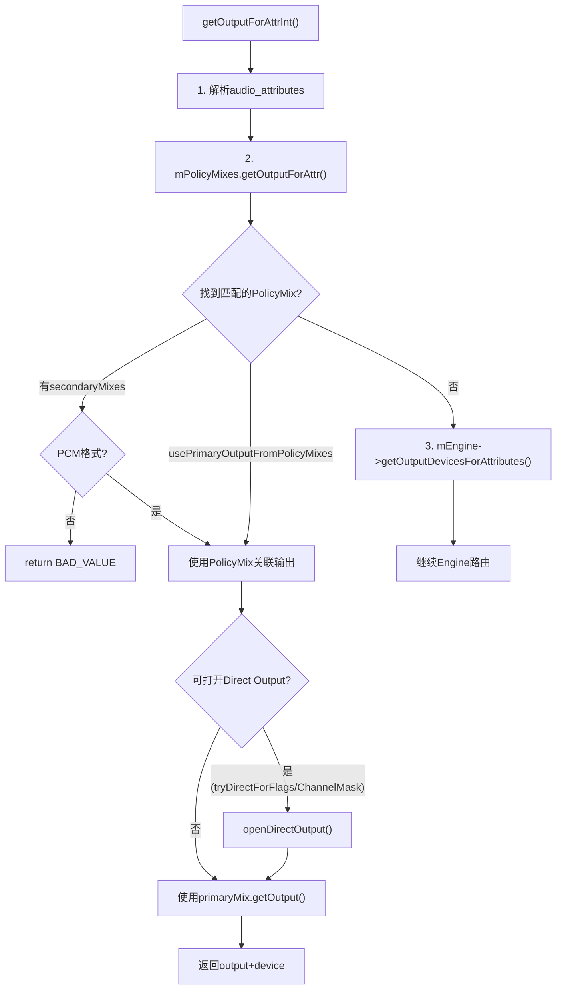
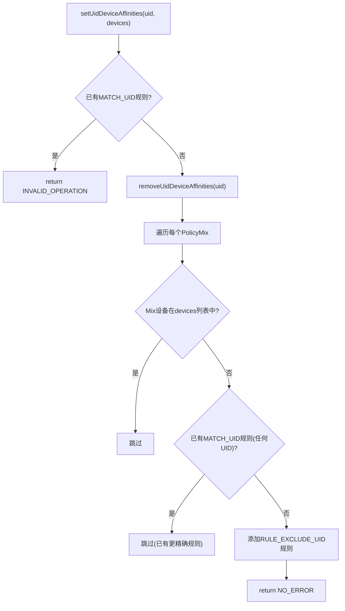
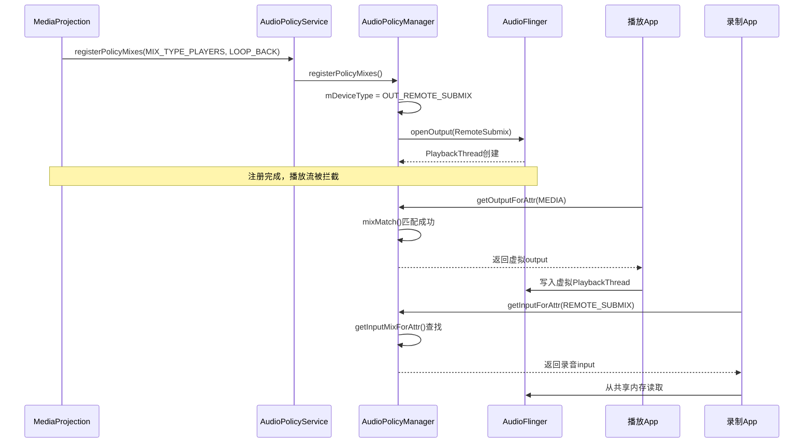

## 6.8 AudioPolicyMix — 动态策略路由

> [← 上一个](06_6.7_Focus_Policy-外部焦点策略.md) | [← 返回Audio Policy Engine](README.md) | [返回导航](../README.md) | [下一个 →](06_6.9_EngineInterface-策略引擎接口.md)

---

### 6.8.1 概述

Android动态策略路由（Dynamic Policy Mix）是一种允许外部应用在运行时注册自定义音频路由规则的机制。与Engine中基于配置文件的静态策略不同，AudioPolicyMix由App通过[`AudioPolicy`](frameworks/av/media/libaudioclient/include/media/AudioPolicy.h)接口动态注入，实现投屏录制、远程子混音、多用户设备隔离等场景。

核心数据流：**App注册AudioMix → APM创建虚拟/物理输出 → getOutputForAttr()匹配路由 → 音频流重定向**



---

### 6.8.2 类结构与继承体系

#### AudioMix基础类

[`AudioMix`](frameworks/av/media/libaudioclient/include/media/AudioPolicy.h:84)定义在`libaudioclient`中，是跨进程传递的基础数据结构：

| 字段 | 类型 | 说明 |
|------|------|------|
| [`mCriteria`](frameworks/av/media/libaudioclient/include/media/AudioPolicy.h:115) | `Vector<AudioMixMatchCriterion>` | 匹配规则集合，最多20条(`MAX_CRITERIA_PER_MIX`) |
| [`mMixType`](frameworks/av/media/libaudioclient/include/media/AudioPolicy.h:116) | `uint32_t` | 混音类型：`MIX_TYPE_PLAYERS`(0)或`MIX_TYPE_RECORDERS`(1) |
| [`mFormat`](frameworks/av/media/libaudioclient/include/media/AudioPolicy.h:117) | `audio_config_t` | 期望的音频格式(采样率/通道掩码/格式) |
| [`mRouteFlags`](frameworks/av/media/libaudioclient/include/media/AudioPolicy.h:118) | `uint32_t` | 路由模式标志位 |
| [`mDeviceType`](frameworks/av/media/libaudioclient/include/media/AudioPolicy.h:119) | `audio_devices_t` | 目标设备类型(如`AUDIO_DEVICE_OUT_REMOTE_SUBMIX`) |
| [`mDeviceAddress`](frameworks/av/media/libaudioclient/include/media/AudioPolicy.h:120) | `String8` | 目标设备地址(也用作注册ID) |
| [`mCbFlags`](frameworks/av/media/libaudioclient/include/media/AudioPolicy.h:121) | `uint32_t` | 回调标志(`kCbFlagNotifyActivity`) |
| [`mAllowPrivilegedMediaPlaybackCapture`](frameworks/av/media/libaudioclient/include/media/AudioPolicy.h:123) | `bool` | 是否忽略`AUDIO_FLAG_NO_MEDIA_PROJECTION` |
| [`mVoiceCommunicationCaptureAllowed`](frameworks/av/media/libaudioclient/include/media/AudioPolicy.h:125) | `bool` | 是否允许捕获语音通信输出 |

#### AudioPolicyMix扩展类

[`AudioPolicyMix`](frameworks/av/services/audiopolicy/common/managerdefinitions/include/AudioPolicyMix.h:33)继承`AudioMix`并添加输出关联：

```cpp
// AudioPolicyMix.h:35-49（逐字）
class AudioPolicyMix : public AudioMix, public RefBase {
public:
    AudioPolicyMix(const AudioMix &mix) : AudioMix(mix) {}
    AudioPolicyMix(const AudioPolicyMix&) = delete;
    AudioPolicyMix& operator=(const AudioPolicyMix&) = delete;

    const sp<SwAudioOutputDescriptor> &getOutput() const { return mOutput; }
    void setOutput(const sp<SwAudioOutputDescriptor> &output) { mOutput = output; }
    void clearOutput() { mOutput.clear(); }

    void dump(String8 *dst, int spaces, int index) const;

private:
    sp<SwAudioOutputDescriptor> mOutput;  // Corresponding output stream
};
```

`mOutput`是动态路由的核心——它将一个逻辑上的AudioMix规则与一个物理/虚拟的输出流绑定，使得匹配该规则的音频流被路由到特定输出。

#### AudioPolicyMixCollection管理类

[`AudioPolicyMixCollection`](frameworks/av/services/audiopolicy/common/managerdefinitions/include/AudioPolicyMix.h:52)继承`Vector<sp<AudioPolicyMix>>`，提供完整的注册/匹配/亲和性管理：

| 方法 | 说明 |
|------|------|
| [`registerMix()`](frameworks/av/services/audiopolicy/common/managerdefinitions/src/AudioPolicyMix.cpp:81) | 注册Mix并关联输出描述符 |
| [`unregisterMix()`](frameworks/av/services/audiopolicy/common/managerdefinitions/src/AudioPolicyMix.cpp:104) | 反注册Mix |
| [`getOutputForAttr()`](frameworks/av/services/audiopolicy/common/managerdefinitions/src/AudioPolicyMix.cpp:153) | 根据属性查找匹配的Mix和输出 |
| [`mixMatch()`](frameworks/av/services/audiopolicy/common/managerdefinitions/src/AudioPolicyMix.cpp:204) | 单个Mix匹配判定(私有方法，返回MixMatchStatus) |
| [`getInputMixForAttr()`](frameworks/av/services/audiopolicy/common/managerdefinitions/src/AudioPolicyMix.cpp:429) | 录音端按地址查找Mix |
| [`setUidDeviceAffinities()`](frameworks/av/services/audiopolicy/common/managerdefinitions/src/AudioPolicyMix.cpp:471) | 设置UID设备亲和性 |
| [`setUserIdDeviceAffinities()`](frameworks/av/services/audiopolicy/common/managerdefinitions/src/AudioPolicyMix.cpp:573) | 设置UserId设备亲和性 |

---

### 6.8.3 AudioMixMatchCriterion匹配规则

[`AudioMixMatchCriterion`](frameworks/av/media/libaudioclient/include/media/AudioPolicy.h:67)是匹配规则的最小单元，采用联合体存储匹配值：

```cpp
// AudioPolicy.h:67-83（逐字）
class AudioMixMatchCriterion {
public:
    union {
        audio_usage_t   mUsage;      // RULE_MATCH_ATTRIBUTE_USAGE
        audio_source_t  mSource;     // RULE_MATCH_ATTRIBUTE_CAPTURE_PRESET
        uid_t           mUid;        // RULE_MATCH_UID
        int             mUserId;     // RULE_MATCH_USERID
    } mValue;
    uint32_t mRule;       // the rule to apply when matching this criterion
                          //    RULE_MATCH_ATTRIBUTE_USAGE
                          //    RULE_MATCH_ATTRIBUTE_CAPTURE_PRESET
                          //    ...
}; //      see audio_policy.h.h RULE_MATCH_* / RULE_EXCLUDE_* rules
```

> **负结论**：联合体只有 4 个成员（无 `mAudioSessionId`；`RULE_MATCH_AUDIO_SESSION_ID` 0x10 本树不存在——grep 零匹配）。

#### 规则类型定义

定义在[`AudioPolicy.h`](frameworks/av/media/libaudioclient/include/media/AudioPolicy.h:32)中的规则常量：

| 规则常量 | 值 | 匹配维度 | 排斥版本 |
|----------|-----|----------|----------|
| `RULE_MATCH_ATTRIBUTE_USAGE` | 0x1 | 音频用途(usage) | `RULE_EXCLUDE_ATTRIBUTE_USAGE` (0x8001) |
| `RULE_MATCH_ATTRIBUTE_CAPTURE_PRESET` | 0x2 | 录音源(source) | `RULE_EXCLUDE_ATTRIBUTE_CAPTURE_PRESET` (0x8002) |
| `RULE_MATCH_UID` | 0x4 | 应用UID | `RULE_EXCLUDE_UID` (0x8004) |
| `RULE_MATCH_USERID` | 0x8 | 用户ID | `RULE_EXCLUDE_USERID` (0x8008) |

排斥标志通过`RULE_EXCLUSION_MASK`(0x8000)与匹配规则OR运算实现。判断是否为排斥规则：`criterion.mRule & RULE_EXCLUSION_MASK`。

#### 匹配逻辑（内联于 mixMatch）

> **负结论**：`isCriterionMatched()` 在本树 AudioPolicyMix.cpp 中**不存在**（grep 零匹配；13+ 重构引入的独立函数）。12L 的单规则判定是 `mixMatch()` 循环内的内联 switch（每条 `RULE_MATCH_*/RULE_EXCLUDE_*` case 直接比较 `mValue` 与 attributes/uid/userId），见 6.8.7。

#### areMixCriteriaMatched()多规则组合匹配

**多维度组合匹配**（同样内联于 `mixMatch`，非独立函数）：

> **负结论**：`areMixCriteriaMatched()`/`areMixCriteriaConsistent()` 在本树**不存在**（grep 零匹配；13+ 重构产物）。12L 实际逻辑（AudioPolicyMix.cpp:239-358）：

```mermaid
flowchart TB
    START["mixMatch() 规则循环<br/>(每条criterion内联switch)"] --> ADDRtags以addr=开头且<br/>地址==mDeviceAddress?
    ADDR -->|"是"| BREAK["hasAddrMatch=true, 跳出循环"]
    ADDR -->|"否"| RULE["按RULE_MATCH_*/RULE_EXCLUDE_*<br/>记录usage/uid/userId维度的<br/>hasXxxRules与XxxFound"]
    RULE --> CONSIST同维度同时存在<br/>MATCH与EXCLUDE?
    CONSIST -->|"是"| INVALID["return INVALID_MIX"]
    CONSIST -->|"否"| EXCL任一排斥规则命中?
    EXCL -->|"是"| BREAK2["跳出循环(将判失败)"]
    EXCL -->|"否"| LOOP["继续下一条"]
    LOOP --> ADDR
    BREAK --> FINAL
    BREAK2 --> FINALhasAddrMatch 或<br/>(无排斥命中 且 所有<br/>MATCH维度全部命中)?
    FINAL -->|"是"| PASS["return MATCH"]
    FINAL -->|"否"| FAIL["return NO_MATCH"]
```

**一致性检查**即循环内的 `hasXxxMatchRules && hasXxxExcludeRules` 三连判（usage/uid/userId），命中返回 `INVALID_MIX`（AudioPolicyMix.cpp:325-340）。

---

### 6.8.4 三种路由模式源码解析

路由模式由`mRouteFlags`控制，定义在[`AudioPolicy.h`](frameworks/av/media/libaudioclient/include/media/AudioPolicy.h:58)：

| 标志 | 值 | 说明 |
|------|-----|------|
| `MIX_ROUTE_FLAG_RENDER` | 0x1 | 直接渲染到指定物理设备 |
| `MIX_ROUTE_FLAG_LOOP_BACK` | 0x2 | 回环到RemoteSubmix虚拟设备 |
| `MIX_ROUTE_FLAG_LOOP_BACK_AND_RENDER` | 0x3 | 同时回环+渲染 |
| `MIX_ROUTE_FLAG_ALL` | 0x3 | RENDER|LOOP_BACK 组合掩码 |

> **负结论**：`MIX_ROUTE_FLAG_DISALLOWS_PREFERRED_DEVICE`(0x4) 在本树 AudioPolicy.h **不存在**（:57-62 仅 4 个标志；13+ 机制）。

辅助判断函数（内联定义在[`AudioPolicy.h`](frameworks/av/media/libaudioclient/include/media/AudioPolicy.h:135)）：
- [`is_mix_loopback_render()`](frameworks/av/media/libaudioclient/include/media/AudioPolicy.h:135)：`routeFlags & LOOP_BACK_AND_RENDER == LOOP_BACK_AND_RENDER`

> **负结论**：`is_mix_loopback()`/`is_mix_disallows_preferred_device()` 本树 AudioPolicy.h 不存在（仅有 is_mix_loopback_render 一个内联判断；grep 零匹配）。

#### LOOP_BACK模式

回环模式创建RemoteSubmix虚拟设备，实现"播放→虚拟输出→录音捕获"的环路：

1. `MIX_TYPE_PLAYERS` 的 Mix `mDeviceType` 被强制设置为 `AUDIO_DEVICE_OUT_REMOTE_SUBMIX`，并使 `AUDIO_DEVICE_IN_REMOTE_SUBMIX` 可用；`MIX_TYPE_RECORDERS` 则相反——`mDeviceType=IN_REMOTE_SUBMIX`、使 `AUDIO_DEVICE_OUT_REMOTE_SUBMIX` 可用（AudioPolicyManager.cpp:3129-3140 逐字逻辑）
2. RemoteSubmix HAL模块添加Output/Input Profile
3. 捕获端App使用`AUDIO_SOURCE_REMOTE_SUBMIX`录音源读取虚拟输出数据

#### RENDER模式

渲染模式将匹配的音频流直接路由到指定物理设备（如HDMI）：

1. 查找已打开的支持目标设备的输出
2. 若无，查找支持目标设备的Direct Output Profile
3. 将Mix与找到的输出描述符关联

#### LOOP_BACK_AND_RENDER模式

同时具备回环和渲染能力，是前两种模式的组合：
- LOOP_BACK部分处理与纯LOOP_BACK相同
- RENDER部分确保音频同时输出到物理设备

---

### 6.8.5 registerPolicyMixes注册流程

[`AudioPolicyManager::registerPolicyMixes()`](frameworks/av/services/audiopolicy/managerdefault/AudioPolicyManager.cpp:3098)是动态路由注册的入口：



**关键源码细节**：

1. **LOOP_BACK注册时output desc传nullptr**（[第3602行](frameworks/av/services/audiopolicy/managerdefault/AudioPolicyManager.cpp:3602)）——输出描述符在`setDeviceConnectionStateInt`触发`openOutput`后才创建

2. **RENDER模式优先复用已有输出**（[第3641行](frameworks/av/services/audiopolicy/managerdefault/AudioPolicyManager.cpp:3641)）：遍历`mOutputs`查找非duplicate且支持目标设备的输出

3. **RENDER回退到Direct Profile**（[第3655行](frameworks/av/services/audiopolicy/managerdefault/AudioPolicyManager.cpp:3655)）：无已有输出时查找`isDirectOutput() && supportsDevice(device)`的Profile

4. **LOOP_BACK_AND_RENDER与LOOP_BACK共用分支**（[第3578行](frameworks/av/services/audiopolicy/managerdefault/AudioPolicyManager.cpp:3578)）：`(mix.mRouteFlags & MIX_ROUTE_FLAG_LOOP_BACK) == MIX_ROUTE_FLAG_LOOP_BACK`条件同时覆盖两种模式

5. **PLAYERS类型校验**（[第3569行](frameworks/av/services/audiopolicy/managerdefault/AudioPolicyManager.cpp:3569)）：LOOP_BACK_RENDER模式仅允许`MIX_TYPE_PLAYERS`

6. **失败回滚**（[第3688行](frameworks/av/services/audiopolicy/managerdefault/AudioPolicyManager.cpp:3688)）：任一mix注册失败则调用`unregisterPolicyMixes`回滚所有已注册的mix

---

### 6.8.6 unregisterPolicyMixes清理流程

[`AudioPolicyManager::unregisterPolicyMixes()`](frameworks/av/services/audiopolicy/managerdefault/AudioPolicyManager.cpp:3235)执行逆操作：

**LOOP_BACK清理**：
1. `mPolicyMixes.unregisterMix(mix)` — 从集合移除
2. 对`IN_REMOTE_SUBMIX`和`OUT_REMOTE_SUBMIX`分别调用`setDeviceConnectionStateInt(UNAVAILABLE)` — 关闭虚拟设备
3. `rSubmixModule->removeOutputProfile(address)` — 移除HAL Profile
4. `rSubmixModule->removeInputProfile(address)` — 移除录音Profile

**RENDER清理**：
1. `mPolicyMixes.unregisterMix(mix)` — 从集合移除
2. 触发`checkForDeviceAndOutputChanges()`和`updateCallAndOutputRouting()`

---

### 6.8.7 mixMatch()匹配算法详解

[`AudioPolicyMixCollection::mixMatch()`](frameworks/av/services/audiopolicy/common/managerdefinitions/src/AudioPolicyMix.cpp:204)是动态路由匹配的核心算法（12L 签名 `(mix, mixIndex, attributes, uid)`，返回 `MixMatchStatus`：INVALID_MIX/NO_MATCH/MATCH，AudioPolicyMix.cpp:204-207）：



**MIX_TYPE_PLAYERS匹配规则**：

1. **Loopback Render安全检查**（AudioPolicyMix.cpp:209-231 逐字）：
   - 仅允许`UNKNOWN/MEDIA/GAME/VOICE_COMMUNICATION`四种usage
   - 拒绝含`AUDIO_FLAG_NO_SYSTEM_CAPTURE`的流
   - 语音通信需要`mVoiceCommunicationCaptureAllowed=true`
   - 非语音需要`mAllowPrivilegedMediaPlaybackCapture=true`来绕过`AUDIO_FLAG_NO_MEDIA_PROJECTION`

2. **一致性检查**（AudioPolicyMix.cpp:263-340）：同一维度（usage/uid/userId）同时存在 MATCH 与 EXCLUDE 规则 → `INVALID_MIX`；任一排斥规则命中 → 跳出循环判 `NO_MATCH`

3. **双重匹配途径**（AudioPolicyMix.cpp:246-250、:352-360）：
   - **地址匹配**：内联 `strncmp(attributes.tags, "addr=", ...)` 与 `mDeviceAddress` 比较（优先命中即跳出循环；**负结论**：`extractAddressFromAudioAttributes()` 本树不存在）
   - **规则匹配**：内联按 usage/uid/userId 三维度判定"无排斥命中且所有 MATCH 维度全部命中"

> **格式检查位置**：mixMatch **不做**格式检查——PCM/压缩格式兼容性检查位于 APM `getOutputForAttrInt()`（AudioPolicyManager.cpp:1049-1054，`audio_is_linear_pcm` 拒绝），属调用方而非 mixMatch。

**MIX_TYPE_RECORDERS匹配规则**：

仅当`usage == AUDIO_USAGE_VIRTUAL_SOURCE`且地址匹配时返回true。这是远程子混音录音端回读的入口。

---

### 6.8.8 getOutputForAttr()中动态策略匹配流程

[`AudioPolicyMixCollection::getOutputForAttr()`](frameworks/av/services/audiopolicy/common/managerdefinitions/src/AudioPolicyMix.cpp:153)在APM的[`getOutputForAttrInt()`](frameworks/av/services/audiopolicy/managerdefault/AudioPolicyManager.cpp:1003)中被调用，是Engine路由决策前的优先级更高的路由路径：



**getOutputForAttr()内部逻辑**（AudioPolicyMix.cpp:153-202）：

1. 遍历所有已注册的`AudioPolicyMix`
2. 对每个Mix调用`mixMatch()`检查是否匹配（INVALID_MIX 直接返回 BAD_VALUE）
3. 拒绝MMAP_NOIRQ流路由到loopback mix
4. 区分primaryMix（非LOOP_BACK_RENDER）和secondaryMix（LOOP_BACK_RENDER）
5. 计算usePrimaryOutputFromPolicyMixes标志

> **负结论**：`mixDisallowsRequestedDevice()` 及"DISALLOWS_PREFERRED_DEVICE 阻止首选设备路由"逻辑本树不存在（grep 零匹配，13+ 机制）。

**primaryMix vs secondaryMixes**：
- `primaryMix`：RENDER模式的Mix，一个请求最多匹配一个primary
- `secondaryMixes`：LOOP_BACK_RENDER模式的Mix，可同时匹配多个（如投屏+录制并行）

---

### 6.8.9 UidDeviceAffinity与UserIdDeviceAffinity亲和性路由

亲和性路由允许将特定UID/UserId的音频流限制到指定设备集合，是AAOS多区域路由的核心机制。

#### setUidDeviceAffinities()

[`setUidDeviceAffinities()`](frameworks/av/services/audiopolicy/common/managerdefinitions/src/AudioPolicyMix.cpp:471)为指定UID设置允许的设备列表：

1. **冲突检测**：若已有`RULE_MATCH_UID`规则则返回`INVALID_OPERATION`
2. **清除旧规则**：调用`removeUidDeviceAffinities()`删除该UID的`RULE_EXCLUDE_UID`规则
3. **注入排斥规则**：对每个目标设备不在devices列表中的Mix，添加`RULE_EXCLUDE_UID`规则



#### setUserIdDeviceAffinities()

[`setUserIdDeviceAffinities()`](frameworks/av/services/audiopolicy/common/managerdefinitions/src/AudioPolicyMix.cpp:573)逻辑与UID版本对称（冲突检测→removeUserIdDeviceAffinities→注入RULE_EXCLUDE_USERID排斥规则），**不设置任何路由标志**（12L 无 DISALLOWS_PREFERRED_DEVICE 机制；此前"注入规则时同时设置该标志"的说法无源码依据，已删）。

#### isDeviceAffinityCompatible()

[`isDeviceAffinityCompatible()`](frameworks/av/media/libaudioclient/include/media/AudioPolicy.h:113)判断一个Mix是否支持亲和性——仅当没有MATCH_UID/MATCH_USERID规则时才允许设置亲和性，避免规则冲突。

---

### 6.8.10 getInputMixForAttr()录音端路由

[`getInputMixForAttr()`](frameworks/av/services/audiopolicy/common/managerdefinitions/src/AudioPolicyMix.cpp:429)处理LOOP_BACK模式的录音端路由：

1. 从`audio_attributes_t.tags`中提取`addr=xxx`地址
2. 按地址在已注册Mix中查找匹配项
3. 校验Mix类型必须为`MIX_TYPE_PLAYERS`
4. 返回对应的`AudioPolicyMix`

录音端通过`AUDIO_SOURCE_REMOTE_SUBMIX`源+Mix地址建立与播放端虚拟输出的连接。数据流路径：
`App播放 → 匹配Mix → 虚拟PlaybackThread → 共享内存 → RemoteSubmix HAL → App录音`

---

### 6.8.11 典型应用场景

#### 场景1：MediaProjection屏幕录制



#### 场景2：Cast投影到HDMI

使用RENDER模式，将匹配的播放流直接路由到HDMI设备：
- Mix配置：`MIX_TYPE_PLAYERS + MIX_ROUTE_FLAG_RENDER + mDeviceType=AUDIO_DEVICE_OUT_HDMI`
- 匹配的播放流跳过Engine路由，直接输出到HDMI关联的PlaybackThread

#### 场景3：多用户隔离路由(AAOS)

通过UserIdDeviceAffinity实现车内多区域音频隔离：

```cpp
// 用户0路由到主区域扬声器
setUserIdDeviceAffinities(0, {AudioDeviceTypeAddr(AUDIO_DEVICE_OUT_SPEAKER, "")});
// 用户10路由到后排区域扬声器
setUserIdDeviceAffinities(10, {AudioDeviceTypeAddr(AUDIO_DEVICE_OUT_BUS, "bus1000")});
```

效果：用户0的播放流被排除从bus1000输出，用户10的播放流被排除从speaker输出。

#### 场景4：辅助功能音频捕获

AccessibilityService通过LOOP_BACK模式截获播放音频用于转录或描述：
- 使用`mAllowPrivilegedMediaPlaybackCapture=true`绕过`AUDIO_FLAG_NO_MEDIA_PROJECTION`保护

| 场景 | Mix类型 | RouteFlag | 关键配置 |
|------|---------|-----------|----------|
| MediaProjection录制 | PLAYERS | LOOP_BACK | RemoteSubmix虚拟设备 |
| Cast到HDMI | PLAYERS | RENDER | mDeviceType=HDMI |
| 投屏+录制 | PLAYERS | LOOP_BACK_AND_RENDER | 同时虚拟+物理输出 |
| 多用户隔离(AAOS) | PLAYERS | RENDER | setUserIdDeviceAffinities 注入 RULE_EXCLUDE_USERID |
| 辅助功能捕获 | PLAYERS | LOOP_BACK | mAllowPrivilegedMediaPlaybackCapture=true |
| 远程录音源 | RECORDERS | LOOP_BACK | AUDIO_USAGE_VIRTUAL_SOURCE |

---

### 6.8.12 设计要点总结

1. **优先级**：动态策略路由优先于Engine静态路由，在`getOutputForAttrInt()`中先查PolicyMixes再查Engine

2. **安全性**：LOOP_BACK_RENDER模式严格限制可捕获的音频类型，通过`AUDIO_FLAG_NO_SYSTEM_CAPTURE`和`AUDIO_FLAG_NO_MEDIA_PROJECTION`保护隐私

3. **隔离性**：亲和性路由通过注入 `RULE_EXCLUDE_USERID/RULE_EXCLUDE_UID` 排斥规则实现（12L 无 DISALLOWS_PREFERRED_DEVICE 标志，App 首选设备仍可参与路由仲裁）

4. **可扩展**：最多支持10个Mix(`MAX_MIXES_PER_POLICY`=10，AudioPolicy.h:64)，每个Mix最多20条规则(`MAX_CRITERIA_PER_MIX`=20，:65)

5. **回滚机制**：注册失败时自动清理已注册的Mix，保持系统一致性

6. **双重匹配**：mixMatch()同时支持基于地址(tags中addr=)和基于规则(mCriteria)的匹配，前者用于录音端回读，后者用于播放端拦截

> **核心设计**：AudioPolicyMix是Android运行时动态路由的唯一机制。它将"匹配规则"与"输出目标"绑定，在`getOutputForAttr()`中优先于Engine决策，使App能通过注册规则控制音频流向。LOOP_BACK模式通过RemoteSubmix虚拟设备实现播放→录音的环路捕获，RENDER模式实现播放→指定设备的直接路由。

---

> [← 上一个](06_6.7_Focus_Policy-外部焦点策略.md) | [← 返回Audio Policy Engine](README.md) | [返回导航](../README.md) | [下一个 →](06_6.9_EngineInterface-策略引擎接口.md)