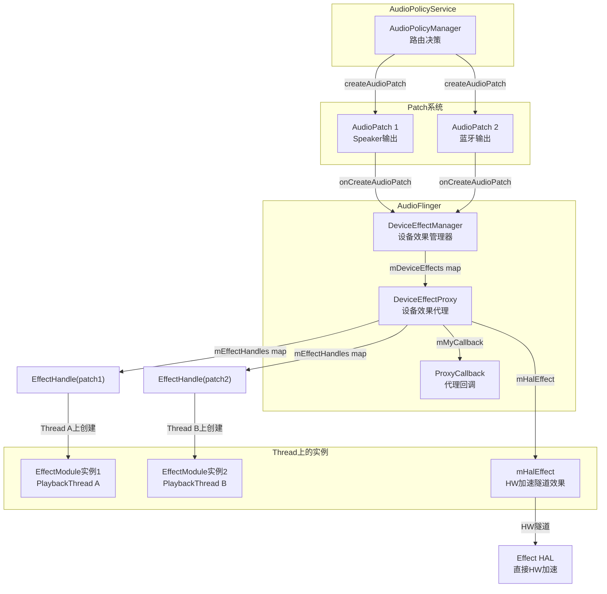
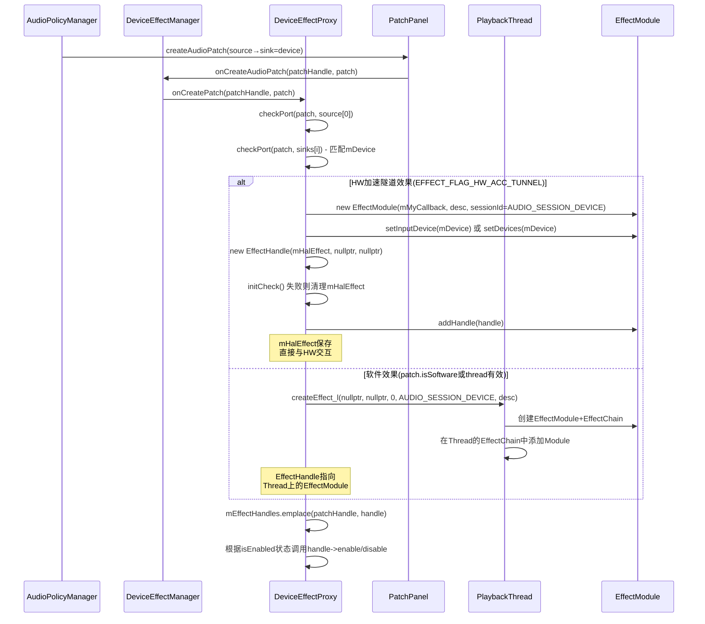
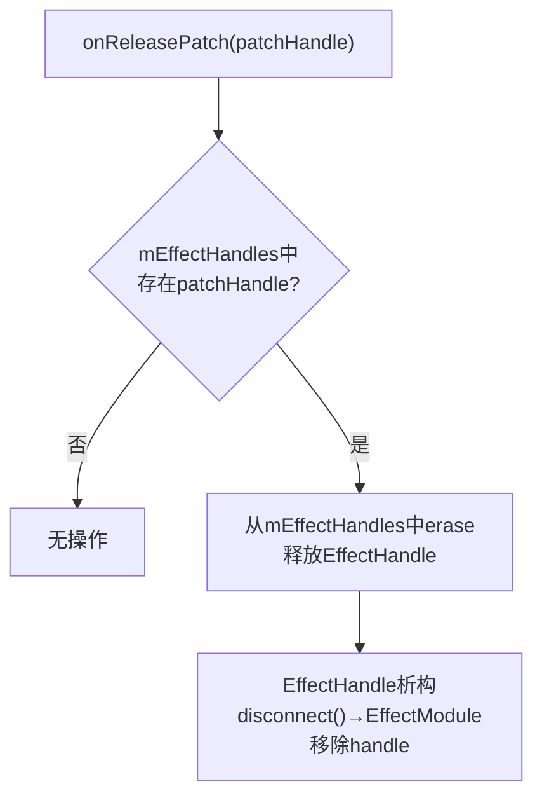
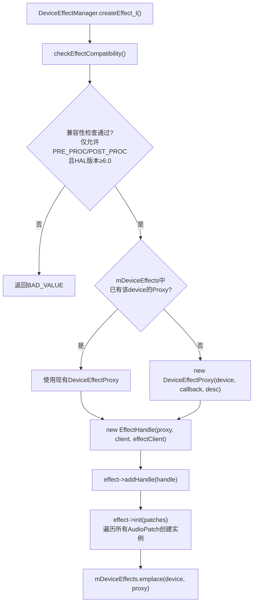
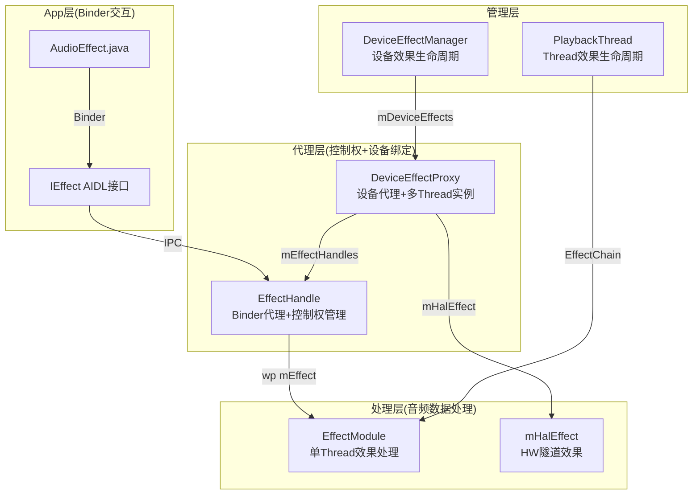
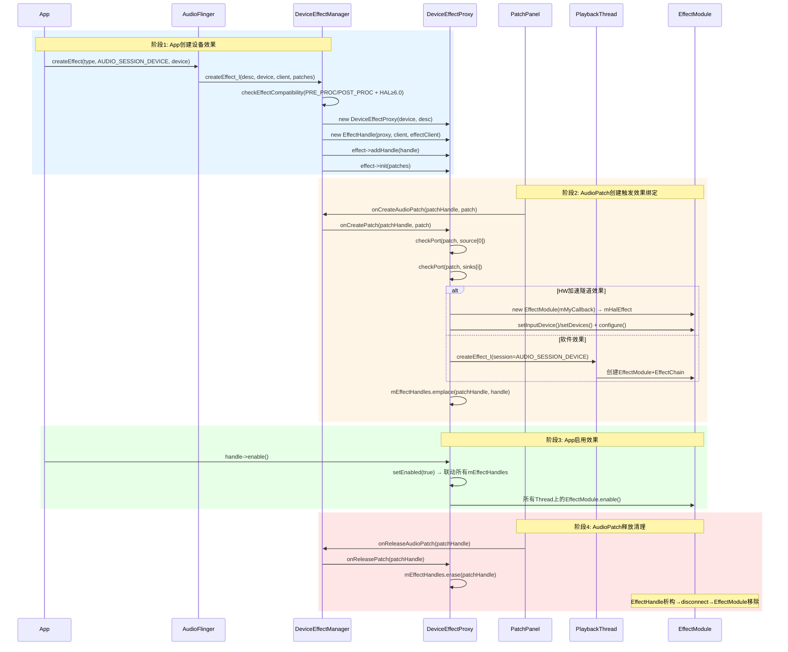

[← 7.10 EffectHandle](07_7.10_EffectHandle.md) | [← 返回Effects Framework](README.md) | [返回导航](../README.md) | [7.12 内置音效Native实现 →](07_7.12_内置音效Native实现.md)

---

## 7.11 DeviceEffectProxy — 设备级音效代理

### 7.11.1 DeviceEffectProxy架构设计

[`DeviceEffectProxy`](frameworks/av/services/audioflinger/Effects.h)继承自`EffectBase`，用于设备级音效（Device Effect）的代理管理。与普通EffectModule不同，DeviceEffectProxy不绑定到特定Thread上的EffectChain，而是通过`DeviceEffectManager`管理，根据AudioPatch动态在相关Thread上创建EffectModule实例。

**DeviceEffectProxy架构图：**



**DeviceEffectProxy核心成员变量（源码: [`Effects.h`](frameworks/av/services/audioflinger/Effects.h)）：**

| 成员 | 类型 | 说明 |
|------|------|------|
| `mDevice` | const AudioDeviceTypeAddr | 目标设备（类型+地址） |
| `mManagerCallback` | const sp＜DeviceEffectManagerCallback＞ | 管理器回调接口 |
| `mMyCallback` | const sp＜ProxyCallback＞ | 代理回调（创建EffectModule时使用） |
| `mProxyLock` | Mutex | 保护mEffectHandles和mHalEffect |
| `mEffectHandles` | map＜audio_patch_handle_t, sp＜EffectHandle＞＞ | 每个AudioPatch对应的EffectHandle |
| `mHalEffect` | sp＜EffectModule＞ | HW加速隧道效果的EffectModule |
| `mDevicePort` | audio_port_config | 设备端口配置（HW加速时使用） |
| `mNotifyFramesProcessed` | const bool | 是否通知帧处理事件 |

---

### 7.11.2 多Thread音效实例管理

DeviceEffectProxy的核心能力是在不同AudioPatch对应的Thread上创建独立的EffectModule实例。当设备（如Speaker）同时有多个AudioPatch时，每个Patch对应的Thread上都会有一个EffectModule处理该Thread的音频数据。

**AudioPatch创建时效果绑定时序图：**



**setEnabled()的多Handle联动（源码: [`Effects.cpp`](frameworks/av/services/audioflinger/Effects.cpp)）：**

```cpp
status_t AudioFlinger::DeviceEffectProxy::setEnabled(bool enabled, bool fromHandle) {
    status_t status = EffectBase::setEnabled(enabled, fromHandle);
    Mutex::Autolock _l(mProxyLock);
    if (status == NO_ERROR) {
        for (auto& handle : mEffectHandles) {
            if (enabled) {
                handle.second->enable(&status);
            } else {
                handle.second->disable(&status);
            }
        }
    }
    return status;
}
```

当DeviceEffectProxy被启用/禁用时，它会联动所有已注册的EffectHandle——确保每个Thread上的EffectModule实例状态一致。

**AudioPatch释放时效果清理（源码: [`Effects.cpp`](frameworks/av/services/audioflinger/Effects.cpp)）：**



**DeviceEffectManager创建流程（源码: [`DeviceEffectManager.cpp`](frameworks/av/services/audioflinger/DeviceEffectManager.cpp)）：**



---

### 7.11.3 DeviceEffectProxy与EffectHandle对比

| 维度 | DeviceEffectProxy | EffectHandle |
|------|-------------------|-------------|
| 继承关系 | EffectBase（音效基类） | BnEffect（Binder服务端） |
| 对外可见性 | AudioFlinger内部，不直接暴露给App | 通过Binder暴露给App |
| 生命周期管理 | 由DeviceEffectManager管理 | 随App进程存活/死亡 |
| 绑定对象 | 设备(AudioDeviceTypeAddr) | EffectModule/EffectBase |
| 效果实例 | 每个AudioPatch一个EffectModule实例 | 只关联一个EffectModule |
| sessionId | AUDIO_SESSION_DEVICE(-2) | App指定的sessionId |
| 启用联动 | setEnabled联动所有mEffectHandles | 只控制单个EffectModule |
| HW加速支持 | 通过mHalEffect实现隧道效果 | 不直接处理HW加速 |
| Patch感知 | 监听AudioPatch创建/释放 | 不感知AudioPatch |
| ProxyCallback | 自有ProxyCallback创建HAL | 通过EffectModule的Callback创建HAL |

**DeviceEffectProxy vs EffectHandle vs EffectModule 三层架构图：**



> **核心区别**: EffectHandle是App→AudioFlinger的Binder通道，DeviceEffectProxy是AudioFlinger内部管理设备级音效的代理。前者解决"App如何控制音效"，后者解决"设备级音效如何在多个Thread上生效"。

---

### 7.11.4 DeviceEffectProxy关键方法源码解析

#### checkPort() — AudioPatch端口匹配与效果创建（源码: [`DeviceEffectProxy::checkPort()`](frameworks/av/services/audioflinger/Effects.cpp:3239)，:3239-3311 逐字摘录主干）

`checkPort()`是DeviceEffectProxy最核心的方法，负责检查AudioPatch中的端口是否匹配目标设备，并决定创建HW加速还是软件效果实例。

```cpp
status_t AudioFlinger::DeviceEffectProxy::checkPort(const PatchPanel::Patch& patch,
        const struct audio_port_config *port, sp <EffectHandle> *handle) {

    ALOGV("%s type %d device type %d address %s device ID %d patch.isSoftware() %d",
            __func__, port->type, port->ext.device.type,
            port->ext.device.address, port->id, patch.isSoftware());
    if (port->type != AUDIO_PORT_TYPE_DEVICE || port->ext.device.type != mDevice.mType
        || port->ext.device.address != mDevice.address()) {
        return NAME_NOT_FOUND;
    }
    status_t status = NAME_NOT_FOUND;

    if (mDescriptor.flags & EFFECT_FLAG_HW_ACC_TUNNEL) {
        Mutex::Autolock _l(mProxyLock);
        mDevicePort = *port;
        mHalEffect = new EffectModule(mMyCallback,
                                      const_cast<effect_descriptor_t *>(&mDescriptor),
                                      mMyCallback->newEffectId(), AUDIO_SESSION_DEVICE,
                                      false /* pinned */, port->id);
        if (audio_is_input_device(mDevice.mType)) {
            mHalEffect->setInputDevice(mDevice);
        } else {
            mHalEffect->setDevices({mDevice});
        }
        *handle = new EffectHandle(mHalEffect, nullptr, nullptr, 0 /*priority*/,
                                   mNotifyFramesProcessed);
        status = (*handle)->initCheck();
        if (status == OK) {
            status = mHalEffect->addHandle((*handle).get());
        } else {
            mHalEffect.clear();
            mDevicePort.id = AUDIO_PORT_HANDLE_NONE;
        }
    } else if (patch.isSoftware() || patch.thread().promote() != nullptr) {
        sp <ThreadBase> thread;
        if (audio_port_config_has_input_direction(port)) {
            if (patch.isSoftware()) {
                thread = patch.mRecord.thread();
            } else {
                thread = patch.thread().promote();
            }
        } else {
            if (patch.isSoftware()) {
                thread = patch.mPlayback.thread();
            } else {
                thread = patch.thread().promote();
            }
        }
        int enabled;
        *handle = thread->createEffect_l(nullptr, nullptr, 0, AUDIO_SESSION_DEVICE,
                                         const_cast<effect_descriptor_t *>(&mDescriptor),
                                         &enabled, &status, false, false /*probe*/,
                                         mNotifyFramesProcessed);
        ALOGV("%s thread->createEffect_l status %d", __func__, status);
    } else {
        status = BAD_VALUE;
    }
    if (status == NO_ERROR || status == ALREADY_EXISTS) {
        Status bs;
        if (isEnabled()) {
            bs = (*handle)->enable(&status);
        } else {
            bs = (*handle)->disable(&status);
        }
        if (!bs.isOk()) {
            status = statusTFromBinderStatus(bs);
        }
    }
    return status;
}
```

> **勘误（版本边界）**：12L 的 checkPort 在设备匹配后**直接进入 HW_ACC_TUNNEL/软件分支**，没有 PRE_PROC/POST_PROC 端口方向过滤（`EFFECT_FLAG_TYPE_POST_PROC && audio_port_config_has_input_direction` 等两段为 13+ 代码）；HW 分支也**没有 `mHalEffect->configure()` 调用**（configure 发生在 addHandle 后的链路），但**有** `initCheck()` 失败清理分支（`mHalEffect.clear()` + `mDevicePort.id` 复位）。

**checkPort决策矩阵：**

| 条件 | 效果Flag | Patch类型 | 创建结果 |
|------|----------|-----------|----------|
| 设备匹配+HW隧道 | `EFFECT_FLAG_HW_ACC_TUNNEL` | 任意 | mHalEffect（直接HAL交互） |
| 设备匹配+软件 | 非`HW_ACC_TUNNEL` | `isSoftware()`或有Thread | Thread上EffectModule |
| 设备匹配+无Thread | 非`HW_ACC_TUNNEL` | 非软件且无Thread | `BAD_VALUE` |
| 设备不匹配 | 任意 | 任意 | `NAME_NOT_FOUND`（继续搜索） |

> **负结论**：12L checkPort **没有**"POST_PROC 不在录音端口 / PRE_PROC 不在播放端口"的方向过滤（PRE_PROC/POST_PROC 校验发生在上游 [`DeviceEffectManager::checkEffectCompatibility()`](frameworks/av/services/audioflinger/DeviceEffectManager.cpp:121)，且只校验类型与 HAL 版本，不校验端口方向）。

#### onCreatePatch() — AudioPatch创建回调（源码: [`Effects.cpp`](frameworks/av/services/audioflinger/Effects.cpp:2577)）

```cpp
status_t DeviceEffectProxy::onCreatePatch(
        audio_patch_handle_t patchHandle, const PatchPanel::Patch& patch) {
    status_t status = NAME_NOT_FOUND;
    sp<EffectHandle> handle;
    // 先检查source[0]（唯一的真实source）
    status = checkPort(patch, &patch.mAudioPatch.sources[0], &handle);
    // 如果source不匹配，遍历所有sink
    for (uint32_t i = 0; i < patch.mAudioPatch.num_sinks && status == NAME_NOT_FOUND; i++) {
        status = checkPort(patch, &patch.mAudioPatch.sinks[i], &handle);
    }
    // 匹配成功则注册到mEffectHandles
    if (status == NO_ERROR || status == ALREADY_EXISTS) {
        Mutex::Autolock _l(mProxyLock);
        mEffectHandles.emplace(patchHandle, handle);
    }
    return status;
}
```

> **搜索顺序**: 先检查source端口（通常对应输入设备如MIC），再检查sink端口（通常对应输出设备如Speaker）。这与PRE_PROC/POST_PROC的语义匹配——PRE_PROC绑定输入源，POST_PROC绑定输出sink。

#### onReleasePatch() — AudioPatch释放回调（源码: [`DeviceEffectProxy::onReleasePatch()`](frameworks/av/services/audioflinger/Effects.cpp:3310)，:3310-3312 逐字摘录）

```cpp
void AudioFlinger::DeviceEffectProxy::onReleasePatch(audio_patch_handle_t patchHandle) {
    Mutex::Autolock _l(mProxyLock);
    mEffectHandles.erase(patchHandle);
}
```

> **简洁设计**: `onReleasePatch()`只需从map中移除Handle，Handle的析构函数会自动触发`disconnect()`→`EffectModule::removeHandle()`→清理效果实例。

#### removeEffect() — HW效果移除（源码: [`Effects.cpp`](frameworks/av/services/audioflinger/Effects.cpp:2577)）

```cpp
size_t DeviceEffectProxy::removeEffect(const sp<EffectModule>& effect) {
    Mutex::Autolock _l(mProxyLock);
    if (effect == mHalEffect) {
        mHalEffect->release_l();  // 释放HAL效果资源
        mHalEffect.clear();
        mDevicePort.id = AUDIO_PORT_HANDLE_NONE;  // 重置设备端口
    }
    return mHalEffect == nullptr ? 0 : 1;
}
```

---

### 7.11.5 ProxyCallback回调详解（源码: [`Effects.cpp`](frameworks/av/services/audioflinger/Effects.cpp:2577)）

`ProxyCallback`是DeviceEffectProxy的内部回调类，实现`EffectCallbackInterface`接口。当HW加速的`mHalEffect`需要创建HAL实例或查询音频配置时，通过此回调获取信息。

| 方法 | 行号 | 说明 |
|------|------|------|
| [`newEffectId()`](frameworks/av/services/audioflinger/Effects.cpp:3415) | Effects.cpp:3415 | 从AudioFlinger获取唯一效果ID |
| [`disconnectEffectHandle()`](frameworks/av/services/audioflinger/Effects.cpp:3420) | Effects.cpp:3420 | Handle断开时清理DeviceEffectProxy |
| [`createEffectHal()`](frameworks/av/services/audioflinger/Effects.cpp:3446) | Effects.cpp:3446 | 创建Effect HAL实例（传递deviceId给HAL） |
| [`addEffectToHal()`](frameworks/av/services/audioflinger/Effects.cpp:3452) | Effects.cpp:3452 | 将效果添加到Audio HAL（流效果链） |
| [`removeEffectFromHal()`](frameworks/av/services/audioflinger/Effects.cpp:3461) | Effects.cpp:3461 | 从Audio HAL移除效果 |
| [`isOutput()`](frameworks/av/services/audioflinger/Effects.cpp:3470) | Effects.cpp:3470 | 基于设备端口方向判断输出/输入 |
| [`sampleRate()`](frameworks/av/services/audioflinger/Effects.cpp:3478) | Effects.cpp:3478 | 返回设备端口的采样率 |
| [`inChannelMask()` / `inChannelCount()`](frameworks/av/services/audioflinger/Effects.cpp:3486) | Effects.cpp:3486/:3495 | 返回输入通道掩码/通道数 |
| [`outChannelMask()` / `outChannelCount()`](frameworks/av/services/audioflinger/Effects.cpp:3503) | Effects.cpp:3503/:3511 | 返回输出通道掩码/通道数 |
| `onEffectEnable()` / `onEffectDisable()` | Effects.h:769-770 | **空实现**（`{}` 内联覆盖，不通知任何Thread） |

**ProxyCallback vs ThreadBase::EffectCallback对比：**

| 回调来源 | ThreadBase回调 | ProxyCallback |
|----------|--------------|---------------|
| 所属对象 | PlaybackThread/RecordThread | DeviceEffectProxy |
| 音频配置来源 | Thread的mFormat/mSampleRate/mChannelMask | mDevicePort端口配置 |
| createEffectHal | 不传deviceId | 传递deviceId给HAL（关键差异） |
| addEffectToHal | 通过Thread的mOutput/mInput流 | 通过mManagerCallback→AudioFlinger |
| 效果链管理 | EffectChain在Thread内部 | mHalEffect独立于Thread |

> **关键差异**: `ProxyCallback::createEffectHal()`调用`mManagerCallback->createEffectHal()`时，会传递`deviceId`参数给HAL——这是HW加速隧道效果能够绑定到特定设备的关键。而Thread的回调通过`AUDIO_IO_HANDLE_NONE`让HAL自行选择。

---

### 7.11.6 DeviceEffectManager管理流程（源码: [`DeviceEffectManager.cpp`](frameworks/av/services/audioflinger/DeviceEffectManager.cpp)）

#### createEffect_l() — 创建设备效果（源码: [`DeviceEffectManager::createEffect_l()`](frameworks/av/services/audioflinger/DeviceEffectManager.cpp:72)，:72-125 逐字摘录）

```cpp
sp<AudioFlinger::EffectHandle> AudioFlinger::DeviceEffectManager::createEffect_l(
        effect_descriptor_t *descriptor,
        const AudioDeviceTypeAddr& device,
        const sp<AudioFlinger::Client>& client,
        const sp<IEffectClient>& effectClient,
        const std::map<audio_patch_handle_t, PatchPanel::Patch>& patches,
        int *enabled,
        status_t *status,
        bool probe,
        bool notifyFramesProcessed) {
    sp<DeviceEffectProxy> effect;
    sp<EffectHandle> handle;
    status_t lStatus;

    lStatus = checkEffectCompatibility(descriptor);
    if (probe || lStatus != NO_ERROR) {
       *status = lStatus;
       return handle;
    }

    {
        Mutex::Autolock _l(mLock);
        auto iter = mDeviceEffects.find(device);
        if (iter != mDeviceEffects.end()) {
            effect = iter->second;
        } else {
            effect = new DeviceEffectProxy(device, mMyCallback,
                    descriptor, mAudioFlinger.nextUniqueId(AUDIO_UNIQUE_ID_USE_EFFECT),
                    notifyFramesProcessed);
        }
        // create effect handle and connect it to effect module
        handle = new EffectHandle(effect, client, effectClient, 0 /*priority*/,
                                  notifyFramesProcessed);
        lStatus = handle->initCheck();
        if (lStatus == NO_ERROR) {
            lStatus = effect->addHandle(handle.get());
            if (lStatus == NO_ERROR) {
                effect->init(patches);
                mDeviceEffects.emplace(device, effect);
            }
        }
    }
    if (enabled != NULL) {
        *enabled = (int)effect->isEnabled();
    }
    *status = lStatus;
    return handle;
}
```

#### checkEffectCompatibility() — 兼容性校验（源码: [`DeviceEffectManager::checkEffectCompatibility()`](frameworks/av/services/audioflinger/DeviceEffectManager.cpp:121)）

```cpp
// DeviceEffectManager.cpp:121-141 逐字摘录（12L）
status_t AudioFlinger::DeviceEffectManager::checkEffectCompatibility(
        const effect_descriptor_t *desc) {
    sp<EffectsFactoryHalInterface> effectsFactory = mAudioFlinger.getEffectsFactory();
    if (effectsFactory == nullptr) {
        return BAD_VALUE;
    }

    static const float sMinDeviceEffectHalVersion = 6.0;
    float halVersion = effectsFactory->getHalVersion();

    if (((desc->flags & EFFECT_FLAG_TYPE_MASK) != EFFECT_FLAG_TYPE_PRE_PROC
            && (desc->flags & EFFECT_FLAG_TYPE_MASK) != EFFECT_FLAG_TYPE_POST_PROC)
            || halVersion < sMinDeviceEffectHalVersion) {
        ALOGW("%s() non pre/post processing device effect %s or incompatible API version %f",
                __func__, desc->name, halVersion);
        return BAD_VALUE;
    }

    return NO_ERROR;
}
```

> **HAL版本要求**: Device Effect功能需要Audio HAL 6.0+（HIDL），因为旧版HAL不支持设备级效果的`addDeviceEffect()`/`removeDeviceEffect()`接口。

#### disconnectEffectHandle() — Handle断开清理（源码: L184）

```cpp
bool DeviceEffectManagerCallback::disconnectEffectHandle(
        EffectHandle *handle, bool unpinIfLast) {
    sp<EffectBase> effectBase = handle->effect().promote();
    sp<DeviceEffectProxy> effect = effectBase->asDeviceEffectProxy();
    // 如果是最后一个Handle且允许unpin，则移除整个DeviceEffectProxy
    bool remove = (effect->removeHandle(handle) == 0) && (!effect->isPinned() || unpinIfLast);
    if (remove) {
        mManager.removeEffect(effect);  // 从mDeviceEffects中移除
        if (handle->enabled()) {
            effectBase->checkSuspendOnEffectEnabled(false, false);
        }
    }
    return true;
}
```

---

### 7.11.7 DeviceEffectProxy音频配置查询

DeviceEffectProxy需要提供音频配置信息给`mHalEffect`的`configure()`调用。这些配置从`mDevicePort`端口配置中获取：

```cpp
bool DeviceEffectProxy::isOutput() const {
    if (mDevicePort.id != AUDIO_PORT_HANDLE_NONE) {
        return mDevicePort.role == AUDIO_PORT_ROLE_SINK;  // SINK=输出
    }
    return true;  // 默认输出
}

uint32_t DeviceEffectProxy::sampleRate() const {
    if (mDevicePort.id != AUDIO_PORT_HANDLE_NONE &&
            (mDevicePort.config_mask & AUDIO_PORT_CONFIG_SAMPLE_RATE) != 0) {
        return mDevicePort.sample_rate;
    }
    return DEFAULT_OUTPUT_SAMPLE_RATE;  // 默认48000Hz
}

audio_channel_mask_t DeviceEffectProxy::channelMask() const {
    if (mDevicePort.id != AUDIO_PORT_HANDLE_NONE &&
            (mDevicePort.config_mask & AUDIO_PORT_CONFIG_CHANNEL_MASK) != 0) {
        return mDevicePort.channel_mask;
    }
    return AUDIO_CHANNEL_OUT_STEREO;  // 默认立体声
}
```

> **回退策略**: 当mDevicePort未配置时，使用默认值（48kHz/立体声/输出方向），确保HW加速效果至少能完成`configure()`初始化。

---

### 7.11.8 完整生命周期时序



---

[← 7.10 EffectHandle](07_7.10_EffectHandle.md) | [← 返回Effects Framework](README.md) | [返回导航](../README.md) | [7.12 内置音效Native实现 →](07_7.12_内置音效Native实现.md)
