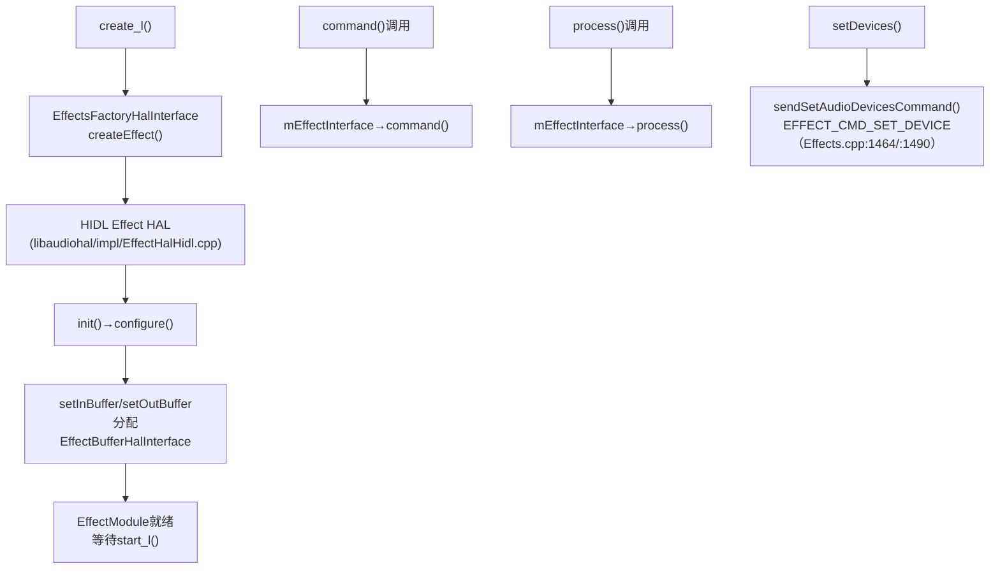
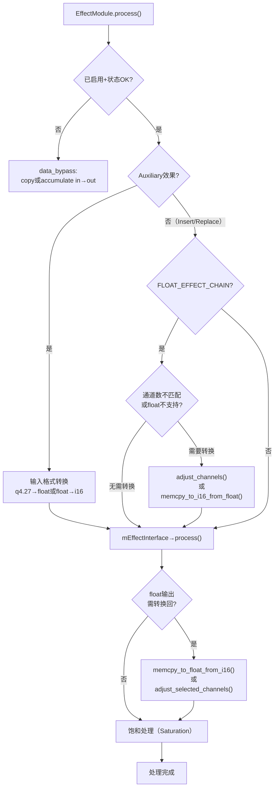

[← 7.3 EffectModule — 单](07_7.3_EffectModule.md) | [← 返回Effects Framework](README.md) | [返回导航](../README.md) | [7.5 EffectChain::pro →](07_7.5_EffectChainprocess_l深度解析.md)

---

## 7.4 EffectModule内部架构详解

### 成员变量与HAL交互

[`EffectModule`](frameworks/av/services/audioflinger/Effects.h)的核心成员变量（Effects.h:306-323，逐行对应）：

| 成员 | 类型 | 说明 | 源码行 |
|------|------|------|--------|
| `mConfig` | effect_config_t | 输入/输出音频配置（格式、通道、buffer） | L306 |
| `mEffectInterface` | sp＜EffectHalInterface＞ | Effect HAL接口（与vendor实现交互） | L307 |
| `mInBuffer` / `mOutBuffer` | sp＜EffectBufferHalInterface＞ | 输入/输出buffer（与HAL共享） | L308-309 |
| `mStatus` | status_t | 初始化状态（OK/错误码） | L310 |
| `mMaxDisableWaitCnt` | uint32_t | 最大禁用等待计数（10s超时） | L312 |
| `mDisableWaitCnt` | uint32_t | 当前禁用等待计数（grace period） | L314 |
| `mOffloaded` | bool | 是否offload到DSP | L315 |
| `mAddedToHal` | bool | 是否已加入audio HAL | L316 |

**FLOAT_EFFECT_CHAIN模式扩展成员**（Effects.h:319-323；**本树 12L 已默认启用**——`frameworks/av/services/audioflinger/Configuration.h:44-45` 无条件 `#define FLOAT_EFFECT_CHAIN`，非 AOSP14 特性）：

| 成员 | 类型 | 说明 | 源码行 |
|------|------|------|--------|
| `mSupportsFloat` | bool | HAL是否支持float处理 | L319 |
| `mInConversionBuffer` | sp＜EffectBufferHalInterface＞ | 输入通道/格式转换buffer | L320 |
| `mOutConversionBuffer` | sp＜EffectBufferHalInterface＞ | 输出通道/格式转换buffer | L321 |
| `mInChannelCountRequested` | uint32_t | 链请求的输入通道数 | L322 |
| `mOutChannelCountRequested` | uint32_t | 链请求的输出通道数 | L323 |

> **负结论**：`mCurrentHalStream` 成员在本树 Effects.h 中**不存在**（grep 零匹配，13+ 演化形）。

### HAL交互流程

> **HAL路径（12L 实况）**：本树 `frameworks/av/media/libaudiohal/impl/` **仅有 HIDL 桥接**（EffectsFactoryHalHidl.cpp / EffectHalHidl.cpp），`EffectsFactoryHalInterface::create()`（libaudiohal/EffectsFactoryHalInterface.cpp:28-31）仅尝试 HIDL 服务名 `android.hardware.audio.effect`/`IEffectsFactory`。**负结论**：AIDL Effect HAL（`IEffect.aidl`/`EffectsFactoryHalAidl`）为 Android 13+ 机制，本树 libaudiohal 无 AIDL 实现（grep 零匹配）。`EffectHalInterface` 也**没有** `setDevice()` 方法（接口仅 setInBuffer/setOutBuffer/process/processReverse/command/getDescriptor/close/isLocal/dump，EffectHalInterface.h:31-58）——设备下发走 `command(EFFECT_CMD_SET_DEVICE)`。

### EffectModule::process()完整数据路径（源码: [`Effects.cpp:667`](frameworks/av/services/audioflinger/Effects.cpp)）

**关键转换路径详解**:

| 场景 | 输入格式 | HAL格式 | 转换操作 |
|------|---------|---------|---------|
| Auxiliary+FLOAT_AUX | q4.27(混音累加) | float | `memcpy_to_float_from_q4_27()` |
| Auxiliary+无FLOAT_AUX | q4.27 | i16 | `memcpy_to_i16_from_q4_27()` |
| Insert+不支持float | float(链内部) | i16 | `memcpy_to_i16_from_float()` in → i16 → HAL → i16 out → `memcpy_to_float_from_i16()` |
| Insert+通道不匹配 | N通道float | M通道float | `adjust_channels()` in转换 + `adjust_selected_channels()` out转换 |

---

---

[← 7.3 EffectModule — 单](07_7.3_EffectModule.md) | [← 返回Effects Framework](README.md) | [返回导航](../README.md) | [7.5 EffectChain::pro →](07_7.5_EffectChainprocess_l深度解析.md)
