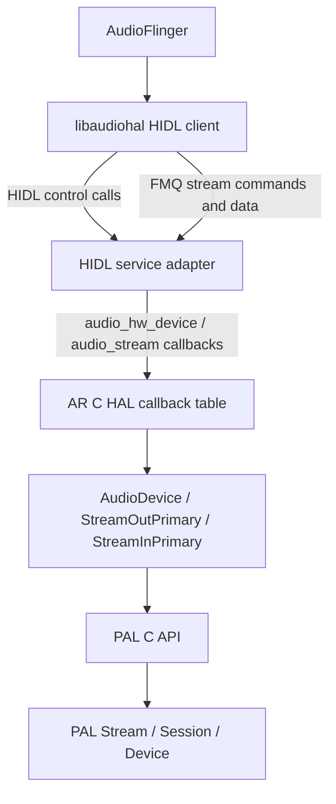
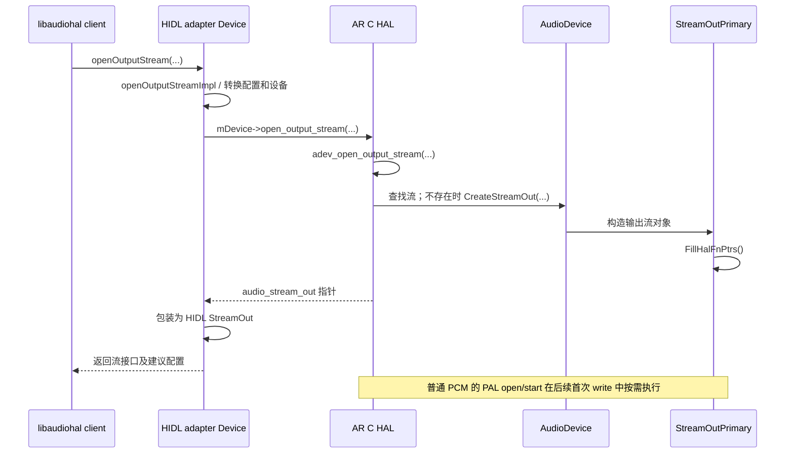
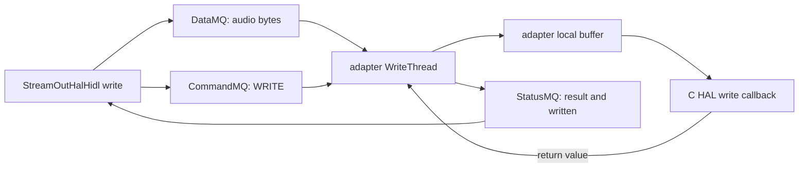
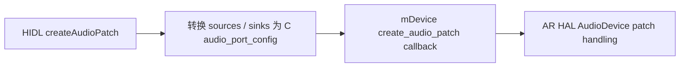

# 8.1 Audio HAL 边界：从 HIDL 接口到 AudioReach 实现

> [返回第 08 章](README.md) | [返回总目录](../README.md) | [下一节：音频数据流](08_8.2_StreamOutStreamIn-音频数据流.md)

## 阅读目标与范围

读完本节，应能回答三个问题：AudioFlinger 怎样调用厂商 HAL？HIDL 的 FMQ 与 C HAL 的 `write` 为什么同时存在？PAL 位于哪一层？

本节以本地 **Android 12L / API 32 + SA8295 AudioReach** 源码为主线。`device/qcom/msmnile_gvmq/manifest.xml` 声明核心 Audio HAL 和 effects 为 **HIDL 6.0**，AudioControl 为 **AIDL v1**。这说明不同职责的 HAL 可以采用不同接口体系，不表示核心 Audio HAL 已改成 AIDL；也不代替对设备最终 manifest 和运行服务的检查。

保留旧文件名以维持链接，但不再以“HIDL 落后、AIDL 才有 FMQ/Patch”的双轨对比讲解。**本地 HIDL 6.0 已定义 FMQ 和 Audio Patch。** 新版本核心 Audio HAL 的 AIDL 机制应结合对应版本源码另行学习，不套到这里。

## 8.1.1 先把四种边界分开

| 边界 | 本地对应对象 | 要解决的问题 |
|---|---|---|
| AudioFlinger 对 HAL 的抽象 | `DeviceHalInterface`、`StreamOutHalInterface` 等 | 上层使用统一的设备、流操作接口 |
| libaudiohal 的 HIDL 客户端 | `DevicesFactoryHalHidl`、`DeviceHalHidl`、`StreamOutHalHidl` | 把上层调用转换成 HIDL 调用或 FMQ 交互 |
| HIDL 服务端适配 C HAL | 通用 adapter 的 `DevicesFactory`、`Device`、`StreamOut` | 将 HIDL 对象操作转换为 `audio_hw_device`、`audio_stream_out` 函数指针调用 |
| 厂商 C HAL 适配 PAL | AR HAL 的 `AudioDevice`、`StreamOutPrimary`、`StreamInPrimary` | 把 Android flags、格式、设备地址和流生命周期转换成 PAL 语义 |

**HIDL `StreamOut` 不等于厂商 `StreamOutPrimary`；通用 adapter 的 `Device` 也不等于 PAL 的 `Device`。** 同名或相似名的类位于不同目录，阅读调用链时必须带上所属层。



这是**职责图**，不是所有进程边界的部署图。HAL 到 PAL 在源码中还有可选 HIDL 相关构建条件；本节不据函数调用名称断言它们一定同进程。PAL 内部对象实现见 [15.99 工厂与映射](../15_PAL_Architecture/15_15.99_附录_Stream-Session-Device映射关系.md)。

## 8.1.2 打开设备与打开输出流是两件事

### 第一步：获得设备接口

`DevicesFactoryHalHidl::openDevice()` 遍历可用 factory，调用其 `openDevice()`；成功后创建 `DeviceHalHidl`。服务端 `DevicesFactory` 经 `loadAudioInterface()` 加载 C HAL，并包装为 HIDL 设备对象。

这里加载的是设备模块。它不等于已创建播放流，更不等于已开始输送 PCM。

### 第二步：打开一条输出流

下面是所讨论的 HIDL adapter → AR HAL 成功路径。配置转换、错误分支和版本适配条件未全部绘出；图中的 `Device` 专指通用 adapter。



这张图的关键不是记住每个对象名，而是区分：

1. **HIDL 流接口**：跨接口边界访问流的对象。
2. **C HAL 流结构**：包含 `write`、`standby` 等函数指针。
3. **AR HAL C++ 流对象**：保存配置、设备与 PAL handle。
4. **PAL 流对象**：由 `pal_stream_open()` 进一步创建，普通 PCM 不应与前面三者的创建时刻画成同一件事。

PAL 的惰性打开、启动和失败清理在 [15.10 HAL-PAL 适配层](../15_PAL_Architecture/15_15.10_HAL-PAL适配层架构.md) 展开。

## 8.1.3 FMQ 与 C 回调不是两种互斥的数据通路

本地 `hardware/interfaces/audio/6.0/IStreamOut.hal` 的 `prepareForWriting()` 返回 command、data、status 三类队列描述及线程信息。libaudiohal 的 `StreamOutHalHidl::write()` 在首次有数据写入、尚未准备队列时调用准备流程；之后经 `callWriterThread()` 提交 WRITE 命令并读取结果。



队列通过 EventFlag 协调读写端。图中的箭头表示数据与命令交互，不代表零拷贝：下面的服务端实现会把 DataMQ 读入本地 buffer，再调用 C HAL。

**源码原文：** `hardware/interfaces/audio/core/all-versions/default/StreamOut.cpp`，`WriteThread::doWrite()`。

```cpp
void WriteThread::doWrite() {
    const size_t availToRead = mDataMQ->availableToRead();
    mStatus.retval = Result::OK;
    mStatus.reply.written = 0;
    if (mDataMQ->read(&mBuffer[0], availToRead)) {
        ssize_t writeResult = mStream->write(mStream, &mBuffer[0], availToRead);
        if (writeResult >= 0) {
            mStatus.reply.written = writeResult;
        } else {
            mStatus.retval = Stream::analyzeStatus("write", writeResult);
        }
    }
}
```

逐步理解：

- `mStream` 是 **C HAL 的 `audio_stream_out_t*`**，不是 PAL Stream。
- `mDataMQ->read()` 取出此次可读字节；C HAL callback 接收 buffer 和长度。
- C HAL 返回非负值时，adapter 将它作为 `written`。返回负值时，转换为 HIDL 结果码。
- `threadLoop()` 负责读取命令、执行 `doWrite()`、写 StatusMQ 和唤醒客户端；不要把整个队列协议归结为上面一个函数。

因此，“HIDL 用 write/read 回调，AIDL 才用 FMQ”是错误二分。**在这条 HIDL 路径上，FMQ 负责客户端与服务端的数据交互，C 回调负责服务端 adapter 与厂商 HAL 的衔接。**

另一个容易漏掉的细节：adapter 只能解释 C HAL 的返回值。AR HAL 的 `onWriteError()` 可能在失败后返回请求字节数，所以这里的 `Result::OK` 和 `written > 0` 不是 DSP 已完成播放的证明。

## 8.1.4 Audio Patch 也已存在于 HIDL

本地 HIDL 6.0 `IDevice.hal` 定义了 `supportsAudioPatches()` 和 `createAudioPatch()`。通用 adapter 的处理逻辑是：



`Device::supportsAudioPatches()` 检查底层 C device API 版本是否至少为 3.0；`Device::createAudioPatch()` 转换端口配置后调用 C HAL 的 `create_audio_patch`。

理解 Patch 时，应分清三个问题：

- **接口表达**：源端口与目标端口是什么，配置如何传递。
- **厂商实现**：HAL 如何创建、更新或释放对应路由。
- **实际声路**：后端设备与 DSP 图是否成功建立、硬件是否工作。

接口存在不等于任意端口组合都受支持，返回 patch handle 也不代表数据已经流动。不能把 HIDL 简化为“只支持字符串参数路由”，也不能把 Patch 与 `set_parameters` 写成非此即彼。

## 8.1.5 输出、输入与特殊通路的边界

| 场景 | 本节可以据源码确认的边界 | 不应照搬的推论 |
|---|---|---|
| 普通 PCM 输出 | `StreamOutHalHidl` → FMQ → `WriteThread` → C `write` | 每次 write 都经一次普通 HIDL RPC 搬运全部 PCM |
| 普通 PCM 输入 | 输入 adapter 有 `prepareForReading()` 和 `ReadThread::doRead()`，调用 C `read` | 把输出 WRITE 队列协议原样用于录音 |
| MMAP | 流接口及厂商对象另有 mmap buffer / position 操作 | 所有音频数据必经本文绘出的 write 循环 |
| 压缩 offload | 厂商按 flags/format 选择压缩流并处理专用控制 | PCM、压缩帧、drain、pause 的行为完全相同 |
| SoundTrigger/LAB | AR 输入实现有独立 SoundTrigger session 分支 | 普通 AudioRecord 和热词检测拥有完全相同的启动流程 |

这里先掌握边界；不同类型的生命周期和回调应在各自实现中继续追踪。

## 8.1.6 AudioControl 不负责替代核心 PCM 流接口

本地 manifest 同时出现核心 Audio HAL HIDL 和 AudioControl AIDL，是因为它们的职责不同：

- 本节讨论的核心 Audio HAL 提供设备、输入输出流以及相关控制。
- AAOS AudioControl 是车载音频控制的另一个接口层次，不能因其使用 AIDL 就推断 `StreamOutPrimary` 的上游已换成 AIDL 核心 Audio HAL。
- AudioControl、CarAudioService 与具体 ducking/muting/焦点策略的配合，应回到 [第 09 章](../09_AAOS_Car_Audio/README.md) 和 [第 10 章](../10_AudioControl_HAL/README.md) 按版本阅读；旧文尚在整理，不能把其中的新版本接口默认套入本地实现。

## 8.1.7 带着问题读源码

本节源码路径均相对于 `Android/lagvm/LINUX/android/`，以路径和函数定位，不将源码路径伪装成知识库内可点击的文件链接。

| 阅读顺序 | 文件 | 关注位置 |
|---|---|---|
| 1 | `device/qcom/msmnile_gvmq/manifest.xml` | 核心 audio、effects 与 audiocontrol 分别声明什么 |
| 2 | `frameworks/av/media/libaudiohal/impl/DevicesFactoryHalHidl.cpp` | `openDevice()`：factory 返回什么对象 |
| 3 | `hardware/interfaces/audio/core/all-versions/default/DevicesFactory.cpp` | `loadAudioInterface()` 与设备包装 |
| 4 | `hardware/interfaces/audio/core/all-versions/default/Device.cpp` | `openOutputStreamImpl()`、`supportsAudioPatches()`、`createAudioPatch()` |
| 5 | `hardware/interfaces/audio/6.0/IStreamOut.hal`、`IDevice.hal` | 本地主线版本的 FMQ/Patch 接口定义 |
| 6 | `frameworks/av/media/libaudiohal/impl/StreamHalHidl.cpp` | `StreamOutHalHidl::write()`、`prepareForWriting()`、`callWriterThread()` |
| 7 | `hardware/interfaces/audio/core/all-versions/default/StreamOut.cpp`、`StreamIn.cpp` | 队列线程与 C HAL 的 write/read callback |
| 8 | `vendor/qcom/opensource/audio-hal-ar/primary-hal/hal-pal/AudioDevice.cpp`、`AudioStream.cpp` | `adev_open_output_stream()`、`FillHalFnPtrs()`、`out_write()` |

`all-versions/default` 是复用实现，包含版本条件，不能凭目录里存在某分支就认定产品使用该版本。

**自测：** 如果 `written` 在增加但没有声音，至少还需要查看哪些层？如果产品 AudioControl 使用 AIDL，是否足以把核心 Audio HAL 的讲解换成 `IModule`？如果 HAL 流已经返回给 AudioFlinger，PAL handle 是否必然已经创建？用本节边界和下一篇的生命周期解释，而不是只背架构图。
