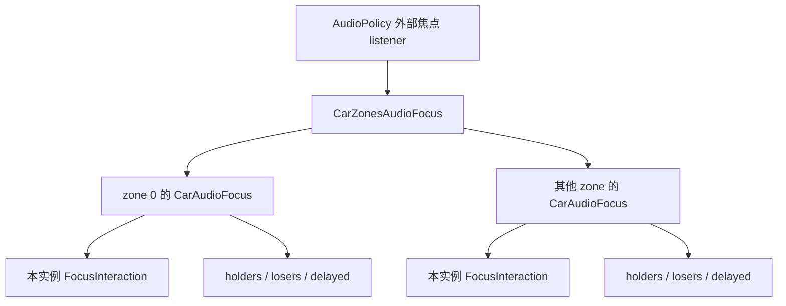
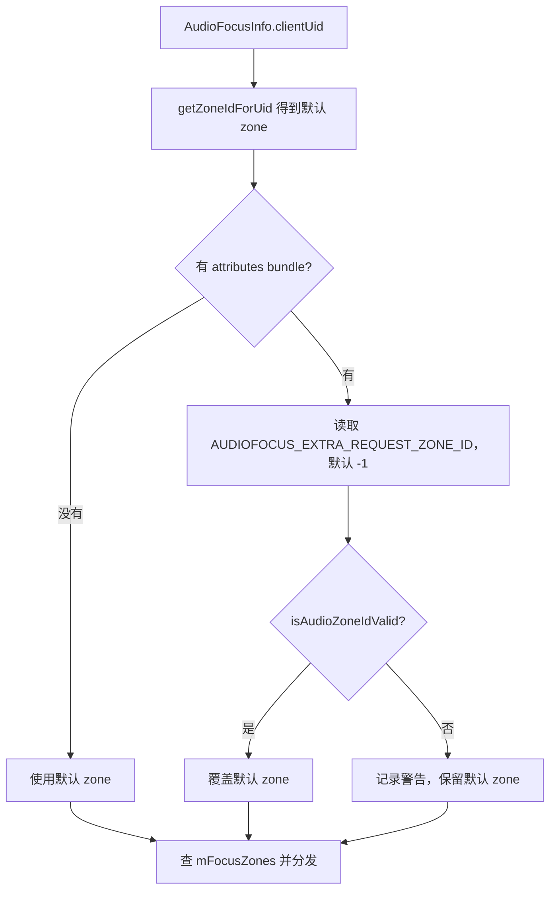

# 9.10 CarZonesAudioFocus：选择区域，再交给区域内策略

> 本地 Android 12L/API 32 的 CarZonesAudioFocus 是 AudioPolicyFocusListener。它负责请求分发与变化通知，不直接实现交互矩阵，不在这里修改设备路由。

前置：[9.3 Zone 对象](09_9.3_CarAudioZone-多Zone音频管理.md)、[9.4 单区域焦点算法](09_9.4_CarAudioFocus-车载焦点管理.md)。

## 1. 每个 zone 一个焦点处理器

工厂遍历已加载的 CarAudioZone，为每个 zoneId 构造 CarAudioFocus，并为其提供新的 FocusInteraction 实例。最终保存为 `SparseArray<CarAudioFocus> mFocusZones`。



各区域不共用 holders/losers 集合。用户设置变化也可以只更新某个区域的 FocusInteraction；但逻辑焦点隔离不自动保证 PCM 与硬件隔离。

构造与 policy 绑定分两步：先创建 listener 才能 build AudioPolicy，再 `setOwningPolicy()` 回填 CarAudioService 和 AudioPolicy，并把 owning policy 传给每个 CarAudioFocus。这是初始化依赖，不是运行时任意切换区域配置。

## 2. 默认区域来自 UID，再检查 attributes bundle

`getAudioZoneIdForAudioFocusInfo()` 的第一步是：

```java
int zoneId = mCarAudioService.getZoneIdForUid(afi.getClientUid());
```

CarAudioService 的查询顺序是：显式 UID→zone 映射优先；没有则取 UID 的 userId，通过 OccupantZone 关联查询区域；仍无有效区域时回到 PRIMARY_AUDIO_ZONE。

然后，分发器检查 AudioAttributes bundle 中的 `AUDIOFOCUS_EXTRA_REQUEST_ZONE_ID`。本地判断依据是指定 zone 是否有效：



无效 bundle zone 不在这里抛“区域权限错误”，而是保留默认 zone。不要将它写成无条件信任 bundle，也不要写成一旦 bundle 存在就必须拒绝无效值。

### 2.1 权限应该放在实际检查的位置

CarAudioService 的公开 `getZoneIdForUid()` 有 CAR_CONTROL_AUDIO_SETTINGS 权限与 dynamic routing 检查；Framework 焦点入口也检查 usage、特殊 lock 条件等。

但本地分发器的 **bundle zone 覆盖分支没有额外检查“请求方对目标区域拥有专属权限”**。不能把其他版本或设计建议中的权限条件加进这段调用图。也不能反过来仅据这里没有检查，就断言整个产品的所有调用入口都无权限控制。

HAL 外部请求由 HalAudioFocus 构造携带区域信息的属性，经相同分发入口到达区域内策略，见 [10.7](../10_AudioControl_HAL/10_10.7_HalAudioFocus-外部焦点请求管理.md)。

## 3. 请求处理与通知顺序

原文：

```java
public void onAudioFocusRequest(AudioFocusInfo afi, int requestResult) {
    int zoneId = getAudioZoneIdForAudioFocusInfo(afi);
    getCarAudioFocusForZoneId(zoneId).onAudioFocusRequest(afi, requestResult);
    notifyFocusCallback(new int[]{zoneId});
}
```

先由单区 CarAudioFocus 评估、更新集合并回送请求结果，之后再通知 CarFocusCallback。这里不是先通知 HAL duck，然后才能决定焦点是否接受。

`notifyFocusCallback()` 在 callback 非 null 时，为受影响的 zone 收集当前 holders，组装 `SparseArray<List<AudioFocusInfo>>` 并调用 onFocusChange。没有把 losers 或 delayed 槽打包成持有者列表。

在 CarAudioService 的条件配置下，CarDucking 可以成为这个 callback 的接收者，再计算设备 duck/unduck。调用 callback 表示重新观察处理后的集合，不表示本次请求一定 GRANTED。

## 4. abandon、客户端死亡与区域选择

`onAudioFocusAbandon()` 也先调用同一个 zone 选择方法，再转发到该区 CarAudioFocus，最后通知变化。它不扫描全车所有区域删除同 clientId 条目。

源码注释说明：Framework 会在持焦点客户端死亡时送来 abandon 类回调，这一层无需为每个应用再次建立独立 Binder death 监听。但这和 AudioControl HAL 服务死亡是不同路径。

区域/用户映射改变时，若只更新默认 zone 而不处理旧焦点，后续 abandon 的选择可能与原请求区域不一致。因此 CarAudioService 的显式 UID zone 切换还要协调旧区域焦点暂失、新区域重新评估，不能只修改一张 Map。

## 5. 焦点迁移不是设备 affinity

本类提供按 UID 查询 holders/losers、暂失一组焦点以及 reevaluateAndRegainAudioFocus 的辅助方法。重新评估时会再次通过 AudioFocusInfo 选择 zone，仍受有效 bundle zone 覆盖影响。

这些是焦点状态操作，**不是设备 affinity**。设置 `AudioPolicy.setUidDeviceAffinity()` / `setUserIdDeviceAffinity()` 在 CarAudioService 的路由管理路径中进行；仅把焦点交给另一个 CarAudioFocus，不会自动搬运 PCM 缓冲或重新绑定所有输出。

详细协调顺序见 [9.2](09_9.2_CarAudioService-车载音频核心服务.md)。

## 6. 用户设置与全区域限制

`updateUserForZoneId()` 验证区域后调用该区 FocusInteraction 的 `setUserIdForSettings()`，用于切换“通话时拒绝导航”等用户设置与 observer。它不修改所有区域的矩阵。

`setRestrictFocus()` 则遍历所有区域，把限制标志交给每个 CarAudioFocus，再将这些 zone IDs 一次通知给 callback。单区算法会清理非 critical focus，见 [9.4](09_9.4_CarAudioFocus-车载焦点管理.md)。

这两条路径作用范围不同：用户设置更新按区，全局限制传播到全部当前区域。解除限制不是自动重建所有已失去的请求。

## 7. 观察分发错误的最小信息

| 信息 | 用途 |
|---|---|
| clientUid / clientId | 区分路由身份与具体焦点请求 |
| UID/user 默认 zone | 检查是否回退到主区 |
| attributes bundle zone | 检查是否覆盖默认值、是否合法 |
| 所选 CarAudioFocus 的集合 | 看 holders、losers、delayed 是否在预期区域 |
| callback 的 zone IDs / holders | 看设备 duck 计算收到的是哪组变化 |
| device affinity 与实际 I/O | 单独核对数据路由，不能只看焦点区域 |

本地类没有旧文中的 resetFrameworksFocusListener 自动重建功能，也没有直接操作 AudioControl 的每项通知。恢复链应沿实际服务和 wrapper 追踪。

源码根为 `Android/lagvm/LINUX/android/`：`packages/services/Car/service/src/com/android/car/audio/CarZonesAudioFocus.java`、`packages/services/Car/service/src/com/android/car/audio/CarAudioService.java`。本文没有执行多区域焦点或播放隔离测试。
