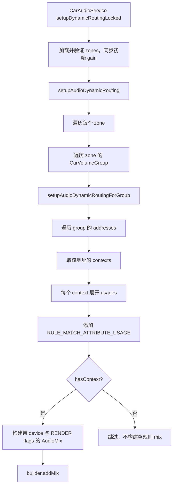
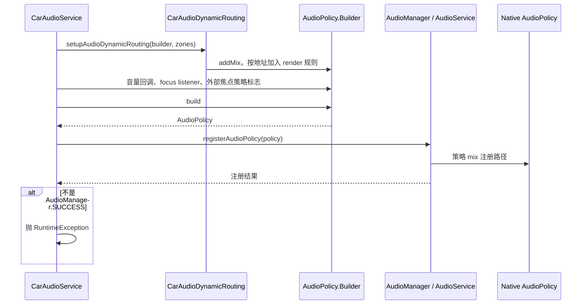

# 9.11 CarAudioDynamicRouting：把 Context/地址配置变成 AudioMix

> 依据本地 Android 12L/API 32 的 `CarAudioDynamicRouting.java`。本地类构建常规车载动态 render 路由；不包含旧文所述的镜像路由构建或新版 CoreAudioHelper 路由替代逻辑。

前置：[9.1 区域、用途与地址](09_9.1_AAOS音频系统总览.md)、[6.2 Native Policy](../06_Audio_Policy_Engine/06_6.2_AudioPolicyManager-策略核心实现.md)。

## 1. 它生成规则，不直接搬运音频

输入是已经加载并验证的 `SparseArray<CarAudioZone>` 和一个 `AudioPolicy.Builder`。输出是加入 builder 的 AudioMix 集合。随后由 CarAudioService 构建并注册 AudioPolicy。

| 输入层次 | 该类如何使用 |
|---|---|
| zone | 遍历区域；本类不自行决定哪个用户属于该区域 |
| volume group | 枚举该组的输出地址 |
| address | 每个地址取 CarAudioDeviceInfo，形成一个有规则的 AudioMix |
| context | 查询该地址承载的 contexts |
| usage | 将 context 展开成 usage 匹配规则 |

规则说的是“哪些播放用途匹配哪个 render 设备”，不是“现在立刻播放这个用途”，更不是把 PCM 转发给 CarAudioService。

## 2. 构建调用链



最外层并不为 zone 创建“一个大混音器”。在这个实现中，真正建立 AudioMix 的粒度是**地址**，不是 zone、group 或每个 usage。

### 2.1 为什么先经过配置验证

同一 BUS 不能重复注册多个 mix。CarAudioZone/CarAudioZonesValidator 负责检查 Context 完整性和地址跨组/跨 zone 重复；本类利用已经构建好的映射，不再用一张默认优先级表修正坏配置。

同一个地址可以承载多个 contexts；一个 group 也可以包含多个地址。两者都不能简化成一一对应。

## 3. usage 规则怎样生成

源码位于 `packages/services/Car/service/src/com/android/car/audio/CarAudioDynamicRouting.java`。核心原文：

```java
for (int carAudioContext : group.getContextsForAddress(address)) {
    hasContext = true;
    int[] usages = CarAudioContext.getUsagesForContext(carAudioContext);
    for (int usage : usages) {
        AudioAttributes attributes = buildAttributesWithUsage(usage);
        mixingRuleBuilder.addRule(attributes,
                AudioMixingRule.RULE_MATCH_ATTRIBUTE_USAGE);
    }
```

这是循环体的连续摘录，后续日志和循环闭合在原文件中。每个 context 展开多个 usage；属性由 `buildAttributesWithUsage()` 建立：system usage 调 `setSystemUsage()`，其余调 `setUsage()`。

`hasContext` 防止对没有分配 context 的输出地址建立零规则 policy mix。源码允许 policy 配置里有未分配 context 的设备，不能把“设备出现在 audio_policy_configuration 中”当作它一定加入了本动态策略。

### 3.1 AudioMix 的设备与方向

有 context 时的原文：

```java
AudioMix audioMix = new AudioMix.Builder(mixingRuleBuilder.build())
        .setFormat(mixFormat)
        .setDevice(info.getAudioDeviceInfo())
        .setRouteFlags(AudioMix.ROUTE_FLAG_RENDER)
        .build();
builder.addMix(audioMix);
```

这里绑定的是具体 AudioDeviceInfo，并指定 render 路由。不要在解释里悄悄添加 LOOP_BACK、capture callback、镜像 secondary output 或 UID 排除规则；它们不是这段本地构建逻辑。

## 4. 格式来自设备辅助对象，但有一个必须保留的实现细节

`CarAudioDeviceInfo` 取设备提供的最大采样率；列表为空时使用本地默认值，编码固定为 PCM 16-bit。它的 `getMaxChannels()` 计算各 channel mask 的 bitCount，得到最大**声道数量**。

而本地构建代码是：

```java
AudioFormat mixFormat = new AudioFormat.Builder()
        .setSampleRate(info.getSampleRate())
        .setEncoding(info.getEncodingFormat())
        .setChannelMask(info.getChannelCount())
        .build();
```

`getChannelCount()` 返回的是数量，**不是声道掩码**。本地 AudioFormat.Builder 的 `setChannelMask()` 接收掩码，并非通用“count 转 mask”函数。因此：

- 上面是本地原文，不应改写为“正确推导出设备最大声道掩码”的算法。
- 不要将这段代码当作新项目的通用配置示例直接复制。
- 具体构建/注册结果还取决于设备上报值和后续校验；本文没有执行设备注册测试，不据此断言所有通路必然失败或必然正确。
- 产品源码只读，本次只在讲解中保留可确认的语义差异。

这一细节说明为什么必须同时读调用方和辅助类，不能只凭变量名把旧代码解释“修顺”。

## 5. 注册由 CarAudioService 完成



图的 AudioService→Native 箭头表示注册边界，不省略成一个虚构的 Car 类方法。这里也不意味着注册时已建立所有应用 Track 或启动所有 HAL 流。

之后应用创建 AudioTrack，AF 通过 `getOutputForAttr()` 请求 Policy 选择 output。Native APM 查询动态 policy mixes；有有效显式设备、无匹配 mix、通路能力不符等情况下会有不同选择/错误，见 [6.2](../06_Audio_Policy_Engine/06_6.2_AudioPolicyManager-策略核心实现.md)。

## 6. 多区域相同 usage：设备 affinity 另行参与

本类为多个 zone 的 MUSIC 都生成 usage 规则，却没有在每个规则里写入 zoneId。多区域最终路由还依赖用户/UID 与设备的 affinity。

- `setZoneIdForUid()` 调 `AudioPolicy.setUidDeviceAffinity(uid, zone.getAudioDeviceInfos())`；成功后才更新服务 Map。
- occupant/user 更新路径使用 `setUserIdDeviceAffinity()`。
- 有 occupant zone mapping 时，不允许混用上述显式 UID zone 路由 API。
- 变更 zone 还需协调焦点，不是修改一个 integer 就能保证正在播放的所有缓冲原子迁移。

同一个 usage 在不同区域有规则，是模型需要；同一个 address 被多次注册则是另一类配置错误。不要把二者混为“重复规则”。

## 7. 用实际 AR 配置理解控制粒度

AR `common_au/car_audio_configuration.xml` 的主区域把 MUSIC、通知类、导航/语音、电话类分别配置在四个地址；副驾/后排则分别把所有 context 放在各自一个地址上。

这个配置可以帮助理解：

- 同一地址上的用途共享设备级控制边界。
- 多个 contexts 不要求多个 AudioMix；多个地址才分别构建 mix。
- gain 控制按 volume group 遍历设备，duck/mute 通知按地址表达，不是按应用 Track 逐个发硬件命令。
- BUS 地址进入 HAL 后还会被映射为 PAL 设备，但多个 Android BUS 映射到相同 PAL 设备 ID，不足以证明 DSP 图或实际接线完全相同。

## 8. 定位时按构建层次检查

| 检查点 | 关键问题 |
|---|---|
| 配置加载 | 真正读取了哪个文件、版本是否支持、地址是否在 AudioDeviceInfo 列表里 |
| zone/group 验证 | Context 是否完整，地址是否跨组/区域重复，gain step 是否一致 |
| AudioMix | 地址是否有 context，usage 是否正确展开，format 是否符合后续要求 |
| 策略注册 | registerAudioPolicy 是否成功，而不是只看 builder.build |
| 运行选择 | 用户/UID affinity、显式设备和 Native policy mix/output 是否一致 |
| 数据路径 | AF Track 实际属于哪个 I/O，HAL/PAL 是否接受与消费数据 |

`dumpsys media.audio_policy` 主要查看 Native policy；`dumpsys media.audio_flinger` 看真正的 Track/线程。不能把 `dumpsys audio` 当作完整 native mix 路由表。

源码根为 `Android/lagvm/LINUX/android/`：

- `packages/services/Car/service/src/com/android/car/audio/CarAudioDynamicRouting.java`。
- `packages/services/Car/service/src/com/android/car/audio/CarAudioDeviceInfo.java`。
- `packages/services/Car/service/src/com/android/car/audio/CarAudioService.java`。
- `frameworks/base/media/java/android/media/AudioFormat.java`。

继续：[9.2 服务协作](09_9.2_CarAudioService-车载音频核心服务.md) · [9.5 音量组](09_9.5_CarVolumeGroup-车载音量组.md)。
