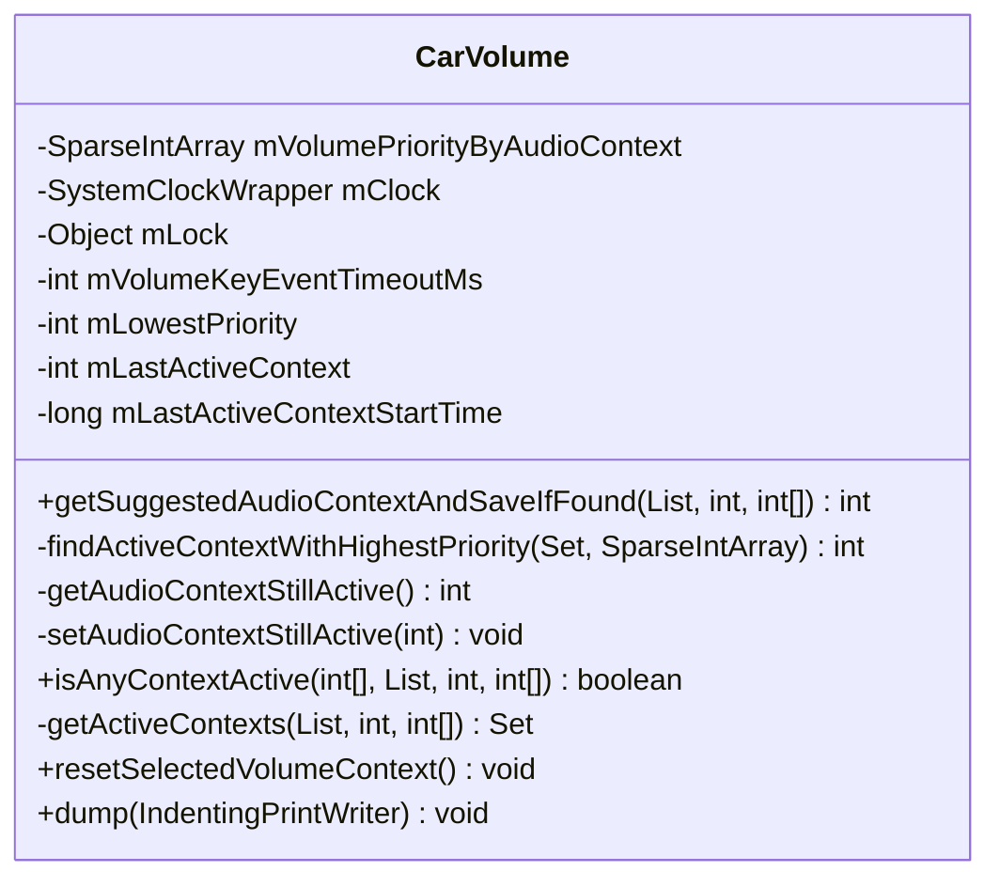
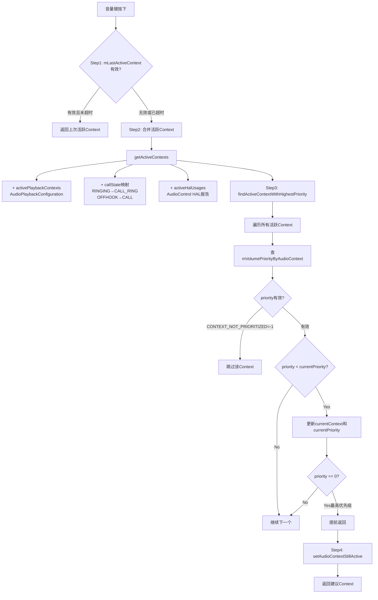
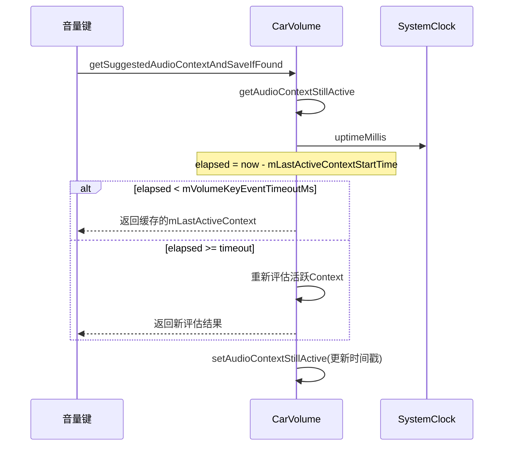
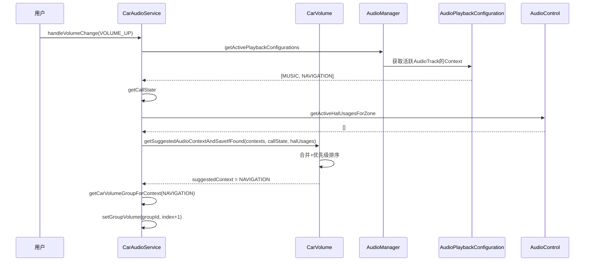

## 9.12 CarVolume — 音量优先级算法

> [← 上一个](09_9.11_CarAudioDynamicRouting-动态路由构建.md) | [返回目录](README.md) | [下一个 →](09_9.13_CarAudioGainMonitor-HAL_Gain事件分发.md)

---

> **版本边界**：本文已按本树 12L [`CarVolume.java`](packages/services/Car/service/src/com/android/car/audio/CarVolume.java)（249 行）逐字校准——优先级表为 `int[]`（`AUDIO_CONTEXT_VOLUME_PRIORITY_V1/V2` :51/:69），活跃集为 `Set<Integer>`（usage/context 整数域），无 `mCarAudioContext` 字段。Android 13+ 的 `List<AudioAttributes>` 属性化形态不在本树，如需对照以 AOSP 13+ 源码为准。V1 > V2 > 单组的优先级顺序语义两版一致。

### 9.12.1 模块概述

[`CarVolume`](packages/services/Car/service/src/com/android/car/audio/CarVolume.java)负责确定音量键调节时应优先响应的音频Context，实现**"按键音量跟随最活跃音频"**的逻辑。当用户按下音量键时，系统需要判断应该调节哪个VolumeGroup——这取决于当前哪个音频Context最活跃且优先级最高。

**核心职责：**
- 维护V1/V2两套音量优先级列表
- 实现`getSuggestedAudioContextAndSaveIfFound`建议Context算法
- 超时机制缓存上次活跃Context
- 合并多源活跃Context（播放态+通话态+HAL活跃usage）

### 9.12.2 类结构



### 9.12.3 V1/V2优先级列表

```java
// CarVolume.java:51-66（V1，逐字摘录；12L 为 context 域 int[]）
private static final int[] AUDIO_CONTEXT_VOLUME_PRIORITY_V1 = {
        CarAudioContext.NAVIGATION,
        CarAudioContext.CALL,
        CarAudioContext.MUSIC,
        CarAudioContext.ANNOUNCEMENT,
        CarAudioContext.VOICE_COMMAND,
        CarAudioContext.CALL_RING,
        CarAudioContext.SYSTEM_SOUND,
        CarAudioContext.SAFETY,
        CarAudioContext.ALARM,
        CarAudioContext.NOTIFICATION,
        CarAudioContext.VEHICLE_STATUS,
        CarAudioContext.EMERGENCY,
        // CarAudioContext.INVALID is intentionally not prioritized as it is not routed by
        // CarAudioService and is not expected to be used.
};

// CarVolume.java:69-74（V2，逐字摘录）
private static final int[] AUDIO_CONTEXT_VOLUME_PRIORITY_V2 = {
        CarAudioContext.CALL,
        CarAudioContext.MUSIC,
        CarAudioContext.ANNOUNCEMENT,
        CarAudioContext.VOICE_COMMAND,
};
```

**V1 vs V2对比：**

| 特性 | V1 | V2 |
|------|----|----|
| 优先级数量 | 12个Context全覆盖 | 4个核心Context |
| 最高优先级 | NAVIGATION | CALL |
| 安全相关 | SAFETY/EMERGENCY独立优先级 | 不包含 |
| 设计理念 | 细粒度优先级排序 | 精简优先级，仅关注关键音频 |
| 适用场景 | 全功能车载系统 | 简化车载系统 |
| 配置项 | `audioVolumeAdjustmentContextsVersion=1` | `audioVolumeAdjustmentContextsVersion=2` |

### 9.12.4 优先级映射构建

```java
// CarVolume.java:93-111（逐字摘录）
CarVolume(@NonNull SystemClockWrapper clockWrapper,
        @CarVolumeListVersion int audioVolumeAdjustmentContextsVersion,
        int volumeKeyEventTimeoutMs) {
    mClock = Objects.requireNonNull(clockWrapper, "Clock must not be null.");
    mVolumeKeyEventTimeoutMs = Preconditions.checkArgumentNonnegative(volumeKeyEventTimeoutMs);
    mLastActiveContext = CarAudioContext.INVALID;
    mLastActiveContextStartTime = mClock.uptimeMillis();
    @AudioContext int[] contextVolumePriority =
            getContextPriorityList(audioVolumeAdjustmentContextsVersion);
    // 将Context→Priority映射存入SparseIntArray
    for (int priority = CONTEXT_HIGHEST_PRIORITY;
            priority < contextVolumePriority.length; priority++) {
        mVolumePriorityByAudioContext.append(contextVolumePriority[priority], priority);
    }
    mLowestPriority = CONTEXT_HIGHEST_PRIORITY + mVolumePriorityByAudioContext.size();
}
```

**V1映射结果（mVolumePriorityByAudioContext）：**

| Priority | Context | 说明 |
|----------|---------|------|
| 0 | NAVIGATION | 最高，音量键首先调节导航 |
| 1 | CALL | 通话次高 |
| 2 | MUSIC | 媒体第三 |
| 3 | ANNOUNCEMENT | 广播公告 |
| 4 | VOICE_COMMAND | 语音命令 |
| 5 | CALL_RING | 来电铃声 |
| 6 | SYSTEM_SOUND | 系统音效 |
| 7 | SAFETY | 安全提示 |
| 8 | ALARM | 闹钟 |
| 9 | NOTIFICATION | 通知 |
| 10 | VEHICLE_STATUS | 车辆状态 |
| 11 | EMERGENCY | 紧急（最低） |

### 9.12.5 getSuggestedAudioContextAndSaveIfFound核心算法

```java
// CarVolume.java:134-153（逐字摘录；步骤说明见下方流程图）
@AudioContext int getSuggestedAudioContextAndSaveIfFound(
        @NonNull List<Integer> activePlaybackContexts, @CallState int callState,
        @NonNull @AttributeUsage int[] activeHalUsages) {

    int activeContext = getAudioContextStillActive();
    if (activeContext != CarAudioContext.INVALID) {
        setAudioContextStillActive(activeContext);
        return activeContext;
    }

    Set<Integer> activeContexts = getActiveContexts(activePlaybackContexts, callState,
            activeHalUsages);


    @AudioContext int context =
            findActiveContextWithHighestPriority(activeContexts, mVolumePriorityByAudioContext);

    setAudioContextStillActive(context);

    return context;
}
```

### 9.12.6 完整决策流程图



### 9.12.7 findActiveContextWithHighestPriority源码解析（:156-176）（:156-176）（:156-176）

```java
// CarVolume.java:156-176（逐字摘录）
private @AudioContext int findActiveContextWithHighestPriority(
        Set<Integer> activeContexts, SparseIntArray contextPriorities) {
    int currentContext = DEFAULT_AUDIO_CONTEXT;
    int currentPriority = mLowestPriority;

    for (@AudioContext int context : activeContexts) {
        int priority = contextPriorities.get(context, CONTEXT_NOT_PRIORITIZED);
        if (priority == CONTEXT_NOT_PRIORITIZED) {
            continue;
        }

        if (priority < currentPriority) {
            currentContext = context;
            currentPriority = priority;
            // If the highest priority has been found, break early.
            if (currentPriority == CONTEXT_HIGHEST_PRIORITY) {
                break;
            }
        }
    }

    return currentContext;
}
```

**关键设计：**
1. **优先级数值越小越高**：`CONTEXT_HIGHEST_PRIORITY=0`
2. **提前退出优化**：找到priority=0的Context时立即返回
3. **默认回退**：无活跃Context时返回`DEFAULT_AUDIO_CONTEXT`

### 9.12.8 getActiveContexts三源合并（:203-221）

```java
// CarVolume.java:203-221（逐字摘录）
private static Set<Integer> getActiveContexts(@NonNull List<Integer> activePlaybackContexts,
        @CallState int callState, @NonNull @AttributeUsage int[] activeHalUsages) {
    Objects.nonNull(activePlaybackContexts);
    Objects.nonNull(activeHalUsages);

    Set<Integer> contexts = CarAudioContext.getUniqueContextsForUsages(activeHalUsages);

    switch (callState) {
        case TelephonyManager.CALL_STATE_RINGING:
            contexts.add(CarAudioContext.CALL_RING);
            break;
        case TelephonyManager.CALL_STATE_OFFHOOK:
            contexts.add(CarAudioContext.CALL);
            break;
    }

    contexts.addAll(activePlaybackContexts);
    return contexts;
}
```

**三源优先级说明：**

| 数据源 | 获取方式 | 说明 |
|--------|---------|------|
| HAL活跃usages | `activeHalUsages` | AudioControl HAL主动报告，可能包含Android不可见的音频流 |
| 通话状态 | `TelephonyManager.getCallState()` | RINGING→CALL_RING, OFFHOOK→CALL |
| 播放配置 | `AudioPlaybackConfiguration` | Android侧活跃的AudioTrack |

### 9.12.9 超时缓存机制

```java
// CarVolume.java:223-238（逐字摘录）
private @AudioContext int getAudioContextStillActive() {
    @AudioContext int context;
    long contextStartTime;
    synchronized (mLock) {
        context = mLastActiveContext;
        contextStartTime = mLastActiveContextStartTime;
    }

    if (context == CarAudioContext.INVALID) {
        return CarAudioContext.INVALID;
    }

    if (hasExpired(contextStartTime, mClock.uptimeMillis(), mVolumeKeyEventTimeoutMs)) {
        return CarAudioContext.INVALID;
    }

    return context;
}
```

```java
// CarVolume.java:180-184
private void setAudioContextStillActive(@AudioContext int context) {
    synchronized (mLock) {
        mLastActiveContext = context;
        mLastActiveContextStartTime = mClock.uptimeMillis();
    }
}
```

**超时机制流程图：**



**设计意图：** 短时间内连续按音量键时，保持调节同一个VolumeGroup，避免音量键"跳跃"到其他Context。

### 9.12.10 典型场景分析

**场景1：导航+音乐同时播放**

```
活跃Context: [MUSIC, NAVIGATION]
V1优先级: NAVIGATION=0 < MUSIC=2
结果: 调节导航音量
```

**场景2：通话+音乐同时播放**

```
活跃Context: [MUSIC, CALL]
callState=CALL_STATE_OFFHOOK
V1优先级: CALL=1 < MUSIC=2
结果: 调节通话音量
```

**场景3：音乐停止5秒后按音量键**

```
mLastActiveContext = MUSIC (之前的活跃Context)
elapsed = 5000ms > mVolumeKeyEventTimeoutMs (假设3000ms)
→ 超时，重新评估
当前无活跃Context
结果: 返回DEFAULT_AUDIO_CONTEXT
```

**场景4：V2模式下导航+音乐**

```
V2列表仅包含: CALL, MUSIC, ANNOUNCEMENT, ASSISTANT
NAVIGATION不在V2列表中 → CONTEXT_NOT_PRIORITIZED
MUSIC在V2中，priority=1
结果: 调节音乐音量
```

### 9.12.11 与CarAudioService的集成



### 9.12.12 resetSelectedVolumeContext

```java
// CarVolume.java:125-127（逐字摘录）
public void resetSelectedVolumeContext() {
    setAudioContextStillActive(CarAudioContext.INVALID);
}
```

在CarAudioService主动切换Zone或用户切换时调用，清除缓存的活跃Context，强制下次音量键重新评估。

### 9.12.13 isAnyContextActive（:187-201）（:187-201）（:187-201）

```java
// CarVolume.java:187-201（逐字摘录）
public static boolean isAnyContextActive(@NonNull @AudioContext int [] contexts,
        @NonNull List<Integer> activePlaybackContext, @CallState int callState,
        @NonNull @AttributeUsage int[] activeHalUsages) {
    Objects.nonNull(contexts);
    Preconditions.checkArgument(contexts.length != 0,
            "contexts can not be empty.");
    Set<Integer> activeContexts = getActiveContexts(activePlaybackContext,
            callState, activeHalUsages);
    for (@AudioContext int context : contexts) {
        if (activeContexts.contains(context)) {
            return true;
        }
    }
    return false;
}
```

用于检查指定Context列表中是否有任何一个处于活跃状态，CarAudioService用于判断是否需要触发Ducking。

### 9.12.14 调试与配置

```bash
# dumpsys查看优先级配置
adb shell dumpsys car_service | grep -A 30 "CarVolume"

# 输出示例:
# CarVolume
#   Volume priority list version 1
#   Volume key event timeout 3000 ms
#   Car audio contexts priorities
#     Car audio context NAVIGATION[id=2] priority 0
#     Car audio context CALL[id=4] priority 1
#     Car audio context MUSIC[id=1] priority 2
#     ...

# 配置优先级版本
# 在overlay配置中设置:
# audioVolumeAdjustmentContextsVersion=2
# volumeKeyEventTimeoutMs=3000
```

---