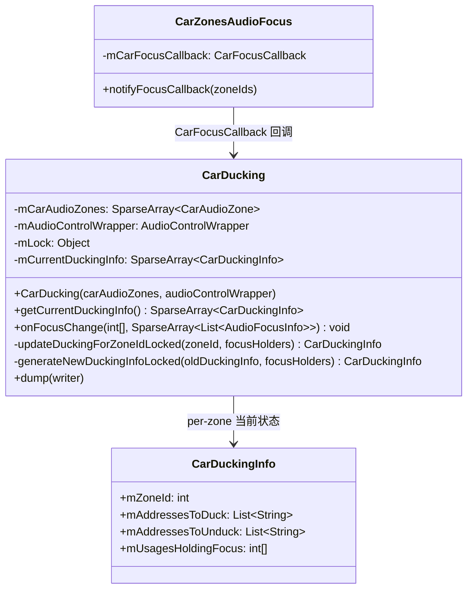
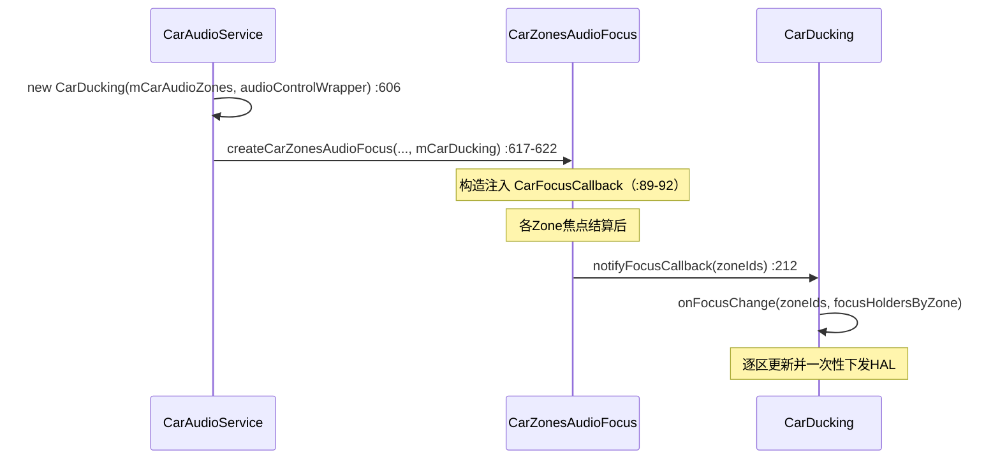

## 9.14 CarDucking — AAOS系统级Ducking

> [← 上一个](09_9.13_CarAudioGainMonitor-HAL_Gain事件分发.md) | [返回目录](README.md) | [下一个 →](09_9.15_CarAudioMirrorRequestHandler-音频镜像请求管理.md)

---

> **版本边界（重写说明）**：本文已按本树 12L [`CarDucking.java`](packages/services/Car/service/src/com/android/car/audio/CarDucking.java)（114 行）整体重写。原稿描述的 "Hold/Lose 上下文列表"机制（`mZoneIdToHoldContexts`/`mZoneIdToLoseContexts`/`addContextToHoldListLocked`/`getAddressToDuck` 等）在本树 **0 命中**，属 13+ 演进形态的误植，已删除（Git 历史可查）。12L 的 duck 判定完全由 **当前焦点持有者集合 + `CarDuckingUtils` 静态策略表** 决定。

### 9.14.1 模块概述

[`CarDucking`](packages/services/Car/service/src/com/android/car/audio/CarDucking.java)（`final class CarDucking implements CarZonesAudioFocus.CarFocusCallback`，:38）实现AAOS系统级Ducking：Per-Zone 焦点持有者变化后，按 [`CarDuckingUtils`](packages/services/Car/service/src/com/android/car/audio/CarDuckingUtils.java) 的静态策略表（`sContextsToDuck` :45，完整矩阵见 [9.6](09_9.6_CarAudioContext-车载音频上下文深度解析.md)）计算该 Zone 需要 Duck/取消 Duck 的设备地址，生成 `CarDuckingInfo` 并经 `AudioControlWrapper.onDevicesToDuckChange()` 通知HAL，由DSP执行增益调整（HAL 侧链路见 [10.4](../10_AudioControl_HAL/10_10.4_Ducking机制.md)）。

**与Android原生Ducking不同**：CarDucking不经App层——被duck的App不会收到 `AUDIOFOCUS_LOSS_TRANSIENT_CAN_DUCK`，粒度为**设备地址级**、按Zone独立计算。

**核心职责（12L 实况）：**
- 实现 `CarZonesAudioFocus.CarFocusCallback`，接收 Per-Zone 焦点持有者集合变化
- 为每个Zone维护当前 `CarDuckingInfo`（`mCurrentDuckingInfo`，:44），供差集计算（unduck）
- 委托 `CarDuckingUtils` 完成 usage→context→duck判定→地址 换算
- 汇总各区新 `CarDuckingInfo` 后一次性下发 HAL

### 9.14.2 类结构（真实 12L）



```java
// CarDucking.java:38-44（逐字摘录）
final class CarDucking implements CarFocusCallback {
    private static final String TAG = CarDucking.class.getSimpleName();

    private final SparseArray<CarAudioZone> mCarAudioZones;
    private final AudioControlWrapper mAudioControlWrapper;
    private final Object mLock = new Object();

    @GuardedBy("mLock")
    private final SparseArray<CarDuckingInfo> mCurrentDuckingInfo = new SparseArray<>();
```

构造时为每个Zone预置空 `CarDuckingInfo`（:46-55），保证首次焦点变化前差集计算有"旧值"可比较：

```java
// CarDucking.java:50-54（逐字摘录）
        for (int i = 0; i < carAudioZones.size(); i++) {
            int zoneId = carAudioZones.keyAt(i);
            mCurrentDuckingInfo.put(zoneId,
                    new CarDuckingInfo(zoneId, new ArrayList<>(), new ArrayList<>(), new int[0]));
        }
```

### 9.14.3 焦点变化处理 — onFocusChange（:65-77）

真实签名为 **批量** 回调：`CarZonesAudioFocus` 结算完各Zone焦点后，把发生变化的 zoneId 数组与全部焦点持有者一并传出，`CarDucking` 循环逐区更新并**一次性**下发：

```java
// CarDucking.java:65-77（逐字摘录）
public void onFocusChange(int[] audioZoneIds,
        @NonNull SparseArray<List<AudioFocusInfo>> focusHoldersByZoneId) {
    synchronized (mLock) {
        List<CarDuckingInfo> newDuckingInfos = new ArrayList<>(audioZoneIds.length);
        for (int i = 0; i < audioZoneIds.length; i++) {
            int zoneId = audioZoneIds[i];
            List<AudioFocusInfo> focusHolders = focusHoldersByZoneId.get(zoneId);
            CarDuckingInfo newDuckingInfo = updateDuckingForZoneIdLocked(zoneId, focusHolders);
            newDuckingInfos.add(newDuckingInfo);
        }
        mAudioControlWrapper.onDevicesToDuckChange(newDuckingInfos);
    }
}
```

### 9.14.4 Ducking更新 — updateDuckingForZoneIdLocked（:80-88）

```java
// CarDucking.java:80-88（逐字摘录）
@GuardedBy("mLock")
private CarDuckingInfo updateDuckingForZoneIdLocked(int zoneId,
        List<AudioFocusInfo> focusHolders) {
    CarDuckingInfo oldDuckingInfo = mCurrentDuckingInfo.get(zoneId);
    CarDuckingInfo newDuckingInfo = generateNewDuckingInfoLocked(oldDuckingInfo,
            focusHolders);
    mCurrentDuckingInfo.put(zoneId, newDuckingInfo);
    return newDuckingInfo;
}
```

**旧值的作用**：`generateNewDuckingInfoLocked` 只算出新的 `addressesToDuck`；`addressesToUnduck`（取消Duck）= 旧 `mAddressesToDuck` − 新 `addressesToDuck` 的差集，因此 `mCurrentDuckingInfo` 必须随每次更新覆盖保存。

### 9.14.5 Ducking计算 — generateNewDuckingInfoLocked（:102-113）

计算全部委托 `CarDuckingUtils`（三步）：

```java
// CarDucking.java:102-113（逐字摘录）
@GuardedBy("mLock")
private CarDuckingInfo generateNewDuckingInfoLocked(CarDuckingInfo oldDuckingInfo,
        List<AudioFocusInfo> focusHolders) {
    int zoneId = oldDuckingInfo.mZoneId;
    CarAudioZone zone = mCarAudioZones.get(zoneId);

    int[] usagesHoldingFocus = CarDuckingUtils.getUsagesHoldingFocus(focusHolders);
    List<String> addressesToDuck = CarDuckingUtils.getAddressesToDuck(usagesHoldingFocus, zone);
    List<String> addressesToUnduck = CarDuckingUtils.getAddressesToUnduck(addressesToDuck,
            oldDuckingInfo.mAddressesToDuck);

    return new CarDuckingInfo(zoneId, addressesToDuck, addressesToUnduck, usagesHoldingFocus);
}
```

三步换算（`CarDuckingUtils` 内部，逐字源码见 [10.4.3](../10_AudioControl_HAL/10_10.4_Ducking机制.md)）：

| 步骤 | 方法（真实行号） | 语义 |
|------|-----------------|------|
| ① 提取usage | `getUsagesHoldingFocus` :112 | 遍历 `focusHolders` 收集 `getSystemUsage()` 去重 |
| ② duck判定 | `getAddressesToDuck` :127 | usage→context→对每个持有者context查 `sContextsToDuck` 行取并集→映射到设备地址→**排除仍持有焦点（未被duck）的context的地址** |
| ③ unduck差集 | `getAddressesToUnduck` :141 | 旧duck地址 − 新duck地址 |

**关键设计**（`CarDuckingUtils.java:138` 注释，逐字）：同一设备可能被多个Context映射——若其中一个Context仍在持有焦点且未被duck，该设备不应被duck。

### 9.14.6 CarDuckingInfo数据结构（12L 为 4 字段）

```java
// CarDuckingInfo.java:34-45（逐字摘录）
public final class CarDuckingInfo {
    public final int mZoneId;
    public final List<String> mAddressesToDuck;
    public final List<String> mAddressesToUnduck;
    public final int[] mUsagesHoldingFocus;

    public CarDuckingInfo(int zoneId, @NonNull List<String> addressesToDuck,
            @NonNull List<String> addressesToUnduck, @NonNull int[] usagesHoldingFocus) {
        mZoneId = zoneId;
        mAddressesToDuck = Objects.requireNonNull(addressesToDuck);
        mAddressesToUnduck = Objects.requireNonNull(addressesToUnduck);
        mUsagesHoldingFocus = Objects.requireNonNull(usagesHoldingFocus);
    }
```

**4 参构造**（zoneId, addressesToDuck, addressesToUnduck, usagesHoldingFocus）——12L 无 metadata 域、无 getter（公开 final 字段直读）。到 HAL `DuckingInfo`（v1 AIDL）的转换由 `CarDuckingInfo.generateDuckingInfo()`（:53，usage→`AudioAttributes.usageToXsdString()`）完成，见 [10.4.5](../10_AudioControl_HAL/10_10.4_Ducking机制.md)。

### 9.14.7 注册链 — 谁回调 CarDucking



（不存在 `registerCarFocusListener` 方法；回调在 [`CarZonesAudioFocus`](packages/services/Car/service/src/com/android/car/audio/CarZonesAudioFocus.java) 构造时注入 `mCarFocusCallback` :51，结算入口 `notifyFocusCallback` :212。）

### 9.14.8 与Android原生Ducking的区别

| 特性 | Android原生Ducking | AAOS CarDucking |
|------|-------------------|-----------------|
| 执行位置 | App自行降低音量 | DSP硬件层(HAL通知) |
| 粒度 | App/Player级 | 设备地址级别 |
| Zone感知 | 无 | Per-Zone独立计算 |
| 通知方式 | App收到AUDIOFOCUS_LOSS_TRANSIENT_CAN_DUCK | HAL收到onDevicesToDuckChange（App无感知） |
| 增益控制 | App自行决定衰减量 | DSP完全自定义衰减量 |
| 适用场景 | 手机/平板 | 车载多Zone系统 |

### 9.14.9 典型场景：导航播报Ducking音乐

12L 真实机制（无 Hold/Lose 列表，全部由持有者集合+静态表推导）：

```
前提（FocusInteraction 交互矩阵，MUSIC 为持有者行）:
  MUSIC(持有) × NAVIGATION(请求) = CONCURRENT → 导航与音乐并存，两者都在 focusHolders

① getUsagesHoldingFocus → usages = {USAGE_MEDIA, USAGE_ASSISTANCE_NAVIGATION_GUIDANCE}
② usage→context: {MUSIC, NAVIGATION}
③ 逐持有者context查 sContextsToDuck 行:
     sContextsToDuck[NAVIGATION] = {MUSIC, CALL_RING, CALL, ALARM, NOTIFICATION,
                                    SYSTEM_SOUND, VEHICLE_STATUS, ANNOUNCEMENT}
     sContextsToDuck[MUSIC]      = {}（空）
   → contextsToDuck = {MUSIC, CALL_RING, CALL, ...}
④ unduckedContexts = 持有者context − ducked = {NAVIGATION}
⑤ addressesToDuck = ducked contexts 的设备地址 − undocked context(NAVIGATION) 的设备地址
   → MEDIA VolumeGroup 的 bus0_media_out 被duck（除非同设备还承载导航）
⑥ addressesToUnduck = 上次duck地址 − 本次duck地址
```

导航播报结束（NAVIGATION abandon）→ 持有者只剩 MUSIC → contextsToDuck 为空 → 差集把 bus0_media_out 放入 `addressesToUnduck`，DSP恢复增益。

**注意**：duck判定是"每个持有焦点的高优先级context会让静态表列出的context组被压低"，与"谁先来谁后被duck"无关；被duck的context若同时自己持有焦点且不在任何duck行内，其设备被排除（步骤④⑤）。

### 9.14.10 调试与验证

```bash
# 查看Ducking状态（dump 链: CarAudioService.dump → mCarDucking.dump :89-99）
adb shell dumpsys car_service --services CarAudioService | grep -A 20 "CarDucking"

# 查看焦点持有者
adb shell dumpsys car_service --services CarAudioService | grep -A 30 "Audio focus"
```

（以上命令为静态推理路径，未在实机验证；本库不包含运行时结果。）

---
