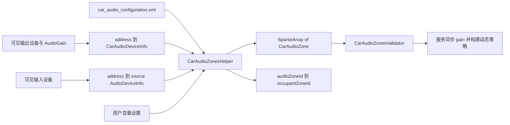
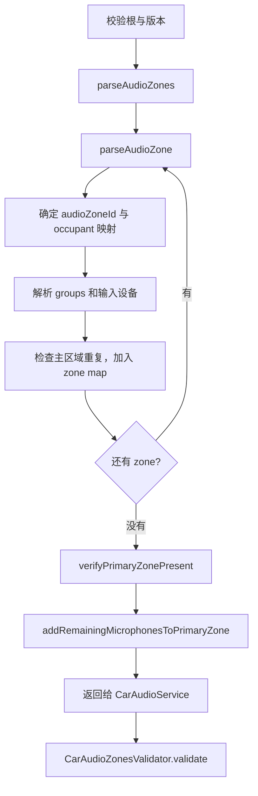

# 9.18 CarAudioZonesHelper：配置如何成为可用的 Zone 对象

> 本地 Android 12L/API 32 的解析器支持配置版本 1、2，最高常量为 `SUPPORTED_VERSION_2`。不是旧文中的 V3/OEM Context/镜像设备池/ZoneConfig 解析器。

前置：[9.3 CarAudioZone](09_9.3_CarAudioZone-多Zone音频管理.md)。本篇讲解析与失败边界；配置被注册为 AudioMix 的过程见 [9.11](09_9.11_CarAudioDynamicRouting-动态路由构建.md)。

## 1. XML 不是孤立的数据来源

构造器接收 CarAudioSettings、InputStream、输出 CarAudioDeviceInfo 列表、输入 AudioDeviceInfo 数组和组静音开关。它为设备建立地址索引，再解析 XML 引用这些已经可见的设备。



输出地址为空的设备会在建立 map 时被过滤；输入 map 只加入 `isSource()` 为真的设备。配置写了一个名字，但 AudioManager 没有提供对应地址，不能由解析器凭空生成设备。

类注释要求单线程使用，且与创建它的线程一致。不要因为内部用了 SparseArray 就推导成线程安全解析器。

## 2. 本地支持的结构

下面是**结构示意**，不是可直接安装的完整配置：

```text
carAudioConfiguration version=1 或 2
└── zones
    └── zone
        ├── volumeGroups
        │   └── group
        │       └── device address=已有输出地址
        │           └── context context=内建名称
        └── inputDevices（版本 2）
            └── inputDevice address=已有输入地址
```

root 必须为 carAudioConfiguration。解析器检查版本，然后寻找 zones；缺少 zones 抛 RuntimeException。它不把任意标签内容解释成音频策略。

## 3. V1 与 V2 的差别

| 项目 | 版本 1 | 版本 2 |
|---|---|---|
| 主区 ID | isPrimary=true 得到 0 | 可以省略，或显式指定 0 |
| 副区 ID | 从 1 开始自动分配 | 必须显式指定非 0 audioZoneId |
| audioZoneId 属性 | 不允许提供 | 支持，并检查重复 |
| occupantZoneId | 不允许提供 | 可选，值不能重复关联给多个音区 |
| inputDevices | 不支持，出现会报错 | 支持显式输入地址分配 |
| 四个 non-legacy contexts | 不能显式配置；自动挂到默认 Context 的设备 | 可显式配置 |

输入规则、组完整性和主区麦克风校验还会在其他步骤执行。配置版本不是 AudioControl HAL 版本：XML version=2 不意味着必须选择 HIDL V2。

## 4. Zone 构造与主区域验证

每个 zone 的解析顺序为：读取 isPrimary/name → `getZoneId()` → `parseOccupantZoneId()` → 构造 CarAudioZone → 解析 volumeGroups/inputDevices。



主区必须存在，不能有两个 ID=0 的主区。ID 使用 `Integer.parseUnsignedInt()` 解析；方法名虽叫 parsePositiveIntAttribute，也不应据名字推断它统一要求大于零——主区 0 正是允许值，主/副区条件另行检查。

## 5. Group、Device、Context 的建立

每次 `parseVolumeGroups()` 从 groupId=0 开始，顺序创建组。`parseVolumeGroup()` 建立 CarVolumeGroup.Builder，解析 device address，先确认地址存在，再把各 Context 与该设备绑定。

该实现没有 group name → groupId 的命名注册表，也没有配置切换 ID。持久化音量使用 zoneId/groupId，因此改变组顺序不能随意视为对已有设置毫无影响。

### 5.1 内建名称与 INVALID 的边界

名称映射原文：

```java
private static @AudioContext int parseCarAudioContext(String context) {
    return CONTEXT_NAME_MAP.getOrDefault(context.toLowerCase(), CarAudioContext.INVALID);
}
```

名称来自固定表：music、navigation、voice_command、call_ring、call、alarm、notification、system_sound、emergency、safety、vehicle_status、announcement。

这里未知名称返回 INVALID，不是立即抛出“未知 Context”专用异常；缺失属性也不能假设会自动采用 MUSIC。`validateCarAudioContextSupport()` 主要拒绝 V1 显式声明 non-legacy contexts。

此外，Zone 的完整性校验用去重集合的数量比较，不是严格合法集合比较。后续动态路由的 `getUsagesForContext()` 会执行合法 Context 检查。所以“配置能进入某个对象”不等于它已经通过全部语义校验，更不等于可注册并播放。

### 5.2 V1 怎样兼容新增 contexts

本地在解析到 `CarAudioService.DEFAULT_AUDIO_CONTEXT` 对应设备时调用：

```java
if (isVersionOne() && carAudioContext == CarAudioService.DEFAULT_AUDIO_CONTEXT) {
    setNonLegacyContexts(groupBuilder, info);
}
```

`setNonLegacyContexts()` 将 EMERGENCY、SAFETY、VEHICLE_STATUS、ANNOUNCEMENT 绑定到同一设备。此兼容行为不是 V1 XML 可以直接写这四个 context，也不是运行时向某个外部 HAL 询问它们的路由。

## 6. 输入地址和未分配麦克风

V2 inputDevice 的地址必须非 null、非空，不能在整个解析过程中重复分配；还必须存在于输入设备 map 中。验证后将 AudioDeviceAttributes 加入该 zone。

所有 zones 解析完成后，补充逻辑原文：

```java
for (AudioDeviceInfo info : mAddressToInputAudioDeviceInfoForAllInputDevices.values()) {
    if (!mAssignedInputAudioDevices.contains(info.getAddress())
            && isMicrophoneInputDevice(info)) {
        primaryAudioZone.addInputAudioDevice(new AudioDeviceAttributes(info));
    }
}
```

这只补“未分配的麦克风输入”，不是把每个未分配的 source 都加入主区。之后 validator 还要求主区输入列表非空且至少有一个 TYPE_BUILTIN_MIC。

因此，只看 XML 中显式 inputDevice 数量不足以判断最终主区输入列表，也不能把此补充规则写成自动保证任意板卡配置通过。

## 7. skip 为什么是重要的语义边界

`skip()` 用嵌套深度跳过一个不处理的标签子树。`parseAudioZone()` 只专门识别 volumeGroups 和 inputDevices。

本地 AR common_au XML 带有 displays 标签，但当前 parser 在 zone 层对它走 skip。文件里的显示端口注释不能代替实际解析代码；同理，在 V2 文件里塞入 zoneConfigs、oemContexts 或 mirroringDevices 标签，不会自动获得新版能力。

不识别标签的跳过策略和“不支持版本号直接拒绝”是两种不同处理，不能笼统称为全部向后兼容。

## 8. 失败在哪一层发生

| 情况 | 本地处理边界 |
|---|---|
| 版本不在 1/2 中 | parser 抛 IllegalArgumentException |
| 缺 zones 或主区，主区重复 | parser 报错，不返回可用区域集合 |
| V1 提供显式 zone/occupant ID 或 inputDevices | 相应版本条件报错 |
| 输出地址不可见 | validateOutputDeviceExist 抛 IllegalStateException |
| 输入地址缺失/重复/不可见 | 对应参数或存在性校验报错 |
| 同组 Context 重复、gain step 不一致 | CarVolumeGroup.Builder 报错 |
| Context/地址跨组重复 | Zone 返回 false，外层 validator 抛异常 |
| 地址跨区域重复、主区无 built-in mic | CarAudioZonesValidator 报错 |
| XML IO/语法异常 | service 捕获对应异常并包装解析失败信息 |

不要把所有异常都说成 XML 语法错误，也不要宣称任一失败都自动选择 fallback 配置。没有统一配置文件时的 legacy loader 仅适用于旧 AudioControlWrapperV1，见 [9.2](09_9.2_CarAudioService-车载音频核心服务.md)。

## 9. 从源配置到运行路由还缺哪些步骤

顺序是：设备可见 → 文件实际选中 → 解析对象 → 语义校验 → 同步 gain → AudioMix 构建/注册 → 用户 affinity → 播放时 Native Policy 选择。源树中的 XML 只覆盖其中一个输入。

因此本篇不根据 `common_au/car_audio_configuration.xml` 的存在断言设备已加载它，也不据 BUS 地址推断座椅接线或 DSP graph。

源码根为 `Android/lagvm/LINUX/android/`：

- `packages/services/Car/service/src/com/android/car/audio/CarAudioZonesHelper.java`。
- `packages/services/Car/service/src/com/android/car/audio/CarAudioZonesValidator.java`。
- `packages/services/Car/service/src/com/android/car/audio/CarAudioContext.java`。
- `vendor/qcom/opensource/audio-hal-ar/primary-hal/configs/common_au/car_audio_configuration.xml`。

继续：[9.11 动态策略](09_9.11_CarAudioDynamicRouting-动态路由构建.md) · [9.5 Gain](09_9.5_CarVolumeGroup-车载音量组.md)。本文没有执行配置装载或实机路由测试。
