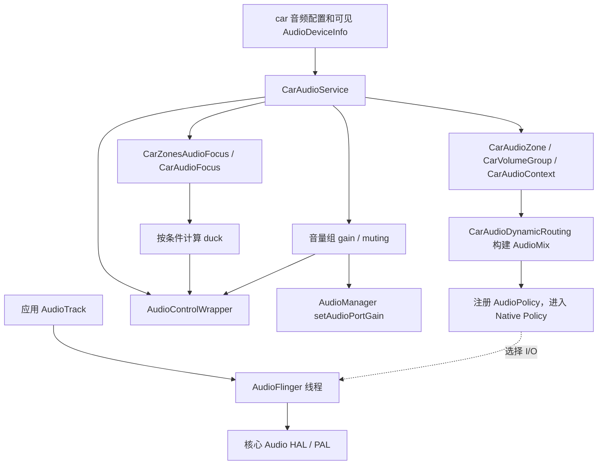
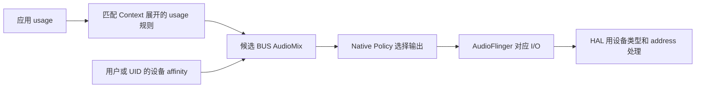

# 9.1 AAOS 音频总览：区域、用途、设备与控制的分工

> 本地主线为 Android 12L/API 32 + SA8295 + QNX AudioReach。AAOS 在 Android 音频机制之上增加车载区域、用途映射和控制协作；不是另写一套 AudioFlinger，也不意味着所有车载声音都由 Android PCM 播放。

前置：[AudioFlinger](../05_AudioFlinger/05_5.1_AudioFlinger-音频数据面引擎.md)、[AudioPolicyManager](../06_Audio_Policy_Engine/06_6.2_AudioPolicyManager-策略核心实现.md)。

## 1. 为什么车载需要额外的对象

普通应用表达 usage，例如媒体、导航或通话。车内还需要回答：哪个用户/乘员区域、哪个输出地址、哪个音量组，以及其他正在发声的用途是否可以并存。

| 概念 | 本地职责 | 不等于 |
|---|---|---|
| audio zone | 一组音量组、输出地址、输入设备及区域焦点管理的边界 | 自动识别出的物理扬声器分区 |
| occupant zone | 乘员区域，用于关联用户与车内位置等信息 | audio zone ID 本身 |
| AudioAttributes usage | Android 对音频用途的描述 | BUS 编号 |
| CarAudioContext | 把相近 usage 归为车载语义组，供路由、音量与焦点使用 | 独立音频流或 PAL stream type |
| BUS address | AudioDeviceInfo 暴露的设备地址，供动态规则与厂商 HAL 匹配 | 实体总线线序、DSP graph ID |
| volume group | 同一区域内共同调节的一组设备/context | 每组必然只有一个 usage |
| UID / userId | 应用身份 / Android 用户身份 | zoneId；两者对应的设备 affinity 也不同 |

## 2. 控制平面与 PCM 数据平面



图中 AudioControl 的焦点、duck/mute、fade/balance 都是控制接口；PCM 数据不经它传输。音量组的设备 gain 也不是统一经 AudioControl 设置：本地 `CarAudioDeviceInfo` 调用 `AudioManager.setAudioPortGain()`。

## 3. CarAudioContext 是多对一的用途分类

`CarAudioContext.java` 定义 12 个有效 contexts：MUSIC、NAVIGATION、VOICE_COMMAND、CALL_RING、CALL、ALARM、NOTIFICATION、SYSTEM_SOUND、EMERGENCY、SAFETY、VEHICLE_STATUS、ANNOUNCEMENT。

例如 MUSIC 的原文映射：

```java
CONTEXT_TO_USAGES.put(MUSIC,
        new int[]{
                AudioAttributes.USAGE_UNKNOWN,
                AudioAttributes.USAGE_GAME,
                AudioAttributes.USAGE_MEDIA
        });
```

导航 guidance 对应 NAVIGATION；VOICE_COMMAND 包括 accessibility 与 assistant；CALL 包括 voice communication 与 signalling。反向查询用 usage 取 context，无法识别时返回 INVALID。

因此“一个 Context 就是一个 usage”“Context 数值可以直接当成 HAL stream type”都不成立。规则构建时要把一个 Context 展开成多个 usage 匹配项。

## 4. 本地 AR 配置怎样表达区域

本地可见配置：`vendor/qcom/opensource/audio-hal-ar/primary-hal/configs/common_au/car_audio_configuration.xml`，根版本为 2。

| 配置中的区域 | 输出分组与地址 | 输入地址 |
|---|---|---|
| primary zone，主区域 | MUSIC → BUS00_MEDIA；通知/告警等 → BUS01_SYS_NOTIFICATION；导航/语音命令 → BUS02_NAV_GUIDANCE；电话/铃声 → BUS03_PHONE | BUS04_INPUT |
| front passenger zone，audioZoneId=1 | 所有有效 Context 在一个组，地址 BUS08_FRONT_PASSENGER | BUS09_INPUT_FRONT_PASSENGER |
| rear seat zone，audioZoneId=2 | 所有有效 Context 在一个组，地址 BUS16_REAR_SEAT | BUS17_INPUT_REAR_SEAT |

这是**该源文件的配置内容**，不是读取运行设备后确认的三音区拓扑。源文件存在、复制规则、资源 overlay 与最终设备加载文件还要分别看。

### 4.1 配置标签存在，不等于当前解析器使用

本地 `CarAudioZonesHelper` 支持配置版本 1/2，版本 2 可指定 audioZoneId、occupantZoneId 和 inputDevices。主区域通常为 ID 0，组 ID 按区域内解析顺序产生。

上述 XML 还带有 `displays` 节点，但本地 `parseAudioZone()` 只专门处理 `volumeGroups` 与 `inputDevices`，其余节点走 skip。不能仅凭文件注释断言这里直接建立了“display port → audio zone”的运行映射；乘员/用户关联另由服务与 OccupantZone 协作。

### 4.2 合法性是逐层检查

`CarAudioZone.validateVolumeGroups()` 检查同一区域内 Context 不重复、Context 集合数量和设备地址不跨组重复。完整性在这里使用数量判断，不是逐元素验证合法集合；未知名称与后续合法性检查见 [9.18 配置解析](09_9.18_CarAudioZonesHelper-XML配置解析.md)。组构造另检查同组 gain step 一致。

`CarAudioZonesValidator` 进一步检查：

- 至少一个 zone；解析器要求存在唯一主区域。
- 每个 zone 的音量组有效。
- 一个输出地址不能重复出现在多个组或 zone。
- 主区域有输入设备且包含至少一个 built-in microphone。

解析器还会把未显式分配的麦克风补入主区域。不能据 XML 只有一个 BUS input 就判定运行验证一定通过或一定失败，必须结合 AudioManager 返回的设备列表。

## 5. 相同 usage 如何去不同区域

CarAudioDynamicRouting 以每个配置地址为单位构建 render AudioMix，把其 contexts 展开成 usage 规则。多个区域可以包含相同 MUSIC usage，因此还需要用户/UID 与设备集合的 affinity 配合。



焦点 zone 与路由 zone 必须协调，但**焦点管理本身不是 PCM 搬运**。`setZoneIdForUid()` 不只是更新 Java Map：它要设置 AudioPolicy 的 UID device affinity，并处理已有焦点的暂失与重获。存在 occupant mapping 时，这条 UID 显式路由 API 被禁止混用。

详细构建见 [9.11](09_9.11_CarAudioDynamicRouting-动态路由构建.md)，服务协作见 [9.2](09_9.2_CarAudioService-车载音频核心服务.md)。

## 6. 音量、焦点、duck 与 mute 分开理解

- **音量索引**：CarVolumeGroup 将 index 换算成 millibel gain，再向组内设备应用。它不是“设置一个 float 值给所有 Track”。
- **焦点**：按区域评估请求能否并存、被拒绝、延迟或导致其他请求失去焦点；应用收到焦点变化后的行为仍需要分层看。
- **duck**：CarDucking 根据持焦点的 usages/context 算设备地址；同一地址承载未 duck 的持焦点 context 时，会从 duck 地址集合中排除。
- **mute**：CarVolumeGroupMuting 按组状态和电源策略限制产生 mute/unmute 地址列表；硬件实际动作在下游。

同一个 BUS 混合了需要 duck 和不该 duck 的用途时，不能指望设备级 duck 再分离它们。这也是配置分组/分地址会影响可独立控制能力的原因，但不代表“每个用途都必须一条物理链路”。

## 7. 功能开关和接口版本有不同层次

CarAudioService 读取 `audioUseDynamicRouting`；关闭时走 legacy 音量模式。HAL ducking 受 `audioUseHalDuckingSignals` 和 wrapper 能力共同约束。组静音要求 dynamic routing、相应开关、指定音量上下文版本与支持组静音的 wrapper。

产品 `device/qcom/msmnile_gvmq/manifest.xml` 声明 AudioControl AIDL v1；核心 audio/effects 则是 HIDL 6.0。两者独立，不能从一者推导另一者。

本地 AIDL wrapper 的能力表包含 focus、ducking、group muting；没有旧文章中部分新版 gain/module 回调适配。默认 AudioControl 示例只记录多项控制通知，不能拿它证明厂商硬件已执行动作。详见 [10.1](../10_AudioControl_HAL/10_10.1_AudioControl_HAL总览.md)。

## 8. 学习与定位路线

1. [9.2 服务初始化与用户/区域关联](09_9.2_CarAudioService-车载音频核心服务.md)。
2. [9.11 动态 AudioMix 构建](09_9.11_CarAudioDynamicRouting-动态路由构建.md)。
3. [9.5 音量索引、设备 gain 与静音](09_9.5_CarVolumeGroup-车载音量组.md)。
4. [10.1 AudioControl 边界](../10_AudioControl_HAL/10_10.1_AudioControl_HAL总览.md) → [10.6 AIDL wrapper](../10_AudioControl_HAL/10_10.6_AudioControlWrapperAidl-AIDL适配层架构.md)。
5. 回到 [6.2 APM](../06_Audio_Policy_Engine/06_6.2_AudioPolicyManager-策略核心实现.md) 和 [15.10 HAL-PAL](../15_PAL_Architecture/15_15.10_HAL-PAL适配层架构.md)，对齐 BUS 地址与实际下游处理。

区域路由问题至少对齐 usage、zone、用户/UID、device address、AudioMix、I/O；不要只查看一个“当前音区”变量。本文说明静态实现和源配置，没有运行服务或验证板级接线。

源码根为 `Android/lagvm/LINUX/android/`，本页主体在 `packages/services/Car/service/src/com/android/car/audio/` 中的 CarAudioService、CarAudioZone、CarAudioContext、CarAudioZonesHelper、CarAudioZonesValidator。
