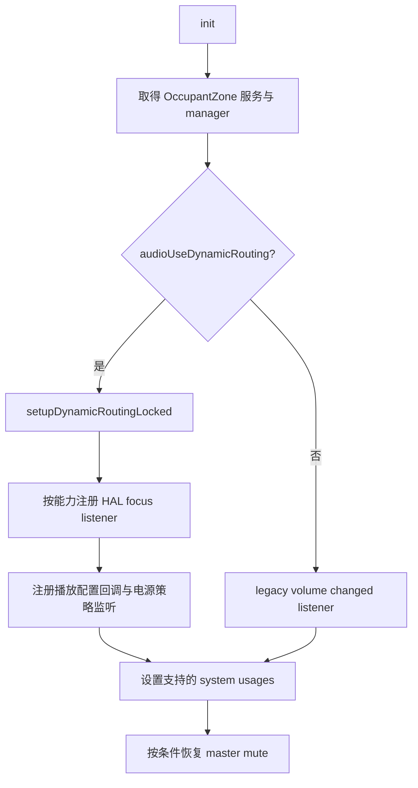
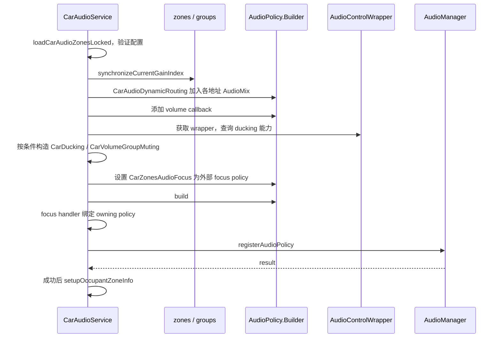

# 9.2 CarAudioService：配置、策略、区域用户与控制的协调者

> 本页按本地 Android 12L/API 32 的 CarAudioService 实现讲解。它组织车载音频控制，不取代 AudioFlinger 的混音线程；原文中的镜像管理、新版 gain/module callback 等不混入本地主线。

前置：[9.1 AAOS 对象模型](09_9.1_AAOS音频系统总览.md)。

## 1. 两种工作模式先于一切流程

构造函数从资源读取 `audioUseDynamicRouting`、`audioUseHalDuckingSignals`、音量上下文版本等。`init()` 根据 dynamic routing 开关分支：



Legacy 模式的音量接口按 `STREAM_TYPES` 映射到 MUSIC/ALARM/RING，不具备本文动态区域/音量组模型的全部行为。不能只因为设备是 AAOS，就假定 dynamic 路径必然执行。

组静音有效开关是 dynamic routing 与 `audioUseCarVolumeGroupMuting` 的逻辑与。关闭 dynamic routing 时，组静音功能关闭，而不是仅因 overlay 配了 true 就抛异常。有效开关为 true 但音量上下文版本不是 VERSION_TWO 时，构造函数抛异常；创建 CarVolumeGroupMuting 时还要确认 wrapper 支持该功能。

## 2. 动态初始化有明确依赖顺序



源码中的焦点策略设置：

```java
builder.setAudioPolicyFocusListener(mFocusHandler);
builder.setIsAudioFocusPolicy(true);

mAudioPolicy = builder.build();
```

本地注释说明该策略让车载层决定焦点请求，并绕过 Framework 的默认 ducking 逻辑。因此 CarDucking 是否创建、HAL 是否实际处理地址级 duck 信号，是独立而重要的条件。

注册返回非 `AudioManager.SUCCESS` 会抛 RuntimeException，不会自动悄悄回到“差不多可用”的多区域模式。

## 3. 配置文件如何进入对象模型

`getAudioConfigurationPath()` 依次检查 `/vendor/etc/car_audio_configuration.xml`、`/system/etc/car_audio_configuration.xml`，取首个存在的文件。

加载过程先从 AudioManager 获取输出/输入设备，用其地址、能力和 gain 创建辅助对象，再由 CarAudioZonesHelper 解析 XML，最后调用 CarAudioZonesValidator。

如果文件不存在，服务尝试旧版 volume group 配置路径；但这条路径明确要求 `AudioControlWrapperV1`，不是所有新 wrapper 都能兼容回退。对本地声明的 AIDL AudioControl，不能建议“删掉配置就会自动用 HAL 默认路由”。

本地 AR 配置和解析器差异见 [9.1](09_9.1_AAOS音频系统总览.md)，AudioMix 构建见 [9.11](09_9.11_CarAudioDynamicRouting-动态路由构建.md)。

## 4. 音量 API：通知、状态与硬件不是同一时刻

`setGroupVolume()` 原文的关键顺序：

```java
enforcePermission(Car.PERMISSION_CAR_CONTROL_AUDIO_VOLUME);
callbackGroupVolumeChange(zoneId, groupId, flags);
// For legacy stream type based volume control
if (!mUseDynamicRouting) {
    mAudioManager.setStreamVolume(
            CarAudioDynamicRouting.STREAM_TYPES[groupId], index, flags);
    return;
}
synchronized (mImplLock) {
    CarVolumeGroup group = getCarVolumeGroupLocked(zoneId, groupId);
    group.setCurrentGainIndex(index);
}
```

先做权限检查，然后发应用侧回调，再进入 legacy 或动态 gain 设置。**音量 UI 收到回调不是下游设备设置成功的确认。** 动态路径还会校验 zone/group 和索引；设备 gain 失败的报告方式见 [9.5](09_9.5_CarVolumeGroup-车载音量组.md)。

### 4.1 音量键不是简单修改全车音量

`CarAudioPolicyVolumeCallback.onVolumeAdjustment()` 先请求主区域的 suggested context，再找对应 group，根据当前值/min/max 计算增减。组静音功能启用与否还决定 mute 操作作用于 volume group 还是 master mute。

这个 callback 的本地入口明确使用 PRIMARY_AUDIO_ZONE，不能把它扩写成“任意区域的所有音量键自动使用相同路由”。实际按键来源与区域扩展需要沿对应实现继续追踪。

### 4.2 组 mute 的独立信号链

`setVolumeGroupMute()` 要求权限、dynamic routing 和组静音功能，先更新组状态并发回调，再调用 `mCarVolumeGroupMuting.carMuteChanged()`，生成发往 AudioControl 的设备 mute/unmute 信息。

这和 setGroupVolume 下发 AudioPort gain 是两条不同路径。CarVolumeGroup 调整音量时虽会清除自身 `mIsMuted`，也不能仅凭这一局部状态变化就宣称设备已收到 unmute；需要看具体调用链是否发出了相应控制通知。

## 5. UID 显式路由：真正修改的是 device affinity

`setZoneIdForUid(zoneId, uid)` 需要 car audio settings 权限、dynamic routing、有效 zone，并要求没有 occupant zone mapping。

它会暂时移除旧区域中该 UID 的焦点 losers/holders，移除旧 affinity，再设置新区域的设备集合，成功后重新评估焦点。顺序上先处理 losers，再处理 holders，避免处理过程中误触发旧焦点恢复。

真正设置新路由的原文：

```java
List<AudioDeviceInfo> deviceInfos = getCarAudioZoneLocked(zoneId).getAudioDeviceInfos();
if (mAudioPolicy.setUidDeviceAffinity(uid, deviceInfos)) {
    // TODO do not store uid mapping here instead use the uid
    //  device affinity in audio policy when available
    mUidToZoneMap.put(uid, zoneId);
    return true;
}
```

失败返回 false，不更新为成功的新映射；这不是一个自动保证全流程事务回滚的接口。特别是此前暂失的焦点和移除的旧映射，不能因为新设置失败就假设已经全部恢复。

## 6. occupant/user 关联是另一条管理路径

乘员区域配置变化触发用户关联更新。`updateUserForOccupantZoneLocked()` 比较新旧 user：

1. 不变则返回。
2. 移除旧用户 device affinity。
3. 用户退出时按默认用户相关逻辑恢复焦点/音量设置。
4. 对适用的新用户设置 `setUserIdDeviceAffinity(userId, zone.getAudioDeviceInfos())`。
5. 加载该用户音量组设置，更新该区域焦点管理使用的用户，再更新映射。

设置用户 affinity 失败会抛异常；移除旧 affinity 失败有日志返回。UID 与 userId API 的限制和失败语义不同，不能混合成“给每个 zone 一个 UID”模型。

配置中的 audioZoneId 与 occupantZoneId 也是不同标识。具体显示器/乘员布局由相应 OccupantZone 配置与服务负责，不由 BUS 数字自动推导。

## 7. AudioControl 能力与死亡处理

`getAudioControlWrapperLocked()` 延迟调用 `AudioControlFactory.newAudioControl()`，并把 `resetHalAudioFocus` 注册为死亡处理回调。

- HAL focus：wrapper 支持时创建 HalAudioFocus，注册请求/放弃焦点的 listener。
- duck：开关允许且 wrapper 支持时创建 CarDucking。
- group mute：启用后构造器要求能力满足，否则报错。
- fade/balance：权限检查后交给 wrapper；这里不计算车内功放系数。

HAL 死亡后，AIDL wrapper 会获取新服务并通知 serviceDied；CarAudioService 的 `resetHalAudioFocus()` 调 reset，再重新注册 focus listener。它没有在这个回调中逐项重放所有音量、fade、balance、duck/mute 控制，所以不能称为“全状态透明恢复”。具体限制见 [10.6](../10_AudioControl_HAL/10_10.6_AudioControlWrapperAidl-AIDL适配层架构.md)。

## 8. 电源、释放与观察

电源音频禁用会限制焦点；使用组静音时还设置 muting restriction。CarVolumeGroupMuting 区分包含 critical contexts 的组，不能写成任何电源变化都无条件静音所有车载告警。

`release()` 按模式注销动态 policy 或 legacy receiver，释放 volume callbacks，处理 HAL focus listener、death link 与 power listener。异步注销策略不等于所有硬件 buffer 已同步清空。

服务 dump 可观察模式、功能开关、配置路径、zones/groups、focus 与 wrapper 状态。继续向下对照：

- Native Policy：AudioMix、affinity 与 I/O 选择。
- AudioFlinger：实际 Track/RecordTrack 和线程。
- 核心 HAL/PAL：地址和配置如何生效。
- AudioControl：通知是否抵达实际产品实现，而不仅是 Java 调用完成。

源码根为 `Android/lagvm/LINUX/android/`，主要文件：

- `packages/services/Car/service/src/com/android/car/audio/CarAudioService.java`。
- `packages/services/Car/service/src/com/android/car/audio/CarAudioPolicyVolumeCallback.java`。
- `packages/services/Car/service/src/com/android/car/audio/CarAudioSettings.java`。
- `packages/services/Car/service/src/com/android/car/audio/CarVolumeGroupMuting.java`。

本文未运行车机命令，不以静态调用或日志点替代实际策略注册、设备音量或恢复效果验证。
