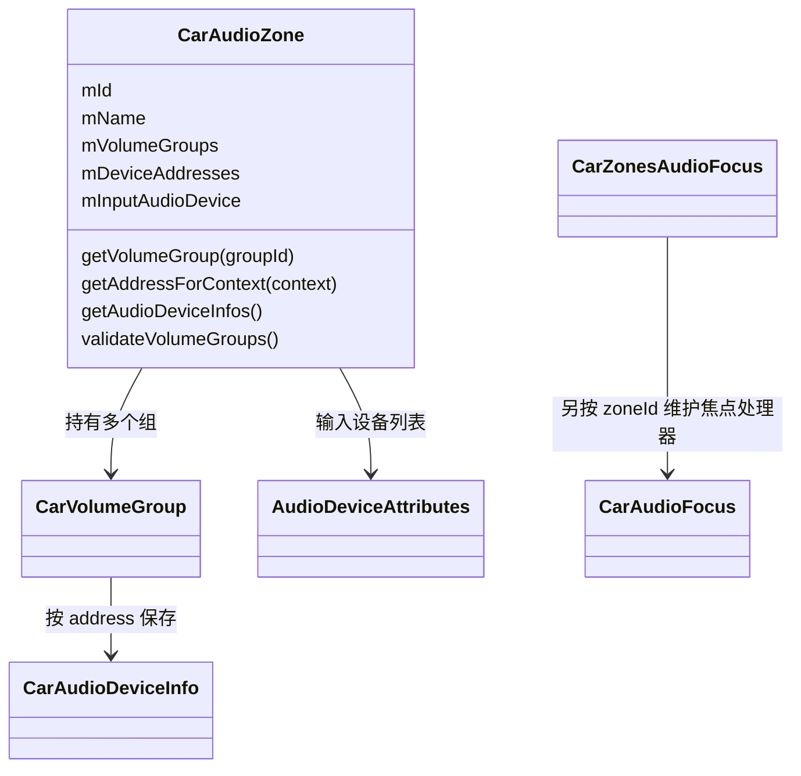
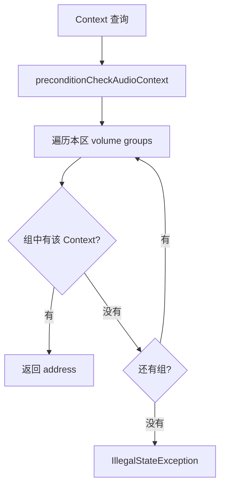

# 9.3 CarAudioZone：区域内的音量组、地址与活动用途

> 本地 Android 12L/API 32 的 CarAudioZone 直接持有 volume groups。它没有旧文中多套 CarAudioZoneConfig 的切换状态，也不直接持有焦点处理器或 AudioTrack。

前置：[9.1 对象模型](09_9.1_AAOS音频系统总览.md)。本篇回答：区域保存哪些信息、怎样查询地址、怎样验证配置、怎样从播放状态找出区域内的活动用途。

## 1. Zone 是逻辑边界，不是设备驱动

本地核心字段为 `mId`、`mName`、`mVolumeGroups`、`mDeviceAddresses` 和输入设备列表。构造时创建空集合，解析器逐个加入组和输入。



逻辑上的区域隔离**不是硬件隔离**保证。实际路由还要由 AudioPolicy mixes、user/UID affinity、核心 HAL/PAL 及设备侧实现共同落实；建立一个 CarAudioZone 不会自行创建独立 PCM 引擎。

## 2. 加入组时缓存设备地址集合

原文：

```java
void addVolumeGroup(CarVolumeGroup volumeGroup) {
    mVolumeGroups.add(volumeGroup);
    mDeviceAddresses.addAll(volumeGroup.getAddresses());
}
```

组保存 Context→address 映射；Zone 缓存所有组的地址集合，用于快速判断某个播放设备是否属于本区。缓存不是“address→硬件通道”表。

`getVolumeGroup(groupId)` 先检查索引位于 `[0, size-1]`，再取列表项。解析器按区域内的 group 顺序编号，所以 groupId 应与 zoneId 一起理解。

### 2.1 获取设备与对象快照的边界

- `getAudioDeviceInfos()` 创建新 List，枚举所有组的地址，取各自 AudioDeviceInfo。
- `getVolumeGroups()` 创建数组快照，但数组元素仍是原 group 对象，不是深复制。
- `getInputAudioDevices()` 直接返回内部输入 List，不是不可变副本。

不能因为某一个 getter 的注释写 snapshot，就把整个类描述成不可变、任意并发安全的配置对象。

## 3. Context 如何找到输出地址

`getAddressForContext()` 先用 CarAudioContext 检查有效 context，再逐组查找；第一个非 null 地址即返回。没有找到则抛 IllegalStateException。



它不是遍历多个“当前激活配置”，也不从 BUS 名字推导 Context。映射已经由 XML 解析与 group builder 写入；动态规则构建使用这份映射，见 [9.11](09_9.11_CarAudioDynamicRouting-动态路由构建.md)。

## 4. validateVolumeGroups 的实际能力

校验分工如下：

| 位置 | 检查 |
|---|---|
| group builder | 同一 Context 不重复分配，同组设备 gain step 一致 |
| CarAudioZone | Context 不跨组重复、address 不跨组重复、Context 集合数量达到要求 |
| CarAudioZonesValidator | 跨区域 address 唯一、主区域存在输入且含 built-in mic 等 |
| CarAudioZonesHelper | XML 版本、主区域/ID、设备地址存在、输入显式分配不重复等 |

其中“所有 contexts 已分配”的本地判定原文使用**数量**：

```java
if (contexts.size() != CarAudioContext.CONTEXTS.length) {
    Slog.e(CarLog.TAG_AUDIO, "Some contexts are not assigned to group");
    Slog.e(CarLog.TAG_AUDIO, "Assigned contexts " + contexts);
    Slog.e(CarLog.TAG_AUDIO,
            "All contexts " + Arrays.toString(CarAudioContext.CONTEXTS));
    return false;
}
```

这不是将集合与合法 CONTEXTS 数组逐元素作相等比较。不能把它单独宣称为“任何非法 Context 都一定在此被拒绝”；解析器对未知名称的处理和后续 getUsagesForContext 的检查需一起看，详见 [9.18](09_9.18_CarAudioZonesHelper-XML配置解析.md)。

没有配置给任何组的输出设备可以保留给其他目的。地址存在于 AudioPolicy，不代表一定属于某个 CarAudioZone。

## 5. 从播放配置找活动 Context

`findActiveContextsFromPlaybackConfigurations()` 接收 AudioPlaybackConfiguration 列表：

1. 只考虑 `configuration.isActive()`。
2. 取得配置实际关联的 AudioDeviceInfo。
3. 设备非 null、address 非 null/非空，且 address 在本区缓存集合内，才继续。
4. 用该播放配置的 AudioAttributes system usage 转成 Context，加入结果 List。

```java
boolean isAudioDeviceInfoValidForZone(AudioDeviceInfo info) {
    return info != null
            && info.getAddress() != null
            && !info.getAddress().isEmpty()
            && containsDeviceAddress(info.getAddress());
}
```

特别注意：返回的是**播放器实际属性对应的 Context**，不是把它的设备地址反查为某个默认 Context。源码也提示 address 配置的 context 与当前播放属性可能不同。

结果是 List，没有在本方法里去重；多个活动配置可以产生相同 Context。`isActive` 是 Framework 状态，不是麦克风测量到真实声压，也不是设备真正输出的确认。

## 6. 用户设置与初始 gain 同步

Zone 把用户切换通知转发给各组的 `loadVolumesSettingsForUser()`。它本身不更新 UID/user 的设备 affinity；这些由 CarAudioService 协调。

初始化同步原文：

```java
void synchronizeCurrentGainIndex() {
    for (CarVolumeGroup group : mVolumeGroups) {
        group.setCurrentGainIndex(group.getCurrentGainIndex());
    }
}
```

这是按当前组索引再次发起 gain 设置，不是从硬件读回后比较。设备失败未逐项反馈给 Zone，因此不能从此方法正常返回断言整区硬件 gain 一致，见 [9.5](09_9.5_CarVolumeGroup-车载音量组.md)。

## 7. 主区域和输入设备

`isPrimaryZone()` 仅判断 ID 是否等于 PRIMARY_AUDIO_ZONE（0）。它不因这个标记自动获得旧文所述的镜像/媒体请求功能。

输入设备由解析器添加；未显式分配的麦克风可补入主区域，然后由 validator 确认主区至少有一个 built-in mic。输入集合不是“这个区域所有录音都已强制走这里”的运行保证。

CarAudioService 负责 occupant/user 关联与动态策略；CarZonesAudioFocus 负责把焦点请求分发到对应区域的 CarAudioFocus。不要把它们的状态都画为 CarAudioZone 成员。

## 8. 阅读与定位

区域问题依次查：zone ID/组索引 → Context 映射 → 地址集合 → 实际播放配置的设备地址 → user/UID affinity → Native I/O。不要仅用 zone 名称或座位示意图证明实际音频隔离。

继续：[9.18 配置解析](09_9.18_CarAudioZonesHelper-XML配置解析.md)、[9.2 服务协作](09_9.2_CarAudioService-车载音频核心服务.md)。

源码相对 `Android/lagvm/LINUX/android/`：`packages/services/Car/service/src/com/android/car/audio/CarAudioZone.java`、`packages/services/Car/service/src/com/android/car/audio/CarAudioZonesValidator.java`。本页没有运行区域切换或设备测试。
