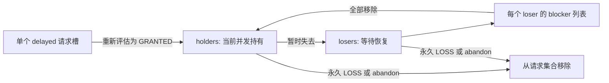
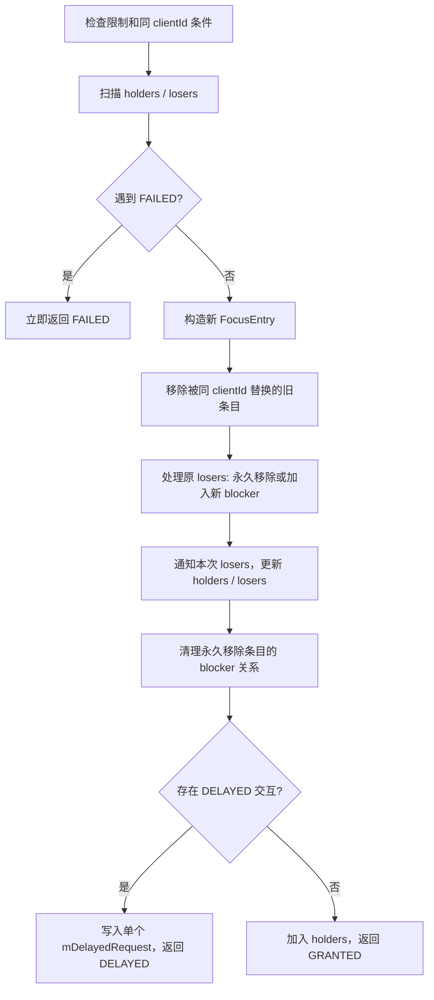
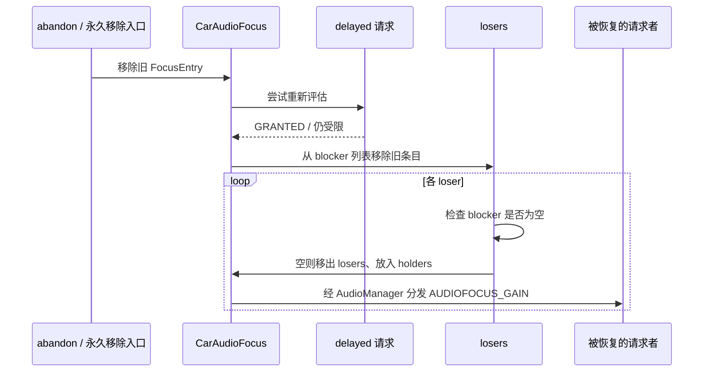

# 9.4 CarAudioFocus：并发持有、阻塞关系与延迟请求

> 本地 Android 12L/API 32 的每个音区拥有一个 CarAudioFocus 实例。本篇以实际 evaluateFocusRequestLocked 为主，不引入新版 OEM evaluator 或 Core Audio routing 分支。

前置：[9.3 区域对象](09_9.3_CarAudioZone-多Zone音频管理.md)；区域选择见 [9.10](09_9.10_CarZonesAudioFocus-多Zone焦点分发器.md)，矩阵全集见 [12.6](../12_Audio_Focus_Deep_Dive/12_12.6_AAOS焦点交互矩阵.md)。

## 1. 不是一个只允许栈顶发声的栈

车载允许多个用途共同持焦点，例如媒体与导航。实现因此用两张以 clientId 为 key 的 Map，而不是用“栈顶唯一所有者”解释所有状态：

| 字段/对象 | 含义 |
|---|---|
| mFocusHolders | 当前被认为持焦点的 FocusEntry 集合 |
| mFocusLosers | 暂失焦点、仍可能恢复的条目集合 |
| FocusEntry.mBlockers | 哪些其他请求阻止该条目恢复 |
| FocusEntry.mIsDucked | 本地记录曾发送相应 duckable loss 的状态，不是实际幅度值 |
| mDelayedRequest | 一个尚未获焦点的延迟请求槽；不是多元素队列 |
| mIsFocusRestricted | 限制非 critical contexts 的请求/现存条目 |

clientId 关联 AudioManager/listener 身份；同一 UID 可以拥有多个 clientId。不能用 UID 直接替代焦点条目的 key。



这是逻辑模型，不表示每个切换都有对应硬件启停。被暂失的条目也可能收到 CAN_DUCK，是否仍播放由其处理与系统控制决定。

## 2. 请求入口与 Framework 协作

CarZonesAudioFocus 选定 zone 后调用本实例 `onAudioFocusRequest()`。它在 mLock 下执行 evaluateFocusRequestLocked，随后把结果通过 `AudioManager.setFocusRequestResult(afi, response, policy)` 发回 Framework。

传入的 requestResult 参数不是本方法直接信任并返回的最终判定。本地重新评估；外部策略结果回送也不等同于发送所有旧播放器的 loss。

普通 Framework 的 MediaFocusControl 发现已注册外部策略时，会转发焦点请求，返回等待外部策略结果的内部状态；并非在默认栈算法结束后再让 CarAudioFocus 额外抢一次。

## 3. 评估阶段先检查什么

1. focus restricted 时，非 EMERGENCY/SAFETY context 的新请求直接 FAILED。
2. `permanent` 仅由 gainRequest==AUDIOFOCUS_GAIN 得到。
3. `allowDucking` 仅由 gainRequest==AUDIOFOCUS_GAIN_TRANSIENT_MAY_DUCK 得到。
4. 延迟还要求功能开关、永久 GAIN 和 DELAY_OK。
5. 与同 clientId 的 delayed/holder/loser 请求比较 Context。
6. 扫描当前 holders 和已暂失的 losers，应用特殊通知条件与 FocusInteraction 矩阵。

同 clientId 同 Context 可以替换旧条目；**比较的是 Context，不是严格 usage 数值相等**。例如两种 usage 映射到同一个 Context 时，不能按旧注释的“必须相同 usage”机械理解。不同 Context 的复用会被拒绝，避免后续 loss/gain 无法区分归属。

当请求 Context 是 NOTIFICATION，已有 holder 或 loser 的 gainRequest 是 TRANSIENT_EXCLUSIVE 时，会直接拒绝。这是矩阵之外的显式条件。

## 4. 矩阵只决定一对请求的关系

FocusInteraction 取 `[已有请求的 Context][新请求 Context]`：

- REJECT：允许 delayed 则 DELAYED，否则 FAILED。
- EXCLUSIVE：把旧条目加入待 loss 列表，返回 GRANTED。
- CONCURRENT：通常允许并存，但新请求不允许 duck、旧请求选择 pause-on-duck、或旧请求要求且有权限接收 duck events 时，也会把旧条目列入待 loss 列表。

矩阵返回 GRANTED 不是旧条目必然保留 focus。完整条件见 [12.6](../12_Audio_Focus_Deep_Dive/12_12.6_AAOS焦点交互矩阵.md)。

本地既扫描 holders，也扫描 losers：即使某声音已经暂失，新的请求仍可能成为它的另一个 blocker，或使它永久失去恢复机会。

## 5. 从评估结果提交状态变化



图中特意把 DELAYED 分支放在末尾：**本地实现可能在最终返回 DELAYED 之前，已经对其他可受影响的条目执行 loss/移除等更新。** 不能把 delayed 解释成“整个评估绝无副作用，原焦点集合完全不变”。

### 5.1 本次 losers 收到什么 loss

原文：

```java
if (permanent) {
    lossType = AudioManager.AUDIOFOCUS_LOSS;
} else if (allowDucking && entry.receivesDuckEvents()) {
    lossType = AudioManager.AUDIOFOCUS_LOSS_TRANSIENT_CAN_DUCK;
    entry.setDucked(true);
} else {
    lossType = AudioManager.AUDIOFOCUS_LOSS_TRANSIENT;
}
```

永久 LOSS 的条目移出请求集合，不等待普通 blocker 清除后自动恢复；暂时 loss 的条目移入 mFocusLosers 并加入 newEntry 作为 blocker。

`receivesDuckEvents()` 不只是权限名存在：还要求 attributes bundle 显式请求接收，且 PackageManager 对包名检查相应权限通过。

### 5.2 已暂失条目怎么变化

新请求若是永久 GAIN，则相应 blocked 条目会收到永久 LOSS 并移出 losers；若是 transient，就增加 blocker。已 ducked 的条目遭遇不允许 duck 的新请求，会被转换成 LOSS_TRANSIENT 并清除本地 ducked 标记。

一个旧请求可有多个 blockers。释放其中一个，并不足以恢复它。

## 6. abandon 与恢复的顺序

`onAudioFocusAbandon()` 先从 holders 移除匹配 clientId；没有再查 losers；仍没有则尝试删除同 clientId 的 delayed 请求。

找到旧条目后，恢复入口原文：

```java
private void removeBlockerAndRestoreUnblockedWaitersLocked(FocusEntry deadEntry) {
    attemptToGainFocusForDelayedAudioFocusRequest();
    removeBlockerAndRestoreUnblockedFocusLosersLocked(deadEntry);
}
```

顺序是**先重新评估 delayed，再清理旧 blocker 并恢复 unblocked losers**，不能反画成“所有旧声音先恢复，最后再考虑 delayed”。



图中最后一步只针对 unblocked 条目；回调对象是该条目的请求者，不一定是发起 abandon 的应用。

## 7. 延迟请求只有一个槽

允许 delayed 的条件原文：

```java
private boolean canReceiveDelayedFocus(AudioFocusInfo afi) {
    if (afi.getGainRequest() != AudioManager.AUDIOFOCUS_GAIN) {
        return false;
    }
    return (afi.getFlags() & AudioManager.AUDIOFOCUS_FLAG_DELAY_OK)
        == AudioManager.AUDIOFOCUS_FLAG_DELAY_OK;
}
```

CarAudioService 本地向工厂传 ENABLE_DELAYED_AUDIO_FOCUS=true，但还需上述请求条件满足。新 delayed 请求替换不同 clientId 的旧 delayed 时，先向旧请求发 LOSS；这不是先进先出排队，也不保证每个被延迟的请求最终获得焦点。

重评估 GRANTED 后清除 delayed 槽，再发 GAIN。如果此次 GAIN 分发明确 FAILED，代码会移除新 holder、清理其 blocker 关系并补发 LOSS。

与此不同，普通 unblocked loser 恢复路径在移入 holders 后调用 dispatchFocusGainedLocked，其返回失败主要记日志，没有同样的整套回滚。这种差异必须保留，不能把所有“GAIN 通知失败”说成统一自动恢复。

## 8. 电源/策略限制不是暂停全部状态等待恢复

`setRestrictFocus(true)` 清理非 critical delayed 请求、losers 和 holders，并发送永久 LOSS。EMERGENCY/SAFETY 是本地 critical contexts。

解除限制只更新标记，不自动重新请求已永久移除的所有焦点。应用恢复播放是否重新申请焦点，是另一条生命周期。

此处是焦点限制，设备静音由 CarVolumeGroupMuting 的独立路径负责。焦点集合变化、mute 地址通知与 PCM 是否真正在播，不可当作同一个状态。

## 9. 调试应保存一组状态，而非一句“有焦点”

观察 clientId、UID、Context、gainRequest、flags、holders/losers、各 blocker、delayed 槽、restricted 标记和分发结果。尤其检查：

- 请求是否在正确 zone，被 bundle zone 覆盖了吗？
- 同 clientId 是否跨 Context 复用？
- 两两并发是否被 pause/duck flags 改变？
- 恢复时是否还有第二个 blocker？
- FocusEntry 状态改变后，通知是否成功，播放器是否执行？

dump 和本地日志能观察控制状态，但不能单独证明播放器已暂停或硬件已 duck。本文没有运行焦点场景测试。

源码根为 `Android/lagvm/LINUX/android/`：`packages/services/Car/service/src/com/android/car/audio/CarAudioFocus.java`、`packages/services/Car/service/src/com/android/car/audio/FocusEntry.java`、`packages/services/Car/service/src/com/android/car/audio/FocusInteraction.java`。继续 [10.7 HAL 外部请求](../10_AudioControl_HAL/10_10.7_HalAudioFocus-外部焦点请求管理.md)。
