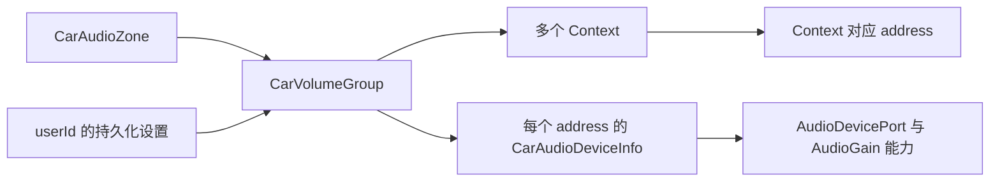
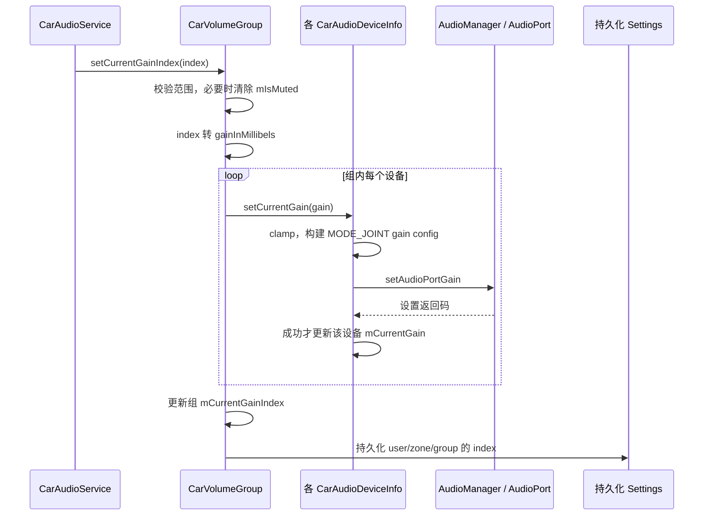
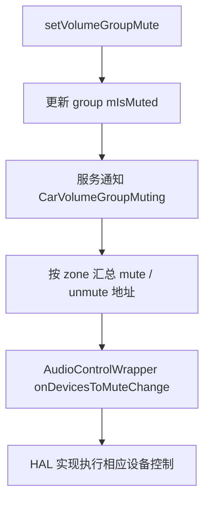

# 9.5 CarVolumeGroup：从用户音量索引到设备 Gain

> 本地 Android 12L/API 32 的 CarVolumeGroup 是一个具体 `final` 类。本文不套用新版抽象音量组、HAL gain callback 或 blocked/limited/attenuated 多层 gain 状态模型。

前置：[9.1 Zone / Context / BUS](09_9.1_AAOS音频系统总览.md)。本页重点区分应用看到的 index、组内 gain、设备实际设置与静音信号。

## 1. 音量组保存什么

每个 group 属于一个 zone，保存：

- zoneId、groupId 和当前 userId。
- Context → address 映射。
- address → CarAudioDeviceInfo 映射。
- min/max/default gain、统一 step size。
- stored/current gain index 和 `mIsMuted`。
- 是否启用组静音，以及是否含 EMERGENCY/SAFETY 等 critical contexts。



一个组可覆盖多个地址，一个地址可承载多个 Context。groupId 在所属 zone 内解释，不是跨所有区域的唯一音量编号。

## 2. Builder 如何汇总设备范围

`CarVolumeGroup.Builder.setDeviceInfoForContext()`：

1. 拒绝同一 context 重复分配。
2. 第一个设备提供 step；后续设备必须有相同 step。
3. 保存 context/address 和 device info。
4. 取设备 default 中的最大值作为组 default，max 中的最大值作为组 max，min 中的最小值作为组 min。

这里是**覆盖设备范围的汇总**，不是取所有设备都能原样接受的范围交集。最终每个设备还会单独 clamp，所以同一个组 gain 请求不必导致每台设备记录完全相同的 gain。

`CarAudioDeviceInfo` 要求存在 MODE_JOINT AudioGain，并检查 default/min/max 与 step 对齐等条件；不能凭空在文档中指定统一的最小增益、最大增益或档位数。

## 3. Index 与 millibel 的转换

源码原文：

```java
private int getGainForIndex(int gainIndex) {
    return mMinGain + gainIndex * mStepSize;
}

private int getIndexForGain(int gainInMillibel) {
    return (gainInMillibel - mMinGain) / mStepSize;
}
```

index 是离散档位；gain 是 millibel。它们不是线性振幅，也不是直接送 AudioTrack 的 float volume。

本地索引范围由 min/max/step 算出。`setCurrentGainIndex()` 先用 `isValidGainIndex()` 校验，非法值抛异常；**组级索引拒绝越界**与**设备级 gain clamp 越界**是两个不同策略。

不应把固定示例数值写成 SA8295 的实际 gain 范围；实际值来自设备端口的 AudioGain 声明。

## 4. 一次 setCurrentGainIndex 的真实顺序



组应用核心原文：

```java
int gainInMillibels = getGainForIndex(gainIndex);
for (String address : mAddressToCarAudioDeviceInfo.keySet()) {
    CarAudioDeviceInfo info = mAddressToCarAudioDeviceInfo.get(address);
    info.setCurrentGain(gainInMillibels);
}

mCurrentGainIndex = gainIndex;

storeGainIndexForUserLocked(mCurrentGainIndex, mUserId);
```

### 4.1 为什么组状态不是硬件确认

`CarAudioDeviceInfo.setCurrentGain()` 返回 void。找不到 AudioGain、无法构造 AudioGainConfig、`setAudioPortGain()` 失败时，它记录日志或返回；并没有把每个设备的成功/失败汇总返回给 group。

因此上段代码仍可能更新 group index 并持久化。**组当前索引不是硬件确认**；UI 看到变化，也不能证明每台设备都应用成功。服务的音量回调甚至在本地 setGroupVolume 中先于设备 gain 设置，见 [9.2](09_9.2_CarAudioService-车载音频核心服务.md)。

设备端辅助对象的 `mCurrentGain` 也只是成功设置后记住的请求值，不是从功放或 DSP 读回的测量值。源码说明设备 port 的 activeConfig 不能在此作为实际 gain 查询来源。

### 4.2 gain 走核心音频端口控制，不走 AudioControl setGroupVolume

本地设备调用是 `AudioManager.setAudioPortGain()`。AudioControl AIDL v1 没有 setGroupVolume 方法；它处理 mute/duck 地址通知与 fade/balance 等。

不要把组音量图画成“CarVolumeGroup → AudioControl HAL → 设置 DSP gain”的唯一链。具体端口 gain 如何进入核心 HAL/PAL，还要沿该控制路径分析。

## 5. 静音不是把存储索引永远改成零

`getCurrentGainIndex()` 在 `mIsMuted` 时返回最小 gain 对应索引；未静音时返回内部 current index。内部保存值与对外静音视图因此可以不同。

`setMuteLocked()` 修改状态，并在用户允许持久化组静音时保存。它不在这个方法里遍历设备执行 setAudioPortGain。



`setCurrentGainIndex()` 会清除组自身的 mute 标志，但这个局部方法不等于已发送 AudioControl unmute。解释外部实际状态时必须继续检查发通知的调用者。

### 5.1 电源限制与 critical contexts

`CarVolumeGroupMuting.generateMutingInfoFromZone()` 将以下组的地址列为 mute：

```java
if (group.isMuted() || (isMutingRestricted && !group.hasCriticalAudioContexts())) {
    mutedDevices.addAll(group.getAddresses());
} else {
    unMutedDevices.addAll(group.getAddresses());
}
```

critical context 对自动限制分支有影响，但显式 group.isMuted 仍独立成立。不能扩写为“critical 组在任何情况下都不可静音”。

这是**组/地址级**控制。如果一个组同时包含普通通知与安全用途，共享该组地址的控制粒度需要一并考虑；源码没有按每个样本的用途重新拆分音频。

## 6. 初始化与用户切换

`init()` 读取 user/zone/group 的 stored gain index，合法则采用，否则使用组 default 对应索引。服务加载所有 zones 后会调用 `synchronizeCurrentGainIndex()`，向设备应用初始值。

`loadVolumesSettingsForUser(userId)` 的顺序是：更新用户与存储值 → 更新 current index → 向设备应用并保存 → 更新组 mute 状态。mute 状态恢复后是否发送下游通知，由服务的相应流程协调，不能在本方法里补造 HAL 调用。

`CarAudioSettings` 使用：

- Settings.System 按用户存储 gain index，key 包含 zoneId/groupId。
- Settings.System 按用户存储组 mute。
- Settings.Secure 的用户设置决定是否持久化组 mute。
- master mute 则有单独的 Settings.Global key，不与组 mute 混为一项。

更换用户不是把整车所有组共用同一个音量值；也不是每次启动都丢掉合法的存储索引。

## 7. 哪些现象不能只看 group index

| 现象 | 需要进一步区分 |
|---|---|
| UI 变化但声音没变 | 回调顺序、设备 gain 返回、下游实现，而不是只看存储成功 |
| 同组设备响度变化不同 | 各设备 min/max clamp、物理/校准差异；同组请求值不是声压测量 |
| 调整音量后仍静音 | group 标志、AudioControl mute 通知、电源限制与设备实际状态 |
| 切换用户后音量异常 | userId/zone/group key、旧存储索引范围、mute 持久化开关 |
| 只某类声音不应 duck | 地址是否和其他持焦点用途共用；音量组 gain 与 duck 是不同控制 |

本地类没有新版 gain reason 回调、四层 gain 优先级、动态 gain stage 重算体系。相关旧文不能被视为本实现的字段说明；新版本应另据对应源码整理。

## 8. 源码与后续阅读

路径相对 `Android/lagvm/LINUX/android/`：

- `packages/services/Car/service/src/com/android/car/audio/CarVolumeGroup.java`。
- `packages/services/Car/service/src/com/android/car/audio/CarAudioDeviceInfo.java`。
- `packages/services/Car/service/src/com/android/car/audio/CarAudioSettings.java`。
- `packages/services/Car/service/src/com/android/car/audio/CarVolumeGroupMuting.java`。
- `packages/services/Car/service/src/com/android/car/audio/CarAudioService.java`。

继续阅读 [10.1 AudioControl](../10_AudioControl_HAL/10_10.1_AudioControl_HAL总览.md)。本页没有测量设备增益或声压，不把设置成功当作实机响度保证。
