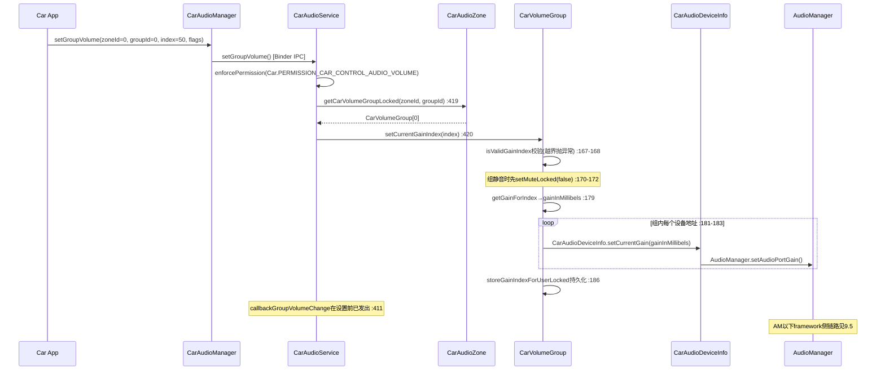
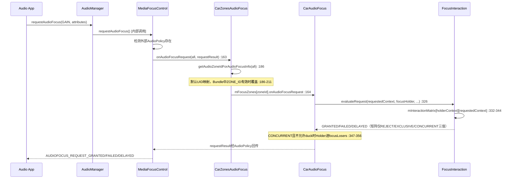
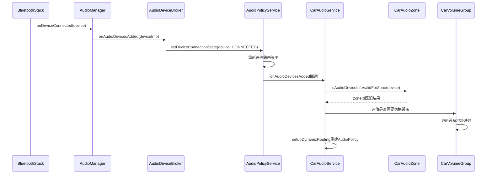
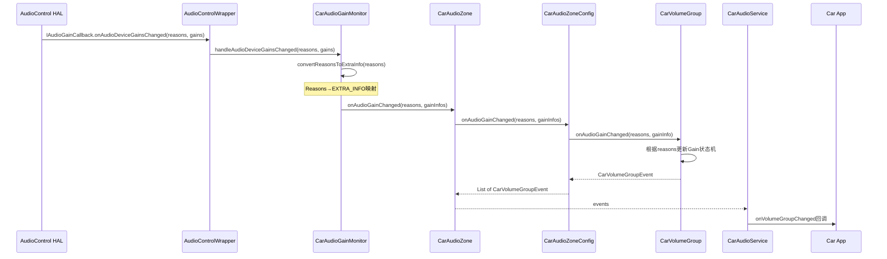
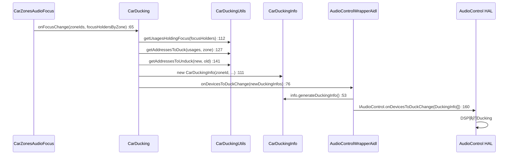
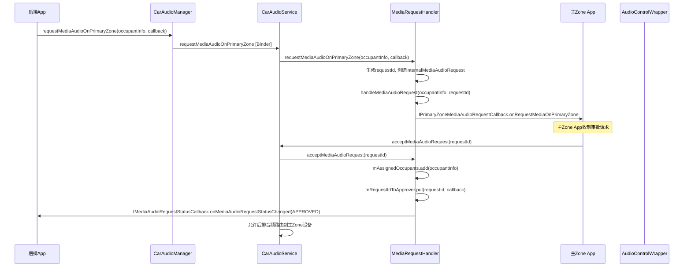
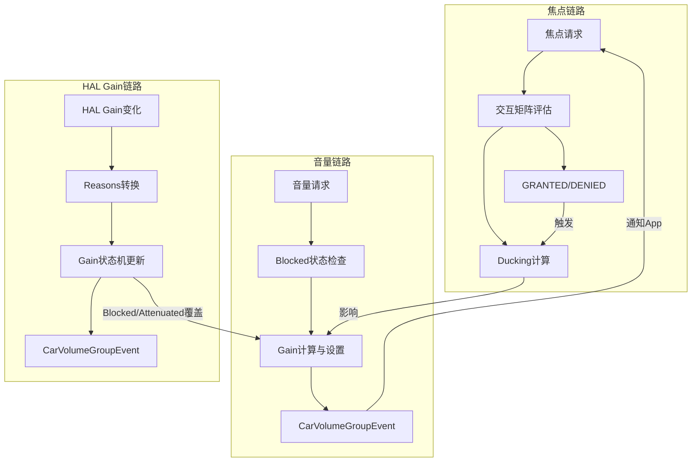

## 9.8 AAOS多Zone全栈调用链

> [← 上一个](09_9.7_Audio_Mirroring-音频镜像.md) | [返回目录](README.md) | [下一个 →](09_9.9_CarAudioZoneConfig-Zone配置管理.md)

---

### 9.8.1 全栈调用链概述

AAOS多Zone音频系统涉及从App层到HAL层的完整调用链路。本章将深入解析三条核心调用链：**音量调节链路**、**焦点请求链路**、**设备切换链路**，从方法调用级别追踪每一步数据流向。

### 9.8.2 音量调节全栈调用链

#### 9.8.2.1 音量调节时序图



#### 9.8.2.2 音量调节关键方法解析

**CarAudioService.setGroupVolume()**（源码 [`setGroupVolume :409-422`](packages/services/Car/service/src/com/android/car/audio/CarAudioService.java:409)，逐字摘录）：

```java
// :409-422
public void setGroupVolume(int zoneId, int groupId, int index, int flags) {
    enforcePermission(Car.PERMISSION_CAR_CONTROL_AUDIO_VOLUME);
    callbackGroupVolumeChange(zoneId, groupId, flags);
    // For legacy stream type based volume control
    if (!mUseDynamicRouting) {
        mAudioManager.setStreamVolume(
                CarAudioDynamicRouting.STREAM_TYPES[groupId], index, flags);
        return;
    }
    synchronized (mImplLock) {
        CarVolumeGroup group = getCarVolumeGroupLocked(zoneId, groupId);
        group.setCurrentGainIndex(index);
    }
}
```

（不存在 `setVolumeIndex`/`saveVolumeGroupSettingsLocked` 方法；`callbackGroupVolumeChange` 在设置**前**发出。）

**CarVolumeGroup.setCurrentGainIndex()**（源码 [`setCurrentGainIndex :167-188`](packages/services/Car/service/src/com/android/car/audio/CarVolumeGroup.java:167)，逐字摘录）：

```java
// :167-188
void setCurrentGainIndex(int gainIndex) {
    Preconditions.checkArgument(isValidGainIndex(gainIndex),
            "Gain out of range (%d:%d) index %d", mMinGain, mMaxGain, gainIndex);
    synchronized (mLock) {
        if (mIsMuted) {
            setMuteLocked(false);
        }
        setCurrentGainIndexLocked(gainIndex);
    }
}

private void setCurrentGainIndexLocked(int gainIndex) {
    int gainInMillibels = getGainForIndex(gainIndex);
    for (String address : mAddressToCarAudioDeviceInfo.keySet()) {
        CarAudioDeviceInfo info = mAddressToCarAudioDeviceInfo.get(address);
        info.setCurrentGain(gainInMillibels);
    }

    mCurrentGainIndex = gainIndex;

    storeGainIndexForUserLocked(mCurrentGainIndex, mUserId);
}
```

（不存在 `setVolumeIndex`/`setDeviceGainGainLocked`/`notifyVolumeGroupChangeLocked`；12L 无 Blocked/OverLimit/Attenuated 增益状态机——13+ 机制见 [9.13](09_9.13_CarAudioGainMonitor-HAL_Gain事件分发.md) 兼容入口。）

**Gain状态机（负结论）**：12L `CarVolumeGroup` 无 `isBlockedLocked/isOverLimitLocked/isAttenuatedLocked`（Blocked/OverLimit/Attenuated 四层优先级为 **Android 13+** `CarAudioGainMonitor` 机制，本树 0 命中，见 [9.13](09_9.13_CarAudioGainMonitor-HAL_Gain事件分发.md)）。12L 音量为上图的简单单向链：校验→（解除组静音）→逐设备 setCurrentGain→持久化。

### 9.8.3 焦点请求全栈调用链

#### 9.8.3.1 焦点请求时序图



#### 9.8.3.2 Zone ID确定逻辑

```java
// CarZonesAudioFocus.java:163-167（逐字摘录）
public void onAudioFocusRequest(AudioFocusInfo afi, int requestResult) {
    int zoneId = getAudioZoneIdForAudioFocusInfo(afi);
    getCarAudioFocusForZoneId(zoneId).onAudioFocusRequest(afi, requestResult);
    notifyFocusCallback(new int[]{zoneId});
}

// :186-199（逐字摘录）
private int getAudioZoneIdForAudioFocusInfo(AudioFocusInfo afi) {
    int zoneId = mCarAudioService.getZoneIdForUid(afi.getClientUid());

    // If the bundle attribute for AUDIOFOCUS_EXTRA_REQUEST_ZONE_ID has been assigned
    // Use zone id from that instead.
    Bundle bundle = afi.getAttributes().getBundle();

    if (bundle != null) {
        int bundleZoneId =
                bundle.getInt(CarAudioManager.AUDIOFOCUS_EXTRA_REQUEST_ZONE_ID,
                        -1);
        // check if the zone id is within current zones bounds
        if (mCarAudioService.isAudioZoneIdValid(bundleZoneId)) {
```

（真实字段为 `mFocusZones` :56，无 `mFocusHandlersForZones`；`getCarAudioFocusForZoneId` :184 直取。Zone ID 逻辑：**默认按 UID 映射**，Bundle 中的 `AUDIOFOCUS_EXTRA_REQUEST_ZONE_ID` **有效时覆盖**（无效仅告警并沿用 UID 映射）。）

#### 9.8.3.3 交互矩阵评估

```java
// FocusInteraction.java:326-361（逐字摘录；矩阵按[holderContext][requestedContext]索引）
public @FocusRequestResult int evaluateRequest(@AudioContext int requestedContext,
        FocusEntry focusHolder, List<FocusEntry> focusLosers, boolean allowDucking,
        boolean allowsDelayedFocus) {
    @AudioContext int holderContext = focusHolder.getAudioContext();
    Preconditions.checkArgumentInRange(holderContext, 0, mInteractionMatrix.length - 1,
            "holderContext");
    synchronized (mLock) {
        int[] holderRow = mInteractionMatrix[holderContext];
        Preconditions.checkArgumentInRange(requestedContext, 0, holderRow.length - 1,
                "requestedContext");

        switch (holderRow[requestedContext]) {
            case INTERACTION_REJECT:
                if (allowsDelayedFocus) {
                    return AudioManager.AUDIOFOCUS_REQUEST_DELAYED;
                }
                return AudioManager.AUDIOFOCUS_REQUEST_FAILED;
            case INTERACTION_EXCLUSIVE:
                focusLosers.add(focusHolder);
                return AudioManager.AUDIOFOCUS_REQUEST_GRANTED;
            case INTERACTION_CONCURRENT:
                // If ducking isn't allowed by the focus requester, then everybody else
                // must get a LOSS.
                // If a focus holder has set the AUDIOFOCUS_FLAG_PAUSES_ON_DUCKABLE_LOSS flag,
                // they must get a LOSS message even if ducking would otherwise be allowed.
                // If a focus holder holds the RECEIVE_CAR_AUDIO_DUCKING_EVENTS permission,
                // they must receive all audio focus losses.
                if (!allowDucking
                        || focusHolder.wantsPauseInsteadOfDucking()
                        || focusHolder.receivesDuckEvents()) {
                    focusLosers.add(focusHolder);
                }
                return AudioManager.AUDIOFOCUS_REQUEST_GRANTED;
            default:
                Slog.e(TAG, String.format("Unsupported CarAudioContext %d - rejecting request",
                            holderRow[requestedContext]));
                return AudioManager.AUDIOFOCUS_REQUEST_FAILED;
        }
    }
}
```

（无 `evaluateAgainstFocusHoldersLocked`/`INTERACTION_MUTE`/`notifyFocusMute`——交互值仅 `INTERACTION_REJECT/EXCLUSIVE/CONCURRENT`（:59/:61/:63）；『CONCURRENT 但请求方不允许duck』时持有者照样进 `focusLosers`，这是AAOS与手机焦点的关键差异。）

### 9.8.4 CarAudioFocus三层执行机制

AAOS焦点系统存在三层执行机制，分别在不同层面确保音频行为正确：

```mermaid
flowchart TB
    subgraph layer1[第一层: 框架主动执行]
        PROP[propagateFocusLossFromGain_syncAf] --> DUCKCHECK{Loss类型判断}
        DUCKCHECK -->|LOSS_TRANSIENT_CAN_DUCK| DUCKEXEC[PlaybackActivityMonitor.duckPlayers]
        DUCKCHECK -->|LOSS| FADEEXEC[FadeOutManager.fadeOutPlayers]
    end
    subgraph layer2[第二层: App回调通知]
        PROP2[propagateFocusLossFromGain_syncAf] --> DISPATCH[FocusRequester.handleFocusLoss]
        DISPATCH --> IPC[IAudioFocusDispatcher.dispatchAudioFocusChange]
        IPC --> APPCB[App.onAudioFocusChange回调]
    end
    subgraph layer3[第三层: AAOS路径]
        PROP3[propagateFocusLossFromGain_syncAf] --> EXTPOL[mFocusPolicy外部策略]
        EXTPOL --> CZAF[CarZonesAudioFocus分发]
        CZAF --> CAF[CarAudioFocus评估]
        CAF --> ACW[AudioControlWrapper]
        ACW --> DSP[AudioControl HAL-DSP执行Ducking/Muting]
    end
```



**三层机制对比：**

| 层级 | 执行方 | 延迟 | 适用场景 | 限制 |
|------|--------|------|---------|------|
| 第一层 | AudioPolicyService | 最低(~5ms) | Duck/Fade，框架层直接操作流 | 仅限当前进程 |
| 第二层 | App进程 | 中等(~50ms) | App主动降低音量或暂停 | 依赖App合规实现 |
| 第三层 | AudioControl HAL | 可变 | AAOS专用，DSP级Ducking/Muting | 需HAL实现支持 |

### 9.8.5 设备切换全栈调用链

当蓝牙设备连接/断开时，音频路由会自动切换：



### 9.8.6 HAL Gain变化全栈调用链（13+ 对照，本树无）

> **版本边界**：本节链路为 **Android 13+** 演进形态——`CarAudioGainMonitor` 与 `IAudioGainCallback` 均不在本树（AudioControl AIDL 仅 v1），12L 无 HAL gain 上报（见 [9.13](09_9.13_CarAudioGainMonitor-HAL_Gain事件分发.md)、[10.8](../10_AudioControl_HAL/10_10.8_IAudioGainCallback-HAL增益回调链路.md)）。回调名采用 v2 canonical 名 `IAudioGainCallback.onAudioDeviceGainsChanged`。

当HAL层报告Gain变化（如外部放大器调整）时（AOSP 13+ 对照）：



**Gain Reasons到EXTRA_INFO映射（13+ `AudioGainConfigChangeReasons`，本树无）：**

| HAL Reason | CarVolumeGroupEvent EXTRA_INFO | 含义 |
|-----------|-------------------------------|------|
| REASON_MUTE | EXTRA_INFO_VOLUME_INDEX_CHANGED_BY_AUDIO_SYSTEM | 静音变化 |
| REASON_DUCK | EXTRA_INFO_VOLUME_INDEX_CHANGED_BY_AUDIO_SYSTEM | Duck变化 |
| REASON_VOLUME | EXTRA_INFO_VOLUME_INDEX_CHANGED_BY_AUDIO_SYSTEM | 音量变化 |
| REASON_THERMAL | EXTRA_INFO_VOLUME_INDEX_CHANGED_BY_AUDIO_SYSTEM | 热保护 |
| REASON_BLOCKED | EXTRA_INFO_VOLUME_INDEX_CHANGED_BY_AUDIO_SYSTEM | 被阻止 |

### 9.8.7 Ducking执行全栈调用链

当焦点变化触发Ducking时：



（真实机制细节见 [9.14](09_9.14_CarDucking-AAOS系统级Ducking.md)；不存在 `evaluateAudioAttributesToDuck`/`setDuckingInfo`。）

### 9.8.8 媒体请求全栈调用链（14+ 对照，本树无）

> **版本边界**：`MediaRequestHandler` 为 **Android 14+**，不在本树（见 [9.16](09_9.16_MediaRequestHandler-媒体音频请求管理.md) 兼容入口）；12L 无后排媒体请求审批机制。

后排Zone请求在主Zone播放媒体音频（AOSP 14+ 对照）：



### 9.8.9 跨链路交互关系

AAOS音频系统的三条核心链路并非孤立运行，存在复杂的交互关系：



**交互要点：**
1. 焦点评估结果决定Ducking状态 → Ducking影响音量Gain
2. HAL Gain状态机(Blocked/OverLimit/Attenuated)覆盖音量设置
3. 音量变化事件可触发焦点重新评估
4. 三条链路通过`CarAudioService`协调统一

---