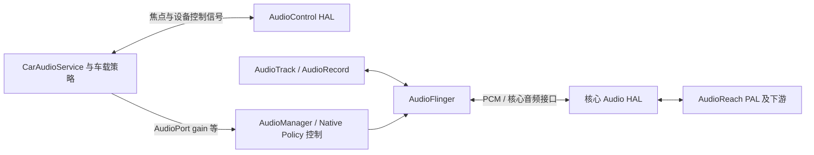
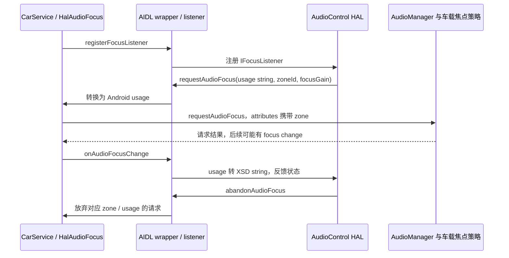
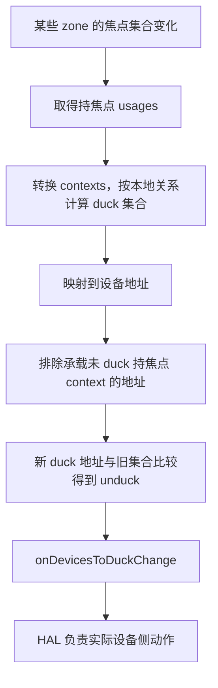

# 10.1 AudioControl HAL：车载音频控制，不是 PCM 接口

> 本产品 manifest 声明 AudioControl **AIDL v1**。本文对照本地 frozen v1 接口、CarService wrapper 与默认示例说明职责。声明、客户端实现、示例 HAL 和设备上实际服务是不同证据层次，不据此声称硬件效果已验证。

## 1. 核心 Audio HAL 与 AudioControl HAL 分工

| 接口 | 本地主线 | 主要作用 |
|---|---|---|
| 核心 audio HAL | 产品声明 HIDL 6.0 | 音频设备/流、配置、read/write、Patch 与相关端口控制 |
| AudioControl HAL | 产品声明 AIDL v1 | 外部音源焦点协作、设备 duck/mute 通知、左右 balance / 前后 fade |

它们都涉及音频，但不是同一接口的两个版本。AudioControl 不提供 AudioTrack 的 PCM 写入队列，不替代 PAL，也不在每块 PCM 的数据链中。



车载外部音源可以参与焦点管理而不经过 Android AudioTrack。反过来，Android 播放普通 PCM 不需要先把数据交 AudioControl。

## 2. AIDL v1 实际有哪些方法

frozen 声明位于：
`hardware/interfaces/automotive/audiocontrol/aidl/aidl_api/android.hardware.automotive.audiocontrol/1/android/hardware/automotive/audiocontrol/IAudioControl.aidl`。

| 方法 | 方向与含义 |
|---|---|
| `registerFocusListener` | CarService 向 HAL 注册 listener，供 HAL 以后请求/放弃焦点 |
| `onAudioFocusChange` | Framework 将 HAL 所请求用途/区域的焦点状态反馈给 HAL |
| `onDevicesToDuckChange` | 按 zone 告知应 duck/unduck 的设备地址及持焦点 usages |
| `onDevicesToMuteChange` | 按 zone 告知应 mute/unmute 的设备地址 |
| `setBalanceTowardRight` | 左右平衡控制意图 |
| `setFadeTowardFront` | 前后渐变控制意图 |

六个方法均为 `oneway void`。例如 frozen v1 原文：

```aidl
oneway void setBalanceTowardRight(in float value);
oneway void setFadeTowardFront(in float value);
```

oneway 是异步控制事务语义，不是业务完成回执。Java 调用返回不证明功放/DSP 已执行控制，也没有从该方法返回硬件 gain 状态。

本地 v1 不含 IAudioGainCallback、IModuleChangeCallback 注册或 metadata 版 focus 回调；不要把新版能力图直接套在这里。音量组 gain 在本地通过 AudioPort 控制，见 [9.5](../09_AAOS_Car_Audio/09_9.5_CarVolumeGroup-车载音量组.md)。

## 3. 外部焦点请求的方向



`HalAudioFocus` 按 **zoneId → usage** 保存请求，不是给每个 HAL 声音分配一个 Android PCM Track。已有同 zone/usage 请求时会反馈当前状态；不是无限创建重复请求。

接口注释还明确：HAL 不被强制要求收到 GAIN 才发声，也不被强制要求收到 LOSS 就停止。因此，焦点协作不能被表述成对所有外部安全告警的硬性播放闸门。具体产品约束需要由系统设计与 HAL 实现落实。

## 4. Ducking：从用途关系变成设备地址

`CarDucking` 监听受影响区域的 focus holders，通过 CarDuckingUtils 将 usages 转 contexts，计算应 duck 的 contexts，再映射到地址。

一个重要保护条件是：**某设备地址若同时承载当前持焦点、且不应 duck 的 context，则不对该地址 duck**。这是设备级控制的粒度限制，不是遗漏对某个 AudioTrack 的浮点音量设置。



通知含 zone、duck/unduck 地址和 usagesHoldingFocus，不含本页可以任意指定的固定衰减 dB 或时间常数。收到通知怎样作用于设备，是 HAL/平台实现责任。

## 5. Muting：状态汇总，不是 gain 回读

CarVolumeGroupMuting 为区域内各组生成 mute/unmute 地址：显式组静音，或电源限制且不含 critical contexts 的组，会被列入 mute。

`MutingInfo` 传递 zone 与两组设备地址，不回报实际功放静音状态。wrapper 缓存/日志记录的是通知过程，不是设备读取结果。

mute 与 duck 也不同：mute 表达设备静音意图，duck 表达用途共存时降低其他声音的意图。它们不能互相替代，也不能与音量索引归零混为同一个 API。

## 6. Fade / Balance 的范围由接口定义，算法由实现负责

接口注释定义 balance 的 -1 左、0 中、+1 右；fade 的 -1 后、0 中、+1 前，并要求实现将越界值钳制到 [-1, 1]。

本地 Java wrapper 只是传递数值；不计算扬声器矩阵、DSP 系数或斜坡。没有产品硬件实现依据时，不能声称这是线性、等功率或固定毫秒过渡算法。

## 7. 服务发现、能力表与实际产品服务

`AudioControlFactory` 优先尝试 AIDL，再尝试 HIDL V2、HIDL V1；找不到任何声明服务则抛异常。AIDL 使用 `waitForDeclaredService()`，不是快速失败后无条件立即回退的探测循环。

本地 `AudioControlWrapperAidl.supportsFeature()` 对 focus、ducking、group muting 返回 true，对其余特性返回 false。它不是按远端版本号自动启用新能力的协商器。

产品 `device/qcom/msmnile_gvmq/manifest.xml` 声明 AIDL v1；部分本地 AR 配置 makefile 还列出旧厂商 AudioControl 服务包名。仅凭这些静态条目不能代替最终产品组合与运行服务核验，本页不把任一默认示例认定为实际车机 HAL。

## 8. 默认示例为什么不能当硬件实现

`hardware/interfaces/automotive/audiocontrol/aidl/default/AudioControl.cpp` 明确是默认示例；balance/fade 的有效值分支注释为 “Just log in this default mock implementation”，duck/mute/focus 方法也以日志展示输入。

例如：

```cpp
ndk::ScopedAStatus AudioControl::onAudioFocusChange(const string& in_usage, int32_t in_zoneId,
                                                    AudioFocusChange in_focusChange) {
    LOG(INFO) << "Focus changed: " << toString(in_focusChange).c_str() << " for usage "
              << in_usage.c_str() << " in zone " << in_zoneId;
    return ndk::ScopedAStatus::ok();
}
```

这能证明默认方法如何接收/记录通知，不能证明下游执行 PAL 调参或 QNX 功放操作。该示例对越界 fade/balance 记录错误并返回 ok，也不能用来证明接口要求的钳制效果已真正完成。

## 9. 失败、死亡与观察边界

wrapper 对不同 RemoteException 的处理不同：focus 注册/状态等可转为 IllegalStateException，duck/mute/fade/balance 则记录日志。不要统一写成“所有调用均自动重试成功”。

HAL death 后 wrapper 获取新接口并通知 CarAudioService 重置/重注册 focus；这不是完整音频系统 SSR 恢复，更不说明所有过去的 device controls 已重放。

定位时依次问：

1. 实际实例是不是本地声明的 IAudioControl/default？
2. CarService 功能开关与 wrapper 能力是否允许发送该通知？
3. zone/usage/address 是否匹配配置与焦点集合？
4. 是否发生 RemoteException 或 HAL death？
5. 产品 HAL 是否真正实现设备动作，下游是否收到？

本文没有运行服务发现、控制命令或硬件测试。继续读 [10.6 AIDL wrapper](10_10.6_AudioControlWrapperAidl-AIDL适配层架构.md)，并与 [8.1 核心 Audio HAL](../08_HAL_Layer/08_8.1_Audio_HAL双轨架构.md) 对照。

源码根为 `Android/lagvm/LINUX/android/`；CarService 适配位于 `packages/services/Car/service/src/com/android/car/audio/hal/`，接口与默认示例位于 `hardware/interfaces/automotive/audiocontrol/aidl/`。
