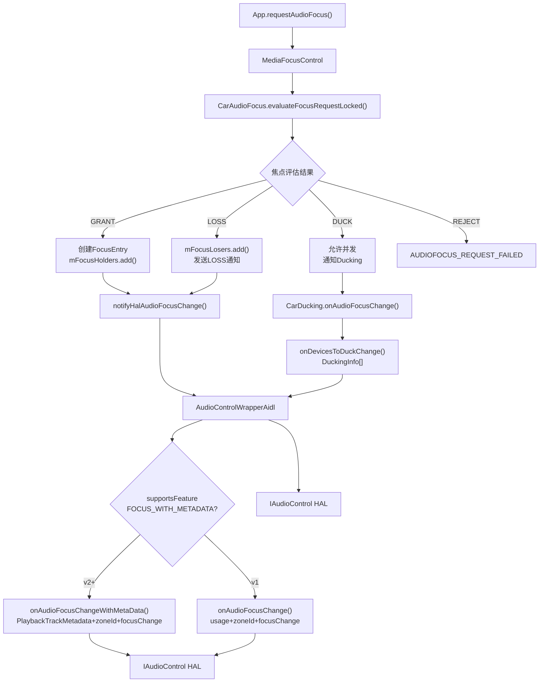
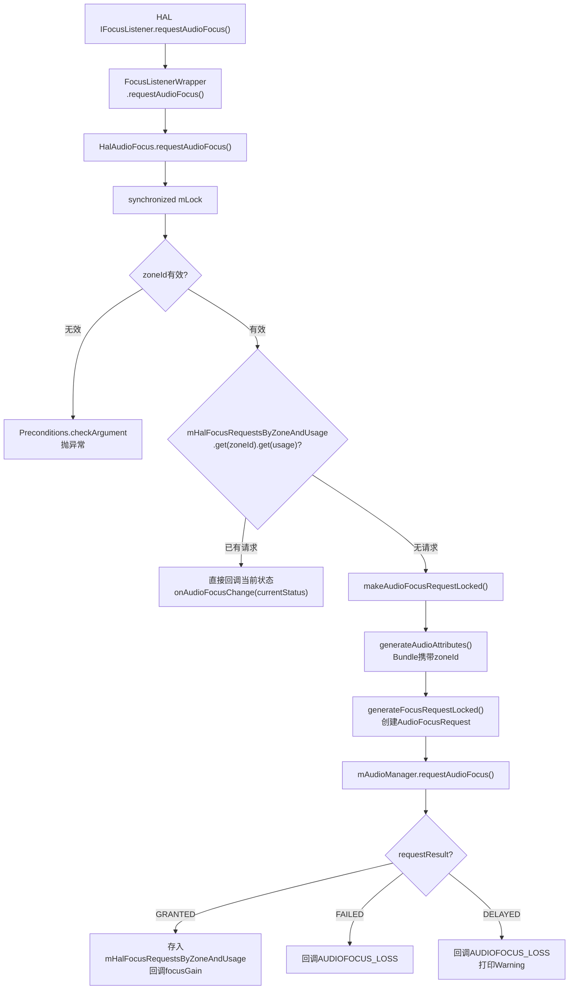
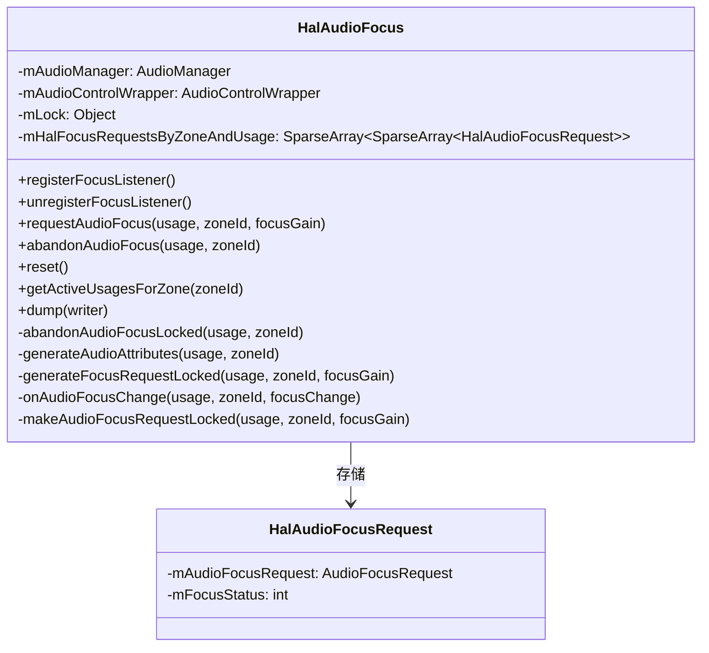
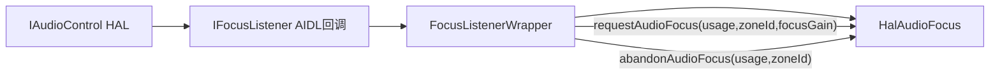
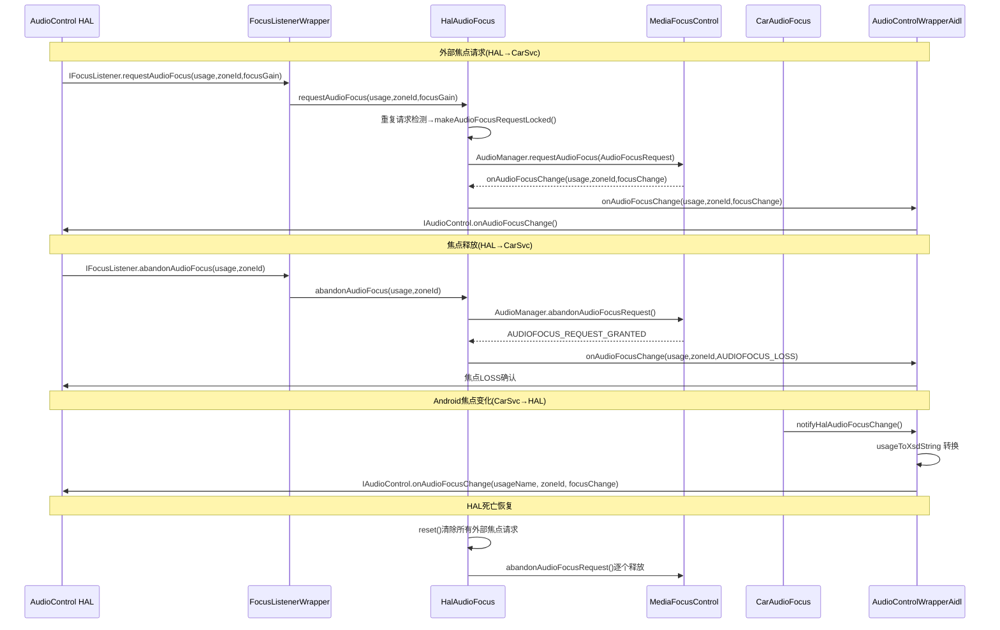

## 10.3 焦点回调流程

> [← 上一个](10_10.2_核心接口.md) | [← 返回10章](README.md) | [返回导航](../README.md) | [下一个 →](10_10.4_Ducking机制.md)

---

AudioControl HAL的焦点机制是**双向交互**：CarSvc→HAL通知焦点变化，HAL→CarSvc请求/释放外部焦点。本节深入解析两个方向的完整流程。

### 10.3.1 CarSvc→HAL焦点通知流程

当Android侧焦点状态变化时，CarAudioService通过AudioControlWrapper将变化通知给HAL。



**本树实现（12L，[`onAudioFocusChange` :101-111](packages/services/Car/service/src/com/android/car/audio/hal/AudioControlWrapperAidl.java:101) 逐字摘录）**——**无版本分发分支**：

```java
public void onAudioFocusChange(@AttributeUsage int usage, int zoneId, int focusChange) {
    if (Log.isLoggable(TAG, Log.DEBUG)) {
        Slog.d(TAG, "onAudioFocusChange: usage " + AudioAttributes.usageToString(usage)
                + ", zoneId " + zoneId + " focusChange " + focusChange);
    }
    try {
        String usageName = AudioAttributes.usageToXsdString(usage);
        mAudioControl.onAudioFocusChange(usageName, zoneId, focusChange);
    } catch (RemoteException e) {
        throw new IllegalStateException("Failed to query IAudioControl#onAudioFocusChange", e);
    }
}
```

> **版本边界（负结论）**：`onAudioFocusChangeWithMetaData()`/`PlaybackTrackMetadata` 分发/`FOCUS_WITH_METADATA` 特性为 AudioControl AIDL **v2/v3**（Android 13/14）机制——本树 aidl 目录仅 v1（5 个 .aidl，与 current 相同），wrapper 无 metadata 分支（grep 无 onAudioFocusChangeWithMetaData/getAudioAttributeWrapperFromUsage）。

| 版本 | 调用方法 | 参数格式 |
|------|---------|---------|
| AIDL v3/v2 | `onAudioFocusChangeWithMetaData()` | `PlaybackTrackMetadata{usage,contentType,tags} + zoneId + focusChange` |
| AIDL v1 | `onAudioFocusChange()` | `XSD字符串usage + zoneId + focusChange` |
| HIDL V2 | `onAudioFocusChange()` | `int usage值 + zoneId + focusChange` |
| HIDL V1 | **不支持焦点通知** | 无此功能 |

### 10.3.2 HAL→CarSvc外部焦点请求流程

外部音频源(DSP/TCU/紧急系统)通过IFocusListener向CarSvc请求焦点，由[`HalAudioFocus`](packages/services/Car/service/src/com/android/car/audio/hal/HalAudioFocus.java:58)处理。



### 10.3.3 HalAudioFocus核心数据结构

[`HalAudioFocus`](packages/services/Car/service/src/com/android/car/audio/hal/HalAudioFocus.java:58) 使用两层嵌套Map管理外部焦点请求：



**核心字段**（源码 [`HalAudioFocus.java:61-70`](packages/services/Car/service/src/com/android/car/audio/hal/HalAudioFocus.java:61)）：

| 字段 | 类型 | 说明 |
|------|------|------|
| `mAudioManager` | AudioManager | 用于向Android框架请求/释放焦点 |
| `mAudioControlWrapper` | AudioControlWrapper | 用于向HAL回调焦点变化 |
| `mLock` | Object | 同步锁，保护mHalFocusRequestsByZoneAndUsage |
| `mHalFocusRequestsByZoneAndUsage` | `SparseArray<SparseArray<HalAudioFocusRequest>>`（:59） | 两层映射：zoneId→(usage→request)，按 usage int 键控 |

**HalAudioFocusRequest**（源码 [`HalAudioFocusRequest` :283-293](packages/services/Car/service/src/com/android/car/audio/hal/HalAudioFocus.java:283)，12L 文件共 293 行）：

| 字段 | 类型 | 说明 |
|------|------|------|
| `mAudioFocusRequest` | AudioFocusRequest | Android框架焦点请求对象 |
| `mFocusStatus` | int | 当前焦点状态(GAIN/LOSS/DUCK等) |

### 10.3.4 requestAudioFocus源码深度解析

#### requestAudioFocus 完整实现（源码 [`requestAudioFocus :92-114`](packages/services/Car/service/src/com/android/car/audio/hal/HalAudioFocus.java:92)）

```java
// :92-114（逐字摘录）
public void requestAudioFocus(@AttributeUsage int usage, int zoneId, int focusGain) {
    Preconditions.checkArgument(mHalFocusRequestsByZoneAndUsage.contains(zoneId),
            "Invalid zoneId %d provided in requestAudioFocus", zoneId);
    if (Log.isLoggable(TAG, Log.DEBUG)) {
        Slog.d(TAG, "Requesting focus gain " + focusGain + " with usage "
                + AudioAttributes.usageToString(usage) + " and zoneId " + zoneId);
    }
    synchronized (mLock) {
        HalAudioFocusRequest currentRequest = mHalFocusRequestsByZoneAndUsage.get(zoneId).get(
                usage);
        if (currentRequest != null) {
            if (Log.isLoggable(TAG, Log.DEBUG)) {
                Slog.d(TAG, "A request already exists for zoneId " + zoneId + " and usage "
                        + usage);
            }
            mAudioControlWrapper.onAudioFocusChange(usage, zoneId, currentRequest.mFocusStatus);
        } else {
            makeAudioFocusRequestLocked(usage, zoneId, focusGain);
        }
    }
}
```

**设计意义**：避免同一zone+usage的重复焦点请求，HAL持续持有焦点时只需回复当前状态。

#### makeAudioFocusRequestLocked（源码 [`makeAudioFocusRequestLocked :260-281`](packages/services/Car/service/src/com/android/car/audio/hal/HalAudioFocus.java:260)）

```java
// :260-281（逐字摘录）
private void makeAudioFocusRequestLocked(@AttributeUsage int usage, int zoneId, int focusGain) {
    AudioFocusRequest audioFocusRequest = generateFocusRequestLocked(usage, zoneId, focusGain);

    int requestResult = mAudioManager.requestAudioFocus(audioFocusRequest);

    int resultingFocusGain = focusGain;

    if (requestResult == AUDIOFOCUS_REQUEST_GRANTED) {
        HalAudioFocusRequest halAudioFocusRequest = new HalAudioFocusRequest(audioFocusRequest,
                focusGain);
        mHalFocusRequestsByZoneAndUsage.get(zoneId).append(usage, halAudioFocusRequest);
    } else if (requestResult == AUDIOFOCUS_REQUEST_FAILED) {
        resultingFocusGain = AUDIOFOCUS_LOSS;
    } else if (requestResult == AUDIOFOCUS_REQUEST_DELAYED) {
        Slog.w(TAG, "Delayed result for request with usage "
                + AudioAttributes.usageToString(usage) + ", zoneId " + zoneId
                + ", and focusGain " + focusGain);
        resultingFocusGain = AUDIOFOCUS_LOSS;
    }

    mAudioControlWrapper.onAudioFocusChange(usage, zoneId, resultingFocusGain);
}
```

### 10.3.5 abandonAudioFocus源码深度解析

#### abandonAudioFocusLocked（源码 [`abandonAudioFocusLocked` :194-218](packages/services/Car/service/src/com/android/car/audio/hal/HalAudioFocus.java:194)）

```java
// :194-217（逐字摘录）
private void abandonAudioFocusLocked(int usage, int zoneId) {
    HalAudioFocusRequest currentRequest = mHalFocusRequestsByZoneAndUsage.get(zoneId)
            .removeReturnOld(usage);

    if (currentRequest == null) {
        if (Log.isLoggable(TAG, Log.DEBUG)) {
            Slog.d(TAG, "No focus to abandon for usage " + AudioAttributes.usageToString(usage)
                    + " and zoneId " + zoneId);
        }
        return;
    }

    int result = mAudioManager.abandonAudioFocusRequest(currentRequest.mAudioFocusRequest);
    if (result == AUDIOFOCUS_REQUEST_GRANTED) {
        if (Log.isLoggable(TAG, Log.DEBUG)) {
            Slog.d(TAG, "Abandoned focus for usage " + AudioAttributes.usageToString(usage)
                    + "and zoneId " + zoneId);
        }
        mAudioControlWrapper.onAudioFocusChange(usage, zoneId, AUDIOFOCUS_LOSS);
    } else {
        Slog.w(TAG,
                "Failed to abandon focus for usage " + AudioAttributes.usageToString(usage)
                        + " and zoneId " + zoneId);
    }
}
```

### 10.3.6 ZoneId传递机制

[`generateAudioAttributes()`](packages/services/Car/service/src/com/android/car/audio/hal/HalAudioFocus.java:220)（:220，12L 实际行号）是关键方法，通过Bundle携带zoneId信息：

```java
// :220-233（逐字摘录）
private AudioAttributes generateAudioAttributes(int usage, int zoneId) {
    AudioAttributes.Builder builder = new AudioAttributes.Builder();
    Bundle bundle = new Bundle();
    bundle.putInt(CarAudioManager.AUDIOFOCUS_EXTRA_REQUEST_ZONE_ID, zoneId);
    builder.addBundle(bundle);

    if (AudioAttributes.isSystemUsage(usage)) {
        builder.setSystemUsage(usage);
    } else {
        builder.setUsage(usage);
    }
    return builder.build();
}
```

**设计意义**：Android标准焦点框架不支持zone概念。通过Bundle附加`AUDIOFOCUS_EXTRA_REQUEST_ZONE_ID`，使CarAudioFocus能识别请求来自哪个音频区域，实现多区域焦点隔离。

### 10.3.7 FocusListenerWrapper — 回调桥接

[`FocusListenerWrapper`](packages/services/Car/service/src/com/android/car/audio/hal/AudioControlWrapperAidl.java:204)（:204，12L 实际行号）是AIDL回调到HalAudioFocus的桥接层：



**源码**（[`FocusListenerWrapper` :204-233](packages/services/Car/service/src/com/android/car/audio/hal/AudioControlWrapperAidl.java:204)，12L 文件共 233 行）：

FocusListenerWrapper（12L v1）只实现IFocusListener的2个方法：
- `requestAudioFocus(usage, zoneId, focusGain)` → 调用`mHalFocusListener.requestAudioFocus()`
- `abandonAudioFocus(usage, zoneId)` → 调用`mHalFocusListener.abandonAudioFocus()`

（`requestAudioFocusWithMetaData/abandonAudioFocusWithMetaData` 为 v2/v3（13+）方法，本树 aidl 目录无此接口，wrapper 亦无对应实现。）

### 10.3.8 HAL死亡恢复 — reset流程

[`reset()`](packages/services/Car/service/src/com/android/car/audio/hal/HalAudioFocus.java:132)（:132，12L 实际行号）在HAL死亡时被调用，清除所有外部焦点请求：

```java
// :132-148（逐字摘录）
public void reset() {
    Slog.d(TAG, "Resetting HAL Audio Focus requests");
    synchronized (mLock) {
        for (int i = 0; i < mHalFocusRequestsByZoneAndUsage.size(); i++) {
            int zoneId = mHalFocusRequestsByZoneAndUsage.keyAt(i);
            SparseArray<HalAudioFocusRequest> requestsByUsage =
                    mHalFocusRequestsByZoneAndUsage.valueAt(i);
            int usageCount = requestsByUsage.size();
            for (int j = 0; j < usageCount; j++) {
                int usage = requestsByUsage.keyAt(j);
                abandonAudioFocusLocked(usage, zoneId);
            }
        }
    }
}
```

**设计意义**：HAL进程死亡后，其持有的外部焦点请求不再有效。必须释放所有zone+usage维度的焦点，避免焦点资源永远被占用。重新注册FocusListener时，HAL需重新请求所需焦点。

### 10.3.9 焦点变化回调 — onAudioFocusChange

[`onAudioFocusChange()`](packages/services/Car/service/src/com/android/car/audio/hal/HalAudioFocus.java:244)（:244，12L 实际行号）是Android框架焦点状态变化的通知入口：

```java
// :244-258（逐字摘录）
private void onAudioFocusChange(int usage, int zoneId, int focusChange) {
    synchronized (mLock) {
        HalAudioFocusRequest currentRequest = mHalFocusRequestsByZoneAndUsage.get(zoneId).get(
                usage);
        if (currentRequest != null) {
            if (focusChange == AUDIOFOCUS_LOSS) {
                mHalFocusRequestsByZoneAndUsage.get(zoneId).remove(usage);
            } else {
                currentRequest.mFocusStatus = focusChange;
            }
            mAudioControlWrapper.onAudioFocusChange(usage, zoneId, focusChange);
        }

    }
}
```

**关键逻辑**：
- LOSS时从Map中移除请求（焦点已丢失，记录不再需要）
- 其他状态(GAIN/DUCK等)更新`mFocusStatus`（HAL后续重复请求时可直接回复）
- 仅对有记录的usage+zone回调（忽略无关的焦点变化）

### 10.3.10 完整双向时序图



---

[← 上一个](10_10.2_核心接口.md) | [← 返回10章](README.md) | [返回导航](../README.md) | [下一个 →](10_10.4_Ducking机制.md)