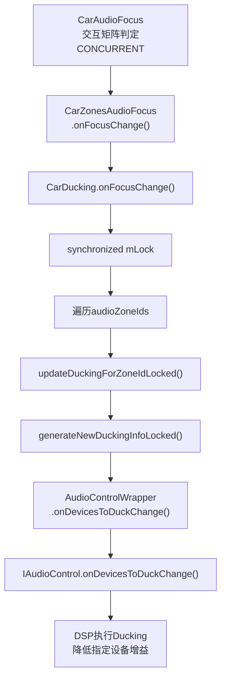
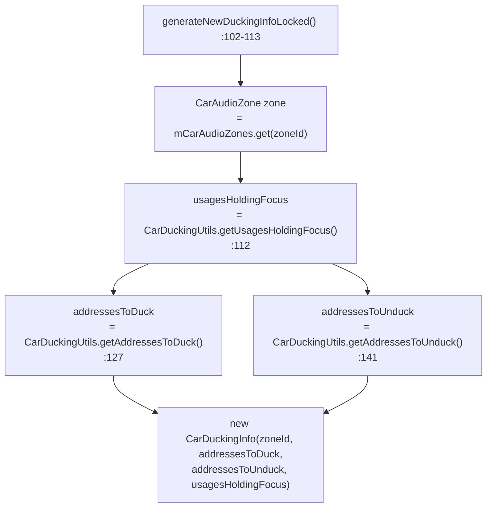
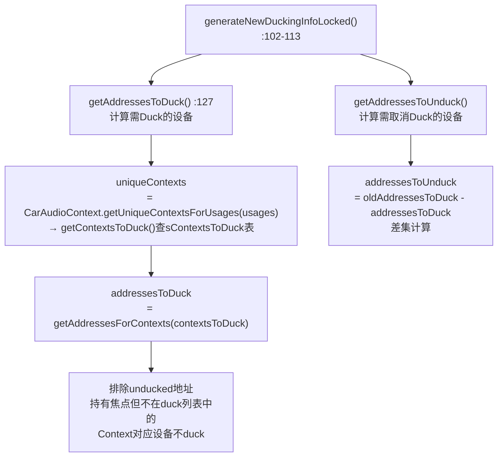
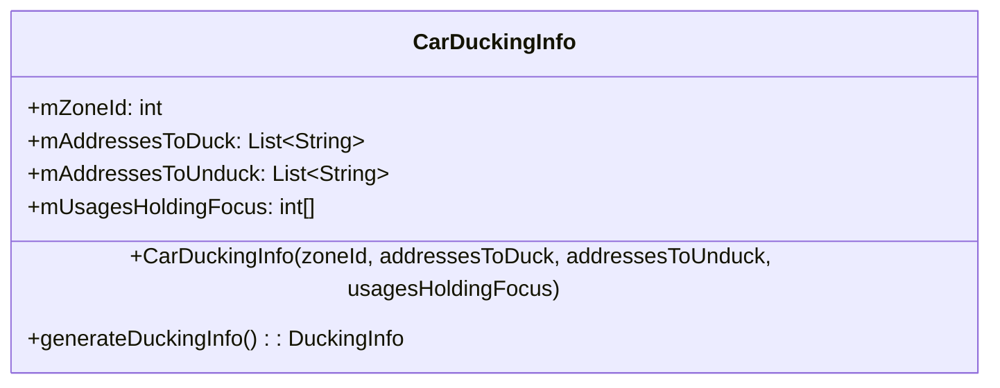
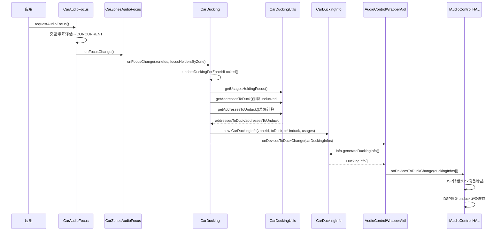

## 10.4 Ducking机制

> [← 上一个](10_10.3_焦点回调流程.md) | [← 返回10章](README.md) | [返回导航](../README.md) | [下一个 →](10_10.5_Muting机制.md)

---

AAOS的Ducking由CarAudioFocus交互矩阵自动触发，通过AudioControl HAL通知DSP执行，在硬件层面降低被Duck设备的增益。

### 10.4.1 Ducking触发入口

[`CarDucking`](packages/services/Car/service/src/com/android/car/audio/CarDucking.java:40) 实现了`CarFocusCallback`接口，焦点变化时由`CarZonesAudioFocus`回调：



**onFocusChange入口**（源码 [`CarDucking.java:65-77`](packages/services/Car/service/src/com/android/car/audio/CarDucking.java:65)）：

```java
// :65-77（逐字摘录）
public void onFocusChange(int[] audioZoneIds,
        @NonNull SparseArray<List<AudioFocusInfo>> focusHoldersByZoneId) {
    synchronized (mLock) {
        List<CarDuckingInfo> newDuckingInfos = new ArrayList<>(audioZoneIds.length);
        for (int i = 0; i < audioZoneIds.length; i++) {
            int zoneId = audioZoneIds[i];
            List<AudioFocusInfo> focusHolders = focusHoldersByZoneId.get(zoneId);
            CarDuckingInfo newDuckingInfo = updateDuckingForZoneIdLocked(zoneId, focusHolders);
            newDuckingInfos.add(newDuckingInfo);
        }
        mAudioControlWrapper.onDevicesToDuckChange(newDuckingInfos);
    }
}
```

### 10.4.2 Ducking计算核心 — generateNewDuckingInfoLocked



12L 实现（源码 [`CarDucking.java:102-113`](packages/services/Car/service/src/com/android/car/audio/CarDucking.java:102)，逐字摘录）：

```java
@GuardedBy("mLock")
private CarDuckingInfo generateNewDuckingInfoLocked(CarDuckingInfo oldDuckingInfo,
        List<AudioFocusInfo> focusHolders) {
    int zoneId = oldDuckingInfo.mZoneId;
    CarAudioZone zone = mCarAudioZones.get(zoneId);

    int[] usagesHoldingFocus = CarDuckingUtils.getUsagesHoldingFocus(focusHolders);
    List<String> addressesToDuck = CarDuckingUtils.getAddressesToDuck(usagesHoldingFocus, zone);
    List<String> addressesToUnduck = CarDuckingUtils.getAddressesToUnduck(addressesToDuck,
            oldDuckingInfo.mAddressesToDuck);

    return new CarDuckingInfo(zoneId, addressesToDuck, addressesToUnduck, usagesHoldingFocus);
}
```

**OEM扩展机制（14+ 对照，本树无）**：`CarDucking.java` 全文 114 行、无 OEM 分支；`evaluateAttributesToDuckExternally/Internally` 为 Android 14+ API。12L 的 duck 判定全部封装在 `CarDuckingUtils` 的静态策略表内：

| 判断条件 | Ducking策略 |
|----------|------------|
| （14+）OEM Service可用 | `evaluateAttributesToDuckExternally()` — OEM自定义逻辑（不在本树） |
| 12L（及 14+ 默认） | `CarDuckingUtils.getAddressesToDuck()` — `sContextsToDuck` 静态表策略（:45/:127） |

### 10.4.3 CarDuckingUtils — Ducking设备计算

[`sContextsToDuck` 所在的 `CarDuckingUtils`](packages/services/Car/service/src/com/android/car/audio/CarDuckingUtils.java:45)（:45 声明处）计算需要Duck和取消Duck的设备地址：



**关键逻辑**（源码 [`getAddressesToDuck :127-139`](packages/services/Car/service/src/com/android/car/audio/CarDuckingUtils.java:127)、[`getAddressesToUnduck :141-145`](packages/services/Car/service/src/com/android/car/audio/CarDuckingUtils.java:141)；duck 判定表 [`sContextsToDuck :45`](packages/services/Car/service/src/com/android/car/audio/CarDuckingUtils.java:45)）：

1. **getAddressesToDuck**：将需要duck的AudioAttributes映射到Context，再映射到设备地址。排除持有焦点但不在duck列表中的Context对应的设备。
2. **getAddressesToUnduck**：旧duck地址 - 新duck地址 = 需要取消duck的地址。

**设计意义**：同一设备可能被多个Context映射，若其中一个Context持有焦点且不需要duck，该设备不应被duck。

### 10.4.4 CarDuckingInfo数据结构

[`CarDuckingInfo`](packages/services/Car/service/src/com/android/car/audio/CarDuckingInfo.java:37) 是CarSvc内部Ducking信息载体：



| 字段 | 类型 | 说明 |
|------|------|------|
| `mZoneId` | int | 音频区域ID |
| `mAddressesToDuck` | List\<String\> | 需要Duck的设备地址列表 |
| `mAddressesToUnduck` | List\<String\> | 需要取消Duck的设备地址列表 |
| `mUsagesHoldingFocus` | int[] | 持有焦点的 usage 列表（12L 无 metadata 域） |

### 10.4.5 CarDuckingInfo→HAL DuckingInfo转换

转换在本树 12L 由 [`CarDuckingInfo.generateDuckingInfo()`](packages/services/Car/service/src/com/android/car/audio/CarDuckingInfo.java:53)（:53-67，实例方法）完成——CarSvc 内部结构自转 HAL AIDL 结构（`CarHalAudioUtils` 不在本树）：

```java
// CarDuckingInfo.java:53-67（逐字摘录）
public DuckingInfo generateDuckingInfo() {
    DuckingInfo duckingInfo = new DuckingInfo();
    duckingInfo.zoneId = mZoneId;
    duckingInfo.deviceAddressesToDuck = mAddressesToDuck.toArray(new String[0]);
    duckingInfo.deviceAddressesToUnduck = mAddressesToUnduck.toArray(new String[0]);
    String[] usageStrings = new String[mUsagesHoldingFocus.length];
    for (int i = 0; i < mUsagesHoldingFocus.length; i++) {
        usageStrings[i] = AudioAttributes.usageToXsdString(mUsagesHoldingFocus[i]);
    }
    duckingInfo.usagesHoldingFocus = usageStrings;

    return duckingInfo;
}
```

| CarSvc字段 | HAL字段 | 转换方式 |
|------------|---------|---------|
| `mZoneId` | `zoneId` | 直接赋值 |
| `mAddressesToDuck` | `deviceAddressesToDuck` | `List.toArray(String[0])` |
| `mAddressesToUnduck` | `deviceAddressesToUnduck` | `List.toArray(String[0])` |
| `mUsagesHoldingFocus` | `usagesHoldingFocus` | `AudioAttributes.usageToXsdString()` — usage→XSD字符串 |

### 10.4.6 AudioControlWrapperAidl.onDevicesToDuckChange

源码 [`onDevicesToDuckChange` :149-162](packages/services/Car/service/src/com/android/car/audio/hal/AudioControlWrapperAidl.java:149)（12L 实际行号）：

```java
// :149-162（逐字摘录）
public void onDevicesToDuckChange(@NonNull List<CarDuckingInfo> carDuckingInfos) {
    Objects.requireNonNull(carDuckingInfos);
    DuckingInfo[] duckingInfos = new DuckingInfo[carDuckingInfos.size()];
    for (int i = 0; i < carDuckingInfos.size(); i++) {
        CarDuckingInfo info = Objects.requireNonNull(carDuckingInfos.get(i));
        duckingInfos[i] = info.generateDuckingInfo();
    }

    try {
        mAudioControl.onDevicesToDuckChange(duckingInfos);
    } catch (RemoteException e) {
        Slog.e(TAG, "onDevicesToDuckChange failed", e);
    }
}
```

### 10.4.7 PlaybackTrackMetadata生成

`PlaybackTrackMetadata` 与 `CarHalAudioUtils.audioAttributeToMetadata()` 均为 **AudioControl AIDL v2+（Android 13+）** 的 HAL metadata 域——本树 v1 的 5 个 .aidl 无此类型，12L Ducking 只携带 usage 字符串（v1 `DuckingInfo` 字段）：

| v1 DuckingInfo字段 | 12L 值来源 | 说明 |
|------|--------|------|
| `zoneId` | `CarDuckingInfo.mZoneId`（:35） | 音频区域ID |
| `deviceAddressesToDuck` | `mAddressesToDuck.toArray(new String[0])`（:56） | 需Duck的设备地址 |
| `deviceAddressesToUnduck` | `mAddressesToUnduck.toArray(new String[0])`（:57） | 需取消Duck的设备地址 |
| `usagesHoldingFocus` | `AudioAttributes.usageToXsdString()`（:60） | usage→XSD字符串数组 |

### 10.4.8 Ducking完整时序图



### 10.4.9 标准Android vs AAOS Ducking对比

| 对比维度 | 标准Android | AAOS |
|----------|------------|------|
| 触发机制 | App自行响应`LOSS_TRANSIENT_CAN_DUCK` | CarAudioFocus交互矩阵自动判定CONCURRENT |
| 执行位置 | App层(duckPlayers)或框架DuckingManager | DSP层(HAL执行) |
| 通知方式 | `AudioManager.OnAudioFocusChangeListener` | `IAudioControl.onDevicesToDuckChange()` |
| App感知 | App需处理Ducking回调 | App无感知，DSP直接降低增益 |
| 延迟 | 受App响应速度影响 | DSP层执行，延迟极低 |
| 精确度 | 按Player控制 | 按设备地址精确控制 |
| 适用场景 | 通用Android | 车载法规要求(ADAS/导航提示) |

---

[← 上一个](10_10.3_焦点回调流程.md) | [← 返回10章](README.md) | [返回导航](../README.md) | [下一个 →](10_10.5_Muting机制.md)