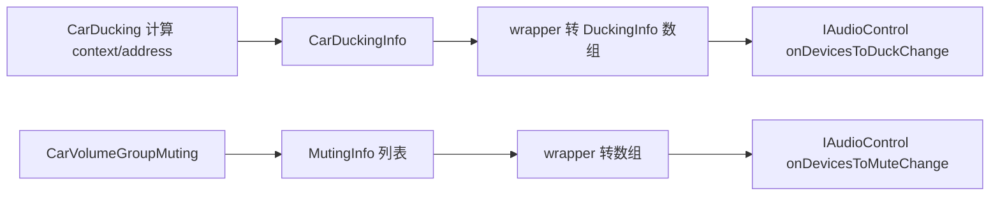
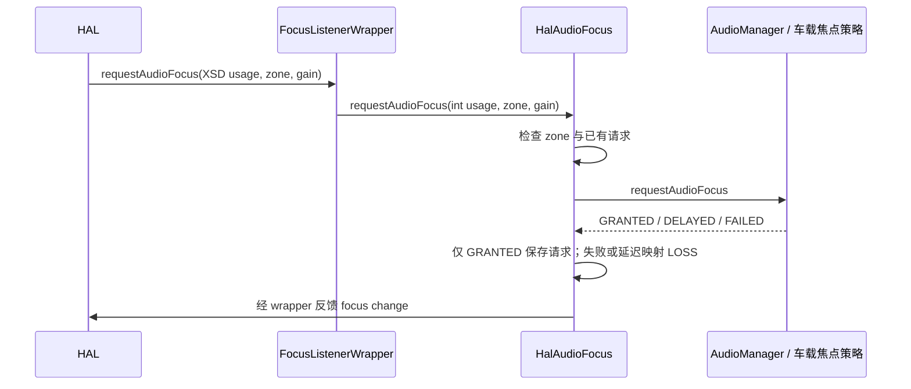
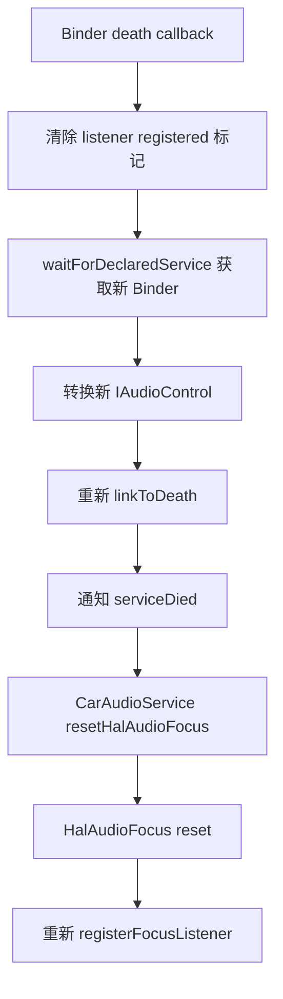

# 10.6 AudioControlWrapperAidl：类型桥接、异常与死亡恢复边界

> 对照本地 Android 12L/API 32 的完整 wrapper。它适配本地 AudioControl AIDL 接口，不按远端版本动态装配新版 gain/module 回调。

前置：[10.1 AudioControl 职责](10_10.1_AudioControl_HAL总览.md)、[9.2 CarAudioService](../09_AAOS_Car_Audio/09_9.2_CarAudioService-车载音频核心服务.md)。

## 1. wrapper 持有什么

- `mBinder`：服务 Binder，用于 death link。
- `mAudioControl`：`IAudioControl.Stub.asInterface()` 获得的接口。
- `mListenerRegistered`：本地记录 focus listener 注册调用已完成的标记。
- `mDeathRecipient`：CarService 提供的死亡处理回调。

服务名固定为 `android.hardware.automotive.audiocontrol.IAudioControl/default`。获取入口原文：

```java
static @Nullable IBinder getService() {
    return Binder.allowBlocking(ServiceManager.waitForDeclaredService(
            AUDIO_CONTROL_SERVICE));
}
```

`waitForDeclaredService` 不是轮询所有版本的无等待检查；工厂按 AIDL→HIDL V2→HIDL V1 尝试，但已声明 AIDL 服务的等待语义会影响何时获得结果。不要把“优先级”误画成每隔固定时间重试一次的后台线程。

## 2. supportsFeature 是固定能力表

```java
public boolean supportsFeature(int feature) {
    switch (feature) {
        case AUDIOCONTROL_FEATURE_AUDIO_FOCUS:
        case AUDIOCONTROL_FEATURE_AUDIO_DUCKING:
        case AUDIOCONTROL_FEATURE_AUDIO_GROUP_MUTING:
            return true;
        default:
            return false;
    }
}
```

本地没有根据远端 `getInterfaceVersion()` 判断这些业务特性的分支。内部 FocusListenerWrapper 确实实现 `getInterfaceVersion()` / `getInterfaceHash()`，返回生成接口的 VERSION/HASH；那是稳定 AIDL callback 接口的信息，不是本 wrapper 的运行时功能协商。

capability 为 true 只说明客户端适配支持此调用面。HAL 是否真正操作设备，需要继续看实际服务实现与运行行为。

## 3. CarService → HAL：不同方法的类型转换

| wrapper 方法 | 转换与检查 |
|---|---|
| onAudioFocusChange | Android int usage → `AudioAttributes.usageToXsdString()`；zone/focusChange 原样传递 |
| onDevicesToDuckChange | 非 null 列表、逐项非 null；CarDuckingInfo 转 DuckingInfo[] |
| onDevicesToMuteChange | 非 null 且非空列表；转 MutingInfo[] |
| setFadeTowardFront / setBalanceTowardRight | 直接传 float；这里不计算硬件矩阵或钳制系数 |
| registerFocusListener | 包装 HalFocusListener 为 AIDL IFocusListener 后注册 |

duck 列表没有与 mute 相同的显式非空校验，不能为求表格整齐而声称两者完全同构。



这些方法传递控制信息，不处理 PCM，也不生成一个用于等待硬件 gain 完成的回执对象。

## 4. HAL → CarService：FocusListenerWrapper

callback 的请求入口原文：

```java
public void requestAudioFocus(String usage, int zoneId, int focusGain) {
    @AttributeUsage int usageValue = AudioAttributes.xsdStringToUsage(usage);
    mListener.requestAudioFocus(usageValue, zoneId, focusGain);
}
```

abandon 路径做同样的 XSD usage 转换，再调用 HalFocusListener。wrapper 不在这里建立 AudioTrack，不校验区域设备连接，也不替焦点策略作接受/拒绝决定。

`HalAudioFocus` 才负责有效 zone 检查、按 zone/usage 保存请求、构建携带区域信息的 AudioAttributes，并调用 AudioManager 的焦点 API。



本地 `makeAudioFocusRequestLocked()` 仅在 GRANTED 时保存请求；FAILED 映射为 LOSS，DELAYED 也按 LOSS 反馈且不保存为待恢复请求。不能将这一路径描述成 HAL 延迟焦点队列。后续已保存请求收到永久 LOSS 时会从映射移除，其他变化更新状态。

AIDL v1 的反馈方法是 oneway；HAL 的外部音源行为仍受具体实现约束，不能从这张控制图推导所有声音必须等待 GAIN。

## 5. RemoteException 的处理并不统一

| 调用 | 本地异常处理 | 对调用方意味着什么 |
|---|---|---|
| registerFocusListener | 日志 + 抛 IllegalStateException | 不设置后续成功标记，调用可中断上层流程 |
| onAudioFocusChange | 抛 IllegalStateException | 不是吞掉异常后自动重发 |
| linkToDeath | 抛 IllegalStateException | death 监听注册失败不是成功 |
| duck / mute / fade / balance | 记录错误日志 | 调用方不能靠正常返回确认下游动作成功 |

空参数、非法 mute 列表等可在远端调用之前就失败；这些也不能泛称 RemoteException。

`registerFocusListener()` 正常返回后设置 `mListenerRegistered=true`。由于接口注册是 oneway，这个布尔值不是远端实际 callback 活性的持续探测结果。

## 6. binderDied：先换接口，再通知上层

原文：

```java
private void binderDied() {
    Slog.w(TAG, "AudioControl HAL died. Fetching new handle");
    mListenerRegistered = false;
    mBinder = AudioControlWrapperAidl.getService();
    mAudioControl = IAudioControl.Stub.asInterface(mBinder);
    linkToDeath(mDeathRecipient);
    if (mDeathRecipient != null) {
        mDeathRecipient.serviceDied();
    }
}
```



这里没有保存所有 duck/mute/fade/balance 请求的重放队列，也没有设备级恢复完成确认。HAL 死亡恢复只应按这条实际链解释，不能扩写成“所有音区、DSP graph 和 PCM 都自动无缝恢复”。

获取新服务或重新 link 失败时，后续上层通知并不保证执行；代码也没有本地显式重试次数、指数退避或超时恢复状态机。

## 7. unregister 与 unlink 的生命周期限制

`unregisterFocusListener()` 本地方法体只有注释：listener 由 HAL 自动注销。它没有显式远端 unregister 调用，也没有在此把 `mListenerRegistered` 清零。因此 dump 中的布尔值只适合结合本地生命周期解释。

`linkToDeath()` 与 `unlinkToDeath()` 都使用 `this::binderDied` 方法引用。不要把它改画为本地有一个保存起来、可确认重复使用的 IBinder.DeathRecipient 字段；实际字段 `mDeathRecipient` 是上层 AudioControlDeathRecipient，不是那个 Binder callback 对象。

本文不依据方法名推断“unlink 后绝无回调”或“reset 已原子清空所有外部焦点”。具体对象身份、回调时序与 HalAudioFocus 的集合更新，还需专门验证；这次没有执行 Binder death 测试。

## 8. dump 应怎样读

本地 dump 打印 wrapper 类型、`mListenerRegistered` 和一部分 supported features。列表打印了 focus、ducking，但 supportsFeature 还支持 group muting；**展示列表不是完整能力表**。

观察时应对齐四层信息：

1. CarService 是否创建对应 CarDucking/CarVolumeGroupMuting/HalAudioFocus。
2. wrapper 参数、异常和 listener 标记。
3. 真实 HAL 服务的接收日志与实现。
4. 设备实际效果。

只看第二层不能确认第四层。默认示例的日志输出也不能证明产品硬件控制成功，见 [10.1](10_10.1_AudioControl_HAL总览.md)。

## 9. 源码入口

路径相对 `Android/lagvm/LINUX/android/`：

- `packages/services/Car/service/src/com/android/car/audio/hal/AudioControlWrapperAidl.java`。
- `packages/services/Car/service/src/com/android/car/audio/hal/AudioControlFactory.java`。
- `packages/services/Car/service/src/com/android/car/audio/hal/HalAudioFocus.java`。
- `packages/services/Car/service/src/com/android/car/audio/CarDuckingInfo.java`。
- `packages/services/Car/service/src/com/android/car/audio/CarAudioService.java`。

继续回到 [9.2 服务生命周期](../09_AAOS_Car_Audio/09_9.2_CarAudioService-车载音频核心服务.md) 和 [9.5 音量/静音边界](../09_AAOS_Car_Audio/09_9.5_CarVolumeGroup-车载音量组.md)。
