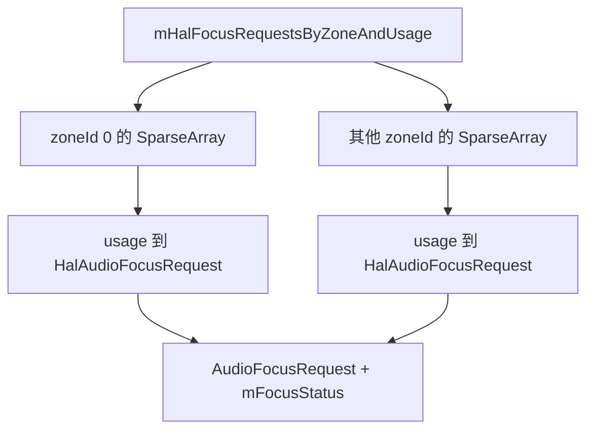
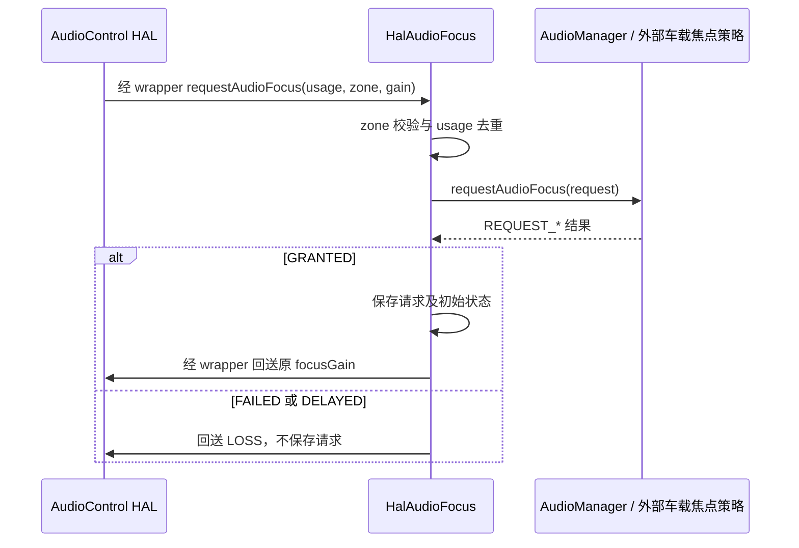

# 10.7 HalAudioFocus：外部音源请求的保存、反馈与清理

> 本地 Android 12L/API 32 的实现以 `SparseArray<SparseArray<HalAudioFocusRequest>>` 保存请求，内层 key 是 int usage。不是新版 AudioAttributesWrapper Map，也没有按 metadata 区分请求的本地分支。

前置：[10.1 AudioControl v1](10_10.1_AudioControl_HAL总览.md)、[10.6 AIDL wrapper](10_10.6_AudioControlWrapperAidl-AIDL适配层架构.md)。

## 1. 为什么需要 HalAudioFocus

外部收音机、告警等音源可能不经过 Android AudioTrack，但仍需与 Android 的音频用途协作。HAL 通过注册的 IFocusListener 请求/放弃焦点；HalAudioFocus 将它转成 AudioManager 请求，并把状态通过 AudioControlWrapper 回送。

它不接收 PCM、不创建 AudioTrack，也不决定功放是否允许外部声音发声。接口允许 HAL 不严格以 GAIN/LOSS 作为发声开关，见 10.1。

## 2. 两层请求表保存什么



构造函数按传入的 audioZoneIds 预建空内层表。request/abandon 入口检查 zone 是否在此集合中，非法 zone 抛参数异常。

同一个 zone、同一个 usage 只能保存一项；不同 usage 可以属于同一个 CarAudioContext，但在这里仍是不同 key。同 usage 跨 zone 也互不覆盖。

`mFocusStatus` 初始保存请求的 focusGain，之后随 Framework callback 更新。它不是 AudioManager 的 REQUEST_GRANTED 结果枚举，即使某些常量数值碰巧相同也应区分语义。

## 3. 重复请求不重新协商 gain 类型

requestAudioFocus 检查内层 usage 项：

- 已存在：通过 wrapper 返回当前 mFocusStatus，不再请求 AudioManager。
- 不存在：创建新的 AudioFocusRequest 并请求。

因此相同 zone/usage 再传不同 focusGain，不能视为重新升级/替换了原请求；本地先命中已有记录。这是请求去重边界，不是任意参数组合都能按调用意图更新的通用幂等接口。

## 4. usage 与 zone 怎样进入 Framework

生成 AudioAttributes 时，zoneId 写入 `AUDIOFOCUS_EXTRA_REQUEST_ZONE_ID` bundle；system usage 用 setSystemUsage，其余用 setUsage。

```java
Bundle bundle = new Bundle();
bundle.putInt(CarAudioManager.AUDIOFOCUS_EXTRA_REQUEST_ZONE_ID, zoneId);
builder.addBundle(bundle);
```

AudioFocusRequest.Builder 设置 attributes 与 OnAudioFocusChangeListener；本地没有调用 setAcceptsDelayedFocusGain 来显式选择延迟接收。

区域信息经 Framework 外部策略到 CarZonesAudioFocus，由后者提取有效 bundle zone，再交对应 CarAudioFocus。不能把 zone 解析箭头直接画到单区域 CarAudioFocus 内部。

## 5. 请求结果：只保存 GRANTED

| AudioManager 结果 | 保存新项 | 反馈 HAL |
|---|---|---|
| REQUEST_GRANTED | 是 | 原 focusGain |
| REQUEST_FAILED | 否 | AUDIOFOCUS_LOSS |
| REQUEST_DELAYED | 否 | AUDIOFOCUS_LOSS，同时记录延迟结果 |

GRANTED 分支原文：

```java
if (requestResult == AUDIOFOCUS_REQUEST_GRANTED) {
    HalAudioFocusRequest halAudioFocusRequest = new HalAudioFocusRequest(audioFocusRequest,
            focusGain);
    mHalFocusRequestsByZoneAndUsage.get(zoneId).append(usage, halAudioFocusRequest);
```

这是 if 分支的连续摘录，后续 else-if 在源文件中。**DELAYED 不是在本类建立等待项后自动恢复。** 后续 callback 会先查当前请求表；若没有对应项，就不更新、不转发。这修正了旧文“延迟先报 LOSS，之后必然接收授予并更新”的推断。



图省略已有请求直接反馈的短路分支；所有对 HAL 的箭头实际经 AudioControlWrapper，AIDL v1 为 oneway，不是设备操作完成回执。

## 6. 异步变化怎样更新状态

在 mLock 内查 zone/usage 当前项：

- 项不存在：忽略回调，不创建补偿请求。
- 永久 AUDIOFOCUS_LOSS：先从内层表移除，再回送 LOSS。
- 其他变化：更新 mFocusStatus，再回送变化。

LOSS_TRANSIENT 或 CAN_DUCK 的记录仍留在表内。因此 `getActiveUsagesForZone()` 返回的“active usages”是当前保存请求的 keys，不能理解为全部都处于 GAIN、更不能证明都正在硬件发声。

## 7. abandon 先删除本地项，再请求 Framework

原文入口：

```java
HalAudioFocusRequest currentRequest = mHalFocusRequestsByZoneAndUsage.get(zoneId)
        .removeReturnOld(usage);
```

没有记录就返回；有记录才向 AudioManager 调 abandonAudioFocusRequest。返回 GRANTED 则通过 wrapper 反馈 LOSS，失败只记警告，**不会把已删除的记录放回表中**。

所以“本地表已经为空”不等于“Framework 已成功放弃全部焦点”。重复 abandon 因记录不存在不会自动重试上一笔失败。

同样，wrapper 的 onAudioFocusChange 可能抛 IllegalStateException；本类没有在每个调用点吞掉该异常或建立重试队列。观察异常时应检查调用之前是否已经修改了本地集合。

## 8. HAL death 与 reset 的真实顺序

AIDL wrapper 的 binderDied 先获取新服务、重建接口和 death link，再通知 CarAudioService。服务回调调用 HalAudioFocus.reset，然后重新注册 focus listener。

因此不能断言“reset 中回送 LOSS 一定发往已死的旧 HAL，必然失败”。正常推进到上层回调时，wrapper 已替换接口；当然重新发现或 IPC 仍可能失败。

### 8.1 本地 reset 不是复制 keys 后安全遍历

实际内层代码：

```java
int usageCount = requestsByUsage.size();
for (int j = 0; j < usageCount; j++) {
    int usage = requestsByUsage.keyAt(j);
    abandonAudioFocusLocked(usage, zoneId);
}
```

这里保存初始 usageCount，但 abandon 内的 removeReturnOld 会删除正在遍历的 SparseArray 项。本地 SparseArray 删除先标记 DELETED，后续 keyAt 在有 garbage 时执行 gc 压缩，移动有效项的位置。

因而递增 j 不保证仍对应下一个未处理的 key。以三个递增 key 的静态路径为例：删除索引 0 后，下一次 keyAt(1) 在压缩后可以读到原第三项，原第二项被跨过；再使用旧 usageCount 可能访问已不属于有效范围的位置。具体越界表现还受 keyAt 的检查顺序与平台开关影响，不能把它简单等同于某个固定异常必现。

本地 HalAudioFocusTest 有两个 usage 的 reset 测试，但**测试存在不等于本次执行通过，也不证明任意数量请求都完整清理**。本次只对照了源码与这些测试，没有运行 AndroidJUnit 或 Binder death 场景，更没有修改产品源码。

这一细节的教学结论是：不要把 reset 的注释“清空所有请求”当作已验证结果；排查多外部音源恢复时，要核对每项 Framework abandon 与残留映射。

## 9. 三种失去状态不要混淆

| 路径 | 本地删除时机 | 外部通知/后续 |
|---|---|---|
| Framework 永久 LOSS callback | 先删除 | 再向 HAL 通知 LOSS |
| HAL 主动 abandon | 先 removeReturnOld | Framework 返回 GRANTED 才反馈 LOSS，失败不回填 |
| HAL death reset | 遍历并复用 abandon | 受遍历变更、Framework 返回与 wrapper 异常影响 |

这些路径既不包含 PCM 恢复，也不等于重放所有 fade/balance/duck/mute 状态。恢复范围应与 [10.6](10_10.6_AudioControlWrapperAidl-AIDL适配层架构.md) 一起阅读。

## 10. 源码与定位

路径相对 `Android/lagvm/LINUX/android/`：

- `packages/services/Car/service/src/com/android/car/audio/hal/HalAudioFocus.java`。
- `packages/services/Car/service/src/com/android/car/audio/hal/AudioControlWrapperAidl.java`。
- `packages/services/Car/tests/carservice_unit_test/src/com/android/car/audio/hal/HalAudioFocusTest.java`。
- `frameworks/base/core/java/android/util/SparseArray.java`。

定位时关联 zone、usage、请求 gain、当前 mFocusStatus、Framework 返回、映射删除时机和 HAL 服务重连状态。仅看到本地日志“Resetting”或一次正常返回，不能宣称外部焦点已完整恢复。
