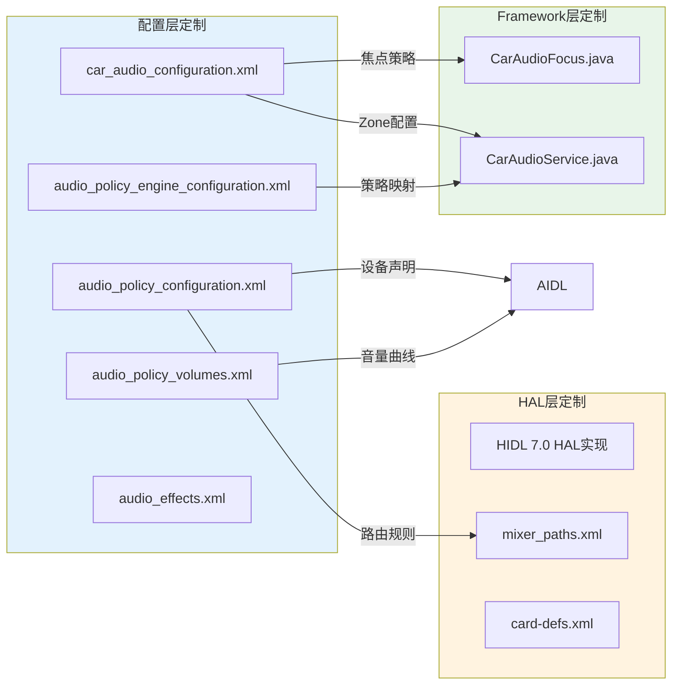
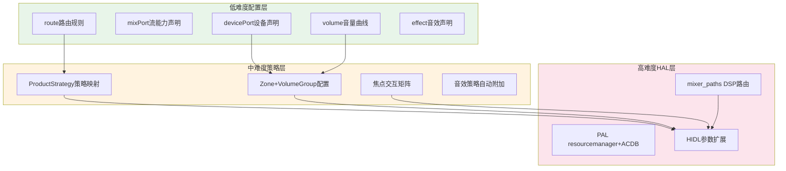

## 11.10 OEM定制点完整矩阵

> [← 上一个](11_11.9_car_audio_configuration.xml_深度解析.md) | [← 返回11章](README.md) | [返回导航](../README.md) | [下一个 →](11_11.11_AIDLHIDL_Vendor_HAL实现架构.md)

---

### 11.10.1 矩阵总览

OEM定制AAOS音频系统涉及配置文件（政策/音量/引擎/车载/音效/mixer paths）和多个源码修改点。本矩阵从定制维度、文件位置、关键参数、影响范围、难度等级5个维度全面梳理所有可定制点。



### 11.10.2 audio_policy_configuration.xml 定制点

#### 11.10.2.1 设备声明定制

| 定制点 | XML标签 | 关键属性 | 定制影响 | 难度 |
|--------|---------|---------|---------|------|
| 输出设备类型 | devicePort | type=AUDIO_DEVICE_OUT_* | HAL设备识别 | 低 |
| Bus设备地址 | devicePort | address=busX_xxx | Car端Context路由 | 低 |
| 设备角色 | devicePort | role=sink/source | 输出/输入方向 | 低 |
| 增益控制 | gains | min/max/step/default | 音量范围和步进 | 低 |
| 增益模式 | gain | mode=JOINT/CHANNELS/RAMP | 增益调节方式 | 中 |
| 音量关联 | gain | useForVolume（默认false） | Serializer.cpp:403-404 默认 false；产品 Bus 增益未设置（走 CarVolumeGroup/HAL gain 命令） | 低 |
| 蓝牙编码 | devicePort | encodedFormats | A2DP支持的编码格式 | 中 |
| 附加设备 | attachedDevices | tagName列表 | Framework可见设备 | 低 |
| 默认输出 | defaultOutputDevice | tagName | 无匹配路由时的输出 | 低 |

**产品 Bus 设备定制清单（ msmnile_au/audio_policy_configuration.xml:133-185 实测）**：

| devicePort tagName | address | mixPort name（route 1:1:1） | gains 范围（mB） |
|---------|---------|-------------------|-----------|
| Media Bus | BUS00_MEDIA | media（flag PRIMARY） | -6000~600 |
| Sys Notification Bus | BUS01_SYS_NOTIFICATION | sys_notification | -6000~600 |
| Nav Guidance Bus | BUS02_NAV_GUIDANCE | nav_guidance | -6000~600 |
| Phone Bus | BUS03_PHONE | phone | -6000~600 |
| Front Passenger Bus | BUS08_FRONT_PASSENGER | front_passenger | -6000~600 |
| Rear Seat Bus | BUS16_REAR_SEAT | rear_seat | -6000~600 |

另有非 Bus mixPort：primary output（FAST|PRIMARY）、raw、deep_buffer、mmap_no_irq_out。

> **勘误（负结论）**：原表为 emulator 口径（bus0_media_out 等，device/generic/car/emulator/audio），且含 `bus1000_mirror_device`（音频镜像为 Android 13+ 机制，本树 CarAudioZonesHelper 标签表与产品配置中均不存在，全树 grep 零命中）。上表已替换为本产品（SA8295 msmnile_au）真实 Bus 清单。

#### 11.10.2.2 流能力定制

| 定制点 | XML标签 | 关键属性 | 定制影响 | 难度 |
|--------|---------|---------|---------|------|
| 输出flags | mixPort | flags=PRIMARY/FAST/DEEP_BUFFER等 | Thread类型选择 | 低 |
| 采样率 | profile | samplingRates | 支持的采样率列表 | 低 |
| 音频格式 | profile | format=PCM_16BIT/PCM_FLOAT等 | 支持的数据格式 | 低 |
| 声道掩码 | profile | channelMasks=STEREO/MONO等 | 声道布局 | 低 |
| 最大活跃流 | mixPort | maxActiveCount | 同类型并发流数 | 中 |
| 最大打开流 | mixPort | maxOpenCount | 同类型最大打开数 | 中 |
| 独占模式 | mixPort | flags=COMPRESS_OFFLOAD | 硬件解码直出 | 中 |

**flags→Thread映射定制约束**：

| flags值 | 对应Thread类型（12L 真实类名，Threads.h） | 延迟要求 | OEM定制空间 |
|---------|---------------|---------|------------|
| PRIMARY | MixerThread（:1380） | <20ms | 调整buffer大小 |
| FAST | MixerThread（fast track 内嵌 fast mixer，**无 FastMixerThread 类**） | <5ms | 调整burst size |
| DEEP_BUFFER | MixerThread（普通 track，**无 DeepBufferThread 类**） | <100ms | 调整buffer深度 |
| COMPRESS_OFFLOAD | OffloadThread（:1554，继承 DirectOutputThread） | 不限 | 编码格式扩展 |
| MMAP_NOIRQ | MmapPlaybackThread（:2073，继承 MmapThread） | <3ms | DSP固件配置 |
| DIRECT | DirectOutputThread（:1479） | <50ms | 格式限定 |

#### 11.10.2.3 路由规则定制

| 定制点 | XML标签 | 关键属性 | 定制影响 | 难度 |
|--------|---------|---------|---------|------|
| 输出路由 | route | type=mix, sink=devicePort | mixPort→devicePort映射 | 低 |
| 输入路由 | route | type=mix, source=devicePort | 输入设备→mixPort映射 | 低 |
| 多源路由 | route | sources=逗号分隔列表 | 多 mixPort 经同一 route 指向同一 devicePort（route 声明层面支持；产品 Bus 均为 1:1:1） | 中 |

**Car端路由约束**：Car端每Bus必须是1:1:1映射（一个mixPort→一个route→一个devicePort），不支持多对一路由。

### 11.10.3 audio_policy_volumes.xml 定制点

| 定制点 | XML标签 | 关键属性 | 定制影响 | 难度 |
|--------|---------|---------|---------|------|
| 音量曲线定义 | volume | stream+deviceCategory | 设备类别音量插值曲线 | 低 |
| 曲线段点 | point | `0,-9600`（索引,mB） | 音量索引→毫贝增益映射 | 低 |
| 曲线引用 | volume | ref="DEFAULT_..._VOLUME_CURVE" | 复用 default_volume_tables.xml 中 reference 曲线 | 低 |
| 设备类别 | volume | deviceCategory=HEADSET/SPEAKER等 | 不同设备独立曲线 | 低 |
| 默认音量表 | （独立文件 default_volume_tables.xml） | reference name | 提供 FULL_SCALE/SILENT/DEFAULT_* 等可引用曲线 | 低 |

**音量曲线定制原则**：

| 设备类别 | 典型min dB | 典型max dB | 推荐段数 | 说明 |
|---------|-----------|-----------|---------|------|
| SPEAKER | -60dB | 0dB | 5-7段 | 车载主输出 |
| HEADSET | -56dB | 0dB | 5-7段 | 耳机输出 |
| EARPIECE | -48dB | 0dB | 4-5段 | 听筒 |
| BUS（Car） | -32dB | 6dB | 5段 | Bus增益范围 |

### 11.10.4 audio_policy_engine_configuration.xml 定制点

| 定制点 | XML标签 | 关键属性 | 定制影响 | 难度 |
|--------|---------|---------|---------|------|
| ProductStrategy | ProductStrategy（audio_policy_engine_product_strategies.xml） | id+Attributes | Usage→Strategy映射 | 中 |
| Strategy属性 | Attributes | usage+contentType+tags | 策略匹配条件 | 中 |
| 曲线引用 | Volume（engine_volumes） | deviceCategory+ref | Strategy组→VolumeGroup关联 | 中 |
| 交互条件 | criteria/criterion（criteria 配置） | name+type+default | 策略选择的准则（如 AvailableOutputDevicesAddresses/TelephonyMode） | 高 |
| 准则类型 | criterion_types | values+value_pairs | 准则取值域 | 高 |

> **勘误（负结论）**：原表"焦点交互 LegacyRoutingStrategy/interaction"与"默认策略 default productStrategy"两行不是 12L 引擎配置结构（全树 grep `LegacyRoutingStrategy` 零命中）。真实结构：engine configuration 是 `<configuration>` + xi:include（product_strategies/criterion_types/criteria/volumes 四文件），焦点交互矩阵在 Framework 侧 `FocusInteraction.java sInteractionMatrix`（:65），不是该 XML。

**Car端策略引擎定制（版本边界）**：
- CarAudioContext 的 id 直接对应 ProductStrategy 的 id、OEM 扩展 Context 同步扩展 ProductStrategy——均为 **Android 13+ Core Audio Routing 机制**（`mUseCoreAudioRouting` 全树零命中）；12L 的 Context→Bus 路由走 AudioPolicyMix，策略引擎 ProductStrategy 用于非 Car 的通用路由决策

### 11.10.5 car_audio_configuration.xml 定制点

#### 11.10.5.1 Zone配置定制

| 定制点 | XML标签 | 关键属性 | 定制影响 | 难度 |
|--------|---------|---------|---------|------|
| Zone数量 | zone | audioZoneId | 多区域音频独立 | 中 |
| 主Zone | zone | isPrimary=true | 系统默认音频区域 | 低 |
| 乘员绑定 | zone | occupantZoneId | 乘客Zone自动分配 | 中 |
| Zone名称 | zone | name | 显示标识 | 低 |

#### 11.10.5.2 VolumeGroup定制

| 定制点 | XML标签 | 关键属性 | 定制影响 | 难度 |
|--------|---------|---------|---------|------|
| 音量组数量 | group | （无属性，12L不读name） | 独立音量控制维度 | 中 |
| Bus绑定 | device | address | Context→Bus映射（唯一属性） | 低 |
| Context分配 | context | context=xxx | 音频语义到Bus的路由 | 低 |
| HAL路由模式 | device | useHalAudioRouting（**13+，不在本树**） | Framework vs HAL路由 | 中 |
| 多配置 | zoneConfig | isDefault（**14+，不在本树**） | 运行时配置切换 | 高 |

#### 11.10.5.3 输入/镜像定制

| 定制点 | XML标签 | 关键属性 | 定制影响 | 难度 |
|--------|---------|---------|---------|------|
| 输入设备 | inputDevice（12L 支持） | address | Zone录音设备绑定 | 中 |
| 镜像设备 | mirroringDevice（**Android 13+，不在本树**） | address | 音频镜像输出 | 高 |
| OEM Context | oemContext（**Android 14+，不在本树**） | name+id+audioAttributes | 自定义音频上下文 | 高 |

> **勘误（负结论）**：`useHalAudioRouting`/`mirroringDevice`/`oemContext`/`zoneConfig` 均不在本树 12L（packages/services/Car 全树 grep 零命中；标签常量表 CarAudioZonesHelper.java:53-68 无对应常量）。详见 11.9 的版本边界说明。

### 11.10.6 audio_effects.xml 定制点

| 定制点 | XML标签 | 关键属性 | 定制影响 | 难度 |
|--------|---------|---------|---------|------|
| 音效库声明 | libraries（产品 audio_effects.xml:30-48，非 effectLibraries） | library name+path | Vendor音效SO库（libqtiautobundle.so/libqcomvoiceprocessing.so 等） | 中 |
| 音效类型 | effect | name+uuid | 可用音效类型标识 | 低 |
| 音效库绑定 | effect | library=xxx | 音效到SO库映射 | 低 |
| 音效代理 | effectProxy | proxy uuid + libsw/libhw 子节点 | SW/HW 双实现代理 | 中 |

> **勘误（负结论）**：`isDefault` 属性不存在（产品 audio_effects.xml 无此属性；12L EffectsFactory 亦无此声明）。effectProxy 真实结构是 `<effectProxy name library uuid><libsw .../><libhw .../></effectProxy>`（如 equalizer→bundle/offload_bundle，audio_effects.xml:58-61）。

**产品真实音效清单（msmnile_au/audio_effects.xml:86-94 实测）**：

| 音效类型 | UUID | 库 | 用途 |
|---------|------|------|------|
| aec | 0f8d0d2a-59e5-45fe-b6e4-248c8a799109 | audio_pre_processing（libqcomvoiceprocessing.so） | 通话回声消除 |
| ns | 1d97bb0b-9e2f-4403-9ae3-58c2554306f8 | audio_pre_processing | 通话降噪 |
| audio_bmt | e039757b-a367-44e9-9bbb-634af0c51cb7 | audio_bmt（libqtiautobundle.so） | 车机音效（Balance/Treble/Middle/Bass） |
| audio_fnb | 6bc88c84-a544-11e8-98d0-529269fb1459 | audio_fnb | 反馈消除 |
| audio_delay | a31574a6-a5e7-11e8-98d0-529269fb1459 | audio_delay | 延迟 |
| audio_volume | 3d844dd4-a367-11e8-9eb6-529269fb1459 | audio_volume | 音量 |
| audio_avc | 2130c69e-6a3a-4e35-9890-71687f0b78bf | audio_avc | 自动音量控制 |
| audio_sumx | 32e9fe7f-de63-4d1b-a5d2-281e8492f3ce | audio_sumx | 求和矩阵 |
| audio_synth | a124b54f-4026-4ed2-9316-4ba2d5effdb8 | audio_synth | 合成提示音 |

（另有 effectProxy：bassboost/virtualizer/equalizer/reverb 族 → bundle/reverb（SW）+ offload_bundle（HW），audio_effects.xml:50-73）

> **勘误**：原表为 AOSP 默认 UUID（7b491460… 等），非本产品清单；产品使用 QC 车机音效族（libqtiautobundle）与 QC aec/ns，已按 msmnile_au/audio_effects.xml 替换。

### 11.10.7 audio_effect_policy.xml（Android 14+，不在本树）

> **版本边界（负结论）**：`audio_effect_policy.xml` 是 Android 14 机制；本树 frameworks/av 与 vendor/qcom 全树 **不存在**该文件（find 零命中），12L 音效附加走 audio_effects.xml 声明 + AudioFlinger EffectChain/DeviceEffectManager（见 5.12）。以下为 14+ 概念定制点（版本限定，非本树能力）：

| 定制点 | XML标签 | 关键属性 | 定制影响 | 难度 |
|--------|---------|---------|---------|------|
| 音效附加规则 | effect | uuid+stream/device | 自动附加音效 | 中 |
| 输出设备音效 | deviceEffect | deviceAddress+effect | 特定设备音效 | 中 |
| 音效策略 | effects->effect | streamType+usage | 特定流类型音效 | 中 |

### 11.10.8 mixer_paths.xml 定制点

| 定制点 | XML标签 | 关键属性 | 定制影响 | 难度 |
|--------|---------|---------|---------|------|
| 控制器定义 | ctl | name+value | ALSA mixer控制 | 高 |
| 路由路径 | path | name | DSP内部信号路由 | 高 |
| 增益设定 | ctl | name=xxx Gain value | 模拟增益配置 | 高 |
| 开关控制 | ctl | name=xxx Switch | 信号通断控制 | 高 |
| 交叉路由 | path | →交叉引用 | 多路径组合 | 高 |

**mixer_paths.xml典型结构**（简化示意，非逐字摘录：`PRI_MI2S_RX MultiMedia1` 等 MSM 通用示例不在本产品路径表中，本产品 mixer_paths_gvmauto8295_adp_star.xml 为 AudioReach/QUAT_TLAIN/TERT_TDM 等表述）：

```xml
<mixer>
    <!-- 媒体输出到外部功放（示意） -->
    <path name="media-playback">
        <ctl name="QUAT_TLAIN_RX Audio Mixer MultiMedia1" value="1"/>
    </path>
    <!-- 回采/环通（示意） -->
    <path name="audio-record">
        <ctl name="MultiMedia1 Mixer TERT_TDM_TX" value="1"/>
    </path>
</mixer>
```

### 11.10.9 audio_platform_info.xml（legacy 树，非本产品 AR 配置面）

> **边界（负结论）**：`audio_platform_info.xml` 属 legacy 音频树（本树仅 msmsteppe_au.mk:99 引用，msmsteppe 变体）；本产品 SA8295 AudioReach 配置目录 msmnile_au **无此文件**（AR 路由/后端参数走 PAL resourcemanager_gvmauto8295_adp_star.xml + ACDB，见 15.6/16.9）。以下为 legacy 概念定制点（版本限定，非本产品路径）：

| 定制点 | XML标签 | 关键属性 | 定制影响 | 难度 |
|--------|---------|---------|---------|------|
| 编解码器映射 | codec | name+device | SoC codec→设备映射 | 高 |
| 设备参数覆盖 | device | backend+channels+rate | 后端参数覆盖 | 高 |
| 后端配置 | backend | bit_width+sample_rate | I2S/TDM接口配置 | 高 |
| 外部设备 | external_device | type+address | USB/A2DP等外部设备 | 中 |

### 11.10.10 AIDL Vendor扩展定制点（Android 13+/14+，不在本树）

> **版本边界（负结论）**：本产品 HAL 为 **HIDL 7.0**（manifest.xml 声明 android.hardware.audio@7.0，见 11.11）；AIDL core audio `IModule` 及下列方法（get/setVendorParameters、getSoundDose、getMmapPolicyInfos、getBluetoothA2dp/Le、getTelephony）均为 Android 13+/14+ 能力，本树 hardware/interfaces/audio **无 .aidl 文件**（find 零命中）。本树等价定制点：HIDL `IDevice` 的 `setParameters/getParameters` + vendor 参数键值约定。以下为 AIDL 概念定制点（版本限定，非本树能力）：

| 定制点 | AIDL方法 | 参数类型 | 定制影响 | 难度 |
|--------|---------|---------|---------|------|
| Vendor参数读 | getVendorParameters | VendorParameter[] | HAL私有参数查询 | 高 |
| Vendor参数写 | setVendorParameters | VendorParameter[] | HAL私有参数配置 | 高 |
| Sound Dose | getSoundDose | ISoundDose | 安全听音剂量 | 高 |
| MMap策略 | getMmapPolicyInfos | MmapPolicyInfo[] | AAudio低延迟策略 | 高 |
| 蓝牙A2DP | getBluetoothA2dp | IBluetoothA2dp | A2DP协议控制 | 中 |
| 蓝牙LE | getBluetoothLe | IBluetoothLe | BLE Audio控制 | 中 |
| 电话 | getTelephony | ITelephony | 通话音频控制 | 中 |

### 11.10.11 Framework层定制点

| 定制点 | 源码文件 | 关键方法/常量（12L 实名） | 定制影响 | 难度 |
|--------|---------|-------------|---------|------|
| 焦点交互矩阵 | FocusInteraction.java | sInteractionMatrix（:65） | Context间焦点优先级 | 高 |
| Duck策略 | CarDuckingUtils.java | sContextsToDuck（:45） | Duck降音关系 | 高 |
| Usage映射 | CarAudioContext.java | CONTEXT_TO_USAGES（:137） | Usage→Context映射 | 中 |
| Zone校验 | CarAudioZonesValidator.java | validateAudioZones（至少一个zone、主Zone须有麦克风输入、地址唯一） | Zone/组约束 | 中 |
| 核心路由模式 | CarAudioContext.java | mUseCoreAudioRouting（**13+，不在本树**） | 传统 vs Strategy路由 | 中 |

> **勘误（负结论）**：原表"CarAudioFocus.java INTERACTION_MATRIX"（真实位置 FocusInteraction.java sInteractionMatrix）、"CarAudioContext.java sContextsToDuck"（真实位置 CarDuckingUtils.java）、"sContextsMap"（真实名 CONTEXT_TO_USAGES）、"MAX_VOLUME_GROUPS/MAX_AUDIO_ZONES"（**本树不存在**，12L 经 CarAudioZonesValidator 规则而非常量上限）均已按源码实名修正。

### 11.10.12 定制难度与依赖关系



### 11.10.13 定制验证清单

| 验证项 | 验证命令 | 期望结果 |
|--------|---------|---------|
| 设备枚举 | dumpsys media.audio_policy \| grep BUS | 所有Bus设备可见 |
| 路由验证 | dumpsys audio \| grep Route | Context→Bus路由正确 |
| 音量组 | dumpsys audio \| grep VolumeGroup | VolumeGroup映射符合预期 |
| Zone配置 | dumpsys audio \| grep Zone | Zone数量和属性正确 |
| 音效列表 | dumpsys media.audio_flinger \| grep Effect | 音效已加载 |
| 增益范围 | dumpsys audio \| grep gain | gains范围符合gains配置 |
| Vendor参数 | dumpsys audio \| grep -i param | HIDL setParameters/getParameters 键值可读（AIDL VendorParameter 为 13+） |

---

[← 上一个](11_11.9_car_audio_configuration.xml_深度解析.md) | [← 返回11章](README.md) | [返回导航](../README.md) | [下一个 →](11_11.11_AIDLHIDL_Vendor_HAL实现架构.md)