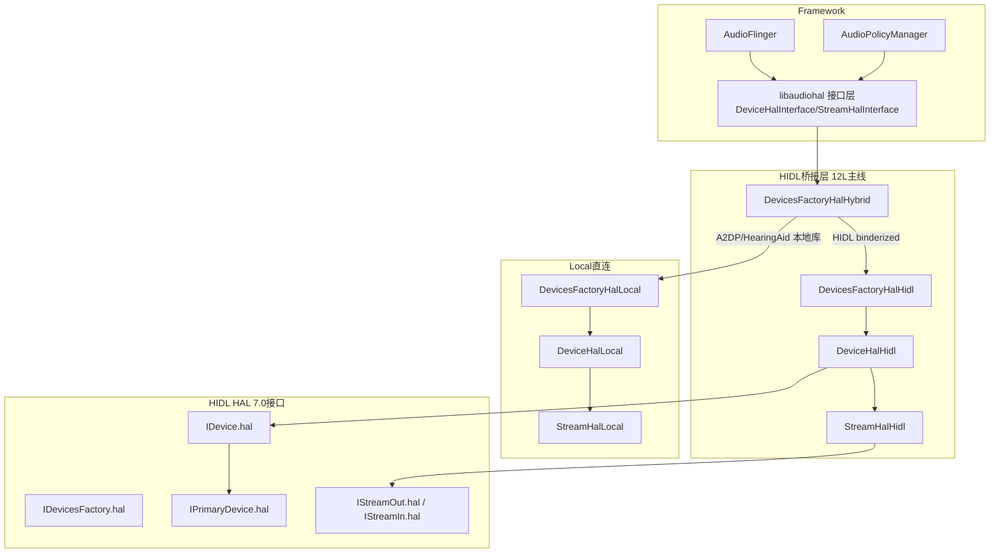
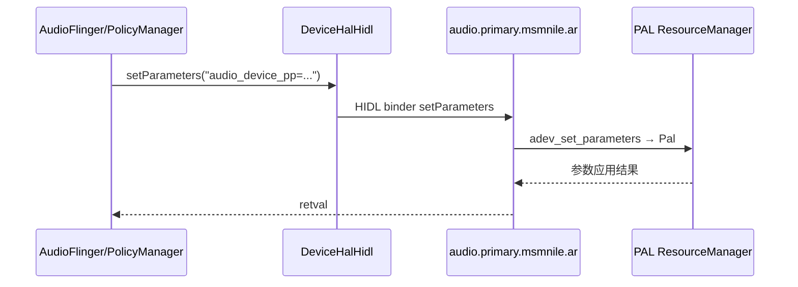

## 11.11 AIDL/HIDL Vendor HAL实现架构（本树主线：HIDL；AIDL为13+/14演进）

> [← 上一个](11_11.10_OEM定制点完整矩阵.md) | [← 返回11章](README.md) | [返回导航](../README.md) | [下一篇 →](../12_Audio_Focus_Deep_Dive/README.md)

---

### 11.11.1 架构总览（12L 本树事实）

> **版本边界（负结论）**：Android 14 的 AIDL 音频 HAL（`hardware/interfaces/audio/aidl` 的 `IModule.aidl`/`IConfig.aidl`、framework 侧 `DevicesFactoryHalAidl.cpp`）**不在本树**。本树（Android 12L）音频 HAL 主线是 **HIDL**：接口定义 `hardware/interfaces/audio/7.0/`（2.0→7.0 均存在），framework 桥接层在 `frameworks/av/media/libaudiohal/impl/`，默认参考实现在 `hardware/interfaces/audio/core/all-versions/default/`。产品（msmnile_gvmq/msmnile_au）实际打包到 **audio@6.0**（见 11.11.5）。



### 11.11.2 HIDL 7.0 接口方法列表（本树 `hardware/interfaces/audio/7.0/`）

#### IDevice.hal（设备级）

| 方法 | 行号 | 语义 |
|------|-----|------|
| `initCheck()` | :29 | 初始化自检 |
| `setMasterVolume/getMasterVolume` | :39/:51 | 主音量 |
| `setMicMute/getMicMute` | :59/:67 | 麦克风静音 |
| `setMasterMute/getMasterMute` | :76/:88 | 主静音 |
| `getInputBufferSize(config)` | :98 | 录音缓冲尺寸 |
| `openOutputStream(...)` | :122 | 打开输出流 |
| `openInputStream(...)` | :153 | 打开输入流 |
| `supportsAudioPatches()` | :171 | 是否支持 patch 路由 |
| `createAudioPatch/updateAudioPatch/releaseAudioPatch` | :185/:204/:219 | 动态路由三元组 |
| `getAudioPort/setAudioPortConfig` | :234/:243 | 端口查询与配置 |
| `getHwAvSync()` | :254 | AV 同步句柄 |
| `setScreenState(turnedOn)` | :265 | 屏幕状态通知 |
| `getParameters/setParameters` | :284/:302 | vendor 参数 |
| `getMicrophones()` | :314 | 麦克风信息 |
| `setConnectedState(address, connected)` | :326 | 设备连接状态 |

#### IStreamOut.hal（输出流级）

| 方法 | 行号 | 语义 |
|------|-----|------|
| `getLatency()` | :30 | 时延查询 |
| `setVolume(left, right)` | :46 | 流音量 |
| `updateSourceMetadata(sourceMetadata)` | :59 | 用量/内容元数据下发 |
| `prepareForWriting(frameSize, framesCount)` | :124 | 建立共享内存/壁钟 |
| `getRenderPosition()` | :141 | DSP 渲染帧数 |
| `getNextWriteTimestamp()` | :153 | 写时间戳 |
| `setCallback/clearCallback` | :168/:181 | 非阻塞写回调 |
| `setEventCallback(IStreamOutEventCallback)` | :192 | HAL→FW 事件 |
| `supportsPauseAndResume()/supportsDrain()` | :201/:233 | 能力查询 |
| `pause()/resume()/drain(type)/flush()` | :216/:226/:257/:271 | 流控制 |
| `getPresentationPosition()` | :293 | 呈现位置（AVSync） |

> 对比：Android 14 AIDL `IModule` 的 setDeviceConnectionState/setDataDescription/simulateDeviceConnection（以及 `IFactory`）等，本树 HIDL 对应物是上表的 `setConnectedState`、`prepareForWriting` + framework 的 `StreamHalHidl::getRenderPosition` 路径；AIDL 专属能力（per-device 音量曲线、SoundDose、AAudio MMap 服务化参数）不在本树。

### 11.11.3 DevicesFactoryHalHybrid 关键实现（12L）

[`openDevice`](frameworks/av/media/libaudiohal/impl/DevicesFactoryHalHybrid.cpp:32) 决定走 HIDL 还是本地直连：

```cpp
status_t DevicesFactoryHalHybrid::openDevice(const char *name, sp<DeviceHalInterface> *device) {
    if (mHidlFactory != 0 && strcmp(AUDIO_HARDWARE_MODULE_ID_A2DP, name) != 0 &&
        strcmp(AUDIO_HARDWARE_MODULE_ID_HEARING_AID, name) != 0) {
        return mHidlFactory->openDevice(name, device);
    }
    return mLocalFactory->openDevice(name, device);
}
```

> 源码：`DevicesFactoryHalHybrid.cpp:32-38`（逐字摘录，12L）。**规则**：除 A2DP 与 HearingAid 两个模块名外，其余模块（含 `primary`/`r_submix`/`usb` 及自定义模块）一律走 HIDL 工厂；A2DP/HearingAid 因需要与 bluetooth 进程内协作，使用 **Local 直连**（`dlopen` 本地 so）。`getHalPids()`/`setCallbackOnce()` 只有 HIDL 通路（:40-52）。

### 11.11.4 HIDL vs AIDL 演进对比（AIDL 列为版本坐标）

| 维度 | HIDL（12L 本树） | AIDL（13+/14，不在本树） |
|------|----------------|------------------------|
| 接口定义 | `hardware/interfaces/audio/7.0/*.hal` | `hardware/interfaces/audio/aidl/.../IModule.aidl` |
| factory | `IDevicesFactory.hal`，Hybrid 桥接 | `IFactory`，按 name 实例化 IModule |
| 版本管理 | 2.0→7.0 多版本共存 | aidl_api 版本目录（1/2/3…） |
| 流方向 | IStreamOut/IStreamIn 显式类型 | IStreamIn/Out 拆分 + BufferDescriptor/FMQ 统一 |
| 音量 | master volume + per-stream setVolume | per-device volume 曲线（sounddose/核心配置） |
| SoundDose | 无（见 [13.5](../13_Volume_Device_Deep_Dive/13_13.5_SoundDose与CSD声剂量管理.md)） | ISoundDose 接口（14） |
| BLuetooth A2DP offload | Local 直连（见 11.11.3） | 纳入 IModule 标准能力 |

### 11.11.5 本产品的 HAL 打包证据（msmnile_au / msmnile_gvmq）

- `msmnile_au.mk:469-500`（vendor/qcom/opensource/audio-hal-ar/primary-hal/configs/）：`PRODUCT_PACKAGES` 打包 `android.hardware.audio@2.0-service`、`@2.0-impl`，并逐级追加 `@4.0`、`@5.0`、`@6.0` 的 `-impl` 与 `android.hardware.audio.common@N.0(-util)`、`android.hardware.audio.effect@N.0-impl`。
- `device/qcom/msmnile_gvmq/msmnile_gvmq.mk:315-320`：Guest 侧同样打包 `android.hardware.audio@5.0-impl` 系列。
- Primary HAL 实现本体是 AR 版 `audio.primary.msmnile.ar`（PAL→AGM/GSL→QNX audio_service 链路，详见 [16.13](../16_Vendor_QNX_Architecture/16_16.13_Primary_HALAudioReach版深度解.md)），通过 HIDL `@6.0-impl` 对 framework 暴露；`android.hardware.audio@7.0` 接口虽在本树 hardware/interfaces 中定义，产品 mk 未打包 7.0-impl。

### 11.11.6 Vendor参数扩展实战（HIDL setParameters 路径）

12L 的 vendor 扩展通道是 [`IDevice.setParameters`](hardware/interfaces/audio/7.0/IDevice.hal:302)（`setParameters(vec<ParameterValue> context, vec<ParameterValue> parameters)`），AR HAL 侧由 `AudioDevice.cpp` 的 `adev_set_parameters` 落到 PAL `ResourceManager`（详见 [16.13](../16_Vendor_QNX_Architecture/16_16.13_Primary_HALAudioReach版深度解.md)）。AIDL 时代的 `VendorParameter`/`setParameter` 回调式扩展不在本树。



---

> [← 上一个](11_11.10_OEM定制点完整矩阵.md) | [← 返回11章](README.md) | [返回导航](../README.md) | [下一篇 →](../12_Audio_Focus_Deep_Dive/README.md)
