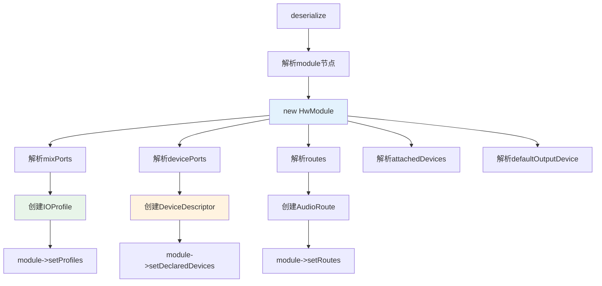
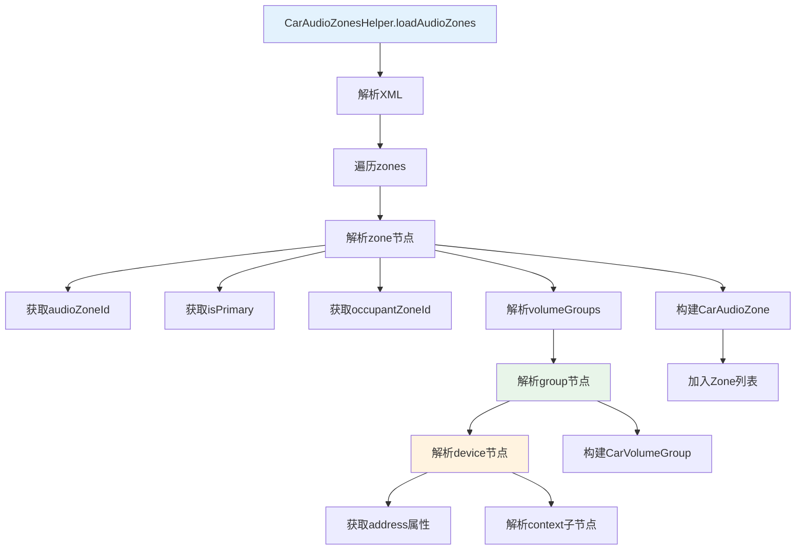
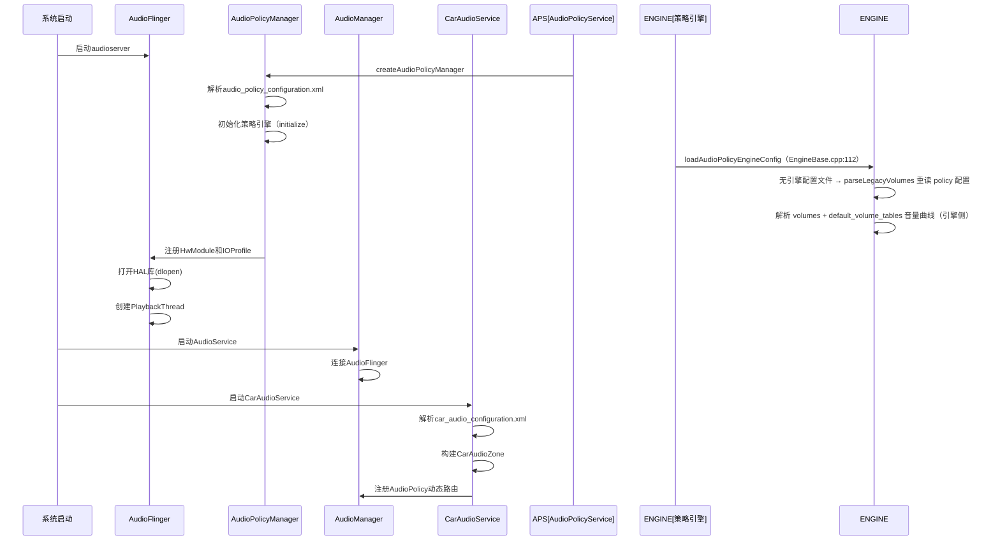

## 11.6 配置解析流程

> [← 上一个](11_11.5_car_audio_configuration.xml-AAOS车载配置.md) | [← 返回11章](README.md) | [返回导航](../README.md) | [下一个 →](11_11.7_OEM定制指南.md)

---

### 11.6.1 配置解析总体架构

Android音频系统启动时，多个组件按序解析各自的XML配置文件，构建内存中的音频策略数据结构。解析流程涉及Native层(AudioPolicyManager)和Java层(CarAudioService)的协作。

```mermaid
graph TD
    INIT[系统启动] --> APS[AudioPolicyService启动]
    APS --> APM_INIT[AudioPolicyManager初始化]
    APM_INIT --> PARSE1[解析audio_policy_configuration.xml]
    PARSE1 -->|xi:include| PARSE_V[解析audio_policy_volumes.xml]
    PARSE1 -->|xi:include| PARSE_DVT[解析default_volume_tables.xml]

    PARSE1 --> BUILD1[构建HwModule/IOProfile/DeviceDescriptor]
    BUILD1 --> ENGINE[策略引擎初始化]

    ENGINE -->|enginedefault(产品默认)| ED[EngineDefault默认策略+parseLegacyVolumes解析音量]
    ENGINE -->|engineconfigurable| EC[解析audio_policy_engine_configuration.xml]

    INIT --> CAS_INIT[CarAudioService初始化]
    CAS_INIT --> PARSE2[解析car_audio_configuration.xml]
    PARSE2 --> BUILD2[构建CarAudioZone/VolumeGroup]
    BUILD2 --> DYN_ROUTE[注册动态路由AudioPolicy]

    style PARSE1 fill:#e3f2fd
    style PARSE2 fill:#e8f5e9
    style ENGINE fill:#fff3e0
```

### 11.6.2 Native层解析流程

#### 11.6.2.1 AudioPolicyManager初始化

真实解析调用链（12L，managerdefault/AudioPolicyManager.cpp + Serializer.cpp，libxml2 非 tinyxml2）：

```
AudioPolicyService::createAudioPolicyManager()        // AudioPolicyService.cpp:65-69
  → new AudioPolicyManager(clientInterface)           // :5074 构造即 loadConfig()
    → AudioPolicyManager::loadConfig()                // :5080-5088
      → deserializeAudioPolicyXmlConfig(getConfig())  // :5044 静态函数
        → audio_get_audio_policy_config_file()        // system/media/.../audio_config.h:56
        → deserializeAudioPolicyFile(file, &config)   // Serializer.cpp:891
          → PolicySerializer::deserialize(...)        // Serializer.cpp:835（libxml2 xmlNode，含 xi:include 处理）
```

> **勘误（负结论）**：原链 `AudioPolicyConfig::parse()/deserializeAudioPolicyXmlFile()` 与 `AudioPolicyConfig::deserialize(const tinyxml2::XMLElement&)` 均非本树真实符号（grep 零命中；本树解析器是 libxml2 的 `PolicySerializer`）。上游入口 `AudioPolicyService::onFirstRef()`（AudioPolicyService.cpp:115）真实存在：:127 `loadAudioPolicyManager()` → :128 `mCreateAudioPolicyManager` 触发下述 createAudioPolicyManager 链。解析失败时 `loadConfig` 回退 `getConfig().setDefault()` 硬编码默认（:5081-5084）。

#### 11.6.2.2 audio_policy_configuration.xml 解析入口

```cpp
// frameworks/av/services/audiopolicy/common/managerdefinitions/src/Serializer.cpp:835-887（简化示意，非逐字摘录）
status_t PolicySerializer::deserialize(const char *configFile, AudioPolicyConfig *config) {
    // 1. 解析根节点版本（仅接受 "1.0" 或 "7.0"，:864-870）
    // 2. 解析 globalConfiguration
    // 3. 解析 modules（deserializeCollection<ModuleTraits>，:874）
    // 注：本 Serializer 不解析 volumes——音量曲线在引擎侧解析（见 11.6.2.7）
}
```

#### 11.6.2.3 module 解析流程



#### 11.6.2.4 关键C++解析类与XML节点对应

| XML节点 | 解析C++类 | 关键成员 |
|---------|----------|----------|
| `<module>` | [`HwModule`](frameworks/av/services/audiopolicy/common/managerdefinitions/include/HwModule.h) | mDeclaredDevices, mOutputProfiles, mInputProfiles, mRoutes |
| `<mixPort>` | [`IOProfile`](frameworks/av/services/audiopolicy/common/managerdefinitions/include/IOProfile.h) | mSupportedDevices（IOProfile.h:212）；mProfiles/mFlags 为继承成员（AudioPort.h:113/PolicyAudioPort.h:132） |
| `<devicePort>` | [`DeviceDescriptor`](frameworks/av/services/audiopolicy/common/managerdefinitions/include/DeviceDescriptor.h) | mDeviceTypes（DeviceDescriptor.h:292）；mDeviceTypeAddr/mAddress/mGains 为继承成员（DeviceDescriptorBase.h:84/AudioDeviceTypeAddr.h:67/AudioPort.h:108） |
| `<route>` | [`AudioRoute`](frameworks/av/services/audiopolicy/common/managerdefinitions/include/AudioRoute.h) | mSources（集合）, mSink, mType |
| `<gains>` | [`AudioGainTraits`](frameworks/av/services/audiopolicy/common/managerdefinitions/src/Serializer.cpp:70) | `PolicySerializer::deserialize<AudioGainTraits>`（:350；12L 无 managerdefinitions/AudioGain.h，AudioGain 类在 `frameworks/av/media/libaudiofoundation/include/media/AudioGain.h`） |
| `<volume>` | [`VolumeCurve`](frameworks/av/services/audiopolicy/engine/common/include/VolumeCurve.h) | mCurvePoints |

#### 11.6.2.5 mixPort解析详细流程

```
Serializer::deserializeCollection <mixPort>
  → 遍历每个<mixPort>节点
    → 解析name属性
    → 解析role属性(output/input)
    → 解析flags属性
      → OutputFlagConverter::maskFromString()转换字符串→枚举（调用点 Serializer.cpp:485/:488；strtok 实现于 TypeConverter.h:187，按 mFlagsSeparator "|" 切分）
    → 解析<profile>子节点(采样率/格式/声道)
    → 创建IOProfile对象
    → HwModule.addOutputProfile() 或 addInputProfile()
```

**flags解析映射**：

| flags字符串 | 枚举值 | 含义 |
|------------|--------|------|
| `AUDIO_OUTPUT_FLAG_PRIMARY` | 0x2（枚举同名 AUDIO_OUTPUT_FLAG_*） | 主输出 |
| `AUDIO_OUTPUT_FLAG_DIRECT` | 0x1（枚举同名 AUDIO_OUTPUT_FLAG_*） | 直接输出(低延迟) |
| `AUDIO_OUTPUT_FLAG_COMPRESS_OFFLOAD` | 0x10（枚举同名 AUDIO_OUTPUT_FLAG_*） | 硬件解码 |
| `AUDIO_OUTPUT_FLAG_DEEP_BUFFER` | 0x8（枚举同名 AUDIO_OUTPUT_FLAG_*） | 深缓冲 |
| `AUDIO_OUTPUT_FLAG_VOIP_RX` | 0x8000（枚举同名 AUDIO_OUTPUT_FLAG_*） | VoIP接收 |
| `AUDIO_OUTPUT_FLAG_INCALL_MUSIC` | 0x10000（枚举同名 AUDIO_OUTPUT_FLAG_*） | 通话中音乐 |
| `AUDIO_OUTPUT_FLAG_MMAP_NOIRQ` | 0x4000（枚举同名 AUDIO_OUTPUT_FLAG_*） | MMAP无中断 |

#### 11.6.2.6 devicePort解析详细流程

```
Serializer::deserializeCollection <devicePort>
  → 遍历每个<devicePort>节点
    → 解析tagName属性
    → 解析type属性(AUDIO_DEVICE_OUT_BUS等)
      → DeviceConverter::fromString()转换字符串→枚举（Serializer.cpp:543）
    → 解析role属性(source/sink)
    → 解析address属性(BUS00_MEDIA等)
    → 解析<gains><gain>子节点
      → AudioGainTraits::deserialize直接读属性（Serializer.cpp:350-411，无Gain::dump()环节）
    → 创建DeviceDescriptor对象
    → module->setDeclaredDevices()（Serializer.cpp:679-695）
```

#### 11.6.2.7 volume解析流程（引擎侧，非 PolicySerializer）

> **勘误（归属修正）**：`Serializer::deserializeVolume`/`mVolumeCurves` 不存在（PolicySerializer 无 VolumeTraits）。12L 音量曲线解析在**策略引擎侧**：`EngineBase::loadAudioPolicyEngineConfig()`（engine/common/src/EngineBase.cpp:112）→ `engineConfig::parseLegacyVolumes()`（EngineBase.cpp:165；enginedefault/src/Engine.cpp:64 经 loadAudioPolicyEngineConfig 间接调用）→ `deserializeLegacyVolume()`（engine/config/src/EngineConfig.cpp:537-585）：

```
deserializeLegacyVolume <volume>           // EngineConfig.cpp:537-585
  → 解析stream属性 → streamType枚举
  → 解析deviceCategory属性 → device_category枚举
  → 检查是否有ref属性
    → 有ref: getReference()在<volumes><reference name=...>查找引用曲线（:550-559，调用点 :553；即 default_volume_tables.xml 的 reference 元素）
    → 无ref: 解析<point>子节点
  → 构建 VolumeCurve（engine/common/include/VolumeCurve.h，mCurvePoints）
```

### 11.6.3 Java层解析流程(AAOS)

#### 11.6.3.1 CarAudioService初始化

```java
// packages/services/Car/service/src/com/android/car/audio/CarAudioService.java:536-547（逐字摘录，12L；统一左移 4 空格缩进）
private SparseArray<CarAudioZone> loadCarAudioConfigurationLocked(
        List<CarAudioDeviceInfo> carAudioDeviceInfos, AudioDeviceInfo[] inputDevices) {
    try (InputStream inputStream = new FileInputStream(mCarAudioConfigurationPath)) {
        CarAudioZonesHelper zonesHelper = new CarAudioZonesHelper(mCarAudioSettings,
                inputStream, carAudioDeviceInfos, inputDevices, mUseCarVolumeGroupMuting);
        mAudioZoneIdToOccupantZoneIdMapping =
                zonesHelper.getCarAudioZoneIdToOccupantZoneIdMapping();
        return zonesHelper.loadAudioZones();
    } catch (IOException | XmlPullParserException e) {
        throw new RuntimeException("Failed to parse audio zone configuration", e);
    }
}
```

> **勘误（负结论）**：原代码块 `R.raw.car_audio_configuration` 资源加载、`mUseCarVolumeGroupMgmt/mUseCoreAudioVolume/mUseCoreAudioRouting` 构造参数、`loadCarAudioZones()` 方法名均非本树真实符号（CarAudioService 服务代码 grep 零命中——测试 fixture 中 R.raw.car_audio_configuration 大量使用，如 CarAudioZonesHelperTest.java:85，属测试资源；真实为 `FileInputStream(mCarAudioConfigurationPath)`、`mUseCarVolumeGroupMuting`、`loadAudioZones()`）。

#### 11.6.3.2 CarAudioZonesHelper解析详细流程



#### 11.6.3.3 动态路由注册

CarAudioService完成配置解析后，通过AudioManager注册动态路由策略：

```java
// CarAudioService.java:582-640（简化示意，非逐字摘录；12L 真实机制）
private void setupDynamicRoutingLocked() {
    final AudioPolicy.Builder builder = new AudioPolicy.Builder(mContext);
    builder.setLooper(Looper.getMainLooper());
    // 1. 构建每个Zone/VolumeGroup的AudioMix（USAGE→Bus地址）
    //    真实实现：CarAudioDynamicRouting.setupAudioDynamicRouting(builder, mCarAudioZones)
    //    （CarAudioDynamicRouting.java:50-101，AudioMix per Context→device，builder.addMix）
    // 2. 设置音量/焦点回调后注册（AudioPolicy.Builder 无 addRule 方法）
    int r = mAudioManager.registerAudioPolicy(mAudioPolicy);
}
```

> **勘误（负结论）**：`AudioPolicy.Builder.addRule` 不存在（frameworks/base/.../AudioPolicy.java:196,211 仅 addMix/setLooper 等）；路由规则经 `CarAudioDynamicRouting.setupAudioDynamicRouting` → `builder.addMix(audioMix)` 逐 Context 建立。

### 11.6.4 配置文件加载时序



### 11.6.5 配置文件搜索路径

audio_get_configuration_paths() 搜索顺序（system/media/audio/include/system/audio_config.h:32-44）：

| 优先级 | 路径 | 说明 |
|--------|------|------|
| 1 | `/odm/etc` | ODM定制配置(最高优先) |
| 2 | `/vendor/etc/audio/sku_<sku>`（仅 ro.boot.product.vendor.sku 设置时插入） | SKU 变体 |
| 3 | `/vendor/etc` | Vendor配置 |
| 4 | `/system/etc` | 系统默认配置 |

CarAudioService搜索路径（CarAudioService.java:118-121）：

| 优先级 | 来源 | 说明 |
|--------|------|------|
| 1 | `/vendor/etc/car_audio_configuration.xml` | Vendor配置 |
| 2 | `/system/etc/car_audio_configuration.xml` | 系统默认 |
| 兜底 | `R.xml.car_volume_groups` 资源 + AudioControl legacy | 两者皆无时走 CarAudioZonesHelperLegacy（:549-561），非 R.raw 资源 |

### 11.6.6 解析错误处理

| 错误类型 | 处理方式（12L 真实行为） |
|----------|----------|
| 缺少必需属性 | 节点返回 BAD_VALUE，整个解析失败 → loadConfig 回退 `getConfig().setDefault()` 硬编码默认（空属性检查 BAD_VALUE：Serializer.cpp:517-533；错误传播 :312-340；APM:5080-5084） |
| Version不匹配 | ALOGE + BAD_VALUE 拒绝解析（Serializer.cpp:864-870，仅接受 "1.0"/"7.0"） |
| XML格式错误 | 加载失败，使用硬编码默认配置 |
| VolumeGroup中device无对应devicePort | `IllegalStateException` 抛出（CarAudioZonesHelper.java:435-440 validateOutputDeviceExist） |
| 输入设备地址重复 | `IllegalArgumentException` 抛出（:376-384），并非"后定义覆盖" |

### 11.6.7 配置热更新机制

| 配置文件 | 是否支持热更新 | 更新方式 |
|----------|--------------|----------|
| audio_policy_configuration.xml | 否 | 重启audioserver |
| audio_policy_volumes.xml | 否 | 重启audioserver |
| car_audio_configuration.xml | 否（12L 仅 SUPPORTED_VERSION_1/2，Helper.java:92-94；zoneConfig 切换为 Android 14+ 机制，`setZoneConfigSwitch/switchZoneConfig` 全树零命中） | 重启（14+ 才有 zoneConfig 切换） |
| audio_policy_engine_configuration.xml | 否 | 重启audioserver |

### 11.6.8 配置验证工具

```bash
# 验证audio_policy_configuration.xml
adb shell dumpsys media.audio_policy

# 验证音量曲线
adb shell dumpsys media.audio_policy | grep "Volume"

# 验证动态路由
adb shell dumpsys audio | grep "CarAudio"

# 验证HwModule加载
adb shell dumpsys media.audio_flinger | grep "Output"

# 验证HAL库加载
adb shell lsof | grep audio.primary

# 检查XML格式（注：本树 frameworks/av 无 audio_policy_configuration.xsd，xmllint 仅可做 well-formed 检查）
xmllint --noout audio_policy_configuration.xml
```

---

[← 上一个](11_11.5_car_audio_configuration.xml-AAOS车载配置.md) | [← 返回11章](README.md) | [返回导航](../README.md) | [下一个 →](11_11.7_OEM定制指南.md)