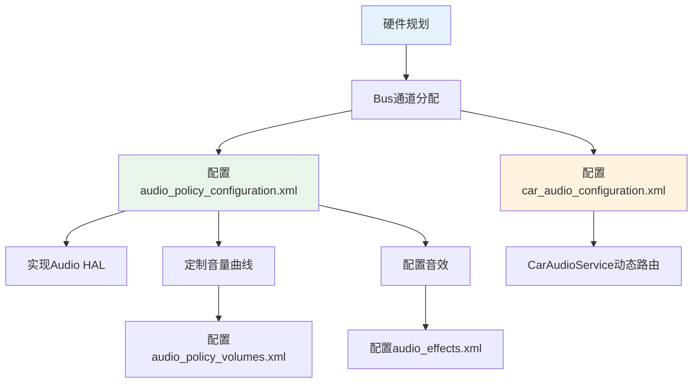

## 11.7 OEM定制指南

> [← 上一个](11_11.6_配置解析流程.md) | [← 返回11章](README.md) | [返回导航](../README.md) | [下一个 →](11_11.8_audio_policy_configuration.xml_属性详解.md)

---

### 11.7.1 OEM定制概述

AAOS车载音频系统的OEM定制主要通过修改XML配置文件和实现Audio HAL来完成，无需修改Framework源码。本指南覆盖从硬件规划到软件配置的完整定制流程。



### 11.7.2 定制文件清单与职责

| 文件 | 部署路径 | 定制内容 | 影响范围 |
|------|----------|----------|----------|
| audio_policy_configuration.xml | /vendor/etc/ | 设备/路由/增益定义 | 音频路由和设备枚举 |
| audio_policy_volumes.xml | /vendor/etc/ | 音量曲线 | 音量控制 |
| default_volume_tables.xml | /vendor/etc/ | 曲线模板 | 音量曲线引用 |
| car_audio_configuration.xml | /vendor/etc/ | Zone/VolumeGroup/Context | AAOS动态路由 |
| audio_effects.xml | /vendor/etc/ | 音效配置 | 音效处理链 |
| audio_policy_engine_configuration.xml | /vendor/etc/ | 策略引擎 | 策略路由决策 |

### 11.7.3 Step 1: 硬件规划与Bus通道分配

#### 11.7.3.1 Bus通道规划原则

| 原则 | 说明 |
|------|------|
| 一Context一Bus | 每个AudioContext分配独立Bus，实现独立音量控制 |
| 安全优先 | EMERGENCY/SAFETY必须独立Bus，不被其他流衰减 |
| Zone隔离 | 不同Zone的Bus编号不重叠 |
| 预留扩展 | Bus编号留间隔（产品实际：主Zone 0-3、Zone1=8、Zone2=16、输入 4/9/17，见上表） |

#### 11.7.3.2 典型车载Bus分配方案

> 本表原为 AOSP emulator 口径（bus0_media_out 等）；本产品（SA8295 common_au/msmnile_au）真实分配如下，输入侧为 devicePort `BUS04_INPUT`（非 bus1000_microphone_in，后者全树零命中）：

| Bus | 产品地址 | tagName | 用途 | Zone |
|-----|------|------|------|------|
| 00 | BUS00_MEDIA | Media Bus | 媒体音乐 | Primary |
| 01 | BUS01_SYS_NOTIFICATION | Sys Notification Bus | 系统/通知 | Primary |
| 02 | BUS02_NAV_GUIDANCE | Nav Guidance Bus | 导航提示 | Primary |
| 03 | BUS03_PHONE | Phone Bus | 通话语音 | Primary |
| 08 | BUS08_FRONT_PASSENGER | Front Passenger Bus | 副驾 | Zone 1 |
| 16 | BUS16_REAR_SEAT | Rear Seat Bus | 后排 | Zone 2 |
| 04 | BUS04_INPUT | Primary In Bus | 麦克风输入（inputDevice） | Primary |
| 09 | BUS09_INPUT_FRONT_PASSENGER | Front Passenger In Bus | 输入（common_au:257） | Zone 1 |
| 17 | BUS17_INPUT_REAR_SEAT | Rear Seat In Bus | 输入（common_au:265） | Zone 2 |

> 注：输入 BUS（AUDIO_DEVICE_IN_BUS）仅存在于 common_au 变体（即生效的 /vendor/etc/audio_policy_configuration.xml）；msmnile_au 目录变体（装到 /vendor/etc/audio/，供 AR HAL）的输入为 Built-In Mic 等常规设备，无 IN_BUS。

### 11.7.4 Step 2: 配置audio_policy_configuration.xml

#### 11.7.4.1 定义Bus设备

```xml
<module name="primary" halVersion="3.0">
    <attachedDevices>
        <item>Media Bus</item>
        <item>Nav Guidance Bus</item>
    </attachedDevices>
    <defaultOutputDevice>Media Bus</defaultOutputDevice>

    <devicePorts>
        <!-- 结构与产品 common_au/audio_policy_configuration.xml:155-163 一致（devicePort 的 <profile> 子元素此处省略，产品 :157-158 有 PCM_16/48000 profile；routes 单 source 对齐产品 :275-286） -->
        <devicePort tagName="Media Bus" type="AUDIO_DEVICE_OUT_BUS"
                    address="BUS00_MEDIA" role="sink">
            <gains>
                <gain name="" mode="AUDIO_GAIN_MODE_JOINT"
                        minValueMB="-6000" maxValueMB="600" defaultValueMB="0" stepValueMB="100"/>
            </gains>
        </devicePort>
        <devicePort tagName="Nav Guidance Bus" type="AUDIO_DEVICE_OUT_BUS"
                    address="BUS02_NAV_GUIDANCE" role="sink">
            <gains>
                <gain name="" mode="AUDIO_GAIN_MODE_JOINT"
                        minValueMB="-6000" maxValueMB="600" defaultValueMB="0" stepValueMB="100"/>
            </gains>
        </devicePort>
    </devicePorts>

    <routes>
        <route type="mix" sink="Media Bus"
               sources="media"/>
        <route type="mix" sink="Nav Guidance Bus"
               sources="nav_guidance"/>
    </routes>
</module>
```

#### 11.7.4.2 gains参数设定指南

> **勘误（负结论）**：原表属性名 minGainMB/maxGainMB **不存在**（真实属性为 gain 元素的 minValueMB/maxValueMB，Serializer.cpp:71-91 AudioGainTraits；`minGainMB|maxGainMB` 框架与产品配置全树零命中），且 useForVolume "AAOS必须为true" 不成立（CarAudioDeviceInfo.getAudioGain 只按 MODE_JOINT 选取增益、不检查 useForVolume，CarAudioDeviceInfo.java:193-200；产品 Bus gains 全部未设置 useForVolume）。真实结构与产品取值：

| 参数（`<gain>` 元素属性） | 设定依据 | 产品取值（common_au） |
|------|----------|----------|
| mode | 增益模式（必填，mode=0 → BAD_VALUE，Serializer.cpp:412-417） | AUDIO_GAIN_MODE_JOINT |
| minValueMB | 功放最小增益(静音附近) | -6000 mB |
| maxValueMB | 功放最大增益(不失真) | 600 mB |
| defaultValueMB | 开机默认增益 | 0 mB |
| stepValueMB | 音量步进精度 | 100 mB |
| useForVolume | 可选，默认 false（Serializer.cpp:403-404）；产品未设置，音量走 CarVolumeGroup 增益链路 | （未设置） |

**增益校准方法**：
1. 确定功放0dB增益时的声压级(SPL)
2. 测量最大不失真SPL对应的增益值设为maxValueMB
3. 测量可听最小SPL对应的增益值设为minValueMB
4. 计算步进步数：产品实际 (600-(-6000))/100 = 66 步（indexMin=0, indexMax=66）

### 11.7.5 Step 3: 配置car_audio_configuration.xml

参见[11.5节](11_11.5_car_audio_configuration.xml-AAOS车载配置.md)的详细配置示例。

关键定制点：
- Zone划分和audioZoneId分配
- VolumeGroup分组策略
- Context到Bus映射关系
- （zoneConfig多配置切换为 Android 14+ 机制，不在本树）

### 11.7.6 Step 4: 定制音量曲线

#### 11.7.6.1 AAOS音量控制模型

AAOS使用Bus Gain而非Stream Volume，音量控制链路：

```
用户调节音量
  → CarVolumeGroup.setCurrentGainIndex(index)
  → 计算gainMB = minValueMB + index × stepValueMB（setCurrentGainIndexLocked :178-183 调用；getGainForIndex 公式定义 :328-330）
  → CarAudioDeviceInfo.setCurrentGain(gainMB)（CarAudioDeviceInfo.java:128-161）
  → AudioManager.setAudioPortGain(port, config)
  → AudioFlinger::setAudioPortConfig（AudioFlinger.cpp:2350）→ HIDL HAL → DSP或功放增益
```

#### 11.7.6.2 音量步数计算

```
indexMax = (maxValueMB - minValueMB) / stepValueMB
示例: 产品 common_au (600 - (-6000)) / 100 = 66步 (indexMin=0, indexMax=66)
```

### 11.7.7 Step 5: 实现Audio HAL

#### 11.7.7.1 HIDL Audio HAL（树内接口定义至 7.0；产品实装 @6.0）

> **版本边界（负结论）**：本树 hardware/interfaces/audio 仅 HIDL 2.0/4.0/5.0/6.0/7.0（无 .aidl）；`BnModule/setAudioPortGain(const AudioPort&, const GainConfig&)` 为 Android 13+/14+ AIDL 符号，本树不存在。增益设置的真实链路：CarAudioDeviceInfo.setCurrentGain → AudioManager.setAudioPortGain → AudioFlinger::setAudioPortConfig（AudioFlinger.cpp:2350-2375）→ HIDL `IDevice::setAudioPortConfig`（产品实装 @6.0：msmnile_au.mk 打包至 @6.0-impl、manifest.xml:73-81 声明 6.0；树内接口定义至 7.0，AudioPortConfig 携带 gain config）。

关键实现方法：

| 方法（IDevice，产品实装 6.0/树内定义至 7.0，hardware/interfaces/audio/6.0/IDevice.hal 与 7.0 同名方法） | 说明 |
|------|------|
| openOutputStream | 打开Bus输出流 |
| setAudioPortConfig | 设置端口配置（含增益 config，音量控制实际经路） |
| getAudioPort | 获取端口信息 |
| createAudioPatch | 建立路由 patch |

#### 11.7.7.2 HAL实现模板（HIDL Device.cpp 模式简化示意，非逐字摘录；7.0 变体 Device.cpp:402 同签名）

```cpp
// hardware/interfaces/audio/core/all-versions/default/Device.cpp 模式（本树为 HIDL 非 AIDL BnModule）
Return<Result> AudioDevice::setAudioPortConfig(const AudioPortConfig& config) {
    // 1. 从 AudioPortConfig 提取 port 地址（BUS00_MEDIA 等）与 gain config
    // 2. 将 gainMB 转换为 DSP/功放增益（产品经 PAL → AudioReach 图，见 15/16 章）
    // 3. 逐层下发（HAL→PAL→ACDB/GSL）
}
```

### 11.7.8 Step 6: 音效配置

#### 11.7.8.1 车载常用音效

| 音效 | 用途 | 路径 |
|------|------|------|
| Equalizer | 均衡器调节 | libbundlewrapper.so |
| BassBoost | 低音增强 | libbundlewrapper.so |
| Virtualizer | 环绕声 | libbundlewrapper.so |
| LoudnessEnhancer | 响度增强 | libldnhncr.so |
| NoiseSuppression(aec/ns) | 降噪(输入) | libqcomvoiceprocessing.so（产品 audio_effects.xml:40 audio_pre_processing，:86-87） |
| AcousticEchoCanceler | 回声消除(输入) | libqcomvoiceprocessing.so（同上） |

### 11.7.9 Step 7: 编译与部署

```bash
# 推送配置到设备
adb push audio_policy_configuration.xml /vendor/etc/
adb push car_audio_configuration.xml /vendor/etc/

# 重启audioserver使配置生效
adb shell killall audioserver

# 重启CarAudioService（进程名为 com.android.car，killall car_service 匹配不到）
adb shell kill com.android.car

# 验证配置加载
adb shell dumpsys media.audio_policy | head -50
adb shell dumpsys audio | grep "CarAudio"
```

### 11.7.10 定制验证清单

| 验证项 | 命令或方法 | 预期结果 |
|--------|-----------|----------|
| Bus设备枚举 | dumpsys media.audio_policy查找BUS | 所有Bus设备可见 |
| Zone配置 | dumpsys audio查找CarAudio | Zone数量和ID正确 |
| VolumeGroup | dumpsys audio查找VolumeGroup | 分组和Context映射正确 |
| 音量控制 | 调节音量滑块 | 对应Bus增益变化 |
| 路由正确性 | 播放不同Usage音频 | 路由到正确Bus |
| HAL加载 | lsof查找audio.primary | HAL库已加载 |
| 音效加载 | dumpsys media.audio_flinger查找effect | 音效链路正确 |

### 11.7.11 常见问题排查

| 问题 | 原因 | 解决方案 |
|------|------|----------|
| 无声音 | Bus地址不匹配 | 检查两个XML的address一致 |
| 音量不可控 | Bus地址不匹配 / gain 模式非 JOINT / min-max-default-step 约束非法（checkAudioGainConfiguration，CarAudioDeviceInfo.java:208-217） | 核对 address、mode=AUDIO_GAIN_MODE_JOINT 与增益四属性约束 |
| 路由错误 | Context映射不正确 | 检查car_audio_configuration.xml |
| HAL crash | gains范围超出硬件支持 | 调整minValueMB/maxValueMB |
| Zone切换失败 | occupantZoneId未绑定 | 检查Zone配置 |
| 多Zone串音 | route source包含多余mixPort | 精简routes配置 |

---

[← 上一个](11_11.6_配置解析流程.md) | [← 返回11章](README.md) | [返回导航](../README.md) | [下一个 →](11_11.8_audio_policy_configuration.xml_属性详解.md)