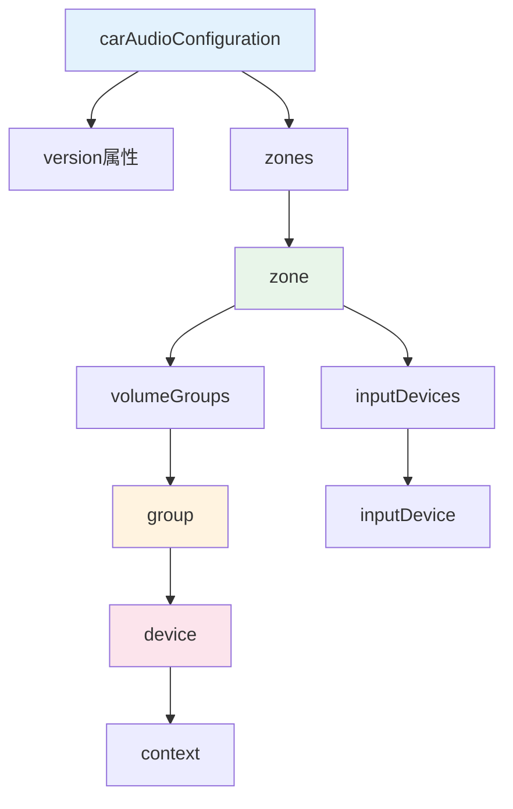
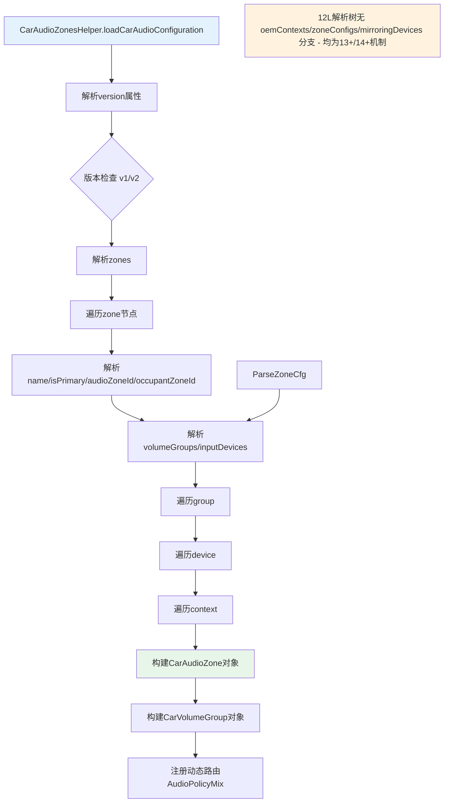
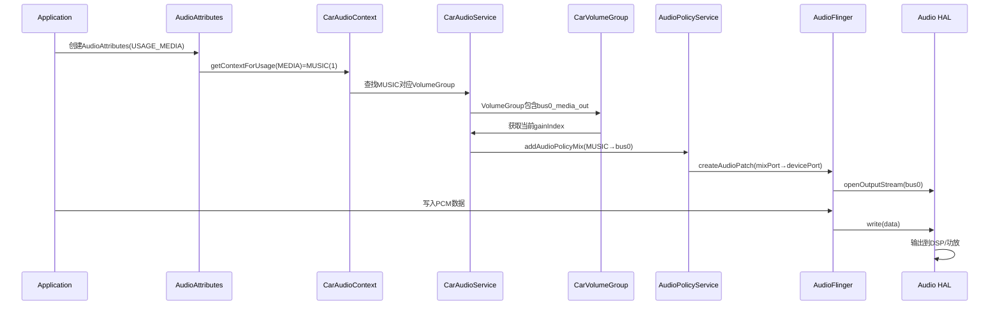

## 11.9 car_audio_configuration.xml 深度解析

> [← 上一个](11_11.8_audio_policy_configuration.xml_属性详解.md) | [← 返回11章](README.md) | [返回导航](../README.md) | [下一个 →](11_11.10_OEM定制点完整矩阵.md)

---

### 11.9.1 文档结构总览

car_audio_configuration.xml是AAOS车载音频系统的核心配置文件，定义了音频Zone、VolumeGroup、Context到Bus的映射关系。本文档基于源码对每个XML标签和属性进行方法级深度解析。



### 11.9.2 根节点 carAudioConfiguration

| 属性 | 必填 | 类型 | 说明 |
|------|------|------|------|
| version | 是 | int | 配置版本号，1/2/3 |

**版本演进**：

| 版本 | Android版本 | 关键变更 |
|------|------------|----------|
| 1 | Android 8-9 | 初始版本，基础Zone/VolumeGroup定义 |
| 2 | Android 10-11（**本树**） | 增加inputDevices（TAG_INPUT_DEVICES/INPUT_DEVICE，Helper.java:67-68） |
| 3 | Android 13+（不在本树） | mirroringDevices 音频镜像（12L parseAudioZone 仅处理 volumeGroups/inputDevices）；Android 14 增加 zoneConfigs 多配置切换、oemContexts（本树 CarAudioZonesHelper 不解析） |

### 11.9.3 oemContexts OEM自定义上下文（Android 14+，不在本树）

> **版本边界（负结论）**：`oemContexts`/`oemContext`/`audioAttribute` 节点为 Android 14 机制，本树 12L 的 `CarAudioZonesHelper.java` 标签常量表（:53-68）中没有这些节点，也不解析。以下为概念示例（版本限定，非本树能力）：

oemContexts允许OEM定义额外的AudioContext，扩展系统预定义的12个Context。

```xml
<carAudioConfiguration version="3">
    <oemContexts>
        <oemContext name="OEM_TRAFFIC_ANNOUNCEMENT" id="100">
            <audioAttributes>
                <audioAttribute usage="USAGE_ASSISTANCE_NAVIGATION_GUIDANCE"
                               contentType="CONTENT_TYPE_SPEECH"
                               tags="oem=traffic_announcement"/>
            </audioAttributes>
        </oemContext>
        <oemContext name="OEM_ADAS_WARNING" id="101">
            <audioAttributes>
                <audioAttribute usage="USAGE_SAFETY"
                               contentType="CONTENT_TYPE_SONIFICATION"
                               tags="oem=adas_warning"/>
            </audioAttributes>
        </oemContext>
    </oemContexts>
</carAudioConfiguration>
```

#### 11.9.3.1 oemContext属性

| 属性 | 必填 | 类型 | 说明 |
|------|------|------|------|
| name | 是 | string | 自定义Context名称 |
| id | 是 | int | Context ID，必须>=100避免与系统冲突 |

#### 11.9.3.2 audioAttribute属性

| 属性 | 必填 | 类型 | 说明 |
|------|------|------|------|
| usage | 是 | string | AudioAttributes USAGE_* |
| contentType | 否 | string | 内容类型 CONTENT_TYPE_* |
| tags | 否 | string | 扩展标签，oem=xxx格式 |

**OEM Context约束**：
- id值必须>=100（0-99为系统保留）
- 一个oemContext可包含多个audioAttribute
- tags用于细分同Usage的不同场景

### 11.9.4 CarAudioContext 完整列表

CarAudioContext定义了车载音频上下文的语义分类，每个context对应一组AudioAttributes Usage。源码定义在[`CarAudioContext`](packages/services/Car/service/src/com/android/car/audio/CarAudioContext.java:40)（context→usage 映射表 `CONTEXT_TO_USAGES` 在 :137）。

> **命名勘误**：本树 12L `CarAudioContext.java` 只有一个 `CONTEXTS[]` 数组（:105），**没有** `NON_CAR_SYSTEM_CONTEXTS`/`CAR_SYSTEM_CONTEXTS`（更没有 13+ 的 `LEGACY_CONTEXTS`/`NON_LEGACY_CONTEXTS`）分组常量；"通用/车载专用"只是下表的叙述性分类，非源码分组。右侧"优先级"列无源码依据（焦点交互优先级在 FocusInteraction 矩阵，见 12.6），已删除。

#### 11.9.4.1 通用上下文（ID 1-8，叙述性分类）

| ID | 名称 | 对应AudioAttributes Usage（CONTEXT_TO_USAGES，CarAudioContext.java:137-181） |
|----|------|--------------------------|
| 1 | MUSIC | USAGE_UNKNOWN, USAGE_GAME, USAGE_MEDIA |
| 2 | NAVIGATION | USAGE_ASSISTANCE_NAVIGATION_GUIDANCE |
| 3 | VOICE_COMMAND | USAGE_ASSISTANCE_ACCESSIBILITY, USAGE_ASSISTANT |
| 4 | CALL_RING | USAGE_NOTIFICATION_RINGTONE |
| 5 | CALL | USAGE_VOICE_COMMUNICATION, USAGE_VOICE_COMMUNICATION_SIGNALLING（无 USAGE_CALL_ASSISTANT，:163-167） |
| 6 | ALARM | USAGE_ALARM |
| 7 | NOTIFICATION | USAGE_NOTIFICATION, USAGE_NOTIFICATION_COMMUNICATION_REQUEST, USAGE_NOTIFICATION_COMMUNICATION_INSTANT, USAGE_NOTIFICATION_COMMUNICATION_DELAYED, USAGE_NOTIFICATION_EVENT（:174-181） |
| 8 | SYSTEM_SOUND | USAGE_ASSISTANCE_SONIFICATION |

#### 11.9.4.2 车载专用上下文（ID 9-12，叙述性分类）

| ID | 名称 | 对应AudioAttributes Usage |
|----|------|--------------------------|
| 9 | EMERGENCY | USAGE_EMERGENCY |
| 10 | SAFETY | USAGE_SAFETY |
| 11 | VEHICLE_STATUS | USAGE_VEHICLE_STATUS |
| 12 | ANNOUNCEMENT | USAGE_ANNOUNCEMENT |

#### 11.9.4.3 Duck策略矩阵

基于[`sContextsToDuck`](packages/services/Car/service/src/com/android/car/audio/CarDuckingUtils.java:45)静态表（12L 在 CarDuckingUtils 中，非 CarAudioContext）：

| 活跃Context | 被Duck的Context列表 |
|------------|---------------------|
| MUSIC | 无 |
| NAVIGATION | MUSIC, CALL_RING, CALL, ALARM, NOTIFICATION, SYSTEM_SOUND, VEHICLE_STATUS, ANNOUNCEMENT |
| VOICE_COMMAND | CALL_RING |
| CALL_RING | 无 |
| CALL | CALL_RING, ALARM, NOTIFICATION, VEHICLE_STATUS |
| ALARM | MUSIC |
| NOTIFICATION | MUSIC, ALARM, ANNOUNCEMENT |
| SYSTEM_SOUND | MUSIC, ALARM, ANNOUNCEMENT |
| EMERGENCY | CALL |
| SAFETY | MUSIC, NAVIGATION, VOICE_COMMAND, CALL_RING, CALL, ALARM, NOTIFICATION, SYSTEM_SOUND, VEHICLE_STATUS, ANNOUNCEMENT |
| VEHICLE_STATUS | MUSIC, CALL_RING, ANNOUNCEMENT |
| ANNOUNCEMENT | 无 |

**Duck策略解析**（表方向：活跃方→被压低方）：
- EMERGENCY 仅 Duck CALL（碰撞警告时仅降低通话音量）
- SAFETY Duck 几乎所有 Context（倒车雷达优先）
- MUSIC 与 ANNOUNCEMENT 作为**活跃方**不 Duck 任何其他 Context（`sContextsToDuck` :46-47/:88-89 空数组）；但它们**会被** NAVIGATION/ALARM/NOTIFICATION/SYSTEM_SOUND/SAFETY 等压低（出现在这些行的被 Duck 列表中）——原表述"MUSIC 和 ANNOUNCEMENT 不会被 Duck"方向颠倒，已勘误
- NAVIGATION Duck 范围广泛（导航提示时降低媒体/铃声等）

### 11.9.5 zone 区域配置详解

zone定义一个独立的音频区域，每个Zone有独立的音量控制和焦点管理。

#### 11.9.5.1 zone属性表

| 属性 | 必填 | 类型 | 说明 |
|------|------|------|------|
| name | 是 | string | Zone显示名称 |
| audioZoneId | 条件 | int | Zone ID，非Primary Zone必填 |
| isPrimary | 否 | bool | 是否为主Zone，默认false |
| occupantZoneId | 否 | int | 绑定乘员Zone ID |

#### 11.9.5.2 isPrimary深度解析

```xml
<!-- Primary Zone：接收所有未指定Zone的音频 -->
<zone name="primary zone" isPrimary="true" occupantZoneId="0">
```

- 系统必须有且仅有一个Primary Zone
- Primary Zone的audioZoneId默认为0
- 未指定Zone的音频流自动路由到Primary Zone
- isPrimary=true时audioZoneId可省略

#### 11.9.5.3 occupantZoneId绑定

occupantZoneId将音频Zone与CarOccupantZoneService定义的乘员Zone绑定：

```xml
<!-- 主驾Zone绑定乘员Zone 0 -->
<zone name="primary zone" isPrimary="true" occupantZoneId="0">
<!-- 后排Zone绑定乘员Zone 1 -->
<zone name="rear seat zone 1" audioZoneId="1" occupantZoneId="1">
```

**用途**：
- 乘员登录时自动切换音频Zone
- 必须与CarOccupantZoneService的zoneId一致
- （Android 13+ 的 Audio Mirroring 按乘员 Zone 分配镜像输出，本树 12L 无该机制）

### 11.9.6 zoneConfigs 多配置切换（v3新增）

zoneConfigs允许一个Zone定义多个配置，运行时可切换。

#### 11.9.6.1 zoneConfig属性表

| 属性 | 必填 | 类型 | 说明 |
|------|------|------|------|
| name | 是 | string | 配置名称，用于标识和切换 |
| isDefault | 否 | bool | 是否为默认配置 |

**示例**（本树 car_emulator 为 `version="2"`，[`carAudioConfiguration`](device/generic/car/emulator/audio/car_audio_configuration.xml:24)；v3 的 `zoneConfigs` 结构不在本树）：

```xml
<zone name="primary zone" isPrimary="true" occupantZoneId="0">
    <volumeGroups>
                <group>
                    <device address="bus0_media_out">
                        <context context="music"/>
                        <context context="announcement"/>
                    </device>
                    <device address="bus6_notification_out">
                        <context context="notification"/>
                    </device>
                </group>
            </volumeGroups>
        </zoneConfig>
    </zoneConfigs>
</zone>
```

#### 11.9.6.2 配置切换场景

> **版本边界**：zoneConfigs/zoneConfig/isDefault 多配置切换是 Android 14 机制（本树 CarAudioZonesHelper 标签表无 TAG_AUDIO_ZONE_CONFIGS 等，全树无 `switchZoneConfig`）；12L 只有单一隐式配置。下表为 14+ 概念场景：

| 场景 | 切换方式 | 说明 |
|------|---------|------|
| 驾驶模式切换 | CarAudioService.switchZoneConfig()（14+） | 运动模式/舒适模式不同音量分组 |
| 乘客变化 | 乘员登录触发 | 后排有乘客时启用后排Zone配置 |
| 夜间模式 | 系统设置触发 | 夜间降低媒体音量上限 |

#### 11.9.6.3 v1/v2 vs v3格式对比

（右列 = Android 14+，不在本树；本树为 v1/v2 形态）

| 特性 | v1/v2（本树） | v3（14+，不在本树） |
|------|-------|-----|
| VolumeGroup位置 | zone直接包含volumeGroups | zone→zoneConfigs→zoneConfig→volumeGroups |
| 多配置 | 不支持 | zoneConfigs支持多个zoneConfig |
| 默认配置 | 隐式唯一 | isDefault=true指定 |
| 切换API | 无 | switchZoneConfig() |

### 11.9.7 volumeGroups 音量组详解

volumeGroups将Context分组，同组共享音量设置。

#### 11.9.7.1 group属性

group 节点在 12L 解析器中**没有属性被读取**（`parseVolumeGroup` 仅遍历子节点 TAG_AUDIO_DEVICE，其余 `skip()`，Helper.java:417-431）；组身份由 zoneId+groupId 构成。`name` 属性 v3 起才用作显示标识。

#### 11.9.7.2 device节点

device定义一组Context到同一个Bus设备的映射。

| 属性 | 必填 | 说明 |
|------|------|------|
| address | 是 | Bus设备地址，必须与audio_policy_configuration.xml一致（validateOutputDeviceExist 校验，Helper.java:423-424） |

> **勘误（负结论）**：`useHalAudioRouting` 属性在本树**不存在**（packages/services/Car 全树 grep 零命中，为 Android 13+ HAL 音频路由机制）。12L 中 Context→Bus 路由由 Framework 通过 AudioPolicyMix 完成，device 节点唯一属性是 address。

#### 11.9.7.3 context节点

context声明该Bus设备承载的音频语义类型。

| 属性 | 必填 | 说明 |
|------|------|------|
| context | 是 | CarAudioContext名称（小写） |

> **勘误（负结论）**：原文"组级别 context（v2常用）"为本树不存在的形态——12L `parseVolumeGroup`（Helper.java:417-431）只识别 `<device>` 子节点、其余 `skip()`；context 的**唯一**合法位置是 device 之下（`parseVolumeGroupContexts`，Helper.java:443-462）。

```xml
<!-- 设备级别 context（12L 唯一支持的形态） -->
<group>
    <device address="bus0_media_out">
        <context context="music"/>
        <context context="announcement"/>
    </device>
    <device address="bus1_navigation_out">
        <context context="navigation"/>
    </device>
</group>
```

### 11.9.8 完整配置解析流程

CarAudioZonesHelper负责解析car_audio_configuration.xml，标签常量定义在[`CarAudioZonesHelper`](packages/services/Car/service/src/com/android/car/audio/CarAudioZonesHelper.java:53)（TAG_ROOT 起依次为 zones/zone/volumeGroups/group/device/context）。



### 11.9.9 Context→Bus→HAL端到端路由链



### 11.9.10 inputDevices 输入设备绑定

inputDevices定义Zone的音频输入设备（v2+）。

```xml
<!-- 12L v2：inputDevices 直接位于 zone 之下（parseAudioZone 处理 volumeGroups/inputDevices 两类子节点） -->
<zone name="primary zone" isPrimary="true">
    <volumeGroups>...</volumeGroups>
    <inputDevices>
        <inputDevice address="Built-In Mic"/>
        <inputDevice address="Built-In Back Mic"/>
    </inputDevices>
</zone>
```

| 属性 | 必填 | 说明 |
|------|------|------|
| address | 是 | 输入设备地址，与devicePort tagName匹配 |

**约束**：
- 每个输入设备只能绑定到一个Zone
- 输入设备必须是在audio_policy_configuration.xml中定义的source设备
- Zone的输入设备在焦点管理中参与录音焦点仲裁

### 11.9.11 mirroringDevices 镜像设备（Android 13+，不在本树）

> **版本边界（负结论）**：Audio Mirroring 是 Android 13+ 机制；本树 12L `parseAudioZone` 只处理 volumeGroups/inputDevices，标签常量表（:53-68）无 mirroringDevices/mirroringDevice，全树 grep `mirroringDevice` 零命中。以下为 13+ 概念形态（版本限定，非本树能力）：

```xml
<!-- 13+ 概念示例：位于 zone 之下 -->
<zone name="primary zone" isPrimary="true">
    <volumeGroups>...</volumeGroups>
    <mirroringDevices>
        <mirroringDevice address="bus1000_mirror_device"/>
    </mirroringDevices>
</zone>
```

**Audio Mirroring功能（13+）**：
- 将一个Zone的音频输出复制到镜像设备
- 用于后排耳机收听主Zone音频
- 镜像设备不参与焦点管理
- 镜像设备必须有对应的devicePort和gains配置

### 11.9.12 完整配置示例（car_emulator，实际为 version=2）

> **勘误**：car_emulator 的 `car_audio_configuration.xml` 实际是 `version="2"`、无 zoneConfigs/zoneConfig/isDefault 包装（原文误标为 v3 示例）；以下为该文件真实结构（zone 直接包含 volumeGroups）：

```xml
<carAudioConfiguration version="2">
    <zones>
        <!-- Primary Zone: 主驾 -->
        <zone name="primary zone" isPrimary="true" occupantZoneId="0">
                <volumeGroups>
                    <!-- 组1: 媒体+通知 -->
                    <group>
                        <device address="bus0_media_out">
                            <context context="music"/>
                            <context context="announcement"/>
                        </device>
                        <device address="bus6_notification_out">
                            <context context="notification"/>
                        </device>
                    </group>
                    <!-- 组2: 导航+语音 -->
                    <group>
                        <device address="bus1_navigation_out">
                            <context context="navigation"/>
                        </device>
                        <device address="bus2_voice_command_out">
                            <context context="voice_command"/>
                        </device>
                    </group>
                    <!-- 组3: 通话 -->
                    <group>
                        <device address="bus4_call_out">
                            <context context="call"/>
                        </device>
                        <device address="bus3_call_ring_out">
                            <context context="call_ring"/>
                        </device>
                    </group>
                    <!-- 组4: 告警+系统+安全 -->
                    <group>
                        <device address="bus5_alarm_out">
                            <context context="alarm"/>
                        </device>
                        <device address="bus7_system_sound_out">
                            <context context="system_sound"/>
                            <context context="emergency"/>
                            <context context="safety"/>
                            <context context="vehicle_status"/>
                        </device>
                    </group>
                </volumeGroups>
        </zone>

        <!-- Zone 1: 后排左 -->
        <zone name="rear seat zone 1" audioZoneId="1">
            <volumeGroups>
                <group>
                    <device address="bus100_audio_zone_1">
            <context context="music"/>
                    </device>
                </group>
            </volumeGroups>
        </zone>
    </zones>
</carAudioConfiguration>
```

### 11.9.13 两个XML文件配合约束

car_audio_configuration.xml与audio_policy_configuration.xml必须严格配合：

| 约束项 | 说明 | 错误后果 |
|--------|------|---------|
| address匹配 | car_audio_configuration的device address必须与devicePort的address一致 | 路由失败，无声音 |
| Bus数量一致 | car_audio_configuration引用的Bus必须在devicePort中定义 | 解析异常 |
| gains必须配置 | 被car_audio引用的Bus设备必须配置gains（产品 BUS00_MEDIA：JOINT 模式 -6000~600 mB，audio_policy_configuration.xml:134-140）；`useForVolume` 是 gain 元素属性、默认 false（Serializer.cpp:403-404），产品配置未设置 | 无gains时音量不可控 |
| mixPort映射 | 每个Bus设备的route必须指向正确的mixPort | 音频无法输出 |
| attachedDevices | Bus设备必须在attachedDevices中声明 | 设备不可见 |

### 11.9.14 CarAudioContext与AudioProductStrategy映射

**（12L 负结论）**：`mUseCoreAudioRouting`/Core Audio Routing 双模式是 Android 13 引入，本树 CarAudioContext 只有基于 `CONTEXT_TO_USAGES`（:137）的固定映射：

| 路由模式（左列 flag 为 13+ 属性，本树只有右行机制） | 实现方式 | Context映射 |
|---------|---------|------------|
| 传统模式（useCoreAudioRouting=false，本树唯一形态） | CarAudioService通过AudioPolicyMix直接路由 | CarAudioContext→Bus直接映射 |
| 核心路由模式（useCoreAudioRouting=true，13+） | 依赖AudioProductStrategy路由 | CarAudioContext→Strategy→Bus映射 |

**核心路由模式（13+，不在本树）**：
- 基于audio_policy_engine_configuration.xml的ProductStrategy定义
- CarAudioContext的id直接对应Strategy的id
- OEM扩展Context需要通过mOemExtensionContexts标记

### 11.9.15 VolumeGroup分组设计原则

```
VolumeGroup分组决策树：
├── 是否需要独立音量控制？
│   ├── 是 → 独立VolumeGroup
│   └── 否 → 可合并到同组
├── 音量范围是否不同？
│   ├── 是 → 独立VolumeGroup
│   └── 否 → 可合并到同组
├── 是否有Duck关系？
│   ├── 是 → Duck方和被Duck方可同组
│   └── 否 → 按功能分组
└── 安全优先级
    ├── EMERGENCY/SAFETY → 独立组或与SYSTEM_SOUND同组
    └── 其他 → 按用户体验分组
```

**典型4组方案**（如car_emulator）：

| 组 | 包含Context | 设计理由 |
|----|-----------|---------|
| 组1 | MUSIC, ANNOUNCEMENT, NOTIFICATION | 媒体类共享音量 |
| 组2 | NAVIGATION, VOICE_COMMAND | 语音提示类共享音量 |
| 组3 | CALL, CALL_RING | 通话类共享音量 |
| 组4 | ALARM, SYSTEM_SOUND, EMERGENCY, SAFETY, VEHICLE_STATUS | 系统/安全类共享音量 |

### 11.9.16 CarAudioZonesHelper标签常量映射

[`ATTR_IS_PRIMARY`](packages/services/Car/service/src/com/android/car/audio/CarAudioZonesHelper.java:61)等属性常量（标签常量 TAG_ROOT 在 :53-68）：

> **勘误**：下表左列原含 TAG_OEM_CONTEXTS/TAG_OEM_CONTEXT/TAG_AUDIO_ZONE_CONFIGS/TAG_AUDIO_ZONE_CONFIG/TAG_MIRRORING_DEVICES/TAG_MIRRORING_DEVICE 与 ATTR_IS_CONFIG_DEFAULT——这些常量在本树 `CarAudioZonesHelper.java` **不存在**（全树 grep 零命中），为 13+/14+ 机制的常量。本树真实常量表（:53-68）如下：

**本树标签常量（CarAudioZonesHelper.java:53-68）**：

| 常量 | 值 | 行号 |
|------|-----|------|
| TAG_ROOT | carAudioConfiguration | :53 |
| TAG_AUDIO_ZONES | zones | :54 |
| TAG_AUDIO_ZONE | zone | :55 |
| TAG_VOLUME_GROUPS | volumeGroups | :56 |
| TAG_VOLUME_GROUP | group | :57 |
| TAG_AUDIO_DEVICE | device | :58 |
| TAG_CONTEXT | context | :59 |
| TAG_INPUT_DEVICES | inputDevices | :67 |
| TAG_INPUT_DEVICE | inputDevice | :68 |

**本树属性常量**：

| 常量 | 值 | 行号 |
|---------|-----|------|
| ATTR_VERSION | version | :60 |
| ATTR_IS_PRIMARY | isPrimary | :61 |
| ATTR_ZONE_NAME | name | :62 |
| ATTR_DEVICE_ADDRESS | address | :63 |
| ATTR_CONTEXT_NAME | context | :64 |
| ATTR_ZONE_ID | audioZoneId | :65 |
| ATTR_OCCUPANT_ZONE_ID | occupantZoneId | :66 |

（13+/14+ 才引入 OEM context、zoneConfigs、mirroring 相关常量）

### 11.9.17 验证与调试命令

| 命令 | 用途 |
|------|------|
| dumpsys audio \| grep CarAudio | 查看CarAudioService配置 |
| dumpsys audio \| grep VolumeGroup | 查看VolumeGroup映射 |
| dumpsys audio \| grep Zone | 查看Zone配置 |
| dumpsys media.audio_policy \| grep BUS | 验证Bus设备枚举 |
| adb logcat -s CAR.AUDIO | 查看CarAudio日志（12L TAG=CAR.AUDIO，非 CarAudioService） |
| adb shell dumpsys car_service --services CarAudioService | CarAudioService 专项 dump |

---

[← 上一个](11_11.8_audio_policy_configuration.xml_属性详解.md) | [← 返回11章](README.md) | [返回导航](../README.md) | [下一个 →](11_11.10_OEM定制点完整矩阵.md)