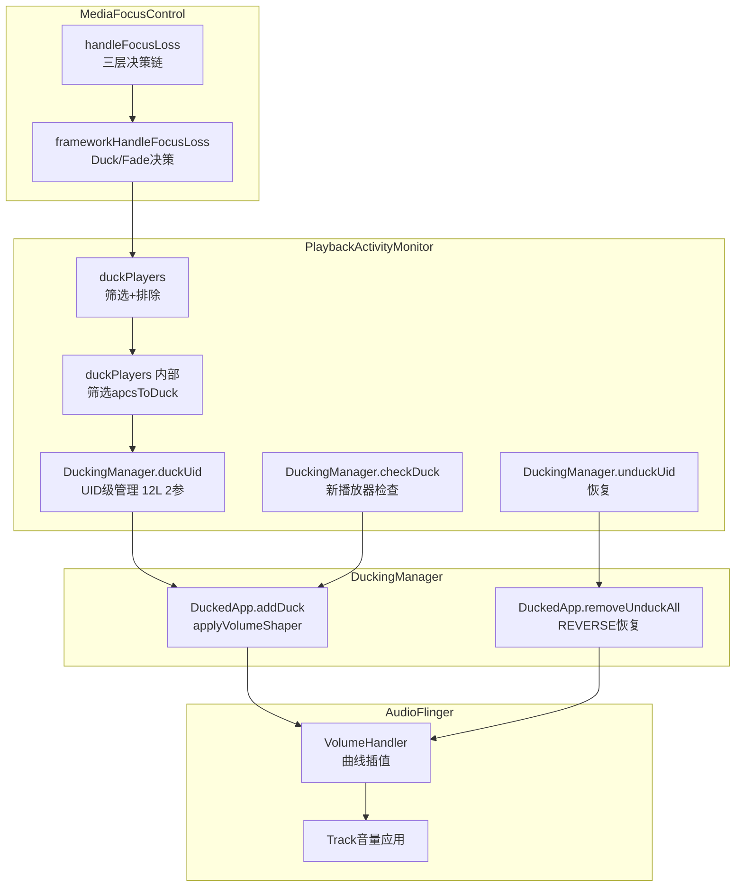
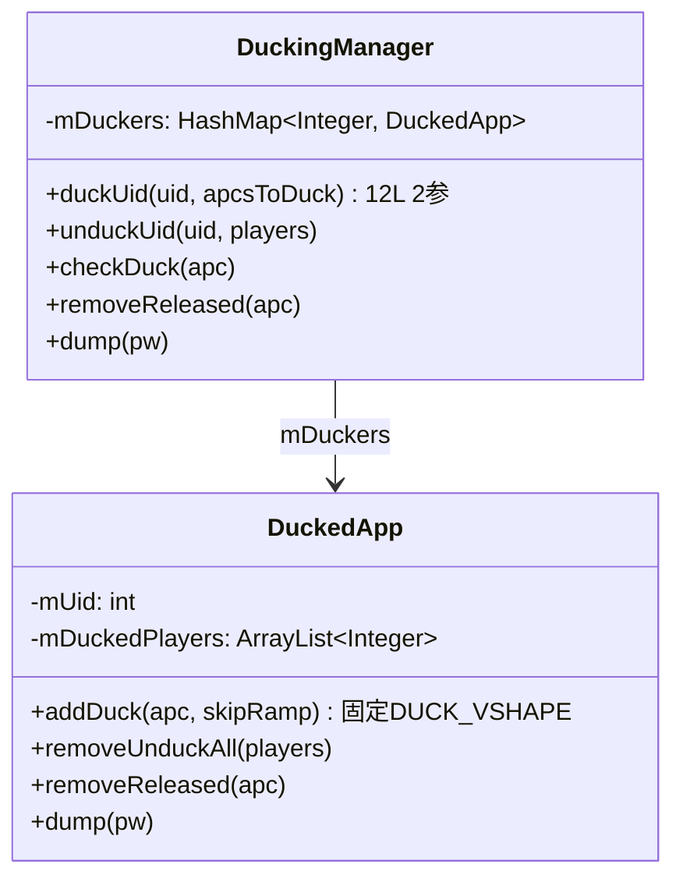
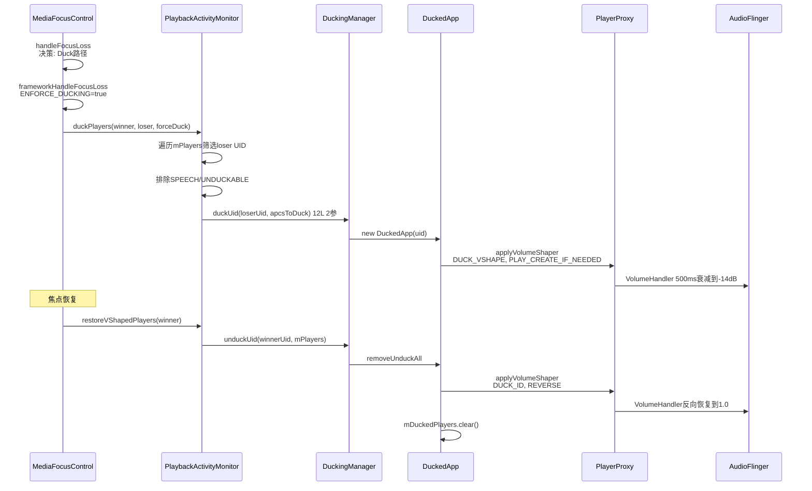

## 12.11 PlaybackActivityMonitor Duck执行深度

> [← 上一个](12_12.10_FadeOutManager深度解析.md) | [← 返回12章](README.md) | [返回导航](../README.md) | [下一个 →](12_12.12_FocusRequester内部机制.md)

---

Duck执行是框架级焦点执行的第一条路径（Duck/FadeOut/Mute），由PlaybackActivityMonitor(PAM)的duckPlayers方法和DuckingManager内部类协作完成。

> **版本边界（负结论，12L）**：本树 PlaybackActivityMonitor **只有一种 Duck 曲线**——`DUCK_VSHAPE`（PlaybackActivityMonitor.java:58-62，`{1.f, 0.2f}` ≈ -14dB，无曲线选择）；`duckUid` 为 2 参（`duckUid(int uid, ArrayList<AudioPlaybackConfiguration> apcsToDuck)` :863）。`STRONG_DUCK_VSHAPE(-35dB)`/`reqCausesStrongDuck()`/`mUseStrongDuck` 等**强 Duck 机制为 Android 14+**，本树 grep 无匹配——下文强 Duck 各节仅作版本对照，非本树实现。

### 12.11.1 Duck执行整体架构



### 12.11.2 DUCK_VSHAPE与STRONG_DUCK_VSHAPE（后者为 14+，本树无）

源码位置：[`DUCK_VSHAPE` :58](frameworks/base/services/core/java/com/android/server/audio/PlaybackActivityMonitor.java:58)（12L 实际行号）

```java
// PlaybackActivityMonitor.java:58-68（逐字摘录；duration 实际为 getFocusRampTimeMs 对
// USAGE_NOTIFICATION/MAY_DUCK 的返回值=500ms）
private static final VolumeShaper.Configuration DUCK_VSHAPE =
        new VolumeShaper.Configuration.Builder()
            .setId(VOLUME_SHAPER_SYSTEM_DUCK_ID)
            .setCurve(new float[] { 0.f, 1.f } /* times */,
                new float[] { 1.f, 0.2f } /* volumes */)
            .setOptionFlags(VolumeShaper.Configuration.OPTION_FLAG_CLOCK_TIME)
            .setDuration(MediaFocusControl.getFocusRampTimeMs(
                AudioManager.AUDIOFOCUS_GAIN_TRANSIENT_MAY_DUCK,
                new AudioAttributes.Builder().setUsage(AudioAttributes.USAGE_NOTIFICATION)
                        .build()))
            .build();
```

**STRONG_DUCK_VSHAPE**（-35dB 强Duck曲线，`VOLUME_SHAPER_SYSTEM_STRONG_DUCK_ID`）为 **14+ 机制，不在本树**（grep 无匹配），此处不提供伪摘录；参数对比表中其列仅作版本对照。

**两种Duck曲线参数对比：**

| 参数 | DUCK_VSHAPE | STRONG_DUCK_VSHAPE |
|------|-------------|---------------------|
| VolumeShaper ID | VOLUME_SHAPER_SYSTEM_DUCK_ID | VOLUME_SHAPER_SYSTEM_STRONG_DUCK_ID |
| 起始音量 | 1.0 | 1.0 |
| 目标音量 | 0.2 (-14dB) | 0.017783 (-35dB) |
| 曲线类型 | 线性两点 | 线性两点 |
| Duration | 500ms | 500ms |
| CLOCK_TIME | 是 | 是 |
| 触发条件 | 导航等GAIN_TRANSIENT_MAY_DUCK | USAGE_ASSISTANT获得焦点 |

**衰减量计算：**
- 0.2 = 20%音量 ≈ -14dB衰减：`20*log10(0.2) = -13.98dB`
- 0.017783 ≈ 1.78%音量 = -35dB衰减：`20*log10(0.017783) = -34.98dB`

### 12.11.3 duckPlayers源码解析

源码位置：[`duckPlayers` :571](frameworks/base/services/core/java/com/android/server/audio/PlaybackActivityMonitor.java:571)（12L 实际行号）

```java
// PlaybackActivityMonitor.java:571-618（逐字摘录）
public boolean duckPlayers(@NonNull FocusRequester winner, @NonNull FocusRequester loser,
                           boolean forceDuck) {
    synchronized (mPlayerLock) {
        if (mPlayers.isEmpty()) {
            return true;
        }
        // check if this UID needs to be ducked (return false if not), and gather list of
        // eligible players to duck
        final Iterator<AudioPlaybackConfiguration> apcIterator = mPlayers.values().iterator();
        final ArrayList<AudioPlaybackConfiguration> apcsToDuck =
                new ArrayList<AudioPlaybackConfiguration>();
        while (apcIterator.hasNext()) {
            final AudioPlaybackConfiguration apc = apcIterator.next();
            if (!winner.hasSameUid(apc.getClientUid())
                    && loser.hasSameUid(apc.getClientUid())
                    && apc.getPlayerState() == AudioPlaybackConfiguration.PLAYER_STATE_STARTED)
            {
                if (!forceDuck && (apc.getAudioAttributes().getContentType() ==
                        AudioAttributes.CONTENT_TYPE_SPEECH)) {
                    // the player is speaking, ducking will make the speech unintelligible
                    // so let the app handle it instead
                    Log.v(TAG, "not ducking player " + apc.getPlayerInterfaceId()
                            + " uid:" + apc.getClientUid() + " pid:" + apc.getClientPid()
                            + " - SPEECH");
                    return false;
                } else if (ArrayUtils.contains(UNDUCKABLE_PLAYER_TYPES, apc.getPlayerType())) {
                    Log.v(TAG, "not ducking player " + apc.getPlayerInterfaceId()
                            + " uid:" + apc.getClientUid() + " pid:" + apc.getClientPid()
                            + " due to type:"
                            + AudioPlaybackConfiguration.toLogFriendlyPlayerType(
                                    apc.getPlayerType()));
                    return false;
                }
                apcsToDuck.add(apc);
            }
        }
        // add the players eligible for ducking to the list, and duck them
        // (if apcsToDuck is empty, this will at least mark this uid as ducked, so when
        //  players of the same uid start, they will be ducked by DuckingManager.checkDuck())
        mDuckingManager.duckUid(loser.getClientUid(), apcsToDuck);
    }
    return true;
}
```

**关键行为差异：return false vs continue**

| 排除条件 | 处理方式 | 原因 |
|----------|----------|------|
| SPEECH内容 | **return false** | SPEECH不可duck是全局决策，整个duck操作取消 |
| UNDUCKABLE类型 | **return false** | 不可duck类型意味着框架无法执行duck |
| 不是loser UID | 跳过(不加入apcsToDuck) | 不是目标UID，无需duck |
| 不在播放状态 | 跳过 | 不在播放的播放器无需duck |

**return false的语义：** 框架无法执行duck，退回给App回调处理AUDIOFOCUS_LOSS

### 12.11.4 reqCausesStrongDuck强Duck判定（14+，本树无）

源码位置：`reqCausesStrongDuck` **不在本树**（14+ 方法；下为 14+ 机制示意，勿在本树查找）

```java
// 14+ 版本示意（非本树代码）：winner 为 MAY_DUCK + USAGE_ASSISTANT（语音助手）时判定强 Duck
private boolean reqCausesStrongDuck(FocusRequester requester) { ... }
```

| 焦点获得者 | 焦点类型 | Usage | 强Duck? |
|-----------|----------|-------|---------|
| 导航 | GAIN_TRANSIENT_MAY_DUCK | USAGE_ASSISTANCE_NAVIGATION_GUIDANCE | false(标准duck -14dB) |
| 助手 | GAIN_TRANSIENT_MAY_DUCK | USAGE_ASSISTANT | **true(强duck -35dB)** |
| 通知 | GAIN_TRANSIENT_MAY_DUCK | USAGE_NOTIFICATION | false |
| 通话 | GAIN_TRANSIENT | USAGE_VOICE_COMMUNICATION | N/A(不触发duck) |

### 12.11.5 forceDuck参数详解

| forceDuck值 | 来源 | 效果 |
|-------------|------|------|
| false(默认) | FocusRequester.frameworkHandleFocusLoss | SPEECH播放器排除，duckPlayers返回false |
| true | **无障碍场景**：AudioService.java:8089-8105，`USAGE_ASSISTANCE_ACCESSIBILITY` 且调用方持 `android.permission.CAN_REQUEST_AUDIO_FOCUS_FOR_ACCESSIBILITY`+`KEY_ACCESSIBILITY_FORCE_FOCUS_DUCKING`（MFC:867-869 javadoc "only true if … for accessibility"） | SPEECH播放器也强制duck |

**forceDuck=true场景：** 无障碍服务（如 TalkBack）请求焦点时强制 duck 语音内容，保证辅助提示可闻。

### 12.11.6 DuckingManager类结构



### 12.11.7 duckUid执行

源码位置：[`duckUid` :863](frameworks/base/services/core/java/com/android/server/audio/PlaybackActivityMonitor.java:863)（12L 实际行号）

```java
// PlaybackActivityMonitor.java:863-872（逐字摘录）
synchronized void duckUid(int uid, ArrayList<AudioPlaybackConfiguration> apcsToDuck) {
    if (DEBUG) {  Log.v(TAG, "DuckingManager: duckUid() uid:"+ uid); }
    if (!mDuckers.containsKey(uid)) {
        mDuckers.put(uid, new DuckedApp(uid));
    }
    final DuckedApp da = mDuckers.get(uid);
    for (AudioPlaybackConfiguration apc : apcsToDuck) {
        da.addDuck(apc, false /*skipRamp*/);
    }
}
```

**关键点：**
1. 12L 的 `duckUid` 为 **2 参**，`new DuckedApp(uid)` 单参（:915）——无强 Duck 标志传递（14+ 才有第 3 参与 `mUseStrongDuck`）
2. 已有DuckedApp时不重新创建
3. 即使apcsToDuck为空，也会创建DuckedApp(用于后续checkDuck覆盖新播放器)

### 12.11.8 DuckedApp.addDuck详解

源码位置：[`addDuck` :930](frameworks/base/services/core/java/com/android/server/audio/PlaybackActivityMonitor.java:930)（12L 实际行号）

```java
// PlaybackActivityMonitor.java:929-946（逐字摘录，省略 DEBUG 日志行）
void addDuck(@NonNull AudioPlaybackConfiguration apc, boolean skipRamp) {
    final int piid = new Integer(apc.getPlayerInterfaceId());
    if (mDuckedPlayers.contains(piid)) {
        return;
    }
    try {
        sEventLogger.log((new DuckEvent(apc, skipRamp)).printLog(TAG));
        apc.getPlayerProxy().applyVolumeShaper(
                DUCK_VSHAPE,
                skipRamp ? PLAY_SKIP_RAMP : PLAY_CREATE_IF_NEEDED);
        mDuckedPlayers.add(piid);
    } catch (Exception e) {
        Log.e(TAG, "Error ducking player piid:" + piid + " uid:" + mUid, e);
    }
}
```

**addDuck参数矩阵（12L：曲线固定 DUCK_VSHAPE，无 mUseStrongDuck 分支）：**

| skipRamp | VolumeShaper曲线 | VolumeShaper操作 | 效果 |
|----------|------------------|-----------------|------|
| false | DUCK_VSHAPE（固定） | PLAY_CREATE_IF_NEEDED | 500ms衰减到0.2(-14dB) |
| true | DUCK_VSHAPE（固定） | PLAY_SKIP_RAMP | 立即跳到0.2(-14dB) |

> -35dB 强 Duck（`mUseStrongDuck ? STRONG_DUCK_VSHAPE : DUCK_VSHAPE`）为 14+ 形态，本树无此分支。

### 12.11.9 unduckUid恢复

源码位置：[`unduckUid` :874](frameworks/base/services/core/java/com/android/server/audio/PlaybackActivityMonitor.java:874)（12L 实际行号）

```java
// PlaybackActivityMonitor.java:874-881（逐字摘录，省略 DEBUG 日志行）
synchronized void unduckUid(int uid, HashMap<Integer, AudioPlaybackConfiguration> players) {
    final DuckedApp da = mDuckers.remove(uid);
    if (da == null) {
        return;
    }
    da.removeUnduckAll(players);
}
```

### 12.11.10 DuckedApp.removeUnduckAll详解

源码位置：[`removeUnduckAll` :947](frameworks/base/services/core/java/com/android/server/audio/PlaybackActivityMonitor.java:947)（12L 实际行号）

```java
// PlaybackActivityMonitor.java:947-967（逐字摘录，省略 sEventLogger/Log 日志行）
void removeUnduckAll(HashMap<Integer, AudioPlaybackConfiguration> players) {
    for (int piid : mDuckedPlayers) {
        final AudioPlaybackConfiguration apc = players.get(piid);
        if (apc != null) {
            try {
                apc.getPlayerProxy().applyVolumeShaper(
                        DUCK_ID,
                        VolumeShaper.Operation.REVERSE);
            } catch (Exception e) {
                Log.e(TAG, "Error unducking player piid:" + piid + " uid:" + mUid, e);
            }
        } else {
            Log.w(TAG, "cannot unduck player piid:" + piid
                    + ", player is not found");
        }
    }
    mDuckedPlayers.clear();
}
```

**恢复机制关键点：**

| 要点 | 说明 |
|------|------|
| REVERSE操作 | 反向执行duck曲线，从0.2恢复到1.0 |
| 固定使用 DUCK_ID（:71） | 12L 无 `mUseStrongDuck ? STRONG_DUCK_ID : DUCK_ID` 分支（14+ 形态） |
| 播放器可能已消失 | apc==null时 Log.w 跳过，不报错 |
| clear清空记录 | unduck后mDuckedPlayers为空 |

### 12.11.11 checkDuck新播放器覆盖

源码位置：[`checkDuck` :884](frameworks/base/services/core/java/com/android/server/audio/PlaybackActivityMonitor.java:884)（12L 实际行号）

```java
// PlaybackActivityMonitor.java:884-892（逐字摘录，省略 DEBUG 日志行）
synchronized void checkDuck(@NonNull AudioPlaybackConfiguration apc) {
    final DuckedApp da = mDuckers.get(apc.getClientUid());
    if (da == null) {
        return;
    }
    da.addDuck(apc, true /*skipRamp*/);
}
```

**checkFade vs checkDuck对比：**

| 方法 | skipRamp | 效果 | 调用时机 |
|------|----------|------|----------|
| checkDuck | true | 立即跳到目标音量 | 新播放器PLAYER_STATE_STARTED |
| checkFade | true | 立即跳到静音 | 新播放器PLAYER_STATE_STARTED |

### 12.11.12 UNDUCKABLE_PLAYER_TYPES

源码位置：[`UNDUCKABLE_PLAYER_TYPES` :77](frameworks/base/services/core/java/com/android/server/audio/PlaybackActivityMonitor.java:77)（12L 实际行号）

```java
// PlaybackActivityMonitor.java:77-80（逐字摘录）
private static final int[] UNDUCKABLE_PLAYER_TYPES = {
    AudioPlaybackConfiguration.PLAYER_TYPE_AAUDIO,
    AudioPlaybackConfiguration.PLAYER_TYPE_JAM_SOUNDPOOL,
};
```

| 播放器类型 | 原因 |
|-----------|------|
| PLAYER_TYPE_AAUDIO | AAudio低延迟路径不支持VolumeShaper |
| PLAYER_TYPE_JAM_SOUNDPOOL | SoundPool短音效不适合duck |

### 12.11.13 restoreVShapedPlayers恢复入口

源码位置：[`restoreVShapedPlayers` :620](frameworks/base/services/core/java/com/android/server/audio/PlaybackActivityMonitor.java:620)（12L 实际行号）

```java
// PlaybackActivityMonitor.java:618-624（逐字摘录）
@Override
public void restoreVShapedPlayers(@NonNull FocusRequester winner) {
    if (DEBUG) { Log.v(TAG, "unduckPlayers: uids winner=" + winner.getClientUid()); }
    synchronized (mPlayerLock) {
        mDuckingManager.unduckUid(winner.getClientUid(), mPlayers);
        mFadingManager.unfadeOutUid(winner.getClientUid(), mPlayers);
    }
}
```

**恢复为什么用 winner 的 UID？** 因为恢复场景中"重新获得焦点的 App"就是**之前被 duck 的同一个 App**（duck 的 key 是 loser UID，PAM:615；unduck 用的是重新入栈的同一 App 的 UID，:623）——它此前丢焦点被 duck，现在又拿回焦点，UID 一致所以能命中。恢复入口是 `handleFocusGain()`（FocusRequester.java:354）在 GAIN 派发时调用的 `mFocusController.restoreVShapedPlayers(this)`。

### 12.11.14 Duck完整执行时序



### 12.11.15 Duck与FadeOut执行路径对比

| 维度 | Duck | FadeOut |
|------|------|---------|
| 入口方法 | duckPlayers | fadeOutPlayers |
| 管理器 | DuckingManager | FadeOutManager |
| 内部类 | DuckedApp | FadedOutApp |
| 曲线选择 | DUCK_VSHAPE（12L 固定；STRONG_DUCK_VSHAPE 为 14+） | FADEOUT_VSHAPE |
| 目标音量 | 0.2(-14dB)（-35dB 强Duck 为 14+，不在本树） | 0.0(静音) |
| 曲线时长 | 500ms | 2000ms |
| 恢复操作 | REVERSE | REVERSE |
| 强模式 | 强Duck(-35dB)为 14+，本树无 | 无强模式 |
| Limbo态 | 无 | 有(2s延迟LOSS) |
| SPEECH排除 | forceDuck=false时排除 | requester=SPEECH时排除 |
| UNDUCKABLE/UNFADEABLE | AAUDIO/SoundPool | AAUDIO/SoundPool |

### 12.11.16 边界条件

| 条件 | Duck行为 |
|------|----------|
| loser无活跃播放器 | apcsToDuck为空，仍创建DuckedApp供checkDuck使用 |
| loser是SPEECH内容 | duckPlayers返回false，退回App回调 |
| loser是UNDUCKABLE类型 | duckPlayers返回false，退回App回调 |
| forceDuck=true + SPEECH | 强制duck，SPEECH也被衰减 |
| winner是ASSISTANT | 12L 与普通请求同样使用 DUCK_VSHAPE（强Duck 判定为 14+，本树无） |
| 同一UID多次duck | 保留第一次DuckedApp，不重新创建 |
| 播放器在duck期间释放 | removeReleased移除piid，unduck时跳过 |
| 新播放器在duck期间启动 | checkDuck立即duck(skipRamp=true) |

---

[← 上一个](12_12.10_FadeOutManager深度解析.md) | [← 返回12章](README.md) | [返回导航](../README.md) | [下一个 →](12_12.12_FocusRequester内部机制.md)