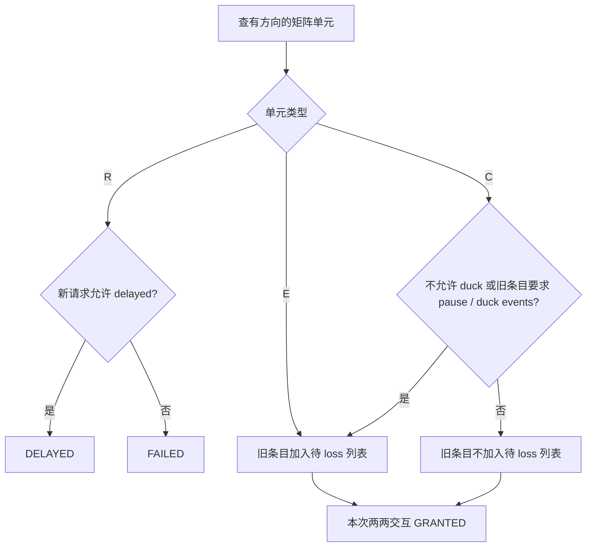

# 12.6 AAOS 焦点交互矩阵：方向、请求类型与并发条件

> 依据本地 Android 12L/API 32 的 FocusInteraction.java。矩阵是车载区域内焦点评估的一部分，不是按优先级排序的设备音量表，也不是硬件 ducking 参数表。

前置：[9.4 CarAudioFocus](../09_AAOS_Car_Audio/09_9.4_CarAudioFocus-车载焦点管理.md)。本篇专讲矩阵如何读、条件如何改变结果；holders/losers/blockers 和完整生命周期由 9.4 负责。

## 1. 先固定行列方向

**行是已有焦点条目的 Context，列是新请求的 Context。** 本地访问方式为 `holderRow[requestedContext]`；交换行列得到的结果不一定相同。

- R = INTERACTION_REJECT：通常拒绝；满足 delayed 条件时可以返回 DELAYED。
- E = INTERACTION_EXCLUSIVE：允许新请求，并将旧条目加入待失焦集合。
- C = INTERACTION_CONCURRENT：允许新请求；旧条目是否不收 loss，还取决于请求类型和 flags。

矩阵值不是 AUDIOFOCUS_GAIN/LOSS 枚举；先得到交互结果，再由 CarAudioFocus 确定具体 loss 与集合变化。

## 2. 本地完整默认矩阵

下表从本地 sInteractionMatrix 整理，含 INVALID 行列。正常有效配置使用 MUSIC～ANNOUNCEMENT；保留 INVALID 用于说明实现边界，不建议把它配置为普通音频用途。

| 已有 / 新来 | INVALID | MUSIC | NAVIGATION | VOICE_COMMAND | CALL_RING | CALL | ALARM | NOTIFICATION | SYSTEM_SOUND | EMERGENCY | SAFETY | VEHICLE_STATUS | ANNOUNCEMENT |
|---|---|---|---|---|---|---|---|---|---|---|---|---|---|
| INVALID | R | R | R | R | R | R | R | R | R | E | E | R | R |
| MUSIC | R | E | C | E | E | E | E | C | C | E | C | C | E |
| NAVIGATION | R | C | C | E | C | E | C | C | C | E | C | C | C |
| VOICE_COMMAND | R | C | R | C | E | E | R | R | R | E | C | C | R |
| CALL_RING | R | R | C | C | C | C | R | R | C | E | C | C | R |
| CALL | R | R | C | R | C | C | C | C | R | C | C | C | R |
| ALARM | R | C | C | E | E | E | C | C | C | E | C | C | R |
| NOTIFICATION | R | C | C | E | E | E | C | C | C | E | C | C | C |
| SYSTEM_SOUND | R | C | C | E | E | E | C | C | C | E | C | C | C |
| EMERGENCY | R | R | R | R | R | C | R | R | R | C | C | R | R |
| SAFETY | R | C | C | C | C | C | C | C | C | C | C | C | C |
| VEHICLE_STATUS | R | C | C | C | C | C | C | C | C | E | C | C | C |
| ANNOUNCEMENT | R | E | C | E | E | E | E | C | C | E | C | C | E |

这是默认矩阵；“通话时拒绝导航”用户设置可修改 CALL 行、NAVIGATION 列的一项。每区 FocusInteraction 持有矩阵副本，而不是共同改写所有区域的静态表。

## 3. C 不代表旧请求永远不收到 loss

关键原文：

```java
if (!allowDucking
        || focusHolder.wantsPauseInsteadOfDucking()
        || focusHolder.receivesDuckEvents()) {
    focusLosers.add(focusHolder);
}
return AudioManager.AUDIOFOCUS_REQUEST_GRANTED;
```

三个条件中任一成立，就把旧条目放进调用者提供的待处理列表：

1. 新请求不是 GAIN_TRANSIENT_MAY_DUCK，`allowDucking=false`。
2. 旧请求设置 PAUSES_ON_DUCKABLE_LOSS，希望 pause 而不是被 duck。
3. 旧请求在 bundle 中要求接收 duck events，且拥有 RECEIVE_CAR_AUDIO_DUCKING_EVENTS 权限。

第三点不只是“包有权限”就成立；FocusEntry 同时检查属性开关与权限。



CarAudioFocus 还要扫描其他 holders 和 losers。因此一个单元 GRANTED 不是整个请求一定 GRANTED；某个其他条目可能拒绝或导致延迟。

## 4. 用实际场景读矩阵

### 4.1 音乐已持有，导航新来

MUSIC→NAVIGATION 为 C。

- 导航用 MAY_DUCK，音乐不要求 pause/duck events：音乐不进入待 loss 列表，焦点可并存。
- 音乐要求 pause：音乐会收到相应 transient loss，不能说“导航永远只降低音乐音量”。
- 导航不用 MAY_DUCK：allowDucking=false，也会把音乐加入待 loss 列表。

保持焦点并存时，CarDucking 可另根据持焦点 contexts 生成设备地址级 duck 通知。矩阵本身没有衰减 dB、斜坡或 PCM 操作。

### 4.2 语音命令与音乐：顺序不同

MUSIC→VOICE_COMMAND 为 E，而 VOICE_COMMAND→MUSIC 为 C。这个方向性说明它不是一张只看“谁等级高”的对称表。

后一种 C 仍需结合新音乐请求的 gain 类型。若是永久 GAIN，不允许 duck，旧条目会进入待 loss 列表；不能单看 C 宣称二者一定同时持有。

### 4.3 通话期间音乐请求

CALL→MUSIC 为 R。若音乐是永久 GAIN、带 DELAY_OK，且本区 delayed 功能开启，交互可以得到 DELAYED；否则 FAILED。

延迟机制在 CarAudioFocus 中只有一个槽，还涉及旧请求替换和后续重评估，不是矩阵自己维护队列。

### 4.4 通话与导航的用户选项

默认 CALL→NAVIGATION 为 C。修改原文：

```java
mInteractionMatrix[CarAudioContext.CALL][CarAudioContext.NAVIGATION] =
        navigationRejectedWithCall ? INTERACTION_REJECT :
        sInteractionMatrix[CarAudioContext.CALL][CarAudioContext.NAVIGATION];
```

这是修改单个方向的单元，不改变 NAVIGATION→CALL。FocusInteraction 通过用户设置与 ContentObserver 更新它；切换用户时注销旧 observer，读取新用户设置，USER_NULL 时恢复默认。

### 4.5 EMERGENCY 与 SAFETY 不能概括为“强制独占全部”

EMERGENCY 已持有时，对 CALL、EMERGENCY、SAFETY 为 C，其他多数新请求为 R。新 EMERGENCY 遇到 CALL 时默认也是 C，而不是全部 E。

SAFETY 与有效 contexts 的默认交互普遍为 C，仍需应用 allowDucking/pause 等条件。另一方面，focus restriction 对 critical contexts 的特殊处理属于 CarAudioFocus 的前置限制，不是把矩阵所有单元改成安全音优先。

## 5. 矩阵之外还有什么

| 条件 | 所在位置 | 作用 |
|---|---|---|
| 区域选择 | CarZonesAudioFocus | 决定使用哪一组焦点状态与矩阵 |
| restricted | CarAudioFocus | 拒绝/清理非 critical 请求 |
| 同 clientId 跨 Context | CarAudioFocus | 拒绝含糊复用；同 Context 可替换 |
| TRANSIENT_EXCLUSIVE 遇 NOTIFICATION | CarAudioFocus | 特殊拒绝条件，不完全由矩阵表达 |
| 多个 blockers | FocusEntry / CarAudioFocus | 决定暂失条目何时可恢复 |
| 音频设备 duck/mute | CarDucking / CarVolumeGroupMuting / AudioControl | 地址级控制，不改变矩阵单元 |
| 实际暂停、播放、声压 | 播放器及音频下游 | 不能从焦点成功直接推导 |

本地矩阵定义在 Java 源码中，不存在本页可以推荐的任意 `CarAudioPolicyConfiguration` XML 矩阵配置接口。车载 XML 负责 Context→设备等映射，不等于直接编辑焦点策略表。

## 7. 阅读入口

- [9.4 CarAudioFocus](../09_AAOS_Car_Audio/09_9.4_CarAudioFocus-车载焦点管理.md)：两张 Map、blockers、delayed 与回调失败。
- [9.10 区域分发](../09_AAOS_Car_Audio/09_9.10_CarZonesAudioFocus-多Zone焦点分发器.md)：UID/用户默认区域与 bundle 覆盖。
- [10.1 AudioControl](../10_AudioControl_HAL/10_10.1_AudioControl_HAL总览.md)：控制消息与实际硬件效果的边界。

源码相对 `Android/lagvm/LINUX/android/`：`packages/services/Car/service/src/com/android/car/audio/FocusInteraction.java`、`packages/services/Car/service/src/com/android/car/audio/FocusEntry.java`。本页表格按源码核对，没有执行实机并发/duck 场景。
