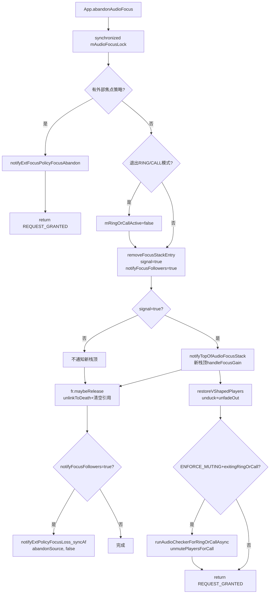

## 12.7 abandonAudioFocus()流程

> [← 上一个](12_12.6_AAOS焦点交互矩阵.md) | [← 返回12章](README.md) | [返回导航](../README.md) | [下一个 →](12_12.8_Audio_Focus全栈调用链.md)

---

[`abandonAudioFocus()`](frameworks/base/services/core/java/com/android/server/audio/MediaFocusControl.java:1058)是焦点释放的核心方法，从栈中移除请求者、通知栈顶恢复焦点、处理通话模式退出。

### 12.7.1 完整流程架构图



### 12.7.2 源码解析（:1057-1112）

```java
// MediaFocusControl.java:1069-1112（逐字摘录，仅省略方法开头的 MediaMetrics/EventLogger 两段）
try {
    // this will take care of notifying the new focus owner if needed
    synchronized(mAudioFocusLock) {
        // external focus policy?
        if (mFocusPolicy != null) {
            final AudioFocusInfo afi = new AudioFocusInfo(aa, Binder.getCallingUid(),
                    clientId, callingPackageName, 0 /*gainRequest*/, 0 /*lossReceived*/,
                    0 /*flags*/, 0 /* sdk n/a here*/);
            if (notifyExtFocusPolicyFocusAbandon_syncAf(afi)) {
                return AudioManager.AUDIOFOCUS_REQUEST_GRANTED;
            }
        }

        boolean exitingRingOrCall = mRingOrCallActive
                & (AudioSystem.IN_VOICE_COMM_FOCUS_ID.compareTo(clientId) == 0);
        if (exitingRingOrCall) { mRingOrCallActive = false; }

        removeFocusStackEntry(clientId, true /*signal*/, true /*notifyFocusFollowers*/);

        if (ENFORCE_MUTING_FOR_RING_OR_CALL & exitingRingOrCall) {
            runAudioCheckerForRingOrCallAsync(false/*enteringRingOrCall*/);
        }
    }
} catch (java.util.ConcurrentModificationException cme) {
    // Catching this exception here is temporary. It is here just to prevent
    // a crash seen when the "Silent" notification is played. This is believed to be fixed
    // but this try catch block is left just to be safe.
    Log.e(TAG, "FATAL EXCEPTION AudioFocus  abandonAudioFocus() caused " + cme);
    cme.printStackTrace();
}

return AudioManager.AUDIOFOCUS_REQUEST_GRANTED;
```

### 12.7.3 abandonAudioFocus vs requestAudioFocus的removeFocusStackEntry差异

两个方法都调用`removeFocusStackEntry()`，但参数不同：

| 调用者 | signal | notifyFocusFollowers | 含义（:314-341 实参语义） |
|--------|--------|---------------------|------|
| abandonAudioFocus | true | true | `signal=true`→移除后**通知新栈顶 GAIN**（notifyTopOfAudioFocusStack）；`notifyFocusFollowers=true`→`notifyExtPolicyFocusLoss_syncAf(abandonSource, false)` 通知外部策略"一次 Loss" |
| requestAudioFocus(阶段8) | false | false | 不通知栈顶 + 不通知外部策略 |
| propagateFocusLossFromGain | false | true | 不通知栈顶 + 通知外部策略 |

**勘误（12L 实况）**：`signal=true` 是"通知**新栈顶**获得焦点"，**不是**向被移除 App 派发 LOSS——abandon 全程不对被放弃的客户端做 `dispatchFocusChange`（放弃即沉默，App 自己知道自己放弃了）；`notifyFocusFollowers=true` 是通知**外部焦点策略**（audio focus followers）一次 Loss 事件。

### 12.7.4 退出RING/CALL模式的特殊处理

当`IN_VOICE_COMM_FOCUS_ID`的请求者abandon时：

1. **mRingOrCallActive=false**：标记通话/铃声模式结束
2. **unmutePlayersForCall()**：恢复被静音的MEDIA/GAME播放器
3. **异步执行**：`runAudioCheckerForRingOrCallAsync(false)`在新线程中执行unmute

### 12.7.5 栈顶恢复流程

`removeFocusStackEntry()`移除条目后，`signal=true`触发`notifyTopOfAudioFocusStack()`（`notifyFocusFollowers=true` 走外部策略通知，见 12.7.3 勘误）：

```java
// MediaFocusControl.java:225-240（逐字摘录）
private void notifyTopOfAudioFocusStack() {
    // notify the top of the stack it gained focus
    if (!mFocusStack.empty()) {
        if (canReassignAudioFocus()) {
            mFocusStack.peek().handleFocusGain(AudioManager.AUDIOFOCUS_GAIN);
        }
    }

    if (mMultiAudioFocusEnabled && !mMultiAudioFocusList.isEmpty()) {
        for (FocusRequester multifr : mMultiAudioFocusList) {
            if (isLockedFocusOwner(multifr)) {
                multifr.handleFocusGain(AudioManager.AUDIOFOCUS_GAIN);
            }
        }
    }
}
```

**恢复条件**：`canReassignAudioFocus()`检查无锁定焦点持有者时才恢复栈顶。如果有锁定持有者，栈顶不获得GAIN。

### 12.7.6 handleFocusGain()恢复详解

栈顶的`handleFocusGain()`执行三个关键操作：

1. **重置状态**：`mFocusLossReceived=NONE`, `mFocusLossFadeLimbo=false`
2. **条件派发GAIN**：仅当`mFocusLossWasNotified=true`时派发GAIN给App
3. **音量恢复**：`restoreVShapedPlayers()`→unduckUid+unfadeOutUid

### 12.7.7 多焦点列表中的abandon

abandonAudioFocus不直接操作`mMultiAudioFocusList`。多焦点列表的条目通过`removeFocusStackEntry()`间接移除（如果clientId在栈中），或通过`updateMultiAudioFocus()`禁用时批量清理。

### 12.7.8 外部策略的abandon

当`mFocusPolicy`存在时，abandon通过`notifyExtFocusPolicyFocusAbandon_syncAf()`通知外部策略，由外部策略决定后续焦点分配。标准Android流程不再执行。

### 12.7.9 ConcurrentModificationException防护

:1096-1101 的 catch 捕获`ConcurrentModificationException`，这是历史遗留的防护措施，防止"Silent"通知播放时的栈并发修改崩溃。

---

[← 上一个](12_12.6_AAOS焦点交互矩阵.md) | [← 返回12章](README.md) | [返回导航](../README.md) | [下一个 →](12_12.8_Audio_Focus全栈调用链.md)