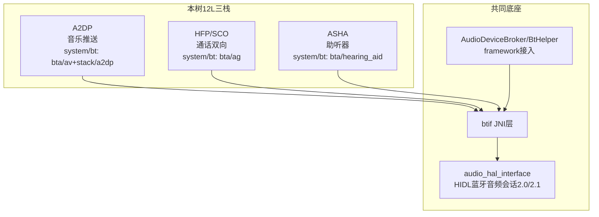

## 14.11 蓝牙音频对比总结（本树 12L：A2DP / HFP-SCO / ASHA 三栈可用；LE Audio 早期未完成）

[← 上一个](14_14.10_LE_Audio与Classic_Bluetooth共存策略.md) | [← 返回14章](README.md) | [返回导航](../README.md)

---

### 14.11.1 本树可用的蓝牙音频协议总览

本树（12L）蓝牙音频 = **A2DP（音乐）+ HFP/SCO（通话）+ ASHA（助听器）**。LE Audio 在 12L 为早期未完成实现（LeAudioService 等 Java 服务在 packages/apps/Bluetooth，但无 liblc3、无 native 状态机、无 BtHelper 集成，不可用）；完整栈为 Android 13+，Broadcast/BASS 为 14+（见 [14.3](14_14.3_LE_Audio-低功耗蓝牙音频.md)/[14.7](14_14.7_LE_Audio_Profile深度解析.md)/[14.8](14_14.8_LC3编码参数与配置.md)/[14.9](14_14.9_LE_Audio广播音频Broadcast_Audio.md)）。

### 14.11.2 核心参数对比（12L）

| 维度 | A2DP | HFP/SCO | ASHA |
|------|------|---------|------|
| **传输** | Classic BT ACL | Classic BT SCO | BLE GATT |
| **编解码器** | SBC/AAC/aptX（栈内协商） | CVSD/mSBC | G.722 |
| **AudioSystem设备** | DEVICE_OUT_BLUETOOTH_A2DP | DEVICE_OUT/IN_BLUETOOTH_SCO | DEVICE_OUT_HEARING_AID |
| **音量通道** | AVRCP绝对音量0-127 | 混音内音量（无绝对音量） | dB 增益（BT_HEARING_AID_GAIN_MIN..0 dB） |
| **Suspend** | A2dpSuspended参数（恢复写，BtHelper.java:446） | SCO状态机 | 无 |
| **HAL数据路径** | audio_a2dp_hw / audio_bluetooth_hw（HIDL会话） | HAL外（SCO走 modem/audio HAL 协同） | HEARING_AID_SOFTWARE_ENCODING_DATAPATH（软件编码） |

### 14.11.3 Framework接入对比（12L）

| 组件 | A2DP | HFP/SCO | ASHA |
|------|------|---------|------|
| **BtHelper代理** | mA2dp（BluetoothA2dp） | mBluetoothHeadset | mHearingAid（BluetoothHearingAid） |
| **连接回调** | onA2dpProfileConnected（:457） | onHeadsetProfileConnected（:501） | onHearingAidProfileConnected（:483） |
| **Broker投递** | postA2dpSourceConnection（:896） | setBluetoothScoOn（:650） | postBluetoothHearingAidDeviceConnectionState（:636） |
| **Codec查询** | getA2dpCodec→bluetoothCodecToAudioFormat（BtHelper.java:277） | N/A（固定CVSD/mSBC） | N/A（固定G.722） |
| **音量设置** | setAvrcpAbsoluteVolumeIndex（:256） | 无专设 | setHearingAidVolume(index, streamType)（:400，dB 通道，见14.5） |

> 注：13+ 的 `setA2dpSuspended()`/`setLeAudioSuspended()`/`mLeAudio` 等不在本树；`LeAudioStateMachine` 在本树为 12L 早期实现（packages/apps/Bluetooth，见 14.3）。

### 14.11.4 音量模型对比（12L）

| 协议 | 音量范围 | 控制方式 | 12L方法 |
|------|----------|----------|---------|
| A2DP | 0-127 | AVRCP绝对音量 | BtHelper.setAvrcpAbsoluteVolumeIndex（:256） |
| HFP | 无独立绝对音量 | stream音量即可 | - |
| ASHA | dB 增益 | setHearingAidVolume（:400） | index/10→getStreamVolumeDB→gainDB 钳位→mHearingAid.setVolume(gainDB) |

音量消息投递（12L AudioDeviceBroker）：`postSetAvrcpAbsoluteVolumeIndex()`（:684）与 `postSetHearingAidVolumeIndex()`（:688）均为 REPLACE 策略（只保留最新值）；13+ 的 `postSetLeAudioVolumeIndex` 不存在。

### 14.11.5 状态机对比（12L）

| 协议 | 状态机位置（12L） | 说明 |
|------|------------------|------|
| A2DP | system/bt `btif_av`（idle/opened/started）+ `bta_av` 事件 + Java `A2dpStateMachine`（packages/apps/Bluetooth/src/com/android/bluetooth/a2dp/，本树存在） |
| HFP/SCO | BtHelper `mScoAudioState`（SCO_STATE_* 常量族） | 12L SCO状态机在framework侧 |
| ASHA | system/bt `bta/hearing_aid` + btif_hearing_aid.cc + Java `HearingAidStateMachine`（packages/apps/Bluetooth/src/com/android/bluetooth/hearingaid/，本树存在） |
| LE Audio | 无 | 13+ |

### 14.11.6 设备组管理对比（12L）

| 协议 | 组机制 | 12L载体 |
|------|--------|---------|
| A2DP | 无组管理（单Active设备） | - |
| HFP | 无组管理 | - |
| ASHA | HiSyncId组（Bluetooth 侧概念） | Audio 层投递无 HiSyncId 参数（:907 签名为 (state, device, delay)；主投递 :636） |
| LE Audio | CSIP设备组（SIRK） | 不存在（13+） |

### 14.11.7 AAOS车载场景选择（12L可用项）

| 场景 | 可用协议 | AudioDevice |
|------|----------|-------------|
| 驾驶员手机音乐 | A2DP | DEVICE_OUT_BLUETOOTH_A2DP |
| 驾驶员手机通话 | HFP SCO | DEVICE_OUT_BLUETOOTH_SCO |
| 助听器接入 | ASHA | DEVICE_OUT_HEARING_AID |
| 紧急通话 | HFP SCO（最高互斥优先级） | DEVICE_OUT_BLUETOOTH_SCO |
| （全车广播通知/多语言导游） | 不存在 | LE Audio Broadcast=Android 14，见[14.9](14_14.9_LE_Audio广播音频Broadcast_Audio.md) |

### 14.11.8 演进脉络（版本限定，非本树主线）

本表仅作演进脉络参考；本知识库主线为 12L/API 32。

| 版本 | 蓝牙音频要点 |
|------|-------------|
| ≤12L（本树） | A2DP(SBC/AAC/aptX) + HFP(CVSD/mSBC) + ASHA(G.722)；HIDL蓝牙音频2.0/2.1 |
| Android 13 | LE Audio 完整 Unicast（LeAudioCodecConfig+LC3+bta/le_audio）、packages/modules/Bluetooth mainline化、broker Suspend状态机（12L 仅有 LeAudioService 雏形与 A2dpSuspended 参数三写入点） |
| Android 14 | LE Audio Broadcast（Auracast/BASS）、AIDL audio IBluetooth*、SCO/HFP AIDL配置 |

### 14.11.9 全局调试命令（12L有效项）

| 命令 | 说明 |
|------|------|
| `dumpsys audio | grep -i bluetooth` | AudioService侧蓝牙设备状态 |
| `dumpsys audio | grep -i sco` | SCO状态（mScoAudioState） |
| `dumpsys bluetooth_manager` | BT Profile连接状态（蓝牙进程侧） |
| `logcat -s AS.AudioDeviceBroker AS.BtHelper` | framework层蓝牙日志 |

---

[← 上一个](14_14.10_LE_Audio与Classic_Bluetooth共存策略.md) | [← 返回14章](README.md) | [返回导航](../README.md)
