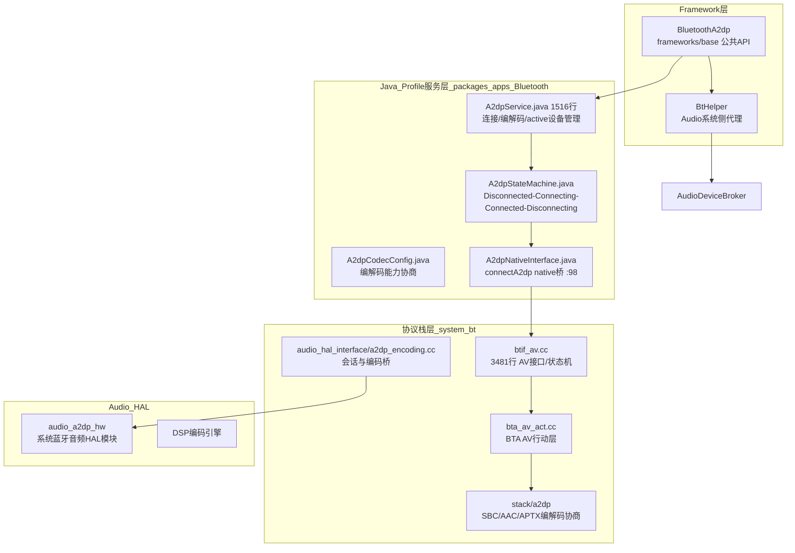
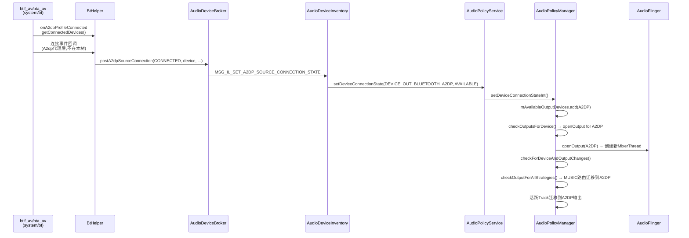
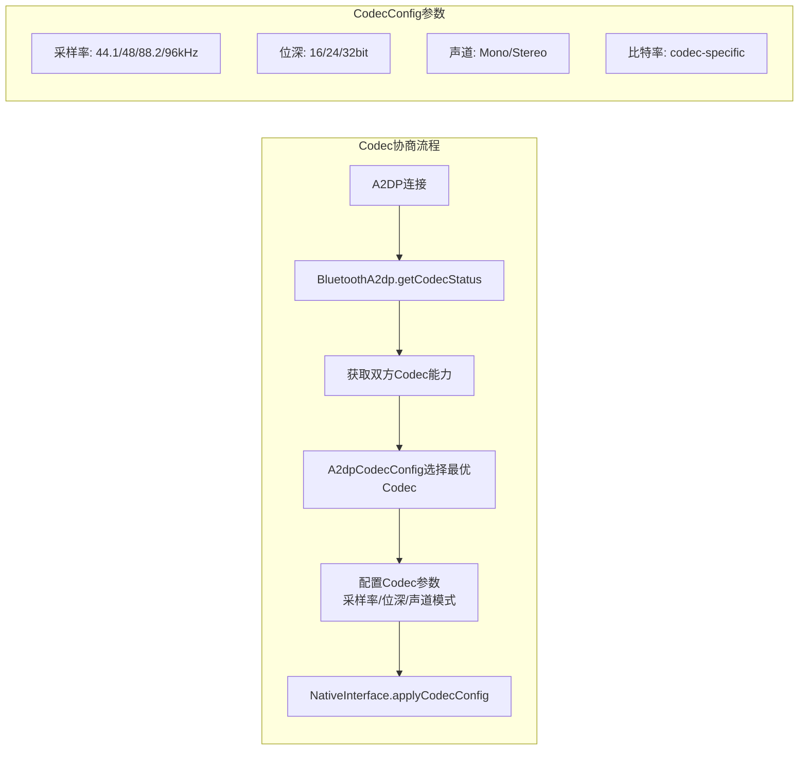
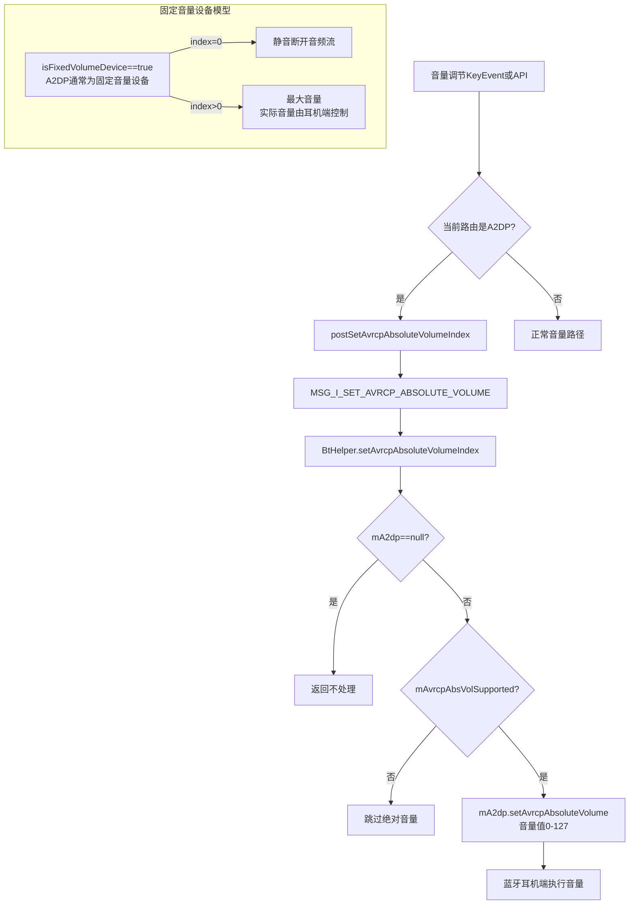
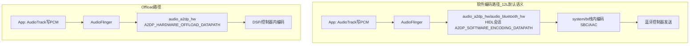
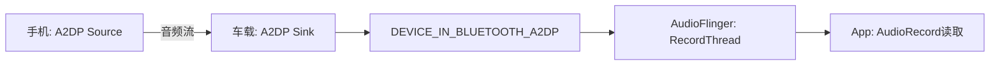

## 14.2 A2DP — 高级音频分发协议

[← 上一个](14_14.1_蓝牙音频协议总览.md) | [← 返回14章](README.md) | [返回导航](../README.md) | [下一个 →](14_14.3_LE_Audio-低功耗蓝牙音频.md)

---

### 14.2.1 A2DP服务架构

A2DP(Advanced Audio Distribution Profile)是蓝牙高质量音频传输的经典协议。

> **树边界（更正）**：本树 A2DP 的 Java Profile 服务**存在**，位于经典蓝牙应用 [`packages/apps/Bluetooth`](packages/apps/Bluetooth/src/com/android/bluetooth/a2dp/A2dpService.java)（`A2dpService`/`A2dpStateMachine`/`A2dpCodecConfig`/`A2dpNativeInterface`）；原稿将它们标注为 `packages/modules/Bluetooth` 路径属于版本错位——**不在本树的是** mainline 蓝牙模块 `packages/modules/Bluetooth`（Android 13 起取代经典蓝牙应用）与 AIDL `IBluetoothA2dp`（Android 14 audio AIDL offload）。本树的 A2DP 由四层构成：



**A2dpService 关键成员**（[`packages/apps/Bluetooth/src/com/android/bluetooth/a2dp/A2dpService.java`](packages/apps/Bluetooth/src/com/android/bluetooth/a2dp/A2dpService.java)，12L 实测行号）：

| 成员 | 行号 | 说明 |
|------|------|------|
| `sA2dpService` | :70 | 静态单例 |
| `mStateMachines: ConcurrentMap<BluetoothDevice, A2dpStateMachine>` | :86 | 每设备状态机表 |
| `mActiveDevice` + `mActiveSwitchingGuard` | :84/:89 | active 设备与切换串行保护 |
| `MAX_A2DP_STATE_MACHINES = 50` | :92 | Bonded 或 Connected 设备上限 |
| `mMaxConnectedAudioDevices` | :94 | Connected/Connecting 上限（默认 1，`getMaxConnectedAudioDevices()` 填充） |
| `mA2dpOffloadEnabled` | :96 | 平台 offload 开关（`mAdapterService.isA2dpOffloadEnabled()` :148） |

framework 侧公共 API 为 [`BluetoothA2dp`](frameworks/base/core/java/android/bluetooth/BluetoothA2dp.java)（连接状态/active设备/codec setter 经 binder 到蓝牙进程）；Audio 侧入口是 `BtHelper.onA2dpProfileConnected()`（BtHelper.java:457，获取 `BluetoothA2dp` 代理后查询已连接设备）。

### 14.2.2 A2DP 连接状态机

**Java 层**（[`A2dpStateMachine.java`](packages/apps/Bluetooth/src/com/android/bluetooth/a2dp/A2dpStateMachine.java)）为四态状态机：`Disconnected`/`Connecting`/`Connected`/`Disconnecting`（:87-90 四个状态对象），消息 `CONNECT=1`/`DISCONNECT=2`（:77-78）与 `CONNECT_TIMEOUT=201`（:81，`sendMessageDelayed(CONNECT_TIMEOUT, sConnectTimeoutMs)` :270 超时重试）。native 桥 [`A2dpNativeInterface.connectA2dp()`](packages/apps/Bluetooth/src/com/android/bluetooth/a2dp/A2dpNativeInterface.java:98) → `connectA2dpNative()`。

**协议栈层**由 `system/bt` 原生状态机承接（btif/bta 分层）：

- [`btif_av.cc`](system/bt/btif/src/btif_av.cc)（3481行）：`btif_av_state` 状态机（idle/opened/started）+ 每设备 `BtifAvPeer` 上下文。
- [`bta_av_act.cc`](system/bt/bta/av/bta_av_act.cc)（2329行）：BTA AV 行动层（open/close/start/stop/suspend 的协议执行）。
- 编解码协商：[`a2dp_codec_config.cc`](system/bt/stack/a2dp/a2dp_codec_config.cc)（栈内优先级/能力集）+ SBC（`a2dp_sbc.cc`）/AAC（`a2dp_aac.cc`）/aptX vendor（`a2dp_vendor_aptx.cc`）编解码实现，framework 侧公共配置类型 [`BluetoothCodecConfig`](frameworks/base/core/java/android/bluetooth/BluetoothCodecConfig.java)。

连接结果经 `BtHelper.onA2dpProfileConnected()`（BtHelper.java:457）汇入 Audio 系统（AudioDeviceBroker 的 `postBtA2dpSinkProfileConnected` :936 / `postBtHeasetProfileConnected` :940 等消息族，源码拼写）。

### 14.2.3 A2DP连接→Audio路由全流程

从蓝牙A2DP连接到音频路由建立的完整流程：



**A2DP 活跃设备切换的 12L 真实路径**（**负结论**：本树无 `queueOnBluetoothActiveDeviceChanged()` 与 `MSG_L_BLUETOOTH_DEVICE_CONFIG_CHANGE`，grep 零匹配，均为 13+ 机制；:860-890 实为 checkMusicActive/postBroadcastScoConnectionState/postA2dpSinkConnection 等方法）：

- 活跃设备变化由蓝牙栈 A2DP 事件经 `A2dpService` → `BtHelper.setA2dpDeviceConnectionState()` 走**连接状态机**：旧设备 STATE_DISCONNECTED、新设备 STATE_CONNECTED 各自作为独立连接事件投递
- 消息队列化用真实消息名：A2DP Source 侧 `MSG_IL_SET_A2DP_SOURCE_CONNECTION_STATE`（AudioDeviceBroker.java:898）、Sink 侧 `MSG_IL_SET_A2DP_SINK_CONNECTION_STATE_CONNECTED/DISCONNECTED`（:887-891 分支），另有 `MSG_L_A2DP_DEVICE_CONFIG_CHANGE`（:1549）
- "同一设备重复连接"由 `AudioDeviceInventory.handleDeviceConnection` 的 isConnected 分支去重（见[13.2](../13_Volume_Device_Deep_Dive/13_13.2_Device状态机.md)）

### 14.2.4 A2DP Codec协商机制

A2DP支持多种编解码器。Java 侧协商器 [`A2dpCodecConfig`](packages/apps/Bluetooth/src/com/android/bluetooth/a2dp/A2dpCodecConfig.java:36)（`new A2dpCodecConfig(this, mA2dpNativeInterface)`，A2dpService.start() Step 4）；栈内编解码选择逻辑在 [`a2dp_codec_config.cc`](system/bt/stack/a2dp/a2dp_codec_config.cc)（codec 优先级/能力集）+ SBC（`a2dp_sbc.cc`）/AAC（`a2dp_aac.cc`）/aptX vendor（`a2dp_vendor_aptx.cc`）实现，framework 侧由 [`BluetoothCodecConfig`](frameworks/base/core/java/android/bluetooth/BluetoothCodecConfig.java) 类型表达结果。

**Codec优先级**（从高到低）：

| 优先级 | Codec | 最大比特率 | 特性 |
|--------|-------|-----------|------|
| 1 | LDAC | 990kbps | Hi-Res音频，自适应比特率 |
| 2 | aptX HD | 576kbps | 高品质音频 |
| 3 | aptX | 384kbps | 低延迟音频 |
| 4 | AAC | 256kbps | Apple生态兼容 |
| 5 | SBC | 328kbps | A2DP强制编码，基线兼容 |
| 6 | Opus | — | 14+ 才入 A2DP（本树 SOURCE_CODEC_TYPE 止于 LDAC=4，见[14.1.7](14_14.1_蓝牙音频协议总览.md)） |



**BtHelper.getA2dpCodec()实现**（源码[`getA2dpCodec :277-294`](frameworks/base/services/core/java/com/android/server/audio/BtHelper.java:277)）：

```java
// 简化的getA2dpCodec逻辑
synchronized int getA2dpCodec(BluetoothDevice device) {
    if (mA2dp == null) return AUDIO_FORMAT_DEFAULT;
    BluetoothCodecStatus btCodecStatus = mA2dp.getCodecStatus(device);
    if (btCodecStatus == null) return AUDIO_FORMAT_DEFAULT;
    BluetoothCodecConfig btCodecConfig = btCodecStatus.getCodecConfig();
    if (btCodecConfig == null) return AUDIO_FORMAT_DEFAULT;
    return AudioSystem.bluetoothCodecToAudioFormat(btCodecConfig.getCodecType());
}
```

### 14.2.5 A2DP音量机制 — AVRCP绝对音量

A2DP设备使用AVRCP(Audio/Video Remote Control Profile)绝对音量协议，手机端音量直接映射到耳机端。



**AVRCP绝对音量关键方法**：

| 方法 | 位置 | 说明 |
|------|------|------|
| [`postSetAvrcpAbsoluteVolumeIndex()`](frameworks/base/services/core/java/com/android/server/audio/AudioDeviceBroker.java:684) | AudioDeviceBroker | 通过MSG_I_SET_AVRCP_ABSOLUTE_VOLUME消息投递 |
| [`setAvrcpAbsoluteVolumeIndex()`](frameworks/base/services/core/java/com/android/server/audio/BtHelper.java:256) | BtHelper | 执行绝对音量设置，空指针和兼容性检查 |
| [`isAvrcpAbsoluteVolumeSupported()`](frameworks/base/services/core/java/com/android/server/audio/BtHelper.java:247) | BtHelper | 检查`mA2dp!=null && mAvrcpAbsVolSupported` |
| [`setAvrcpAbsoluteVolumeSupported()`](frameworks/base/services/core/java/com/android/server/audio/BtHelper.java:251) | BtHelper | 蓝牙端通知绝对音量能力 |

**音量范围**：AVRCP绝对音量范围0-127，AudioService内部音量索引映射到此范围。

### 14.2.6 A2DP Suspend机制（12L：A2dpSuspended 参数，无集中状态机）

> **版本边界（负结论）**：Android 13 引入的集中挂起状态机——`AudioManager.setA2dpSuspended()`、`AudioDeviceBroker.setA2dpSuspended()/clearA2dpSuspended()`、`mBluetoothA2dpSuspendedExt/mBluetoothA2dpSuspendedInt`、`updateAudioHalBluetoothState()` 与 `mBluetoothAudioStateLock`——**均不在本树**（`grep -r 'setA2dpSuspended|updateAudioHalBluetoothState|clearA2dpSuspended|mBluetoothA2dpSuspended' services/core/java/com/android/server/audio/` 无匹配）。

12L 的 A2DP 挂起用 AudioSystem 参数 `A2dpSuspended` 表达，全树共三个写入点：

| 写入点 | 源码位置 | 语义 |
|--------|----------|------|
| `makeA2dpDeviceAvailable()` :957 | [`A2dpSuspended=false` :981](frameworks/base/services/core/java/com/android/server/audio/AudioDeviceInventory.java:981) `setParameters("A2dpSuspended=false")` | 新 sink 就绪时复位（注释 "Reset A2DP suspend state each time a new sink is connected"） |
| `makeA2dpDeviceUnavailableLater()` :1042 | [`A2dpSuspended=true` :1045](frameworks/base/services/core/java/com/android/server/audio/AudioDeviceInventory.java:1045) `setParameters("A2dpSuspended=true")` | 设备延迟移除前置挂起（注释 "prevent any activity on the A2DP audio output to avoid unwanted reconnection of the sink"） |
| `resetBluetoothSco()` | [`resetBluetoothSco()` :446](frameworks/base/services/core/java/com/android/server/audio/BtHelper.java:446) `setParameters("A2dpSuspended=false")` | SCO 结束复位 |

读取方在 audio HAL：[`audio_bluetooth_hw/stream_apis.cc:339`](system/bt/audio_bluetooth_hw/stream_apis.cc:339) 解析 `A2dpSuspended` 参数（:341 判 "true"），:506 挂起期间丢弃输出数据。通话时的 A2DP/SCO 互斥由蓝牙栈侧（`bta_av` suspend）+ 上述设备移除路径协同完成，而非 audio 侧状态机。

### 14.2.7 A2DP Offload 机制（12L：HIDL 蓝牙音频会话，无 AIDL IBluetoothA2dp）

> **版本边界（负结论）**：AIDL `IBluetoothA2dp`（audio AIDL core 的 `reconfigureOffload()`/`supportsOffloadReconfiguration()`）与 `A2dpService.mA2dpOffloadEnabled` 判断是 **Android 14** 机制，不在本树。12L 的 A2DP offload 走 **HIDL 蓝牙音频 HAL 2.1 会话**：

- 本树栈侧：[`a2dp_encoding.cc`](system/bt/audio_hal_interface/a2dp_encoding.cc) 维护 `offloading_hal_interface`（:199）与 [`is_hal_2_0_offloading()`](system/bt/audio_hal_interface/a2dp_encoding.cc:339)（:339，检查会话是否以 offload 编码器运行）、`update_codec_offloading_capabilities()`（:329，`UpdateOffloadingCapabilities`）。
- 会话类型（bluetooth audio 2.1 types.hal）：`A2DP_SOFTWARE_ENCODING_DATAPATH`（软件编码，栈内编码后经 audio_a2dp_hw 传输）与 `A2DP_HARDWARE_OFFLOAD_DATAPATH`（编码在蓝牙控制器/DSP）。
- HAL 侧：[`audio_bluetooth_hw`](system/bt/audio_bluetooth_hw/audio_bluetooth_hw.cc)（audio_bluetooth_hw.cc，加载为 `audio.a2dp.default`-同类 HAL 模块）+ 经典 audio_a2dp_hw 模块（`system/bt/audio_a2dp_hw/src/`）。
- 产品开关：[`AudioExtn::a2dp_source_feature_init`](vendor/qcom/opensource/audio-hal-ar/primary-hal/hal-pal/AudioDevice.cpp:1073)（AudioDevice.cpp:1073，读 `vendor.audio.feature.a2dp_offload.enable` 属性）。



### 14.2.8 A2DP Sink模式

A2DP Sink允许设备作为音频接收端(如车载蓝牙接收手机音乐)，对应Audio设备类型`DEVICE_IN_BLUETOOTH_A2DP`。



A2DP_SINK 连接映射到`DEVICE_IN_BLUETOOTH_A2DP`输入设备（12L：`AudioDeviceInventory` 的 A2DP sink 连接分支；无 13+ 的 createBtDeviceInfo 集中映射）。

### 14.2.9 A2DP服务启动流程

[`A2dpService.start()`](packages/apps/Bluetooth/src/com/android/bluetooth/a2dp/A2dpService.java:112)（packages/apps/Bluetooth，:112 起）九步初始化（源码 "Step 1..9" 注释逐字对应）：

1. **Step 1** 取依赖：`AdapterService`/`A2dpNativeInterface`/`DatabaseManager`/`AudioManager`（`Objects.requireNonNull` 逐一校验非空）
2. **Step 2** `mMaxConnectedAudioDevices = mAdapterService.getMaxConnectedAudioDevices()`
3. **Step 3** 启动状态机线程 `A2dpService.StateMachines`
4. **Step 4** `new A2dpCodecConfig(this, mA2dpNativeInterface)` 编解码协商器
5. **Step 5** 初始化 native 接口
6. **Step 6** 检查 A2DP offload 模式（`mAdapterService.isA2dpOffloadEnabled()`）
7. **Step 7** 注册广播接收器（Bond 状态/连接状态）
8. **Step 8** `setA2dpService(this)` 标记服务就绪
9. **Step 9** 清除 active 设备

Audio 侧的接入从 `BtHelper.onA2dpProfileConnected()`（BtHelper.java:457）获得 `BluetoothA2dp` 代理时开始。

### 14.2.10 AAOS车载A2DP场景

| 场景 | 实现方式 | 关键点 |
|------|----------|--------|
| 手机音乐→车载音响 | A2DP Sink接收+内部路由到Speaker | CarAudioService管理DEVICE_IN_BLUETOOTH_A2DP |
| 车载音乐→蓝牙耳机 | A2DP Source发送 | DEVICE_OUT_BLUETOOTH_A2DP，固定音量设备 |
| 多乘客独立音频 | 多A2DP连接(需mMaxConnectedAudioDevices>1) | 每个Zone独立路由 |
| 通话时暂停音乐 | SCO激活→A2DP 挂起 | 12L 经 `A2dpSuspended` 参数三写入点（见 14.2.6），无 13+ 集中状态机 |
| 上车自动连接 | AutoConnect策略 | A2dpService 状态机表（mStateMachines）+ MAX 50 上限 |

### 14.2.11 A2DP调试命令

| 命令 | 说明 |
|------|------|
| `dumpsys bluetooth_manager` | 蓝牙服务与各 Profile（含 A2DP）状态 |
| `dumpsys bluetooth_manager | grep -A5 a2dp` | A2DP 连接/active 设备/codec 状态 |
| `dumpsys audio | grep -A5 A2DP` | Audio系统中A2DP路由状态 |
| `logcat -s A2dpService A2dpStateMachine` | A2DP日志 |
| `logcat -s AS.BtHelper | grep AVRCP` | AVRCP音量日志 |
| `dumpsys audio | grep FixedVolume` | 固定音量设备检查 |

---

[← 上一个](14_14.1_蓝牙音频协议总览.md) | [← 返回14章](README.md) | [返回导航](../README.md) | [下一个 →](14_14.3_LE_Audio-低功耗蓝牙音频.md)