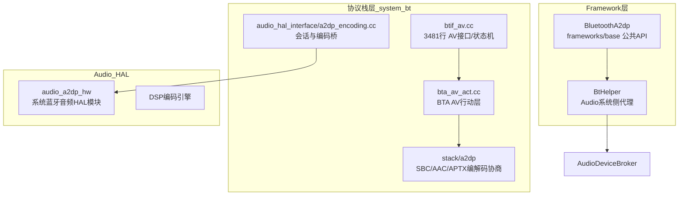
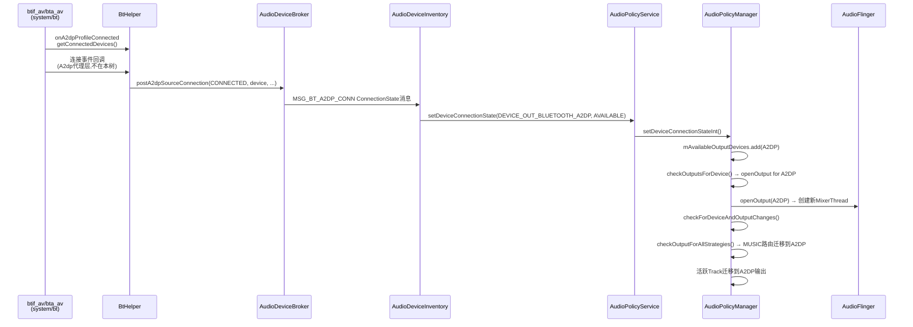
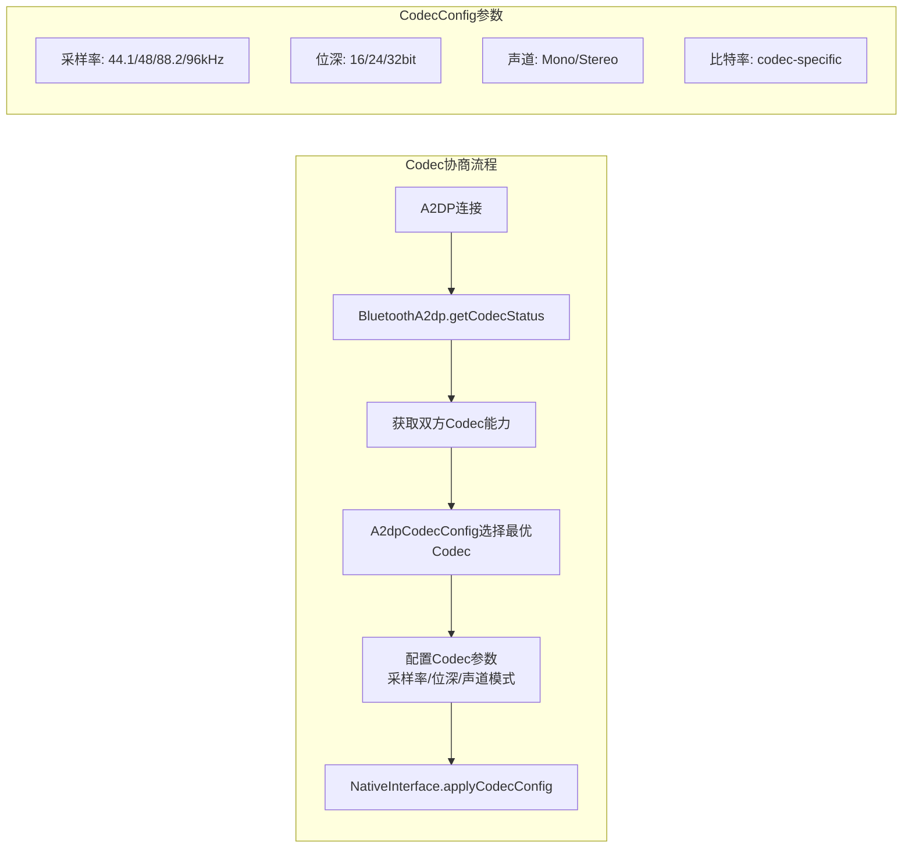
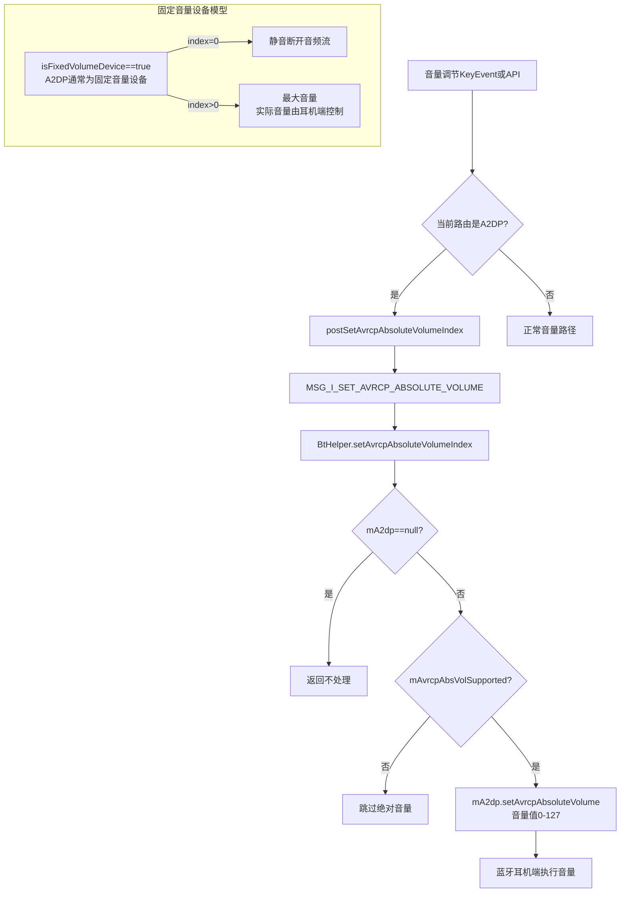
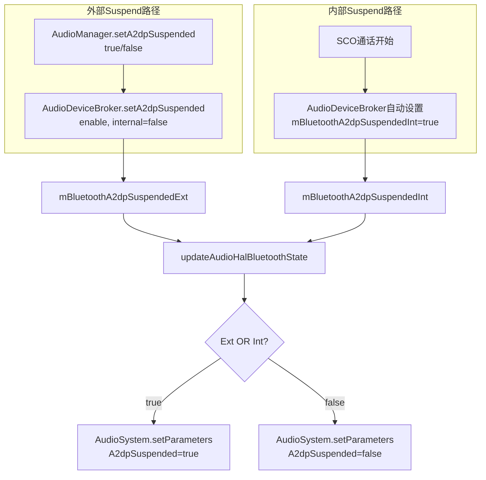
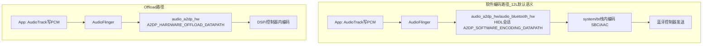
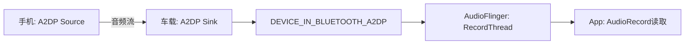

## 14.2 A2DP — 高级音频分发协议

[← 上一个](14_14.1_蓝牙音频协议总览.md) | [← 返回14章](README.md) | [返回导航](../README.md) | [下一个 →](14_14.3_LE_Audio-低功耗蓝牙音频.md)

---

### 14.2.1 A2DP服务架构

A2DP(Advanced Audio Distribution Profile)是蓝牙高质量音频传输的经典协议。

> **树边界（负结论）**：原稿锚定的 `A2dpService`/`A2dpStateMachine`/`A2dpCodecConfig`/`A2dpNativeInterface`（packages/modules/Bluetooth Java Profile 服务）与 AIDL `IBluetoothA2dp`（A2DP offload，Android 13/14 audio AIDL）**均不在本树**——本树蓝牙栈是 `system/bt` 原生实现，无 Java Profile 服务层。本树的 A2DP 由三层构成：



**（本树无 A2dpService）** 原稿的 A2dpService 字段表（sA2dpService/mA2dpCodecConfig/mStateMachines/mA2dpOffloadEnabled 等，packages/modules/Bluetooth，不在本树）按树边界移除。本树 framework 侧可验证的 A2DP Java 物为公共 API [`BluetoothA2dp`](frameworks/base/core/java/android/bluetooth/BluetoothA2dp.java)（连接状态/active设备/codec setter 均经 binder 到蓝牙进程，该进程源码不在本树）；Audio 侧入口是 `BtHelper.onA2dpProfileConnected()`（BtHelper.java:457，获取 `BluetoothA2dp` 代理后查询已连接设备）。

### 14.2.2 A2DP 连接状态机（本树：btif_av/bta_av 原生实现）

本树无 `A2dpStateMachine`（packages/modules/Bluetooth，不在本树）。连接生命周期由 `system/bt` 的原生状态机管理：

- [`btif_av.cc`](system/bt/btif/src/btif_av.cc)（3481行）：`btif_av_state` 状态机（idle/opened/started）+ 每设备 `BtifAvPeer` 上下文。
- [`bta_av_act.cc`](system/bt/bta/av/bta_av_act.cc)（2329行）：BTA AV 行动层（open/close/start/stop/suspend 的协议执行）。
- 编解码协商：[`a2dp_codec_config.cc`](system/bt/stack/a2dp/a2dp_codec_config.cc)（栈内优先级/能力集）+ SBC（`a2dp_sbc.cc`）/AAC（`a2dp_aac.cc`）/aptX vendor（`a2dp_vendor_aptx.cc`）编解码实现，framework 侧公共配置类型 [`BluetoothCodecConfig`](frameworks/base/core/java/android/bluetooth/BluetoothCodecConfig.java)。

概念对照：Android 13+ 的 Java 四态状态机（Disconnected/Connecting/Connected/Disconnecting）不在本树；本树以 `BTA_AV` open/start/suspend/close 原生事件驱动，连接结果经 `BtHelper.onA2dpProfileConnected()`（BtHelper.java:457）汇入 Audio 系统。

### 14.2.3 A2DP连接→Audio路由全流程

从蓝牙A2DP连接到音频路由建立的完整流程：



**queueOnBluetoothActiveDeviceChanged()核心逻辑**（源码[`AudioDeviceBroker.java:860-890`](frameworks/base/services/core/java/com/android/server/audio/AudioDeviceBroker.java:67)）：

- **同一设备更新**（`previousDevice == newDevice`）：直接发送`STATE_CONNECTED`事件
- **设备切换**：先发送`STATE_DISCONNECTED`给旧设备，再发送`STATE_CONNECTED`给新设备
- 消息通过`MSG_L_BLUETOOTH_DEVICE_CONFIG_CHANGE`队列化处理

### 14.2.4 A2DP Codec协商机制

A2DP支持多种编解码器。**（树边界）**：Java 侧协商器 `A2dpCodecConfig`（packages/modules/Bluetooth）不在本树；本树协商由协议栈完成——编解码选择逻辑在 [`a2dp_codec_config.cc`](system/bt/stack/a2dp/a2dp_codec_config.cc)（栈内 codec 优先级/能力集）+ `bta_av` 的 SetConfig 流程，framework 侧由 [`BluetoothCodecConfig`](frameworks/base/core/java/android/bluetooth/BluetoothCodecConfig.java) 类型表达结果。

**Codec优先级**（从高到低）：

| 优先级 | Codec | 最大比特率 | 特性 |
|--------|-------|-----------|------|
| 1 | LDAC | 990kbps | Hi-Res音频，自适应比特率 |
| 2 | aptX HD | 576kbps | 高品质音频 |
| 3 | aptX | 384kbps | 低延迟音频 |
| 4 | AAC | 256kbps | Apple生态兼容 |
| 5 | SBC | 328kbps | A2DP强制编码，基线兼容 |
| 6 | Opus | 待定 | AOSP14新增支持 |



**BtHelper.getA2dpCodec()实现**（源码[`BtHelper.java:241-260`](frameworks/base/services/core/java/com/android/server/audio/BtHelper.java:48)）：

```java
// 简化的getA2dpCodec逻辑
synchronized int getA2dpCodec(BluetoothDevice device) {
    if (mA2dp == null) return AUDIO_FORMAT_DEFAULT;
    BluetoothCodecStatus btCodecStatus = mA2dp.getCodecStatus(device);
    if (btCodecStatus == null) return AUDIO_FORMAT_DEFAULT;
    BluetoothCodecConfig btCodecConfig = btCodecStatus.getCodecConfig();
    if (btCodecConfig == null) return AUDIO_FORMAT_DEFAULT;
    return AudioSystem.bluetoothCodecToAudioFormat(btCodecConfig.getCodecType());
}
```

### 14.2.5 A2DP音量机制 — AVRCP绝对音量

A2DP设备使用AVRCP(Audio/Video Remote Control Profile)绝对音量协议，手机端音量直接映射到耳机端。



**AVRCP绝对音量关键方法**：

| 方法 | 位置 | 说明 |
|------|------|------|
| [`postSetAvrcpAbsoluteVolumeIndex()`](frameworks/base/services/core/java/com/android/server/audio/AudioDeviceBroker.java:684) | AudioDeviceBroker | 通过MSG_I_SET_AVRCP_ABSOLUTE_VOLUME消息投递 |
| [`setAvrcpAbsoluteVolumeIndex()`](frameworks/base/services/core/java/com/android/server/audio/BtHelper.java:256) | BtHelper | 执行绝对音量设置，空指针和兼容性检查 |
| [`isAvrcpAbsoluteVolumeSupported()`](frameworks/base/services/core/java/com/android/server/audio/BtHelper.java:247) | BtHelper | 检查`mA2dp!=null && mAvrcpAbsVolSupported` |
| [`setAvrcpAbsoluteVolumeSupported()`](frameworks/base/services/core/java/com/android/server/audio/BtHelper.java:251) | BtHelper | 蓝牙端通知绝对音量能力 |

**音量范围**：AVRCP绝对音量范围0-127，AudioService内部音量索引映射到此范围。

### 14.2.6 A2DP Suspend机制

A2DP可以被挂起(Suspend)，最典型的场景是SCO通话时需要暂停A2DP音频流。



**setA2dpSuspended()方法详解**（源码[`AudioDeviceBroker.java:1004-1019`](frameworks/base/services/core/java/com/android/server/audio/AudioDeviceBroker.java:67)）：

```java
void setA2dpSuspended(boolean enable, boolean internal, String eventSource) {
    synchronized (mBluetoothAudioStateLock) {
        if (internal) {
            mBluetoothA2dpSuspendedInt = enable;  // 内部请求(如SCO互斥)
        } else {
            mBluetoothA2dpSuspendedExt = enable;  // 外部API请求
        }
        updateAudioHalBluetoothState();  // 统一更新HAL状态
    }
}
```

**clearA2dpSuspended()清除逻辑**（源码[`AudioDeviceBroker.java:1021-1032`](frameworks/base/services/core/java/com/android/server/audio/AudioDeviceBroker.java:67)）：

- `internalOnly=true`：仅清除`mBluetoothA2dpSuspendedInt`
- `internalOnly=false`：同时清除`Ext`和`Int`

### 14.2.7 A2DP Offload 机制（12L：HIDL 蓝牙音频会话，无 AIDL IBluetoothA2dp）

> **版本边界（负结论）**：AIDL `IBluetoothA2dp`（audio AIDL core 的 `reconfigureOffload()`/`supportsOffloadReconfiguration()`）与 `A2dpService.mA2dpOffloadEnabled` 判断是 **Android 14** 机制，不在本树。12L 的 A2DP offload 走 **HIDL 蓝牙音频 HAL 2.1 会话**：

- 本树栈侧：[`a2dp_encoding.cc`](system/bt/audio_hal_interface/a2dp_encoding.cc) 维护 `offloading_hal_interface`（:199）与 [`is_hal_2_0_offloading()`](system/bt/audio_hal_interface/a2dp_encoding.cc:339)（:339，检查会话是否以 offload 编码器运行）、`update_codec_offloading_capabilities()`（:329，`UpdateOffloadingCapabilities`）。
- 会话类型（bluetooth audio 2.1 types.hal）：`A2DP_SOFTWARE_ENCODING_DATAPATH`（软件编码，栈内编码后经 audio_a2dp_hw 传输）与 `A2DP_HARDWARE_OFFLOAD_DATAPATH`（编码在蓝牙控制器/DSP）。
- HAL 侧：[`audio_bluetooth_hw`](system/bt/audio_bluetooth_hw/audio_bluetooth_hw.cc)（audio_bluetooth_hw.cc，加载为 `audio.a2dp.default`-同类 HAL 模块）+ 经典 audio_a2dp_hw 模块（`system/bt/audio_a2dp_hw/src/`）。
- 产品开关：[`AudioExtn::a2dp_source_feature_init`](vendor/qcom/opensource/audio-hal-ar/primary-hal/hal-pal/AudioDevice.cpp:1073)（AudioDevice.cpp:1073，读 `vendor.audio.feature.a2dp_offload.enable` 属性）。



### 14.2.8 A2DP Sink模式

A2DP Sink允许设备作为音频接收端(如车载蓝牙接收手机音乐)，对应Audio设备类型`DEVICE_IN_BLUETOOTH_A2DP`。



A2DP_SINK 连接映射到`DEVICE_IN_BLUETOOTH_A2DP`输入设备（12L：`AudioDeviceInventory` 的 A2DP sink 连接分支；无 13+ 的 createBtDeviceInfo 集中映射）。

### 14.2.9 A2DP服务启动流程

（树边界）原稿此处为 `A2dpService.start()` 的9步初始化（packages/modules/Bluetooth，不在本树），已移除：

（**树边界**：上述 A2dpService 启动九步流程引用 AdapterService/DatabaseManager/A2dpNativeInterface 等不在本树的 mainline 蓝牙应用对象，按版本边界移除。本树 12L 无独立 A2DP Java 服务启动期；协议栈初始化随 `system/bt` 的 stack/btif 启动进行，Audio 侧的 A2DP 接入从 `BtHelper.onA2dpProfileConnected()`（BtHelper.java:457）获得 `BluetoothA2dp` 代理时开始。）

### 14.2.10 AAOS车载A2DP场景

| 场景 | 实现方式 | 关键点 |
|------|----------|--------|
| 手机音乐→车载音响 | A2DP Sink接收+内部路由到Speaker | CarAudioService管理DEVICE_IN_BLUETOOTH_A2DP |
| 车载音乐→蓝牙耳机 | A2DP Source发送 | DEVICE_OUT_BLUETOOTH_A2DP，固定音量设备 |
| 多乘客独立音频 | 多A2DP连接(需mMaxConnectedAudioDevices>1) | 每个Zone独立路由 |
| 通话时暂停音乐 | SCO激活→自动Suspend A2DP | updateAudioHalBluetoothState()互斥 |
| 上车自动连接 | AutoConnect策略 | A2dpService连接优先级管理 |

### 14.2.11 A2DP调试命令

| 命令 | 说明 |
|------|------|
| `dumpsys bluetooth_a2dp` | A2DP服务完整状态 |
| `dumpsys bluetooth_a2dp | grep ActiveDevice` | 当前活动A2DP设备 |
| `dumpsys bluetooth_a2dp | grep Codec` | 当前Codec配置 |
| `dumpsys audio | grep -A5 A2DP` | Audio系统中A2DP路由状态 |
| `logcat -s A2dpService A2dpStateMachine` | A2DP日志 |
| `logcat -s AS.BtHelper | grep AVRCP` | AVRCP音量日志 |
| `dumpsys audio | grep FixedVolume` | 固定音量设备检查 |

---

[← 上一个](14_14.1_蓝牙音频协议总览.md) | [← 返回14章](README.md) | [返回导航](../README.md) | [下一个 →](14_14.3_LE_Audio-低功耗蓝牙音频.md)