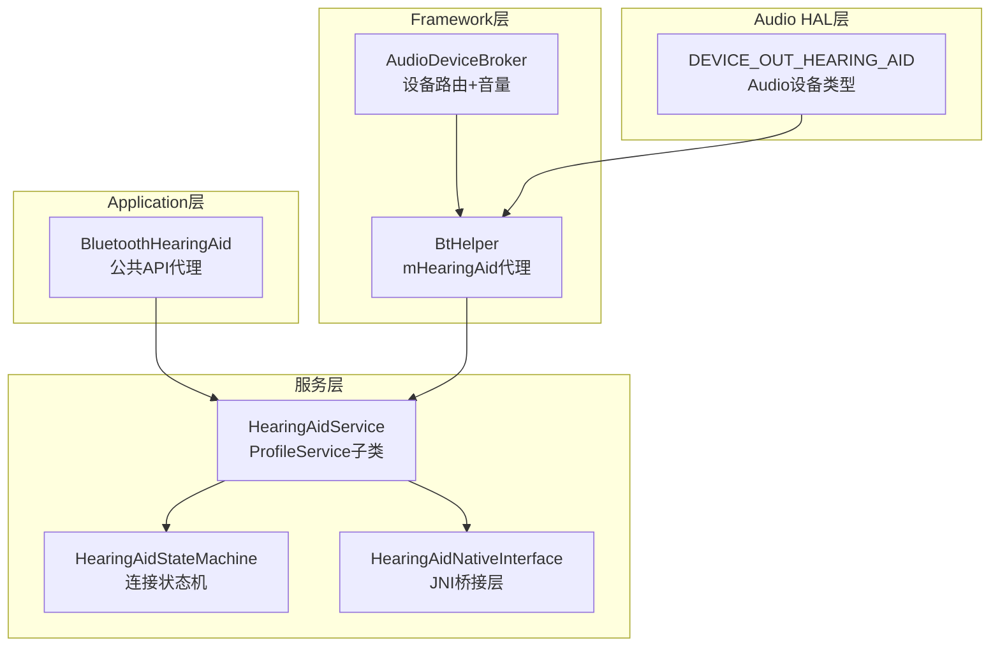
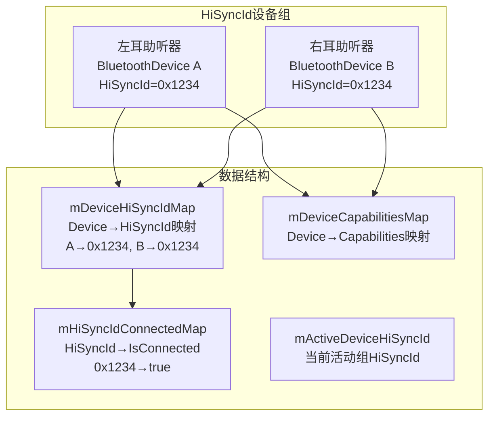
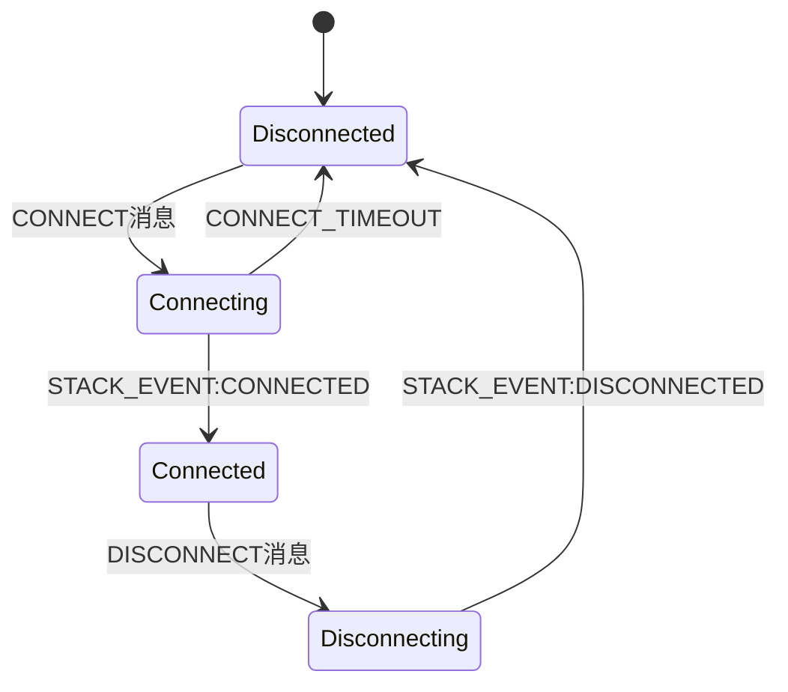
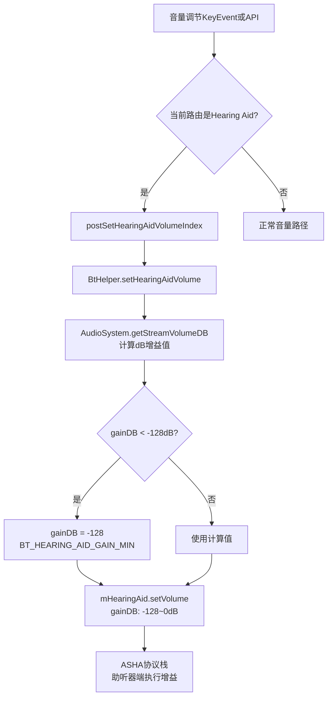
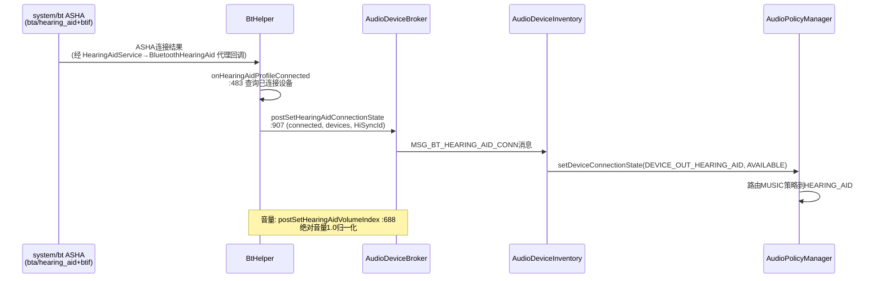
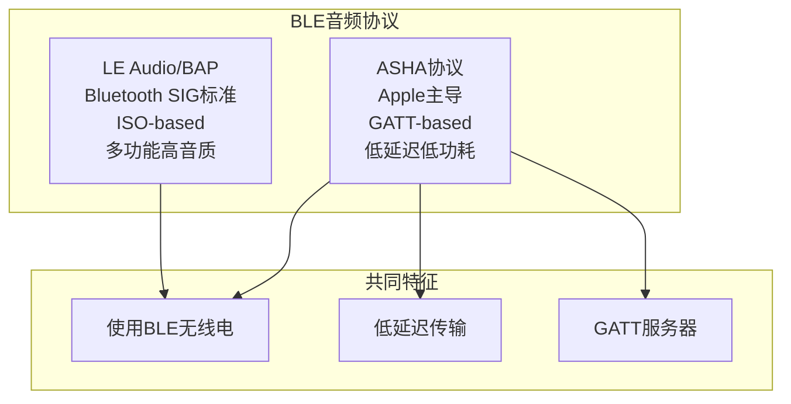
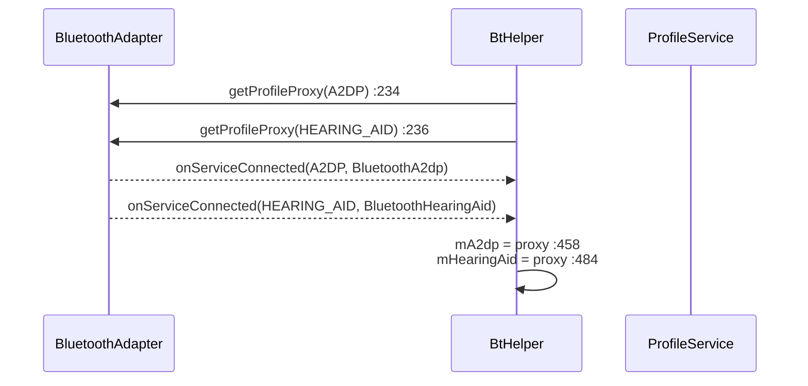

## 14.5 Hearing Aid — 助听器

[← 上一个](14_14.4_SCOHFP-通话语音.md) | [← 返回14章](README.md) | [返回导航](../README.md) | [下一个 →](14_14.6_蓝牙音频设备与AudioDeviceBroker交互.md)

---

### 14.5.1 ASHA协议架构

Hearing Aid（助听器）音频基于 ASHA（Audio Streaming for Hearing Aids）协议实现。

> **树边界（更正）**：Java 侧 [`HearingAidService`](packages/apps/Bluetooth/src/com/android/bluetooth/hearingaid/HearingAidService.java)（1013 行）/`HearingAidStateMachine`/`HearingAidNativeInterface` 在本树经典蓝牙应用 `packages/apps/Bluetooth` 中；原稿标注的 `packages/modules/Bluetooth`（13+ mainline 模块）不在本树。本树可验证的 HearingAid 实体：
> - 协议栈：`system/bt/bta/hearing_aid/`（BTA 层 ASHA Central 逻辑）与 [`btif_hearing_aid.cc`](system/bt/btif/src/btif_hearing_aid.cc)（143行，JNI 接口层）。
> - 音频数据路径：[`hearing_aid_software_encoding.cc`](system/bt/audio_hal_interface/hearing_aid_software_encoding.cc)（G.722 16kHz/24kHz 软件编码 + `HEARING_AID_SOFTWARE_ENCODING_DATAPATH` 会话）。
> - framework 音频侧：`BtHelper.onHearingAidProfileConnected()`（BtHelper.java:483）+ `AudioDeviceBroker.postSetHearingAidConnectionState()`（:907）+ `postSetHearingAidVolumeIndex()`（:688）。ASHA是苹果主导的蓝牙低功耗助听器音频协议，Google在AOSP中提供了Central(中心/手机端)实现。



**HearingAidService 关键成员**（packages/apps/Bluetooth，12L 实测行号）：`sHearingAidService`（:66 单例）、`mDeviceHiSyncIdMap: Map<BluetoothDevice, Long>`（:80）、`mHiSyncIdConnectedMap: Map<Long, Boolean>`（:82）、`mActiveDeviceHiSyncId = BluetoothHearingAid.HI_SYNC_ID_INVALID`（:83）。HiSyncId 组管理逻辑在本树有完整锚点。

### 14.5.2 HiSyncId设备组管理

ASHA协议的核心概念是HiSyncId，用于将左右耳助听器配对为一个逻辑组：



**HiSyncId关键逻辑**：

| 场景 | 行为 |
|------|------|
| 左右耳配对 | 两者具有相同HiSyncId，可同时控制 |
| 单耳使用 | 只有一个设备活跃，HiSyncId仍有效 |
| 切换活动设备 | mActiveDeviceHiSyncId更新，同组设备同步切换 |
| 断开同组设备 | mHiSyncIdConnectedMap标记为false |

**HiSyncId特殊值**：`BluetoothHearingAid.HI_SYNC_ID_INVALID`表示设备不属于任何组。

### 14.5.3 HearingAidStateMachine状态机



与A2DP/LE Audio采用相同的四状态模型，但助听器场景更注重：
- 自动重连（配对后开机自动连接）
- 双耳同步（同一HiSyncId的设备同时连接/断开）

### 14.5.4 ASHA音量机制 — 增益dB

助听器使用dB增益值而非百分比音量，范围-128dB到0dB：



**BtHelper.setHearingAidVolume()实现**（源码 [`setHearingAidVolume` :400-423](frameworks/base/services/core/java/com/android/server/audio/BtHelper.java:400)，逐字摘录）：

```java
/*package*/ synchronized void setHearingAidVolume(int index, int streamType) {
    if (mHearingAid == null) {
        if (AudioService.DEBUG_VOL) {
            Log.i(TAG, "setHearingAidVolume: null mHearingAid");
        }
        return;
    }
    //hearing aid expect volume value in range -128dB to 0dB
    int gainDB = (int) AudioSystem.getStreamVolumeDB(streamType, index / 10,
            AudioSystem.DEVICE_OUT_HEARING_AID);
    if (gainDB < BT_HEARING_AID_GAIN_MIN) {
        gainDB = BT_HEARING_AID_GAIN_MIN;
    }
    if (AudioService.DEBUG_VOL) {
        Log.i(TAG, "setHearingAidVolume: calling mHearingAid.setVolume idx="
                + index + " gain=" + gainDB);
    }
    AudioService.sVolumeLogger.log(new AudioServiceEvents.VolumeEvent(
            AudioServiceEvents.VolumeEvent.VOL_SET_HEARING_AID_VOL, index, gainDB));
    mHearingAid.setVolume(gainDB);
}
```

**音量范围对比**：

| Profile | 音量范围 | 单位 | 接口方法（12L BtHelper 实有） |
|---------|----------|------|----------|
| A2DP (AVRCP) | 0-127 | 绝对音量 | mA2dp.setAvrcpAbsoluteVolume()（BtHelper.java:256 setAvrcpAbsoluteVolumeIndex） |
| Hearing Aid (ASHA) | -128~0 | dB增益 | mHearingAid.setVolume(gainDB)（BtHelper.java:423） |

（LE Audio VCP 音量与 `IBluetooth.setHfpConfig()` 为 13+/14+ 机制，本树 BtHelper 无 `mLeAudio`/对应方法。）

### 14.5.5 Hearing Aid连接→Audio路由流程



**设备映射**：HEARING_AID profile → `DEVICE_OUT_HEARING_AID`（12L 由 `AudioDeviceInventory` 的 HearingAid 连接分支处理；`createBtDeviceInfo` 集中映射为 13+ 机制，不在本树）。

### 14.5.6 HearingAidService 启动与代理接入

`HearingAidService.start()`（packages/apps/Bluetooth，:107 起单例防重入）初始化 native 接口与状态机表；音频侧从 `BtHelper.onHearingAidProfileConnected()`（BtHelper.java:483，`mHearingAid = hearingAid` :484）获得 `BluetoothHearingAid` 代理时开始接入（代理经 `adapter.getProfileProxy(...)` BtHelper.java:234-236 请求）。`BluetoothProperties.isProfileAshaCentralEnabled()` sysprop 判断为 13+ mainline 写法，不在本树。

### 14.5.7 ASHA与LE Audio的关系

ASHA和LE Audio都使用BLE传输音频，但属于不同协议：



| 特性 | ASHA | LE Audio |
|------|------|----------|
| 主导方 | Apple | Bluetooth SIG |
| 传输通道 | GATT | ISO (CIS/BIS) |
| 编解码 | G.722 (Opus可选) | LC3 |
| 延迟 | 极低(适合助听器) | 低(适合多媒体) |
| 双向音频 | 不支持 | 支持(CIS双向) |
| 广播 | 不支持 | 支持(BIS) |
| 设备类型 | DEVICE_OUT_HEARING_AID | DEVICE_OUT_BLE_HEADSET |

### 14.5.8 BtHelper Profile代理管理

[`BtHelper`](frameworks/base/services/core/java/com/android/server/audio/BtHelper.java:48)通过`mBluetoothProfileServiceListener`管理所有蓝牙Profile代理的获取：



**disconnectAllBluetoothProfiles()**（源码 [`disconnectAllBluetoothProfiles` :434-440](frameworks/base/services/core/java/com/android/server/audio/BtHelper.java:434)，逐字摘录；12L 无 LE_AUDIO 行）：

```java
/*package*/ synchronized void disconnectAllBluetoothProfiles() {
    mDeviceBroker.postDisconnectA2dp();
    mDeviceBroker.postDisconnectA2dpSink();
    mDeviceBroker.postDisconnectHeadset();
    mDeviceBroker.postDisconnectHearingAid();
}
```

**Profile 代理获取**：12L BtHelper 仅请求两类代理——`adapter.getProfileProxy(...)`（BtHelper.java:234-236，A2DP 与 HEARING_AID），对应 `onA2dpProfileConnected`（:457，`mA2dp = a2dp` :458）与 `onHearingAidProfileConnected`（:483，`mHearingAid = hearingAid` :484）；LE_AUDIO 代理获取为 13+ 机制（本树 BtHelper 无 mLeAudio）。

### 14.5.9 AAOS车载Hearing Aid场景

| 场景 | 实现方式 | 关键点 |
|------|----------|--------|
| 驾驶员助听器导航 | DEVICE_OUT_HEARING_AID路由 | 车载导航音频传到助听器 |
| 助听器+车载扬声器并行 | 双输出路由 | 助听器和Speaker同时播放 |
| 助听器音量独立调节 | dB增益模式 | -128~0dB范围，getStreamVolumeDB映射 |
| 听障辅助系统 | ASHA协议+车载麦克风 | 车载麦克风拾音→助听器播放 |

### 14.5.10 Hearing Aid调试命令

| 命令 | 说明 |
|------|------|
| `dumpsys bluetooth_manager` | 蓝牙服务与各 Profile（含 HearingAid）状态 |
| `dumpsys bluetooth_manager | grep -A5 hearing` | HiSyncId 组/活动助听器设备 |
| `dumpsys audio | grep HEARING_AID` | Audio系统中助听器路由 |
| `logcat -s HearingAidService HearingAidStateMachine` | 助听器日志 |
| `logcat -s AS.BtHelper | grep HearingAid` | BtHelper助听器音量日志 |

---

[← 上一个](14_14.4_SCOHFP-通话语音.md) | [← 返回14章](README.md) | [返回导航](../README.md) | [下一个 →](14_14.6_蓝牙音频设备与AudioDeviceBroker交互.md)