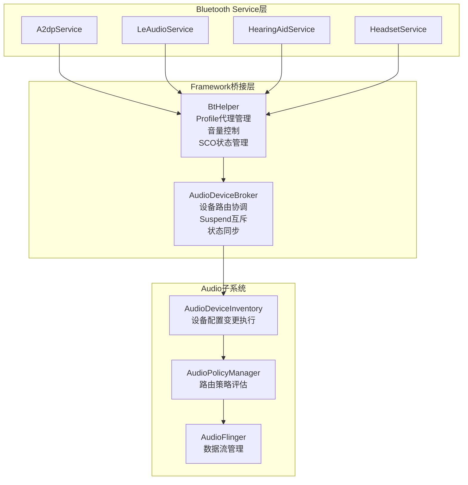
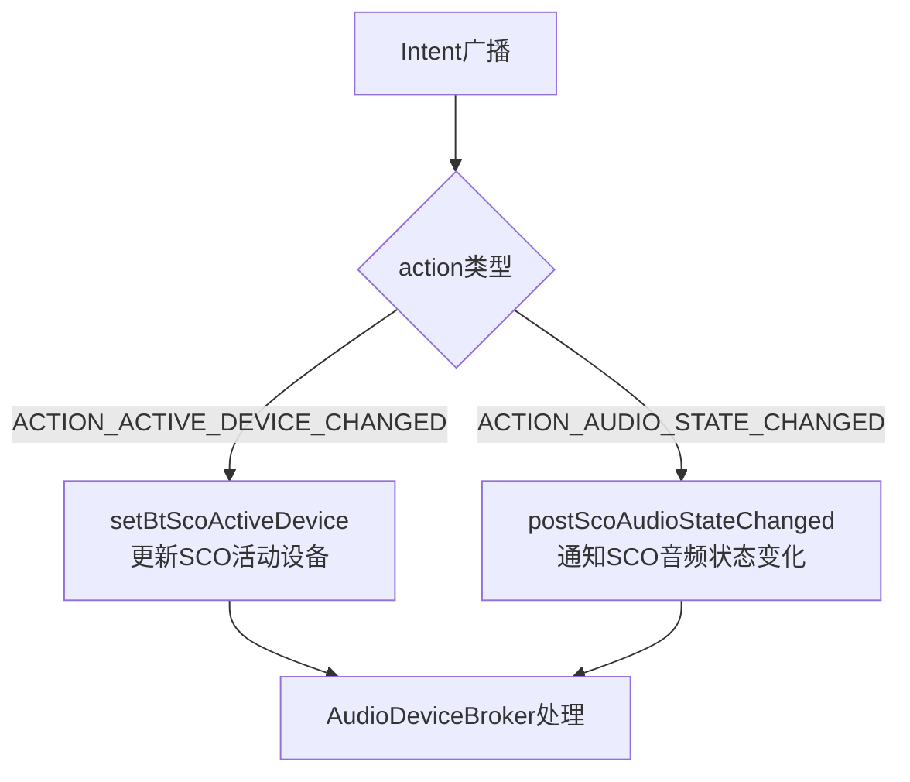
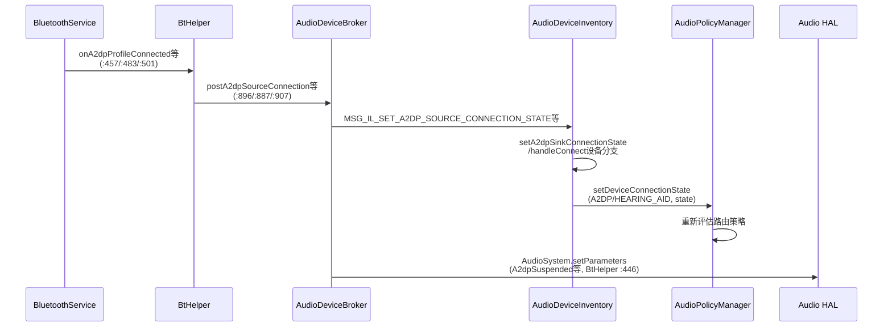

## 14.6 蓝牙音频设备与AudioDeviceBroker交互

[← 上一个](14_14.5_Hearing_Aid-助听器.md) | [← 返回14章](README.md) | [返回导航](../README.md) | [下一个 →](14_14.7_LE_Audio_Profile深度解析.md)

---

### 14.6.1 AudioDeviceBroker蓝牙交互架构

[`AudioDeviceBroker`](frameworks/base/services/core/java/com/android/server/audio/AudioDeviceBroker.java)是Audio Framework中蓝牙设备管理的核心枢纽，桥接Bluetooth Service和Audio Policy子系统：



### 14.6.2 蓝牙设备事件载体与投递（12L：无BtDeviceInfo体系）

> **版本边界（负结论）**：`BtDeviceChangedData`/`BtDeviceInfo`（4构造函数）/`createBtDeviceInfo()`/`queueOnBluetoothActiveDeviceChanged()`（AudioDeviceBroker.java:704-860 区域，Android 13）**不在本树**。12L 的对应机制是**按事件分立的 post 方法**（无统一载体类）：

| 12L方法（AudioDeviceBroker.java） | 行号 | 作用 |
|------|------|------|
| `postA2dpSinkConnection(state, device, delay)` | :887 | A2DP Sink（输入）连接状态 |
| `postA2dpSourceConnection(state, btDeviceInfo, delay)` | :896 | A2DP Source连接（`BtHelper.BluetoothA2dpDeviceInfo`载体） |
| `postBluetoothA2dpDeviceConfigChange(device)` | :696 | A2DP设备配置（codec）变化 |
| `postSetHearingAidConnectionState(connected, devices, hiSyncId)` | :907 | HearingAid连接（含HiSyncId组） |
| `postDisconnectA2dp()/postDisconnectA2dpSink()/postDisconnectHearingAid()/postDisconnectHeadset()` | :916-928 | 各profile断开 |
| `postBtA2dpSinkProfileConnected(profile)`/`postBtHeasetProfileConnected(...)`/`postBtHearingAidProfileConnected(...)` | :936-941 | profile服务就绪回调入队 |
| `setBluetoothA2dpOn_Async(state, source)` | :219 | A2DP总开关（`setBluetoothA2dpOnInt` :1035 消费） |

**A2DP Source连接投递（12L逐字）**：

```java
/*package*/ void postA2dpSourceConnection(@AudioService.BtProfileConnectionState int state,
        @NonNull BtHelper.BluetoothA2dpDeviceInfo btDeviceInfo, int delay) {
    sendILMsg(MSG_IL_SET_A2DP_SOURCE_CONNECTION_STATE, SENDMSG_QUEUE,
            state, btDeviceInfo, delay);
}
```

（`BtHelper.BluetoothA2dpDeviceInfo` 是 12L 仅有的蓝牙设备事件载体：device + codec + volume；远小于 13+ 的 BtDeviceInfo。）

### 14.6.3 Profile到AudioSystem设备映射（12L）

12L 的映射发生在 `AudioDeviceInventory` 的各连接分支（无 `createBtDeviceInfo` 集中映射）：

| Profile | AudioSystem设备 | 备注 |
|---------|----------------|------|
| A2DP | DEVICE_OUT_BLUETOOTH_A2DP | codec经getA2dpCodec() |
| A2DP_SINK | DEVICE_IN_BLUETOOTH_A2DP | 输入方向 |
| HEARING_AID | DEVICE_OUT_HEARING_AID | HiSyncId组在Inventory侧处理 |
| HFP/SCO | DEVICE_OUT/IN_BLUETOOTH_SCO | SCO连接管理 |
| （LE_AUDIO/LE_AUDIO_BROADCAST→BLE_*） | 不存在 | 12L 常量 `DEVICE_OUT_BLE_HEADSET/BLE_SPEAKER` 已有（AudioSystem.java:943），但 BtHelper 无 mLeAudio 集成；`DEVICE_OUT_BLE_BROADCAST`=14+ |

**getA2dpCodec()调用链**（12L源码 BtHelper.java:277-291）：

```java
/*package*/ synchronized @AudioSystem.AudioFormatNativeEnumForBtCodec int getA2dpCodec(
        @NonNull BluetoothDevice device) {
    if (mA2dp == null) {
        return AudioSystem.AUDIO_FORMAT_DEFAULT;
    }
    final BluetoothCodecStatus btCodecStatus = mA2dp.getCodecStatus(device);
    if (btCodecStatus == null) {
        return AudioSystem.AUDIO_FORMAT_DEFAULT;
    }
    final BluetoothCodecConfig btCodecConfig = btCodecStatus.getCodecConfig();
    if (btCodecConfig == null) {
        return AudioSystem.AUDIO_FORMAT_DEFAULT;
    }
    return AudioSystem.bluetoothCodecToAudioFormat(btCodecConfig.getCodecType());
}
```

### 14.6.4 Suspend/SCO互斥（12L：BtHelper SCO状态机，无统一状态组）

> **版本边界（负结论）**：`mBluetoothAudioStateLock` 保护的 8 状态变量组、`updateAudioHalBluetoothState()`/`initAudioHalBluetoothState()` 状态机、`setA2dpSuspended()`/`setLeAudioSuspended()` API（AudioDeviceBroker.java:893-1048，Android 13）**不在本树**。12L 的事实：

- SCO 状态机在 `BtHelper.mScoAudioState`（`SCO_STATE_*` 常量族）；SCO 启停经 [`setBluetoothScoOn()`](frameworks/base/services/core/java/com/android/server/audio/AudioDeviceBroker.java:650)（:650）。
- A2DP 挂起参数 `A2dpSuspended` 共三个写入点（12L 全树）：[`A2dpSuspended=false` :981](frameworks/base/services/core/java/com/android/server/audio/AudioDeviceInventory.java:981)（`makeA2dpDeviceAvailable()` :957 内）复位 false / [`A2dpSuspended=true` :1045](frameworks/base/services/core/java/com/android/server/audio/AudioDeviceInventory.java:1045)（`makeA2dpDeviceUnavailableLater()` :1024 内）置 true 与 [`resetBluetoothSco()`](frameworks/base/services/core/java/com/android/server/audio/BtHelper.java:443)（:443-448，:446 SCO 结束复位 false）。
- 12L 无 `AudioManager.setA2dpSuspended()` 公开API（13+）；无 LeAudioSuspended（LE Audio 12L 为早期未完成实现，无挂起机制，见[14.3](14_14.3_LE_Audio-低功耗蓝牙音频.md)）。

### 14.6.10 蓝牙音量消息投递

AudioDeviceBroker通过Handler消息机制投递蓝牙音量命令：

| 方法 | 消息类型 | 参数 | 目标 |
|------|----------|------|------|
| `postSetAvrcpAbsoluteVolumeIndex(index)` | MSG_I_SET_AVRCP_ABSOLUTE_VOLUME | index(0-127) | BtHelper→mA2dp |
| `postSetHearingAidVolumeIndex(index, streamType)` | MSG_II_SET_HEARING_AID_VOLUME | index, streamType | BtHelper→mHearingAid |
| （`postSetLeAudioVolumeIndex`） | 不存在 | - | Android 13+，本树无LE Audio音量路径 |

**消息替换策略**：

| 消息 | 替换策略 | 原因 |
|------|----------|------|
| AVRCP音量 | SENDMSG_REPLACE | 只需最新音量值 |
| Hearing Aid音量 | SENDMSG_REPLACE | 只需最新音量值 |
| 设备变更 | SENDMSG_QUEUE | 必须按顺序处理 |

### 14.6.11 SCO通信设备管理（12L）

> **版本边界（更正）**：[`startBluetoothScoForClient()`/`stopBluetoothScoForClient()` :700/:718](frameworks/base/services/core/java/com/android/server/audio/AudioDeviceBroker.java:700)**存在于本树**（12L），内部经 `mSetModeLock`→`mDeviceStateLock` 双锁后 `postSetCommunicationRouteForClient(new CommunicationClientInfo(cb, pid, device, scoAudioMode, eventSource))`（:711-715）；13+ 才改名为 `postSetCommunicationDeviceForClient`/`CommunicationDeviceInfo` 载体。12L 的 SCO 请求路径：

- `AudioManager.startBluetoothSco()`/`stopBluetoothSco()` → AudioService → [`setBluetoothScoOn()`](frameworks/base/services/core/java/com/android/server/audio/AudioDeviceBroker.java:650)（:650，含 `scoAudioMode`：VR/VIRTUAL_CALL）→ `BtHelper` SCO 状态机（mScoAudioState）。
- SCO 活动设备：`BtHelper.setBtScoActiveDevice()`（BtHelper.java:301 处调用）。
- SCO 音频状态：`mDeviceBroker.postScoAudioStateChanged(btState)`（BtHelper.java:305）。

### 14.6.12 BtHelper事件接收

[`BtHelper.receiveBtEvent()`](frameworks/base/services/core/java/com/android/server/audio/BtHelper.java:295)处理蓝牙广播事件（12L逐字头）：



### 14.6.13 蓝牙设备变化完整序列图



### 14.6.14 AAOS车载场景

| 场景 | AudioDeviceBroker行为 | 关键参数 |
|------|----------------------|----------|
| 车载蓝牙耳机连接 | A2DP→DEVICE_OUT_BLUETOOTH_A2DP路由 | codec=LDAC/aptX HD |
| 车载蓝牙通话 | SCO激活→A2DP挂起 | BtHelper SCO状态机+resetBluetoothSco恢复 |
| （LE Audio车载耳机） | 不存在 | Android 13+，见[14.3](14_14.3_LE_Audio-低功耗蓝牙音频.md) |
| 助听器导航 | HA→DEVICE_OUT_HEARING_AID路由 | HiSyncId组 |
| （多乘客广播音频） | 不存在 | Android 14 Auracast，见[14.9](14_14.9_LE_Audio广播音频Broadcast_Audio.md) |
| 通话中切媒体 | SCO→A2DP切换 | A2dpSuspended参数三写入点（Inventory :981/:1045 + BtHelper :446，见14.2.6） |

### 14.6.15 调试命令

| 命令 | 说明 |
|------|------|
| `dumpsys audio | grep -A5 Bluetooth` | AudioService蓝牙设备状态 |
| `dumpsys audio | grep mScoAudioState` | BtHelper SCO状态机 |
| `dumpsys audio | grep A2dp` | A2DP连接/挂起状态 |
| `logcat -s AS.AudioDeviceBroker | grep BT` | 蓝牙设备变更日志 |
| `logcat -s AS.AudioDeviceBroker | grep updateAudioHal` | HAL状态同步日志 |

---

[← 上一个](14_14.5_Hearing_Aid-助听器.md) | [← 返回14章](README.md) | [返回导航](../README.md) | [下一个 →](14_14.7_LE_Audio_Profile深度解析.md)