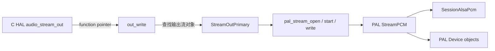
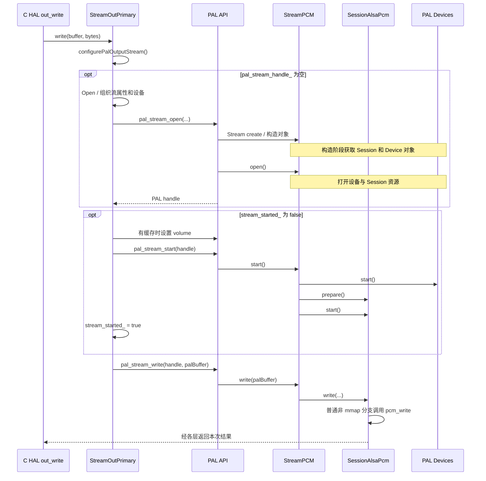
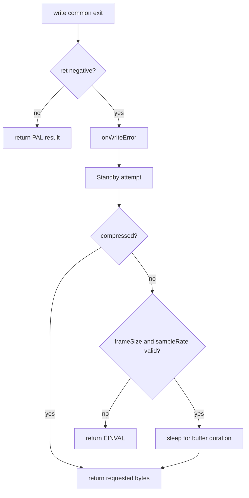
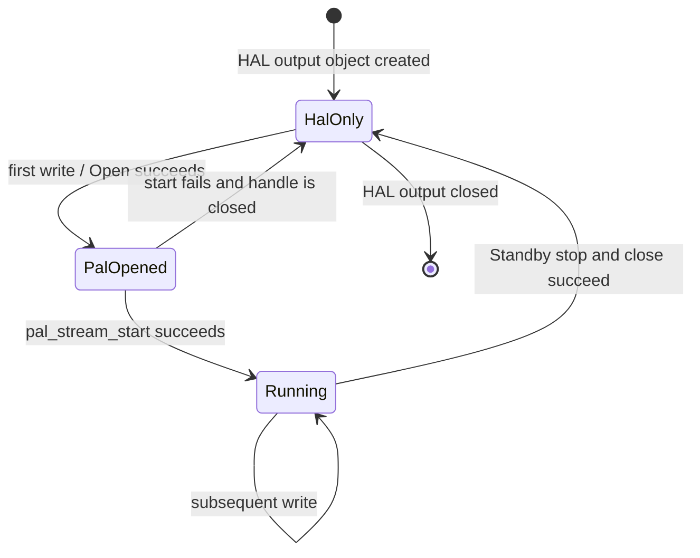

# 15.10 HAL-PAL 适配层：从一次 PCM write 理解对象与生命周期

> [上一节：配置文件](15_15.9_配置文件列表.md) | [返回第 15 章](README.md) | [返回总目录](../README.md) | [下一节：编解码器插件](15_15.11_编解码器插件_pluginscodecs.md)

## 阅读目标与范围

本节沿本地 **Android 12L + SA8295 AudioReach** 的普通 PCM 输出路径，解释 Android 流如何转成 PAL 属性、何时创建 PAL 对象、何时启动、错误如何返回以及 standby 做了什么。

主例排除压缩 offload、MMAP、haptics、SoundTrigger、语音通话和 SSR 恢复状态；这些分支会在边界处单独说明。**普通 PCM 的顺序不是所有音频流的通用模板。**

先读 [8.1 HIDL 与厂商 HAL 的边界](../08_HAL_Layer/08_8.1_Audio_HAL双轨架构.md)，可避免把 AudioFlinger 直接画到厂商 C++ 类；工厂选择见 [15.99 Stream/Session/Device](15_15.99_附录_Stream-Session-Device映射关系.md)。

## 15.10.1 适配层到底适配什么

源码位于 `vendor/qcom/opensource/audio-hal-ar/primary-hal/hal-pal/`。

| 对象/入口 | 这一层负责的事情 | 不应混淆的对象 |
|---|---|---|
| `AudioDevice` | 设备级接口、流对象管理、Audio Patch、Android/PAL 设备映射 | HIDL adapter 的 `Device`、PAL 的 `Device` |
| `StreamPrimary` | 输入输出流的公共基础 | PAL 基类 `Stream` |
| `StreamOutPrimary` | 输出属性、PAL handle、写入、路由、standby 等 | HIDL 的 `StreamOut` |
| `StreamInPrimary` | 输入属性、读取、输入效果及特殊录音分支 | HIDL 的 `StreamIn` |
| `AudioVoice`、`audio_extn/` | 通话和扩展功能入口 | 普通输出 write 循环 |
| `pal_stream_*` | PAL C API，进入 PAL 实现 | 不等于直接调用 DSP 固件 |



图中 PAL 类选择仅对应本节普通 PCM 示例。HAL/PAL 的可选 IPC 部署不在此图表达；本节追踪的是 C API 进入 `Pal.cpp` 后的实现关系。

## 15.10.2 第一次“打开流”不等于已经打开 PAL

在 HIDL adapter 调用 C HAL `open_output_stream` 后，AR 的 `adev_open_output_stream()` 查找流对象；需要时调用 `AudioDevice::CreateStreamOut()` 创建 `StreamOutPrimary`，再返回其 C stream handle。

`StreamOutPrimary::FillHalFnPtrs()` 将 C 函数指针绑定到 HAL 的入口。例如原文中有：

```cpp
    stream_.get()->write = out_write;
```

`out_write()` 取得 `AudioDevice` 并查找该 C handle 对应的输出对象，然后调用其 `write()`；找不到设备或流时返回 `-EINVAL`。

此时至少存在两个不同的“handle”：

- **C HAL stream handle**：让 adapter 能调用 `write`、`standby` 等接口。
- **`pal_stream_handle_`**：让厂商流对象调用 PAL；普通 PCM 路径在首次 write 时按需创建。

### 普通 PCM 的首次写入时序



这是声卡在线、普通输出且关键步骤成功的顺序；设备协调、锁、回滚、分块写入和 SSR 分支未全部绘出。**输出**的 `StreamPCM::start()` 在此路径先启动 Device，再 prepare/start Session；不能把这一顺序直接移植为录音或双向流的图。

## 15.10.3 flags、媒体格式和 BUS 地址怎样进入 PAL

### 流类型不是 flags 的逐位复制

`StreamOutPrimary::GetPalStreamType(flags, address)` 是有先后顺序的条件判断。下面只摘出能明确说明条件的分支，不把所有 flags 组合压成无条件一对一映射。

| 条件（按实现理解） | PAL type | 重点 |
|---|---|---|
| 包含 `AUDIO_OUTPUT_FLAG_VOIP_RX` | `PAL_STREAM_VOIP_RX` | 最前面的提前返回 |
| 在前项未命中时包含 `AUDIO_OUTPUT_FLAG_RAW` | `PAL_STREAM_ULTRA_LOW_LATENCY` | RAW 判断早于后面的 FAST/RAW 组合分支 |
| 包含 FAST，且 `address` 指针为空，前项未命中 | `PAL_STREAM_LOW_LATENCY` | 不能忽略地址条件 |
| flags 恰为 DEEP_BUFFER | `PAL_STREAM_DEEP_BUFFER` | 这里是等值判断 |
| 在前项未命中时命中 MMAP_NOIRQ 分支 | `PAL_STREAM_ULTRA_LOW_LATENCY` | 后续还会设置对应 PAL stream flags |
| flags 恰为 DIRECT | `PAL_STREAM_PCM_OFFLOAD` | **不是压缩流** |
| 在前项未命中时命中 COMPRESS_OFFLOAD 条件 | `PAL_STREAM_COMPRESSED` | 需要继续看压缩配置 |
| 其他落入默认分支 | `PAL_STREAM_GENERIC` | address 非空时还会进入车载类型转换 |

例如源码中虽还存在一个 `FAST | RAW` 等值分支，但前面的 RAW 位判断已经先命中。阅读表格时应跟随**实际判断顺序**，不能把每个条件孤立抄成“都可命中”的映射。

### `Open()` 填充的是 PAL 属性，不只是一个 type

**源码原文摘录：** `AudioStream.cpp`，`StreamOutPrimary::Open()`。

```cpp
    streamAttributes_.type = StreamOutPrimary::GetPalStreamType(flags_, address_);
    streamAttributes_.bus_addr = address_;
    streamAttributes_.hal_flags = flags_;
    streamAttributes_.ch_mask = config_.channel_mask;
    streamAttributes_.format = config_.format;
    streamAttributes_.flags = (pal_stream_flags_t)flags_;
    streamAttributes_.direction = PAL_AUDIO_OUTPUT;
    streamAttributes_.out_media_config.sample_rate = config_.sample_rate;
    streamAttributes_.out_media_config.bit_width = CODEC_BACKEND_DEFAULT_BIT_WIDTH;
    streamAttributes_.out_media_config.aud_fmt_id = PAL_AUDIO_FMT_PCM_S16_LE;
    streamAttributes_.out_media_config.ch_info = ch_info;
```

这是初始赋值片段，**不是最终配置的全部**。其后还会根据类型修改媒体配置和 flags：压缩流设置 codec format 与 non-blocking；部分 PCM/offload/BUS 路径使用格式映射表；MMAP/ULL 按 usecase 设置对应 PAL flags。

当 HAL 输入格式与 PAL 所需格式不同，`write()` 中会使用转换 buffer，并将写入结果换算回 HAL 侧字节数。因此不能把每层字节计数直接当作相同格式、相同帧数。

### BUS 地址保留语义，但不等于一个独占硬件输出

默认类型为 GENERIC 且地址指针非空时，输出函数调用车载扩展；当前 `auto_hal.cpp` 的 `autohal_GetCarAudioPalStreamType()` 返回 `PAL_STREAM_PLAYBACK_BUS`，地址解析并不会在此函数中选择多个不同 PAL Stream 类。

另一方面，`AudioDevice::GetPalDeviceIds(..., address)` 对 `AUDIO_DEVICE_OUT_BUS` 有明确设备选择：

| 源码中的 BUS 地址 | 对应 PAL device ID |
|---|---|
| `BUS00_MEDIA`、`BUS01_SYS_NOTIFICATION`、`BUS02_NAV_GUIDANCE`、`BUS03_PHONE` | `PAL_DEVICE_OUT_SPEAKER` |
| `BUS08_FRONT_PASSENGER` | `PAL_DEVICE_OUT_A2B_SPKR` |
| `BUS16_REAR_SEAT` | `PAL_DEVICE_OUT_A2B2_SPKR` |
| 此分支中的其他地址 | 回退为 `PAL_DEVICE_OUT_SPEAKER` |

这张表只说明这个 HAL 函数的映射。**多个逻辑 BUS 可以映射到同一个 PAL device ID。** 地址还保存在流属性中；不能由此断言所有 BUS 的 DSP 图相同，也不能凭地址名称认定实车座位、喇叭或 A2B 接线已被验证。

## 15.10.4 `pal_stream_open()` 做了哪些实质工作

`Pal.cpp` 中的顺序是：检查属性 → `Stream::create()` → 对象 `open()` → 按需注册回调 → 返回 handle。以 `StreamPCM` 为例，构造阶段创建 Session、获取设备对象并初始化状态；`open()` 再打开相关资源，成功后进入 `STREAM_INIT`。

**源码原文摘录：** `pal_stream_open()` 的后半段。

```cpp
    status = s->open();
    if (0 != status) {
        PAL_ERR(LOG_TAG, "pal_stream_open failed with status %d", status);
        if (s->close() != 0) {
            PAL_ERR(LOG_TAG, "stream closed failed.");
        }
        delete s;
        goto exit;
    }

    if (cb)
       s->registerCallBack(cb, cookie);
    stream = reinterpret_cast<uint64_t *>(s);
    *stream_handle = stream;
```

这里有三点值得注意：

1. `s->open()` 失败后会尝试 close 并删除对象，不是把半打开对象作为正常 handle 返回。
2. 此处实现中的 handle 来自 Stream 指针转换；它不是 ResourceManager 的“DSP graph ID”。如果经过额外 IPC 封装，还需看该层怎样传递 handle，不能把本地指针解释推广到跨进程。
3. 注册了 callback 不等于所有 Stream 都以同样方式使用异步回调；例如普通 PCM 与压缩、检测流有不同实现。

类型选择的关键反例是 `NON_TUNNEL → StreamNonTunnel → SessionAgm`，而 `VOICE_CALL → StreamPCM → SessionAlsaVoice`。详见 [工厂映射](15_15.99_附录_Stream-Session-Device映射关系.md)，不要用普通 PCM 图覆盖它们。

## 15.10.5 configure、write 与成功返回的含义

### configure 负责按需 open/start

`configurePalOutputStream()` 在 handle 为空时调用 `Open()`；尚未 started 时，先尝试应用缓存音量，再 `pal_stream_start()`。主 PAL 流启动失败时，会 close handle、清空指针并返回 `-EINVAL`；成功后设置 `stream_started_ = true`。

**简化伪代码**（省略 tracing、音效、haptics、gapless metadata 及其他分支，不是可编译摘录）：

```text
configurePalOutputStream:
    if no PAL handle:
        if Open fails: return error
    if not started:
        try cached volume, if present
        if pal_stream_start fails:
            pal_stream_close
            clear handle
            return error
        mark HAL stream started

write:
    configurePalOutputStream
    if configuration succeeded:
        convert format / split haptics / ordinary pal_stream_write
    at common exit:
        update HAL byte accounting and timestamp
        if result is negative: return onWriteError(requested bytes)
        return result
```

注意 `write()` 内格式转换的某些参数检查会直接返回 `-EINVAL`，并非所有错误都经过公共出口。

### 普通 PCM 的底层写入

`pal_stream_write()` 将请求交给 Stream；`StreamPCM::write()` 在正常状态下调用 Session。`SessionAlsaPcm::write()` 按 buffer 配置处理分块，普通非 mmap 分支调用 `pcm_write()`，mmap usecase 则走相应写入接口。

本节到这里确定的是 **PAL → Session → PCM API** 的本地调用层次。不能从一个 `pcm_write()` 名字直接画出完整的 Android kernel、AGM、GSL、HAB、QNX 和 DSP 传输链；控制路径与 PCM 数据路径也不应未经追踪就合成一条箭头。

### 正返回不等于 DSP 已播放

`StreamOutPrimary::write()` 公共出口原文包含：

```cpp
    return (ret < 0 ? onWriteError(bytes) : ret);
```

**源码原文：** `onWriteError()`。

```cpp
ssize_t StreamOutPrimary::onWriteError(size_t bytes) {
    // standby streams upon write failures and sleep for buffer duration.
    AHAL_ERR("write error");
    Standby();
    if (streamAttributes_.type != PAL_STREAM_COMPRESSED) {
        uint32_t byteWidth = streamAttributes_.out_media_config.bit_width / 8;
        uint32_t sampleRate = streamAttributes_.out_media_config.sample_rate;
        uint32_t channelCount = streamAttributes_.out_media_config.ch_info.channels;
        uint32_t frameSize = byteWidth * channelCount;

        if (frameSize == 0 || sampleRate == 0) {
            AHAL_ERR("frameSize=%d, sampleRate=%d", frameSize, sampleRate);
            return -EINVAL;
        } else {
            usleep((uint64_t)bytes * 1000000 / frameSize / sampleRate);
        }
    }
    return bytes;
}
```

含义不是“把错误修复成成功播放”，而是**在某些失败路径上，清理/尝试 standby 并维持 buffer 时长对应的调用节奏，然后向上返回请求字节数**。压缩类型不执行这里的 PCM sleep 计算；非压缩类型的 frameSize/sampleRate 无效时仍返回负值。



还有第二层需要警惕：`StreamPCM::write()` 本身在 A2DP suspended、设备集合为空、声卡 offline 或恢复缓存状态非 IDLE 等条件下，也可能丢弃 buffer、按时长等待并返回大小。`StreamPCM::start()` 的 SSR 路径还可能缓存状态而返回成功。

因此，本节正常时序中的“started”仅描述限定分支；**HAL started 标志、write 返回值、已提交帧、DSP 时间戳和实际发声是不同观察点。**

## 15.10.6 standby、stop 与 close 不可混为一谈

### HAL 层的 standby

`StreamOutPrimary::Standby()` 在主 handle 存在时先调用 `pal_stream_stop()`。主流 stop 失败会提前退出；正常继续时，清除 started/paused，处理适用的 offload effects，再 close PAL handle 并置空。haptics 还有独立处理。

因此，“standby 只是暂停 DSP，下次 write 只需 start”不符合这里的普通 PCM 正常路径：**PAL 对象已经关闭，下次 write 会重新 Open，再 start。** HAL 的 `StreamOutPrimary` 对象仍可以保留。



这是 HAL 层**概念状态图**，不是源码里的 enum；只画主流的正常清理路径。stop 失败时不能声称已经回到 HalOnly，close 的异常结果也应检查日志。

### PAL 层另有状态

普通 `StreamPCM` 的主要状态关系是构造后 `STREAM_IDLE`，open 成功到 `STREAM_INIT`，start 成功到 `STREAM_STARTED`，stop 成功到 `STREAM_STOPPED`，close 回到 `STREAM_IDLE`。pause、resume、SSR 缓存等状态变化不能靠这条简述覆盖。

`pal_stream_close()` 调用对象 `close()` 后删除 Stream；`StreamPCM` 析构中还会注销流、处理设备引用并删除 Session。关闭一个 Stream 不等于物理 Device 对象必然销毁，设备可被共享复用。

## 15.10.7 录音：相似入口，不同细节

输入 C callback `in_read()` 找到 `StreamInPrimary` 后调用 `read()`。普通输入路径在流锁内按需 Open、start，应用输入效果，再调用 `pal_stream_read()`。

| 比较点 | 普通输出 | 普通输入 |
|---|---|---|
| 按需打开入口 | `configurePalOutputStream()` | `StreamInPrimary::read()` 内部 |
| 媒体属性 | `PAL_AUDIO_OUTPUT` / `out_media_config` | 输入方向 / `in_media_config` |
| 类型选择 | 输出 flags + address | 输入 flags + sample rate，并使用 source/设备条件 |
| 缓存音量 | configure 中在 start 前尝试设置 | read 中在 start 后尝试设置 |
| 数据操作 | `pal_stream_write()` | `pal_stream_read()` |
| 公共出口 | 非负时返回本次结果 | 非负时返回请求 bytes |
| 失败处理 | `onWriteError()` | `onReadError()` |

### 输入类型必须读自己的条件

`StreamInPrimary::GetPalStreamType()` 首先处理 VOIP_TX；特定采样率、FAST|RAW 等条件还会选择 PROXY/ULTRA_LOW_LATENCY；UNPROCESSED source 有专门判断。随后 switch 中，NONE/HW_HOTWORD 分支还要检查是否有 TELEPHONY_RX 设备及通话录音 source，否则可以落到 DEEP_BUFFER。

所以，不能用“NONE 必然是一种名叫 RECORD 的 PAL 流”“HW_HOTWORD 必然是 VOICE_UI”“所有 source 直接一对一决定 PAL type”等静态表代替这段实现。

### 输入错误与 SoundTrigger 分支

`onReadError()` 也会尝试 Standby，按输入配置计算 buffer 时长并等待，最后返回请求 bytes；参数无效时返回 `-EINVAL`。**这个函数本身没有统一清零 buffer 的操作**，不能把“错误时返回静音”写成全路径保证。

`read()` 的 `is_st_session` 分支则不同：它检查 SoundTrigger session 活跃性、管理 LAB 读取及重试，在部分错误/不可用路径显式清零；它位于普通 `pal_stream_start()` 分支之前并可提前跳到出口。另有按语音会话并发状态和属性控制的录音静音逻辑。这里应沿实际条件分析，不能直接套用普通输入启动图。

## 15.10.8 路由、缓冲区与特殊用例怎样继续读

- **路由不是重新选择 type 的同义词。** 查看 `AudioDevice::CreateAudioPatch()`、`StreamOutPrimary::RouteStream()` 与 `StreamInPrimary::RouteStream()`。后两者在相应 handle/条件满足时调用 `pal_stream_set_device()`；没有打开 PAL 时还存在属性/设备准备问题。
- **缓冲区常量不等于端到端延迟。** 输出 `Open()` 在 pal open 后读取 buffer size/count，读取失败有 fallback，再设置 buffer 配置。周期帧数除以采样率只给出对应时长，不能据此承诺 App 到扬声器的测量延迟。
- **压缩流**还要读 codec 配置、gapless metadata、回调、pause/drain/flush；不能把普通 PCM 的字节和时序语义推广过去。
- **MMAP 与 haptics**分别有专门 buffer/position 操作和音频/触觉拆分，不能从普通 write 图推断它们的数据搬运方式。
- **通话**从 `AudioVoice` 继续读状态更新和 `pal_stream_*` 调用，不能凭电话界面的“响铃/接听”臆造 HAL 状态枚举。
- **AGM/GSL/QNX**属于下一层的控制和传输问题。本地 AGM service 的虚拟化构建条件选择 `libar-gsl_fe`；这不意味着 PAL 直接拥有 GSL frontend，也不能把控制消息与 PCM transport 画成完全相同的路径。

## 15.10.9 用源码选择观察点，而不是只看一个返回码

一次“write 在增加但没有声音”的排查，可以围绕以下问题建立假设，而不是先认定故障一定在 DSP：

| 问题 | 本节对应观察点 |
|---|---|
| 上层真的在向目标输出线程写入吗？ | `dumpsys media.audio_flinger` 的线程/流信息，结合该版本 dump 内容 |
| 路由是否指向预期输出？ | `dumpsys media.audio_policy` 与 HAL 的 flags/address/device 映射 |
| PAL 是否打开并启动？ | `Open()`、`configurePalOutputStream()`、PAL open/start 的返回及日志 |
| 字节是否在错误路径被“消费”？ | `onWriteError()`、`StreamPCM::write()` 的 dropped buffer / offline 分支 |
| 是否触发了路由、standby 或恢复？ | `RouteStream()`、`Standby()`、声卡状态与相关调用时序 |
| 更下层是否真正推进播放？ | 继续检查 Session、时间戳、图与设备；不能仅靠上表得出实机结论 |

`dumpsys audio` 是 Java AudioService 的视角，不是 AudioFlinger 线程 dump。本节没有执行实机命令或验证发声；这些是由实现推导的观察入口。

## 源码阅读位置

以下相对 `Android/lagvm/LINUX/android/`：

| 文件 | 重点函数/内容 |
|---|---|
| `vendor/qcom/opensource/audio-hal-ar/primary-hal/hal-pal/AudioDevice.cpp` | `adev_open_output_stream()`、`CreateStreamOut()`、`GetPalDeviceIds()`、`CreateAudioPatch()` |
| `vendor/qcom/opensource/audio-hal-ar/primary-hal/hal-pal/AudioStream.cpp` | `out_write()`、`in_read()`、`FillHalFnPtrs()`；输出 Open/configure/write/onWriteError/Standby；输入 GetPalStreamType/read/onReadError |
| `vendor/qcom/opensource/audio-hal-ar/primary-hal/hal-pal/AudioStream.h` | StreamPrimary/StreamOutPrimary/StreamInPrimary 的真实声明 |
| `vendor/qcom/opensource/audio-hal-ar/primary-hal/hal-pal/audio_extn/auto_hal.cpp` | `autohal_GetCarAudioPalStreamType()` |
| `vendor/qcom/opensource/pal/Pal.cpp` | `pal_stream_open/start/write/read/stop/close` |
| `vendor/qcom/opensource/pal/stream/src/StreamPCM.cpp` | 构造、open/start/write/stop/close、状态与 SSR 条件 |
| `vendor/qcom/opensource/pal/session/src/SessionAlsaPcm.cpp` | Session 层写入与 PCM API |
| `vendor/qcom/opensource/agm/service/Android.mk` | `ENABLE_HYP` 下的 GSL frontend 依赖边界 |

**阅读练习：** 对比“首次 write”“第二次 write”“正常 standby 后再次 write”，分别指出哪个对象已存在、哪些 open/start 会再次执行。再考虑一次 PAL start 失败：上层为什么仍有可能收到正的 write 返回？能够回答这两个问题，就已经掌握了这层最容易被架构图掩盖的机制。
